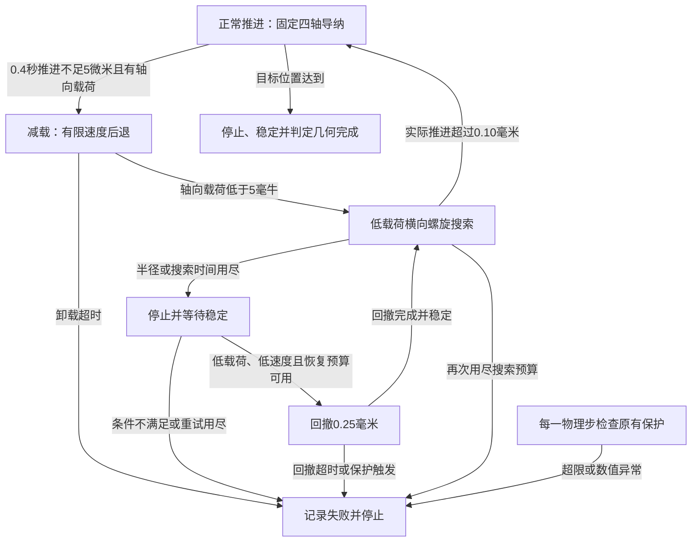

# B2 最小搜索策略与评价协议

日期：2026-09-17；版本：开发候选 1。B2-1 已完成，下面参数是预先规定的开发起点，效果须由后续运行检验。每次候选更改保留旧尝试，不覆盖失败。

## 控制器可以看到什么

可以输入：仿真接触六维力/力矩、末端测得速度、相对本回合或本次搜索起点的位移、时间、执行器停止状态。固定导纳仍使用世界坐标系下 M 点力/力矩。

禁止输入：真实孔中心偏差、针尖超界量、接触几何名称、接触点位置、仿真已知目标姿态误差。这些只用于离线分析或统一评价。控制器与成功评价分开；不能因为仿真知道正确答案，就直接往答案方向移动。

## 状态与转换

任何接触保护触发都终止本次策略试验，不自动恢复推进。一次条件回撤只服务于未触发保护的搜索预算耗尽；不能借回撤清除保护历史。

## 开发候选参数

| 参数 | 候选值 | 用途 |
|---|---:|---|
| 物理步 / 控制周期 | 0.2 ms / 2 ms | 与 B1 一致 |
| 正常推进速度 | 1 mm/s | 与 B1 一致 |
| 受阻观察窗 / 最早触发 | 0.4 s / 0.6 s | 不要求旋转已经完全停止 |
| 窗内轴向净推进阈值 | <5 μm | 触发前同时要求抵抗推进的 Fz <−5 mN |
| 减载速度 / 最长时间 | −0.25 mm/s / 1 s | 实际积分后退，不修改真实位姿 |
| 减载退出条件 | \|Fz\|≤5 mN，合力≤10 mN | 进入低载荷搜索 |
| 搜索轴向目标载荷 | 8 mN | 候选开发值，未做实物标定 |
| 搜索轴向速度 | clip(0.05×(0.008+Fz), −0.00025, +0.0005) m/s | 使用带符号 Fz，受阻时减慢或后退 |
| 螺旋圈距 / 最大半径 | 40 μm / 120 μm | 围绕搜索起点；固定起始方向 +X，不按真实误差定方向 |
| 螺旋路径速度 | 0.15 mm/s | 候选低速横向探索 |
| 横向跟踪增益 / 速度分量上限 | 5 /s；每轴 0.30 mm/s | 路径速度 + 相对位置跟踪 + 原横向导纳 |
| 单次搜索最长时间 | 8 s | 到半径或时间上限即停止搜索 |
| 搜索转回推进 | 自搜索开始实际 Z 净推进≥0.10 mm | 不读取真实孔中心；仍受保护检查 |
| 搜索次数 / 回撤次数 | 最多 2 次 / 最多 1 次 | 往返过程也计入总时间 |
| 搜索实际横移边界 | 距本次搜索起点≤0.20 mm | 超出终止，避免路径跟踪偏离扩大 |
| 回撤参考距离 / 速度 / 最长时间 | 0.25 mm / 0.5 mm/s / 1 s | 沿用执行器已有回撤功能 |
| 回撤后允许再次搜索 | 实际回撤≥0.20 mm、满足低载荷低速度、仅由正常回撤距离停止 | 只重置参考和控制状态，不改实际位姿、峰值、总时间 |
| 停止/回撤后等候稳定 | 最长 1 s | 未稳定则失败 |
| 全回合主动动作总时限 | 20 s | 包含推进、减载、搜索和回撤；不是每阶段各 20 s |
| 最终稳定观察 | 最长 1 s | B1/B2 相同；成功需持续满足原 0.1 s 条件 |

原保护保留：接触合力 25 mN、G 点力矩 0.5 mN·m、停止穿透 30 μm、无效穿透 80 μm；实际速度、总行程、参考领先量、驱动力和加速度边界保持原值。B1 固定导纳参数原样复用。

## 公平比较与记录

1. 先在 X +100 μm 做最小实现试运行。参数更改只能属于明确标记的候选试验，保存原尝试及原因。
2. 最终矩阵前冻结候选参数、代码和模型指纹。对同轴、X +100 μm、Y −100 μm、Roll +1.5°、联合 A ×0.75、联合 B ×0.75、联合 A 全幅，共 7 个开发工况分别执行 B1/B2。
3. 两者都重新运行，动作总时限均 20 s，最终观察均 1 s。原 B1 的停滞终止规则仍保留，其提前停止属于原策略行为；另需单独列出原 6 s 结果，不能把“延长时间”产生的改善全部归因于搜索。
4. 比较：几何完成、完成时间、实际推进、最大力/力矩/穿透、搜索/回撤次数、正式失败原因。不只展示成功动画。
5. 搜索使用的仿真观测尚未加入实物传感噪声、延迟和夹持误差；当前候选不是可直接上 CR5 的实机参数。
6. 无论成功多少，这 7 个工况都是开发集。独立随机偏差、摩擦/夹持/传感参数变化的测试集另行冻结，不能据此宣称泛化成功率。

B2-3 的交付是一次可审查的真实动力学试运行；若保护边界或状态机无法验证，暂停矩阵扩展，先报告缺口。
