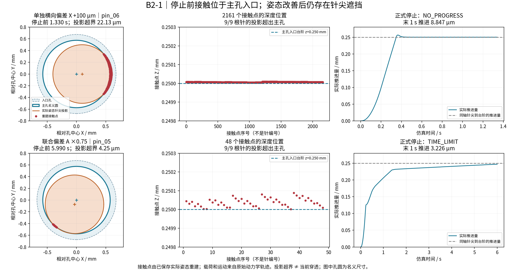

# B2-1：为什么停在入口附近

日期：2026-09-17。状态：诊断完成，尚未用新策略重新插入。本报告读取已验证的 B1 轨迹，使用相同的 256 段/MPR 模型重建停止前接触几何。

## 结论

两个代表工况都在 **0.250 mm 深的主孔入口台阶附近受阻**。当前模型这里是台阶扩孔，不是连续倒角。固定导纳调整了位置和姿态，但停止前九根针的针尖投影仍未全部落入主孔开口。继续沿当前姿态单纯向下推进不能使整个针尖通过。

这支持下一步试验“减小轴向顶压力 + 有边界的横向主动搜索”。它不能证明该策略必定成功，也不能证明真实连接器有相同的卡阻特性。



## 原始数据告诉了我们什么

| 指标 | 单独 X +100 μm | 联合 A ×0.75 |
|---|---:|---:|
| 诊断取样时间 | 1.330 s | 5.990 s |
| 取样位置 X / Y | +97.123 / −0.318 μm | −33.883 / −60.232 μm |
| 总姿态误差：初始 → 取样 | 0 → 0.000165° | 1.591 → 0.1625° |
| 针尖投影超出主孔的针数 | 9 / 9 | 9 / 9 |
| 针尖投影超界量范围 | 22.121～22.129 μm | 4.148～4.250 μm |
| 接触点 Z 范围 | 0.250004～0.250009 mm | 0.250001～0.250088 mm |
| 取样时轴向接触力 Fz | −24.472 mN | −24.432 mN |
| 取样时横向接触力 Fx / Fy | −0.00636 / −0.00283 mN | +0.7111 / −0.1549 mN |
| 正式停止前最后 1 s 的净推进 | 8.847 μm | 3.226 μm |
| 正式停止原因和时间 | 推进停滞，1.340 s | 时限，6.000 s |
| 整回合最大穿透 | 6.395 μm | 7.543 μm |

单独 X 偏差时，接触合力主要沿轴向；横向反馈很弱，固定导纳给出的横向修正速度仅约 −0.328 / −0.143 μm/s。入口台阶上方已经能容纳偏置后的针尖，进入更小的主孔时才遇到遮挡。仅靠这时微弱的横向合力，无法在当前时间内自动走到孔中心。

联合偏差时，姿态误差明显减小，说明旋转导纳在工作；但位置与剩余倾斜共同影响针尖位置，仍有约 4 μm 的投影超界。取样时旋转修正也没有归零。此处不能说“完全锁死”，更不能说“固定导纳没有姿态调整能力”。

两个回合都没有触发导纳速度/累计修正预算限幅，也没有因 25 mN 合力、0.5 mN·m 力矩或 30 μm 穿透保护停止。轴向约 24.5 mN 是当前受限参考位置和驱动产生的载荷，不是设定了 24.5 mN 恒力控制。

## 两种容易混淆的数值

- **针尖投影超界**：把当前真实姿态的针尖圆盘投影到 XY 平面，计算它超出主孔 256 边形开口的最大半空间距离。用于判断保持当前位置姿态、只沿 Z 移动能否让整个针尖通过；不是当前接触穿透，也不是完整针杆/外壳通过证明。
- **最大穿透**：MuJoCo 接触点的负距离最大值，整回合峰值来自每个物理积分步的记录。软接触模型允许有限负距离。

投影计算按 256 段实际孔口计算；图为便于阅读绘制名义圆。主孔离散半径误差上界约 0.0433 μm，小于本次投影超界量，但这不等于动力学对离散分辨率已经全面收敛。

## B2 要新增的动作及边界

1. 以可测的推进量和轴向载荷识别受阻，允许姿态还在变化时进入搜索，避免一直等到所有运动都近乎停止。
2. 降低轴向接触载荷，再围绕当前局部位置做有限范围的横向搜索；方向由预定搜索轨迹给出，不能读取真实孔中心误差来指路。
3. 保留力矩反馈纠姿、原有速度/行程/接触保护。搜索或卸载超时必须记录失败；只在满足停止与低载荷条件时允许一次回撤恢复。
4. 同一参数用于全部开发工况，B1 和 B2 使用相同总时间预算。先做单独 X 偏差试运行，再开展全部比较。

目前尚未完成摩擦贡献与各接触点载荷的分解；联合工况的接触法向并非都沿 Z。不能把所有阻力都归因于“平面台阶正压力”。本次界定到“主孔入口几何遮挡且现有反馈未在预算内解除”为止。

## 可复现与证据

在项目工作目录，使用项目原 Python 环境执行：

```powershell
& 'D:\KEYANRUJIAN\python.exe' -X utf8 -B -m tools.validation.diagnose_b2_contacts
& 'D:\KEYANRUJIAN\python.exe' -X utf8 -B -m pytest tests/b2/test_contact_diagnosis.py -q
```

这会重新分析和绘图，**不会重新跑动力学**。数值见 [contact_diagnosis.json](contact_diagnosis.json)，其中保存两份输入轨迹的 SHA-256、原 B1 代码和历史模型指纹、每根针的几何数据与每个重建接触点。

重建接触点数量与最大穿透均与原轨迹核对；载荷、控制动作与运动取自原轨迹，不使用离线重建得到的载荷。几何算法用同轴解析值、已知偏置解析值和倾斜针尖的高密度独立点采样检验。
