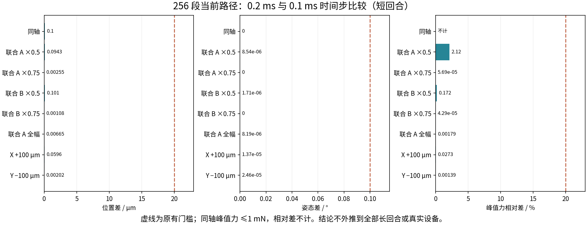

# 当前路径数值复验

结果：**LOCAL_SHORT_VALIDATION_PASS**。新增九回合，与历史七回合组成八组比较；旧全局验收失败记录保持不变。

| 工况 | 位置差/μm | 姿态差/° | 峰值力相对差/% | 事件一致 | 比较通过 |
|---|---:|---:|---:|---|---|
| 同轴 | 0.100000 | 0.000000 | 不计 | True | True |
| 联合 A ×0.5 | 0.094302 | 0.000009 | 2.121740 | True | True |
| 联合 A ×0.75 | 0.002553 | 0.000000 | 0.000057 | True | True |
| 联合 B ×0.5 | 0.101107 | 0.000002 | 0.171708 | True | True |
| 联合 B ×0.75 | 0.001076 | 0.000000 | 0.000043 | True | True |
| 联合 A 全幅 | 0.006649 | 0.000008 | 0.001795 | True | True |
| X +100 μm | 0.059563 | 0.000014 | 0.027263 | True | True |
| Y −100 μm | 0.002020 | 0.000025 | 0.001390 | True | True |

此外逐项检查短回合有限数、停止线/角速度和驱动限幅，详见 results_index.json 的 all_run_checks。
本轮只能评价当前 256 段、MPR、指定短回合的时间步一致性。128/256 差异、长搜索轨迹敏感性、未标定接触参数仍须明确保留。

