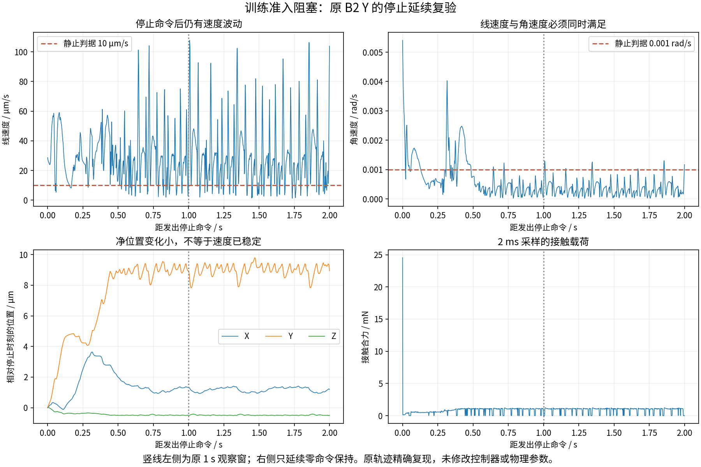

# 停止延续复验：训练准入暂缓

原 B2 Y 回合的完整原始轨迹、事件、峰值及物理步数已精确复现。随后保持原 STOPPING 零命令，延续至停止后 2 s。

- 停止后 1 s：线速度 13.365385 μm/s。
- 停止后 2 s：线速度 103.813317 μm/s，角速度 0.001173076 rad/s。
- 原判据：线速度≤10 μm/s，角速度≤0.001 rad/s；全段满足这两个条件的最长连续采样跨度约 0.012 s，未达到 0.1 s。
- 后一个 1 s 内位置净变化仅 0.138737 μm。不能将上述速度波动直接称为大幅漂移或已确定的数值爆炸；也不能仅因净位移小就判为停稳。
- 本段无新增无效事件或接触超限，保持参考未发生实质变化（各分量最大变化 0）。根因仍未确定。

**结论：原 B2 已完成本轮基线选择，但停止要求仍有未解决项，不进入 SAC 训练，也不绕过该问题缩小范围宣称准入。** 短回合的时间步验证通过，不能代替这段长接触历史的停止验证。

下一步建议是一个有界的“停止可靠性修复与复验”能力：先核查保持驱动/接触求解的作用，再做必要的时间步对照；依据证据决定是否需要共同环境修复。若更换模型、接触参数或控制策略，先汇报方向和影响，再在同一新环境重新评价受影响的基线。当前未开展这些修改，也不继续任意延长观察窗口。

独立审查另指出验收脚本的最终数值错误判定漏洞，现已修复并增加测试。该漏洞未影响本次失败结果：原运行源码、记录与 pass=false 全部保留，修复后只读重判仍为 false，没有重写旧报告或伪造新积分。

数据：[原始索引](old_b2_y_stop_extension_v1/results_index.json)、[只读复核](停止复验审查.json)。
