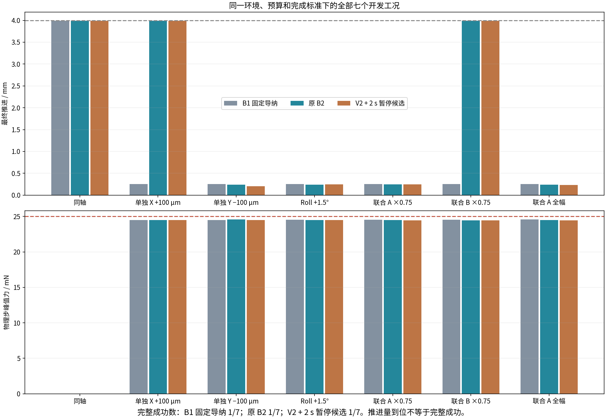

# 基线统一开发评价

按预先规则选择：**B2_original**；原因：no_primary_task_improvement。

| 工况 | 策略 | 完整成功 | 推进/mm | XY/μm | 姿态/° | 峰值力/mN | 终点已静止 | 结束原因 |
|---|---|---|---:|---:|---:|---:|---|---|
| 同轴 | B1 固定导纳 | True | 3.9912 | 0.000 | 0.0000 | 0.0000 | True | GEOMETRIC_SUCCESS |
| 同轴 | 原 B2 | True | 3.9912 | 0.000 | 0.0000 | 0.0000 | True | GEOMETRIC_SUCCESS |
| 同轴 | V2 + 2 s 暂停候选 | True | 3.9912 | 0.000 | 0.0000 | 0.0000 | True | GEOMETRIC_SUCCESS |
| 单独 X +100 μm | B1 固定导纳 | False | 0.2500 | 97.071 | 0.0001 | 24.4774 | True | NO_PROGRESS |
| 单独 X +100 μm | 原 B2 | False | 3.9908 | 63.979 | 0.2264 | 24.4774 | True | TARGET_POSE_NOT_SETTLED |
| 单独 X +100 μm | V2 + 2 s 暂停候选 | False | 3.9912 | 63.979 | 0.2264 | 24.4774 | True | TARGET_POSE_NOT_SETTLED |
| 单独 Y −100 μm | B1 固定导纳 | False | 0.2500 | 97.268 | 0.0002 | 24.5007 | True | NO_PROGRESS |
| 单独 Y −100 μm | 原 B2 | False | 0.2396 | 96.357 | 0.3365 | 24.5579 | False | SEARCH_BUDGET_EXHAUSTED |
| 单独 Y −100 μm | V2 + 2 s 暂停候选 | False | 0.2057 | 161.399 | 1.1023 | 24.5007 | True | SEARCH_BUDGET_EXHAUSTED |
| Roll +1.5° | B1 固定导纳 | False | 0.2500 | 75.760 | 0.0020 | 24.5221 | True | NO_PROGRESS |
| Roll +1.5° | 原 B2 | False | 0.2382 | 24.144 | 0.7455 | 24.4772 | True | SEARCH_BUDGET_EXHAUSTED |
| Roll +1.5° | V2 + 2 s 暂停候选 | False | 0.2442 | 73.651 | 0.2743 | 24.4772 | False | SEARCH_BUDGET_EXHAUSTED |
| 联合 A ×0.75 | B1 固定导纳 | False | 0.2500 | 75.838 | 0.0011 | 24.5328 | True | NO_PROGRESS |
| 联合 A ×0.75 | 原 B2 | False | 0.2453 | 97.831 | 0.2200 | 24.4742 | True | SEARCH_BUDGET_EXHAUSTED |
| 联合 A ×0.75 | V2 + 2 s 暂停候选 | False | 0.2494 | 110.492 | 0.0243 | 24.4631 | True | SEARCH_BUDGET_EXHAUSTED |
| 联合 B ×0.75 | B1 固定导纳 | False | 0.2500 | 75.689 | 0.0014 | 24.5508 | True | NO_PROGRESS |
| 联合 B ×0.75 | 原 B2 | False | 3.9903 | 76.507 | 0.5400 | 24.4679 | True | TARGET_POSE_NOT_SETTLED |
| 联合 B ×0.75 | V2 + 2 s 暂停候选 | False | 3.9903 | 76.507 | 0.5400 | 24.4679 | True | TARGET_POSE_NOT_SETTLED |
| 联合 A 全幅 | B1 固定导纳 | False | 0.2500 | 75.798 | 0.0006 | 24.5869 | True | NO_PROGRESS |
| 联合 A 全幅 | 原 B2 | False | 0.2395 | 92.394 | 0.5050 | 24.4708 | True | SEARCH_BUDGET_EXHAUSTED |
| 联合 A 全幅 | V2 + 2 s 暂停候选 | False | 0.2328 | 112.925 | 0.4018 | 24.4589 | True | SEARCH_BUDGET_EXHAUSTED |

## 暂停实际执行情况

配置的 2 s 是上限，父控制器可以提前退出。下列时长按实际下发的 2 ms 指令周期计数；含端点时可能为 2.002 s。不是刚体完全静止时长。

| 工况 | 触发暂停 | 额外 XY 为零的指令时长/s | 部分恢复/s | 完全恢复出现 |
|---|---|---:|---:|---|
| 同轴 | False | 0.000 | 0.000 | False |
| 单独 X +100 μm | True | 0.726 | 0.000 | False |
| 单独 Y −100 μm | True | 2.002 | 0.098 | True |
| Roll +1.5° | True | 2.002 | 0.098 | True |
| 联合 A ×0.75 | True | 2.002 | 0.098 | True |
| 联合 B ×0.75 | False | 0.000 | 0.000 | False |
| 联合 A 全幅 | True | 2.002 | 0.098 | True |

全部成功时间、力矩/穿透峰值、停止后速度、恢复次数与命令变化率见统一开发评价.json。
十四个对照回合经哈希和同环境检查后复用；七个候选为本轮新运行。开发计数不代表独立随机测试成功率。
原 B2 Y 回合最终未完全停稳仍保留，不能称为静止状态，也不允许据此自动回撤。

