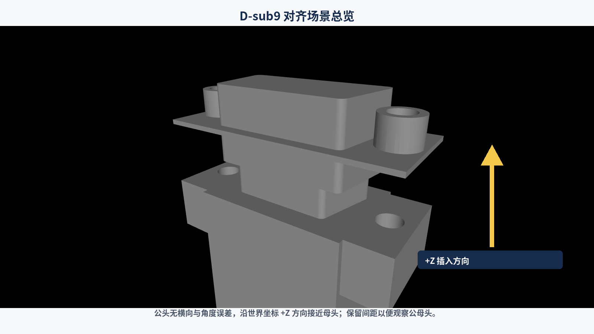
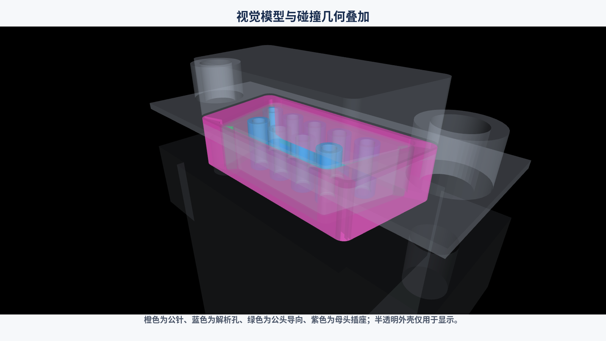
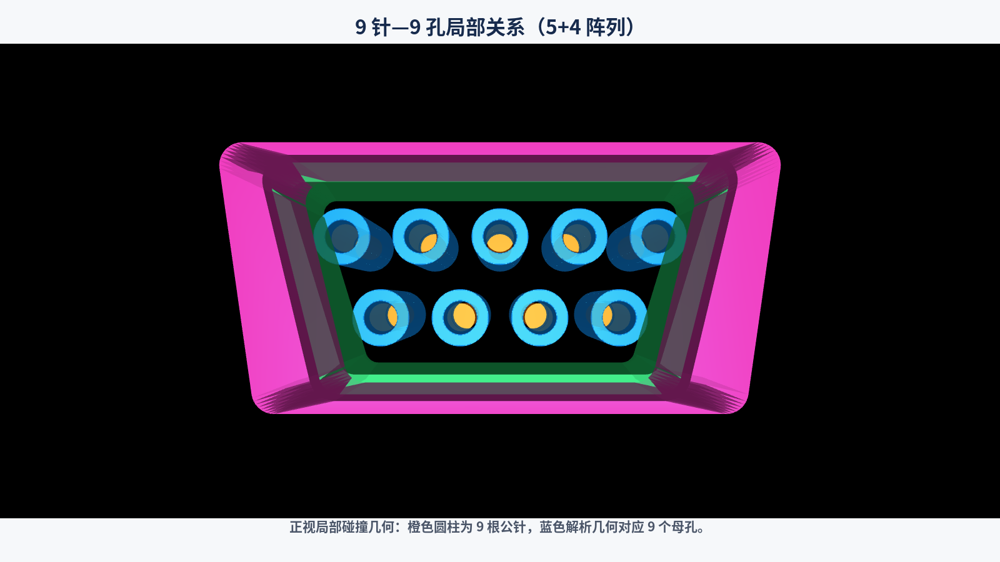
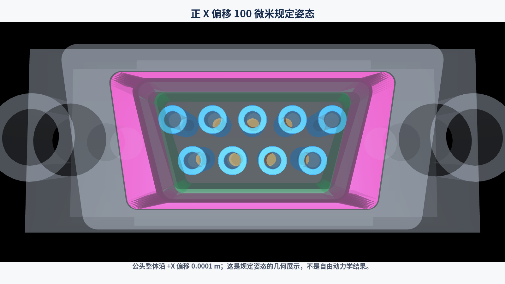
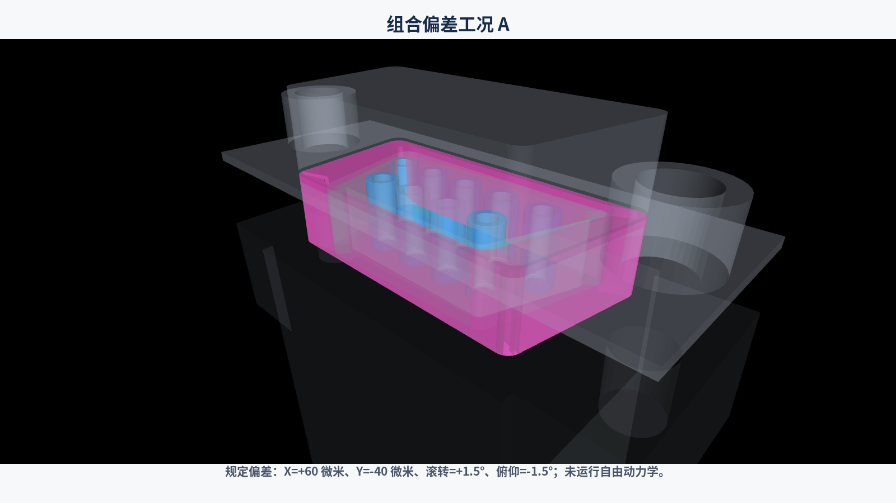
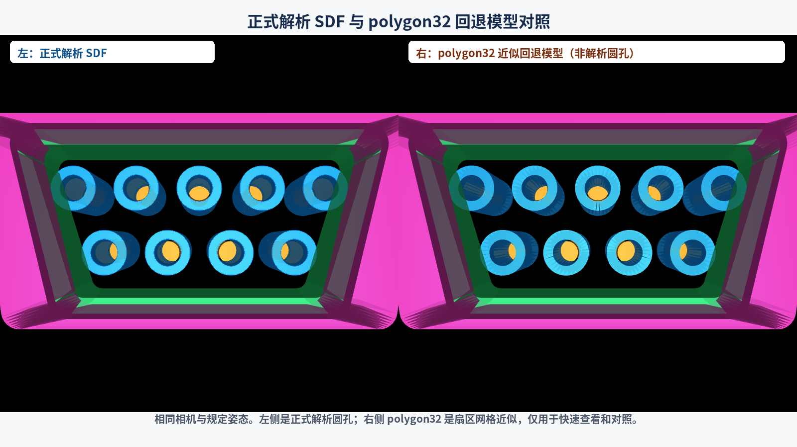
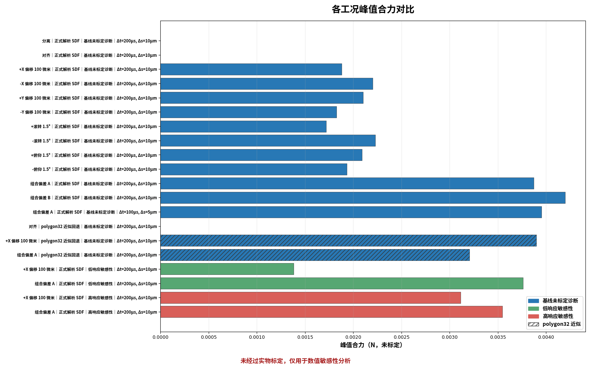
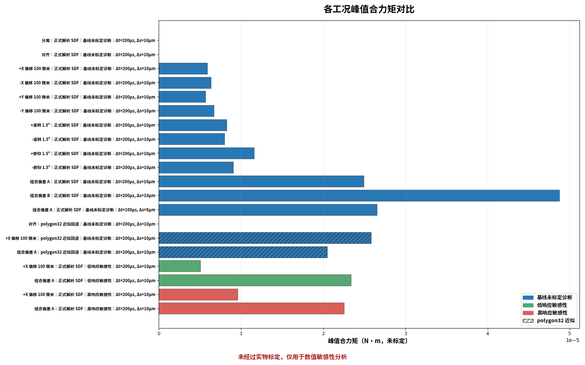
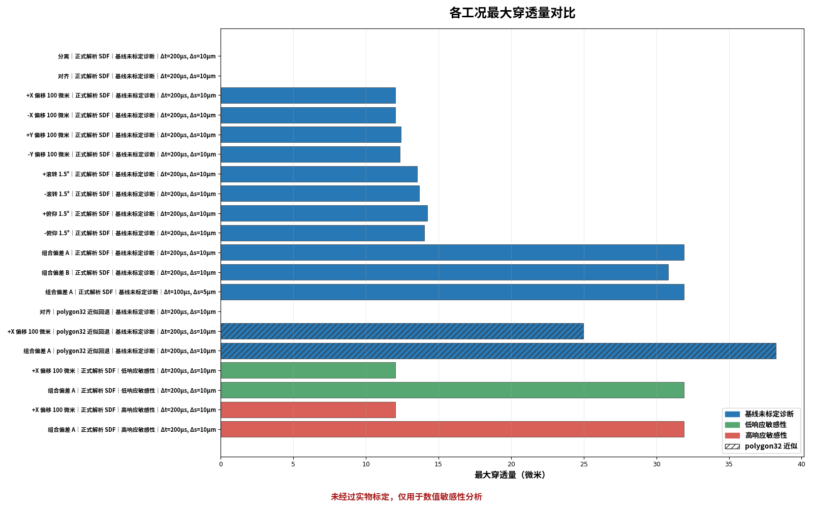
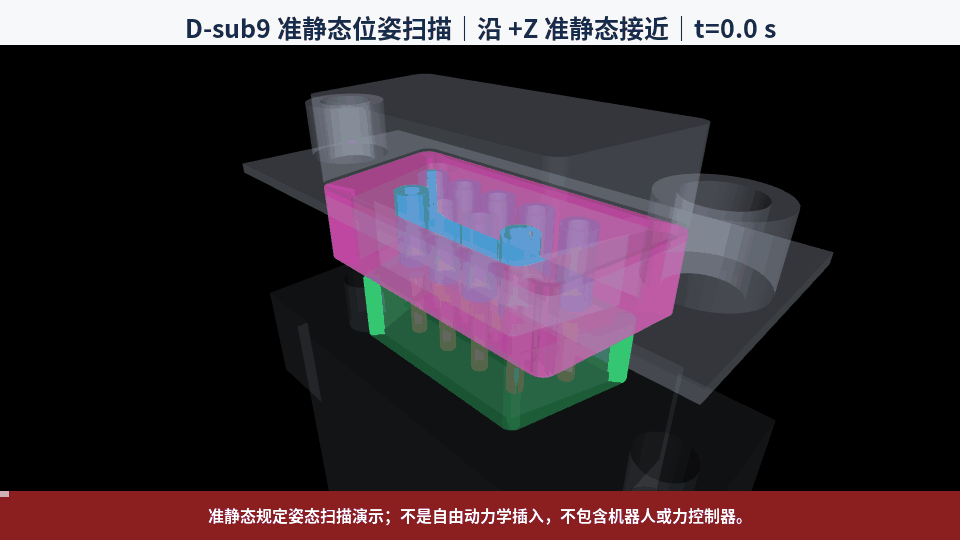

# D-sub9 中文可视化交付包使用说明

> 适用对象：第一次接触本项目、MuJoCo 或接触仿真的研究生。
>
> 最重要的科学边界：本包中的力和力矩**未经过实物标定**，只能用于数值诊断与敏感性分析，不能作为实物插入力预测或安全阈值。动画是准静态规定姿态扫描演示，**不是自由动力学插入**，不包含机器人、力传感器或力控制器。

## 1. 本交付包解决什么问题

上一阶段已经完成 D-sub9 公头与母头的几何、碰撞和接触验证基础，但工程文件较多，第一次使用的人不容易判断应该打开哪个模型、如何加载 SDF 插件，以及结果图中的数值到底代表什么。本交付包把常用入口、中文解释和已生成的可视化结果集中在一个目录中。

使用本包可以直接完成五件事：

1. 双击打开正式解析 SDF 场景；
2. 双击打开不依赖插件的 polygon32 近似回退场景；
3. 查看六张模型结构和偏差工况截图；
4. 查看三张基于现有 schema-3 数据生成的中文图表和一份 CSV；
5. 查看一段 12 秒准静态规定姿态扫描 GIF。

本包没有新增机器人或控制器，也没有改变已经验收的核心碰撞模型。

## 2. 三分钟快速开始

项目当前验证环境为 Windows x64，Python 路径是 `D:\KEYANRUJIAN\python.exe`。

1. 打开本目录：`deliverables\chinese_visual_package\`。
2. 先双击 `启动免插件场景.cmd`。这是最容易成功的查看方式，不需要 SDF DLL。
3. 再双击 `启动正式SDF场景.cmd`。它会检查并加载正式解析圆孔插件。
4. 打开 `screenshots\` 查看六张结构图。
5. 打开 `charts\` 查看力、力矩和最大穿透量图表。
6. 双击 `animation\DSub9_准静态位姿扫描.gif` 查看动画。

### V1 正式接触验证入口

如果你的目的不是只看模型，而是检查逐深度接触曲线、三个时间步是否收敛以及总体 `PASS/FAIL`，请使用独立的 [V1 接触验证详细使用说明](V1接触验证使用说明.md)。该说明面向第一次接触 Git、Python、MuJoCo 和科研数据的用户，包含一条命令复现、全部 JSON/CSV 字段、五张图逐图解释、验收规则、故障排查和复现记录模板。

五张新曲线图集中在 [charts/v1_contact_validation/](charts/v1_contact_validation/)。旧 `charts/` 根目录中的三张图仍来自 schema-3 的 20 条峰值摘要；新目录中的五张图来自 schema-1 的 36 条固定深度网格轨迹。两套证据用途不同，旧文件没有被新结果覆盖。

如果双击后出现错误，窗口会保留并显示中文原因。先不要重装软件，请按照第 15 章逐项检查。

## 3. 项目目录和每类文件的用途

```text
first_stage_sim/
├─ models/                         正式模型和 XML include
├─ assets/                         视觉 STL 与碰撞 STL
├─ plugins/dsub9_hole_sdf/         解析圆孔插件源代码
├─ build/                          本机生成的 DLL 和 polygon32 XML
├─ reports/                        接触结果、技术报告、文件清单
├─ tools/model/                    模型生成器
├─ tools/validation/               准静态接触验证程序
├─ tools/visualization/            本交付包的启动、渲染、图表和动画程序
├─ tests/visualization/            可视化交付自动测试
└─ deliverables/chinese_visual_package/
   ├─ 中文使用说明.md
   ├─ V1接触验证使用说明.md
   ├─ 启动正式SDF场景.cmd
   ├─ 启动免插件场景.cmd
   ├─ screenshots/
   ├─ charts/
   │  └─ v1_contact_validation/     V1 五张逐深度与收敛曲线
   └─ animation/
```

`deliverables/` 是普通用户首先应看的目录；`tools/` 和 `tests/` 主要用于复现与审计。`build/` 在 Git 中默认忽略，因此从 GitHub 下载到另一台电脑后，需要重新编译 DLL 或重新生成回退 XML。

## 4. 公头、母头、9 针、9 孔和 D 形外部导向如何建模

模型包含两个主体：固定的母头 `female` 和带 free joint 的公头 `male`。

- 公头视觉外壳来自居中后的 STL；真实接触针使用 9 根解析圆柱，不是只用于显示的贴图。
- 母头视觉外壳来自居中后的 STL；正式模型中的 9 个孔使用 SDF 解析几何描述入口、孔径和孔深。
- 9 针与 9 孔按标准的 5+4 阵列排列：上排 5 个、下排 4 个。
- 外部 D 形导向不是一个粗略方块。公头导向由 CAD 截面生成的 78 个碰撞段组成，母头插座由 42 个碰撞段组成。
- polygon32 回退模型把每个母孔拆成 32 个圆周扇区及不同深度层，共使用 576 个孔扇区网格。

项目中的碰撞资产合计 696 个：78 个公头导向段、42 个母头插座段、576 个 polygon32 孔扇区。这些资产已经审查，不应为了显示方便重新合并或简化。

## 5. 视觉几何和碰撞几何的区别

视觉几何回答“看起来像什么”，碰撞几何回答“仿真器在哪里计算接触”。两者用途不同：

- 视觉 STL 外观连续、容易理解，但不参与接触；其 `contype` 和 `conaffinity` 均为 0。
- 碰撞几何可能由许多解析体或小网格组成，外观不一定漂亮，但用于接触检测。
- 公针、母孔、外部导向和插座都有明确碰撞角色和接触掩码。
- 本包的半透明与高对比颜色只修改运行时 RGBA 显示值，不修改摩擦、`solref`、`solimp`、margin 或接触掩码。

截图中橙色代表公针、蓝色代表母孔、绿色代表公头导向、紫色代表母头插座，灰色半透明部分是视觉外壳。

## 6. 正式 SDF 模型和 polygon32 回退模型的区别

正式模型是 `models/dsub9_pair.xml`。它通过 `build/dsub9_hole_sdf/Release/dsub9_hole_sdf.dll` 注册 `mujoco.sdf.dsub9_hole` 插件，用解析 SDF 描述 9 个母孔，是后续几何和接触研究的正式基线。

回退模型是 `build/dsub9_pair_polygon32.xml`。polygon32 是近似：它使用 576 个扇区网格近似孔壁，不依赖 DLL，适合快速查看、排错、性能与稳定性对照。它不能被称为“和解析圆孔完全相同”，也不能替代正式 SDF 精度结论。

简单选择原则：

- 只想快速确认项目能打开：先用 polygon32。
- 做正式几何或接触研究：使用 SDF。
- 排查插件问题或对比模型稳定性：同时运行两者，但在报告中写清模型类型。

## 7. 坐标系、插入轴、5+4 针阵列和单位

本项目使用米、千克、秒和弧度的 MuJoCo SI 单位体系。

- 插入轴是世界/任务坐标系 `+Z`。
- 公头规定姿态中的 X、Y 偏移均在世界/任务坐标轴上定义。
- 公头起始原点通常为 `Z=-0.004 m`；规定深度与公头原点关系为：`male_origin_z = start_origin_z + final_depth`。
- `100 微米 = 0.0001 m`。
- `1.5° ≈ 0.02618 rad`。
- 5+4 阵列的上排孔/针编号为 1–5，下排为 6–9。
- 报告中的合力作用在公头上，轴与世界/任务坐标对齐；力矩以公头任务原点为参考。



黄色箭头显示公头沿 `+Z` 接近母头。

## 8. 双击启动正式 SDF 场景

双击 `启动正式SDF场景.cmd`。脚本会自动：

1. 从脚本所在位置找到项目根目录；
2. 检查 `D:\KEYANRUJIAN\python.exe`；
3. 检查 MuJoCo、正式 XML、include、资产和 DLL；
4. 把工作目录切换到项目根目录；
5. 使用 ASCII 相对路径 `build/dsub9_hole_sdf/Release/dsub9_hole_sdf.dll` 注册插件；
6. 编译 `models/dsub9_pair.xml`；
7. 打开 MuJoCo viewer。

Windows 下当前中文绝对路径可能导致 MuJoCo 3.9.0 无法正确注册插件，因此不要把启动器改成直接加载中文绝对 DLL 路径。脚本已经采用本机验证过的“项目根目录 + ASCII 相对路径”方式。

只检查、不打开窗口的命令是：

```powershell
& 'D:\KEYANRUJIAN\python.exe' -m tools.visualization.launch_viewer --mode sdf --check-only
```

## 9. 双击启动免插件场景

双击 `启动免插件场景.cmd`。此入口不会加载 SDF DLL。如果 `build/dsub9_pair_polygon32.xml` 不存在，程序会调用既有确定性生成器重新创建，然后编译并打开 viewer。

只检查、不打开窗口：

```powershell
& 'D:\KEYANRUJIAN\python.exe' -m tools.visualization.launch_viewer --mode polygon32 --check-only
```

手工重新生成回退 XML：

```powershell
& 'D:\KEYANRUJIAN\python.exe' -m tools.model.generate_mjcf `
  --collision-mode polygon32 `
  --output 'build/dsub9_pair_polygon32.xml'
```

回退场景能打开，不代表正式插件也正常；正式研究仍应单独验证 SDF 入口。

## 10. MuJoCo viewer 常用操作

MuJoCo viewer 中常用操作如下。不同鼠标或触控板设置可能略有差别：

- 按住鼠标左键拖动：旋转观察方向。
- 按住鼠标右键拖动：平移观察中心。
- 滚动滚轮：缩放。
- 双击几何体：选择对象或调整观察目标。
- 空格键：切换暂停；本交付场景本身是静态规定姿态，因此暂停前后不会自动插入。

在 viewer 右侧的显示/渲染选项中可以切换：

- Geom group 2：视觉模型；
- Geom group 0：碰撞几何；
- Contact points：接触点；
- Contact forces：接触力方向与大小。

启动器默认显示视觉模型。要看碰撞几何，可打开 group 0；要只看碰撞几何，可关闭 group 2。接触点只会在当前规定姿态确实产生接触时出现。

## 11. 六张截图逐图说明

### 11.1 对齐场景总览


公头没有 X/Y 偏移和滚转/俯仰误差，沿 `+Z` 接近母头。为了看清两个零件，图中保留了轴向间距。

### 11.2 碰撞几何叠加



灰色外壳半透明；橙、蓝、绿、紫分别表示公针、解析母孔、公头导向和母头插座。颜色只用于解释结构。

### 11.3 九针九孔局部放大



正视图显示上排 5 个、下排 4 个。蓝色环形/孔状几何与橙色公针对应。

### 11.4 正 X 偏移 100 微米



公头整体沿 `+X` 偏移 `0.0001 m`。这是直接设置的规定姿态，不是受力后自行移动到该位置。

### 11.5 组合偏差工况 A



组合 A 同时包含 `X=+60 微米`、`Y=-40 微米`、滚转 `+1.5°`、俯仰 `-1.5°`。由于角度很小，主要依靠碰撞几何、相机和图注共同阅读。

### 11.6 SDF 与 polygon32 对照



两侧使用相同相机和姿态。右侧可以看到网格扇区离散特征；这说明 polygon32 是近似回退表示。

## 12. 三张图表如何阅读



横轴是峰值合力，单位 N。每一条横条都有“工况｜模型｜接触配置｜时间步｜空间步长”标签。蓝、绿、红分别代表基线、低响应和高响应配置；斜线条代表 polygon32 近似模型。



横轴是峰值合力矩，单位 N·m。力矩参考公头任务原点，不能脱离该参考点与实物传感器数据直接比较。



横轴是最大穿透量，图中转换为微米。这里的“穿透”是接触求解器中的数值几何量，不是实体零件真的互相穿透或发生材料损伤。

所有图表都写有“未经过实物标定，仅用于数值敏感性分析”。零值表示该扫描没有记录到相应峰值，不应自动解释为实物装配完全无力。

## 13. 20 条验证结果分别代表什么

数据文件是 `reports/contact_validation_results.json`，`schema_version=3`，共 20 条结果：

- 16 条 `uncalibrated_diagnostic_v1`：其中 12 条为正式 SDF 的主要姿态集合，1 条为组合 A 的更小时间/空间步长敏感性记录，3 条为 polygon32 对照记录。
- 2 条 `uncalibrated_low_response_v1`：只覆盖正 X 偏移 100 微米和组合 A。
- 2 条 `uncalibrated_high_response_v1`：同样只覆盖正 X 偏移 100 微米和组合 A。

因此，“20 条结果”不等于 20 个完全不同的工况。替代接触配置各只有两条，不能画成覆盖全部 16 条基线记录。CSV 为每条记录保留模型类型、接触配置、终止原因、峰值力、峰值力矩、最大穿透量、时间步和空间步长。

`SUCCESS` 表示扫描按既定终止规则完成；`EXCESS_PENETRATION` 表示达到预设的数值穿透终止条件，不表示真实零件损坏。

## 14. 为什么结果不能视为真实插入力

现有结果来自规定姿态的准静态扫描和 `mj_forward`。程序逐步设置公头位姿，再求当前姿态的接触状态；它没有模拟机器人执行器、速度控制、力控制、结构柔性或真实材料。

还缺少以下实物信息：

- 材料弹性、塑性与表面处理；
- 真实摩擦系数及其速度、温度依赖；
- 针、孔、壳体和夹具的柔性；
- 制造公差和装配间隙分布；
- 六维力传感器标定与坐标变换；
- 机器人末端质量、惯量、控制周期和控制律；
- 实验数据对接触参数的辨识。

所以图中的 N 和 N·m 数值是未标定数值诊断。它们可以比较“同一数值模型下哪个工况响应更大”，不能作为实物插入力预测或安全阈值，也不能直接指导设备选型。

## 15. 常见故障排查

### 15.1 找不到 Python

启动器固定检查 `D:\KEYANRUJIAN\python.exe`。换电脑后，用文本编辑器打开两个 `.cmd`，把 `PYTHON_EXE` 改为新电脑实际的 `python.exe` 绝对路径。不要把整个项目路径硬编码进脚本。

### 15.2 无法导入 MuJoCo、Matplotlib 或 Pillow

在对应 Python 中检查：

```powershell
& 'D:\KEYANRUJIAN\python.exe' -c "import mujoco, matplotlib, PIL; print(mujoco.__version__)"
```

新电脑可在项目根目录安装已声明的依赖：`python -m pip install -e ".[test,visualization]"`。安装前确认虚拟环境和磁盘位置；本任务没有自动安装大型组件。

### 15.3 DLL 不存在

检查 `build/dsub9_hole_sdf/Release/dsub9_hole_sdf.dll`。GitHub 仓库默认不追踪 `build/`，因此新电脑必须使用项目的 CMake/MSVC 环境重新编译插件。

### 15.4 DLL 存在但插件未注册

不要直接使用包含中文的绝对 DLL 路径。保持当前启动流程：切换到项目根目录，然后加载 ASCII 相对路径。还应确认 Python 和 DLL 都是 Windows x64，MuJoCo 主版本兼容。

### 15.5 XML 或资产缺失

确认 `models/`、`models/includes/`、`assets/visual/` 和 `assets/collision/` 没有被单独移动。XML 中的 `meshdir` 使用项目相对关系，不能只复制一个 XML 到其他目录运行。

### 15.6 回退 XML 缺失

双击免插件启动器会尝试生成；也可执行第 9 章命令。若生成器报资产缺失，应先恢复完整 `assets/collision/`。

### 15.7 离屏渲染失败

先更新或检查显卡驱动与当前 MuJoCo 安装，不要反复更换后端。自动生成失败时可使用可见 viewer 调整到同一姿态后截图，但必须在说明中记录生成方式。

### 15.8 中文字体变成方框

程序优先查找 Noto Sans SC、微软雅黑、黑体和宋体。确认系统至少安装一种，并重新生成图片；不要交付带方框的图表。

### 15.9 终端文字显示乱码但图片正常

某些 PowerShell 捕获环境没有按 UTF-8 解码 Python 输出，会把“已生成”显示成乱码。只要图片中文字、文件名和测试正常，这不代表产物损坏。双击 `.cmd` 时脚本会执行 `chcp 65001`。

## 16. 重新生成回退模型、截图、图表和动画

以下命令都在项目根目录执行。

重新生成 polygon32 回退 XML：

```powershell
& 'D:\KEYANRUJIAN\python.exe' -m tools.model.generate_mjcf --collision-mode polygon32 --output 'build/dsub9_pair_polygon32.xml'
```

重新生成六张截图：

```powershell
& 'D:\KEYANRUJIAN\python.exe' -m tools.visualization.render_scenes --output-dir 'deliverables/chinese_visual_package/screenshots'
```

重新生成三张图表和 CSV：

```powershell
& 'D:\KEYANRUJIAN\python.exe' -m tools.visualization.plot_contact_results --output-dir 'deliverables/chinese_visual_package/charts'
```

重新生成 10 fps、12 秒 GIF：

```powershell
& 'D:\KEYANRUJIAN\python.exe' -m tools.visualization.make_pose_sweep_animation
```

运行可视化相关测试：

```powershell
& 'D:\KEYANRUJIAN\python.exe' -m pytest tests/visualization -v
```

生成程序默认覆盖同名交付产物，但不会覆盖基线 XML、JSON 或碰撞资产。重新生成前可用 Git 查看差异。

## 17. 哪些核心文件不应随意修改

没有新的模型审查和实验依据时，不要修改：

- `models/dsub9_pair.xml` 及 `models/includes/`；
- `plugins/dsub9_hole_sdf/` 中的解析 SDF 几何公式；
- `assets/collision/` 下 696 个已审查资产；
- 9 针—9 孔的数量、位置、尺寸和接触掩码；
- 基线摩擦、`solref`、`solimp` 和 margin；
- `reports/contact_validation_results.json`；
- 原始 STEP、SLDPRT 和原始 STL。

可视化颜色、图注、相机和运行时透明度可以调整，但不应写回物理模型。如果要改变核心模型，应另开分支、说明科学原因、增加验证并重新审查。

## 18. 下一阶段研究如何接入

当前 D-sub9 模型可以作为后续装配研究的接触对象，但下一阶段至少需要新增以下独立模块：

1. 机器人与末端执行器：建立关节、连杆、惯量和末端安装变换。
2. 六维力传感器：定义传感器位置、坐标系、采样率、噪声和实物标定。
3. 位姿规划：把当前规定姿态工况转化为机器人可执行轨迹，并处理速度与加速度限制。
4. 柔顺/阻抗控制：根据接触力调整末端位姿，而不是直接把公头设到目标位置。
5. 参数辨识：使用实物试验拟合摩擦、接触刚度和阻尼，并保留验证集。
6. 强化学习：在传统控制和安全边界明确后，再定义观测、动作、奖励、随机化和 sim-to-real 验证。

不能直接把现有 20 条准静态结果当成强化学习时间序列，也不能把动画当成控制器演示。

## 19. 当前模型已完成和未完成的边界

已经完成：

- D-sub9 公母头视觉资产定位；
- 9 根真实碰撞圆柱针；
- 9 个正式解析 SDF 母孔；
- D 形外部公头导向与母头插座碰撞段；
- polygon32 近似回退模型；
- 基线与敏感性准静态接触结果；
- 模型加载、结构、资产、接触和本交付包测试；
- 中文启动、截图、图表、CSV 和准静态动画。

尚未完成：

- 实物材料与接触参数标定；
- 真实制造公差统计；
- 柔性体或有限元耦合；
- 机器人、末端执行器和夹具模型；
- 六维力传感器模型；
- 自由动力学插入；
- 力控制、柔顺控制或强化学习环境；
- 实验台架对比与安全阈值。

## 20. 复现与引用建议

复现时至少记录：

- Git 提交号和分支名；
- Python、MuJoCo、操作系统和编译器版本；
- 使用 `sdf` 还是 `polygon32`；
- 接触配置名称；
- 工况的 X/Y 偏移、滚转、俯仰和规定深度；
- 时间步、空间步长和终止原因；
- 数据文件 `schema_version`；
- `reports/contact_validation_results.json` 的 SHA-256：`ac767ea63a7e8a6866a974728a1256e688832003076170e270cd181e5c9d65ff`。

论文或报告中建议使用类似表述：

> D-sub9 母孔采用 MuJoCo SDF 插件解析表示，polygon32 扇区网格仅作为免插件近似对照。接触结果来自规定姿态准静态扫描并未经实物标定，因此仅用于数值诊断与敏感性分析。

正式引用截图、图表或动画时，应同时引用对应 Git 提交、生成命令和本说明中的科学边界，不要单独截取数值而省略“未标定”声明。



动画最后提醒：这是准静态规定姿态扫描演示，不是自由动力学插入，不包含机器人或力控制器。
