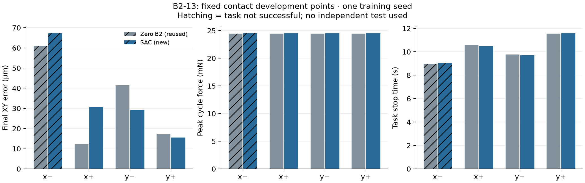

# B2-13｜首次四点接触短训与开发评价

B2-13首次接触短训完成：4个训练回合、22,722条审核转移、4,430次critic更新；固定四点确定性SAC成功3/4，复用同共同版本零残差B2为3/4。 执行链和开发评价完成；本次成功率未提升，终末误差有好有坏，峰值力未降低，尚未取得一致收益证据。

## 本轮事实

| 尝试 | 起点 | 采样模式 | 结果 | 审核周期 | 接触周期 | 实际作用周期 |
|---|---|---|---|---:|---:|---:|
| contact_000000 | (100, 0) μm | uniform_warmup | FULL_SUCCESS | 6327 | 3250 | 4838 |
| contact_000001 | (-100, 0) μm | sac_policy | TASK_FAILURE | 5500 | 2506 | 4002 |
| contact_000002 | (-100, 0) μm | sac_policy | FULL_SUCCESS | 5415 | 2346 | 3921 |
| contact_000003 | (-100, 0) μm | sac_policy | TASK_FAILURE | 5480 | 2420 | 4001 |

## 固定开发对照

| 点位 | B2 / SAC结果 | B2 / SAC最终XY误差 μm | B2 / SAC峰值力 mN | B2 / SAC任务停止时刻 s |
|---|---|---|---|---|
| x_neg_100 | TASK_FAILURE / TASK_FAILURE | 61.099 / 67.225 | 24.4740 / 24.5059 | 8.982 / 9.050 |
| x_pos_100 | FULL_SUCCESS / FULL_SUCCESS | 12.295 / 30.658 | 24.4743 / 24.5055 | 10.566 / 10.460 |
| y_neg_100 | FULL_SUCCESS / FULL_SUCCESS | 41.415 / 29.176 | 24.4743 / 24.5038 | 9.766 / 9.704 |
| y_pos_100 | FULL_SUCCESS / FULL_SUCCESS | 17.290 / 15.549 | 24.4743 / 24.5048 | 11.544 / 11.578 |

本次四点成功数与基线相同。两个X点的终末XY误差增大，两个Y点减小；四点峰值力均略升约0.030—0.032mN，任务停止时刻变化约−0.106至+0.068s。不能据局部误差或微小时间变化宣称整体改善。实际训练在第四回合结束，只有正X一次、负X三次，两个Y点均未被本次训练采到。

斜线柱表示任务未成功；峰值力由周期奖励项复算，停止时刻指任务停止开始，最终XY取实际停稳后位置。

训练调用墙钟 1128.01s；其中已记录更新段 113.95s。评价墙钟 1048.9459312000545s。采集、审核和检查点未单独计时，不能将剩余时长解释为纯物理仿真成本。

完整状态复核确认actor、critic、目标网络和温度参数均发生变化，最终alpha=0.002647836；更新信用、三随机流、回执和经验池一致。这只确认实际学习执行及可恢复性，不证明策略收益。

## 证据与局限

- [预登记](protocol.json)、[训练调用回执](train_run.json)、[原始档案复算](assessment.json)；运行原始数据与检查点在 `run/`。
- 879项执行输入保持；沿用B2-12正式资格和136项已封存检查，未因本轮运行重写历史测试或准入。原始回合的物理停止与分类独立复算；完成短训时复核最终完整检查点。
- 全部是开发数据。固定种子前六次不覆盖正Y，不换种子追求覆盖；有效任务失败按合同可入池，保护/无效/未停稳或执行故障停止实验。
- B2对照复用B2-06零残差原始四点，仅共同物理/控制/奖励/成功与保护规则未变的指标可比较。新运行资格和种子不同，不将其称为相同随机轨迹配对；基线是确定性零残差，无新增基线回合。
- 接触模型未标定；四个固定点没有统计泛化意义。SAC更新完成不等于学习收益成立；较早失败不能解释为效率提升，独立测试仍未使用。

## 下一步

建议B2-14只做本轮档案的有限离线复盘：核对实际训练只覆盖正X一次、负X三次的影响，比较成功/失败回报与接触后的策略响应，给出下一次训练的最小预算方案。保持已查明的动作链和执行接口，不重做脉冲诊断；增加步数、改变采样或采用多种子均先明确方案后沟通，本项不自动追加物理或更新。
