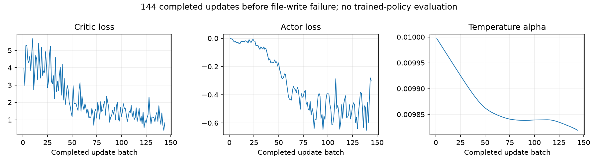

# 本轮停止结果：更新账本替换被Windows拒绝

**本轮已停止（2026-09-29 15:13停止，15:14发现）：** 完成初始4/4成功及四个均衡预热回合（1成功、3普通失败）后，首组SAC更新完成144批时，替换update_budget.json遭Windows拒绝访问（WinError 5），进程退出1。属于文件写入运行故障，不是原生崩溃、入口拒绝或力保护受控停止；底层占用/权限原因尚未确认。8个物理回合均经离线重审有效并停稳，发布22,766条经验；新动态8/32、累计44/68。余24次/4356批保留不执行，跟踪PAUSED，不自动重试。未形成更新后检查点、最终开发/恢复/独立评价，不能判断SAC收益，B.2未完成。

四类更新计数、144条更新历史和持久化更新账本一致，确认完成144批。异常堆栈位于更新完成后的原子文件替换；异常处理随后成功保存最终计数和失败记录。没有证据确定当时的占用进程或权限来源，不能把文件锁、杀毒或跟踪读取直接当作已证实根因。

最新完整训练检查点只到第3个预热回合、更新0；第4回合已完整审核发布，但后续500批边界未完成，因此没有144批策略的完整检查点。不能把失败记录等同于可恢复模型，也不能将旧检查点当作本轮最终结果。

初始4/4是零更新确定性策略；预热1/4采用均匀随机动作，二者不能直接解释为SAC性能下降。144批优化已实际发生，但尚未用更新后策略采集下一回合，也没有学后性能评价。合格力保护失败的学习效果在本次运行中尚未检验。

八个原始档案及收据摘要、预算与失败记录见[机器核验](stop_assessment.json)。离线重审禁止物理、策略推理和优化，计数均0。全部旧包、冻结说明和当前运行源码保持。

## 已有更新诊断

损失和温度曲线只显示优化过程，不代表任务收益。最终开发与独立评价缺失，故不生成虚构的学后成功率、安全/成本和残差轨迹对比；已有初始与预热逐点原始结果保留在run目录。

自动跟踪已暂停；本报告不新增训练预算、不启动重试、不改变算法或保护。
