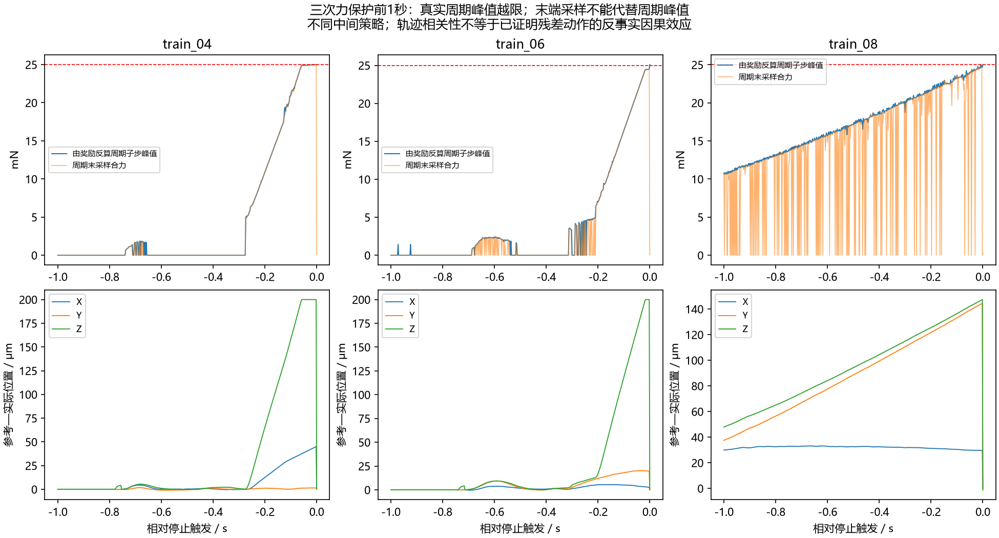

# B.2 力保护停止机制复核（2026-09-29）

结论：已查明本次停止的直接机制；用户随后批准的一次离线critic核对已完成，发现第三次失败边界价值+9.364而精确尾段−8.359的严重乐观偏差。尚未确认唯一成因或可宣告完成的软件修复。不能把正常保护停机当成程序崩溃，也不能把现有探索回合当成固定最终策略评价。

**最新核对：** 4检查点、1747状态、20,968组状态—动作；物理/actor推理/优化0，完整状态保持。见[价值核对结果与修复候选](critic_probe/结果说明.md)。以下归档分析和原核对方案保留其口径。

前半项只读取已封存的原子写入修复轮：13份物理归档和2500批更新记录。物理启动、策略/critic推理、优化更新均为0。共享源码、保护阈值、奖励、配置、旧执行包均不修改。跟踪保持暂停，原余19次/2000批不执行。

## 已证实的事实

| 训练回合（从1计数） | 采集前更新数 | 周期峰值力 / N | 是否经过回撤恢复 | 后续critic边界抽样次数 |
|---|---:|---:|---|---:|
| 第5回合 train_04 | 500 | 0.025001818 | 是 | 5116（1847批） |
| 第7回合 train_06 | 1500 | 0.025104987 | 是 | 2134（908批） |
| 第9回合 train_08 | 2500 | 0.025019905 | 否 | 0（按停止规则不得再更新） |

1. 三次均为INSERT阶段真实合力超过0.025 N，随后有效停稳。第3次累计触发预登记停止，退出码20。没有新的原生崩溃或文件写入失败；已恢复的10条写入重试警告不能解释本次停止。
2. 峰值按冻结奖励公式 `F_peak=0.025*sqrt(-force_term/(0.2*dt))` 从归档反算，代表该控制周期原始子步的最大合力；不是独立新增测量，也不重建峰值子步的各轴分量。它与守卫事件一致。周期末已经降力，因此只看周期末载荷可能误以为未越限。
3. 初始确定性四点虽然4/4成功，峰值约0.024474 N，距离保护线约2.1%。这是这些既有轨迹的余量，不是所有状态的安全余量，不能据此认定阈值设错。
4. 第5、7回合在恢复后的插入期间，Z参考位置相对实际位置逐步领先约200 μm，载荷上涨；第9回合没有恢复，但Y、Z参考领先共同增长。因此“恢复流程单一故障”不能覆盖三次停止。第9回合结束前约0.5秒，roll/pitch残差超过归一化幅度0.95的比例约75%/93%，提示持续偏置行为；不是每次力失败都出现同样角动作饱和。
5. 前两次失败已完整入池、终末奖励均为-10，最后可动作边界的折扣尾段标签约-8.3692。更新记录证明其边界被大量使用，排除“负奖励没写入/失败经验全部丢弃/关键边界从未抽到”。抽样次数不是独立样本数，也不能证明critic已经学会。

## 现在可以怎样解释

控制层面已经看到：受阻接触下参考位置继续领先，合力逐步或在短暂接触峰值中跨过共同保护线。残差改变XY/姿态及接触过程，Z推进来自冻结基线；现有离线轨迹没有“同一状态去掉残差重新运行”的物理反事实，因此不能把越限全部归咎于某一个残差轴。

学习层面已有不利行为证据：四个预热回合1成功/3普通失败，随后五个不同中间策略的探索回合为2普通失败/3力保护。降低训练损失未转化为这组采集行为的改善。但初始评价为确定性策略，训练含随机探索，二者不能直接作为训练前后成功率比较。

首组500批只见过四个预热回合；此后即使加入力失败样本，也仍重复产生失败。优先区分两种情况：critic是否在危险决策处仍给出不合理的乐观评分，或critic已识别失败但actor/探索仍选择不利动作。当前记录未保存这些成对评分，不能仅靠损失曲线区分。

尚未证实：critic过估计、单步价值传播太慢、动作时间尺度不匹配、奖励失衡、观测信息不足中哪一项主导。现有直接终末尾段只覆盖最后可动作边界及停止尾段，前面的可动作状态仍使用一步目标；这是检查线索，不是已证明的缺陷。普通失败的正总回报也不足以证明奖励错误，因为成功总回报仍显著更高。

## 限定核对方案（随后获用户批准，已完成）

目的只回答“危险决策的价值判断是否失真”，不再启动一整轮训练。

- 读取现有train_03、train_04、train_06、train_07完整检查点，分别为500、1000、2000、2500批；校验各自清单和状态文件，全部原文件只读。
- 固定输入为train_04/06/08力失败及train_00成功的末段（最后可动作周期向前最多500周期，每条至多501行），加13回合各自最后可动作行；去重后至多2017状态。
- 对记录动作、零残差、记录动作的一半，计算两个critic及其最小值；总计最多2017×3×4=24,204组状态—动作，硬上限25,000。不得调用actor生成新动作、环境、物理、经验发布或任何优化器更新。
- 对最后可动作记录动作，比较已有精确尾段标签；对前置动作仅报告网络排序，不把替代动作的Q值当成真实物理结果，也不把未来才采集的数据冒称已参与该检查点训练。记录哪些回合已入池。
- 每个检查点计算前后核对权重、计数和随机状态不变。仅出一次报告，不自动接优化诊断、参数扫描或新训练。
- 若失败边界仍被明显高估，下一项应针对价值拟合/传播提出单一候选；若边界已拟合但前置排序可疑，只能提出传播假设；若这些均无明显异常，停止反复修补终末采样，转而讨论actor更新/探索的单变量对照。任何分支都不凭离线Q排序宣称控制问题已修复。

修复验收最终需要同版本物理对照与冻结评价；当前证据不足以承诺某个参数修改必然改善。任何新增物理/更新预算及方向改变另行沟通。审批原因是此前执行约定明确禁止额外模型计算，并非读取归档本身需要批准。

## 复核及产出

- [结构化证据](assessment.json)：13回合、15个关键归档文件与封存摘要一致，含阶段转换、动作比例、奖励反算峰值、边界标签与抽样计数。
- `analyze.py`仅做归档运算与制图，显式拒绝加载torch、MuJoCo和SB3；未运行旧资格脚本。
- 用项目既有CPU解释器执行本目录`analyze.py`可复算本项。生成物不写入历史执行包。图已人工检查，原始子步峰值反算与周期末采样明确区分。
- B.2仍未完成，本项不新增训练收益证据。
