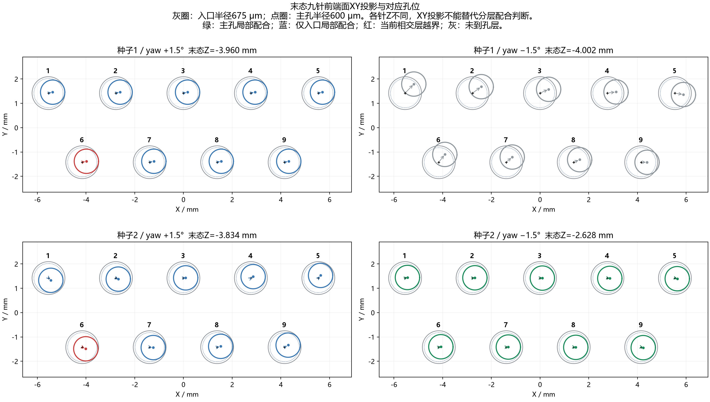
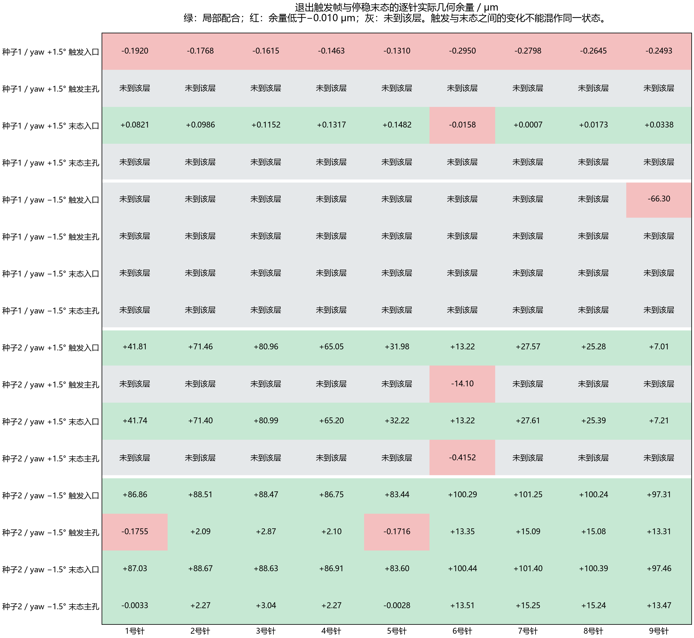
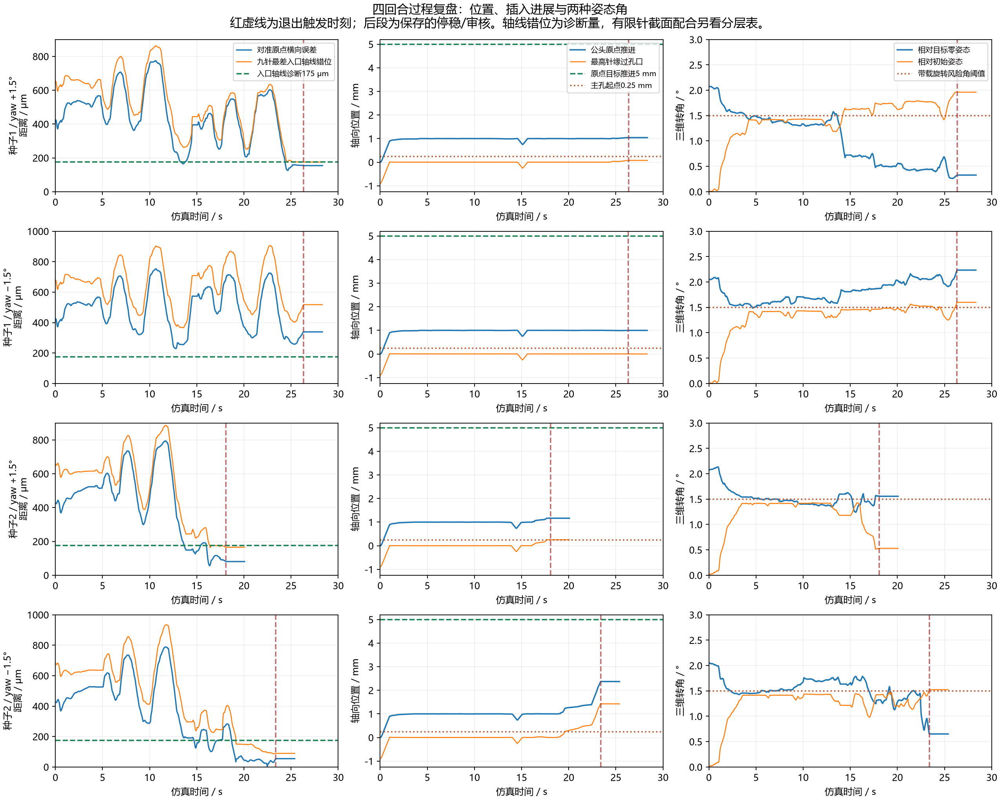

# 被动yaw开启后四次新种子的逐针与失败过程复盘

2026年11月3日，B.2第3项。四次均为同一F4000冻结网络、50ms探索随机数保持、2ms网络计算、被动Mz到yaw反馈开启；X/Y各+0.30mm，roll/pitch为−1°/+1°，初始yaw为±1.5°。本轮没有参数更新。

**四次失败不能统一解释为没有找到孔或同一种卡死。** 种子1正yaw最终贴近入口边缘但未进入主孔；种子1负yaw仍有较大平移与yaw联合偏差；种子2正yaw在6号针主孔入口几何越界的同时触发轴向卡滞；种子2负yaw则在九针跨入主孔、持续推进和目标姿态误差减小的过程中，触发按初始姿态计算的带载旋转风险。

本批成功0/4，全部是有效、停稳、审核通过的任务失败。以下区分失败触发帧与停稳末态，避免将卸载后的接触松弛状态当作触发时的状态。

## 坐标与几何口径

- 母头任务对准原点为世界(0,0,0)，目标公头原点Z为0。X/Y误差指公头原点到母头任务对准原点的横向差，不是9孔算术质心之差。
- 编号沿实际模型pin_01至pin_09，XY图上排1至5、下排6至9，X向右、Y向上。每根针对应同编号、同名义XY的孔。
- 针为直径1mm、长4mm的有限刚性圆柱，局部前端中心Z为4mm；公头初始Z为−5mm，所以约1mm原点推进主要用于接近孔口。
- 入口层为Z=0～0.25mm、半径675μm；主孔层为Z=0.25～4.5mm、半径600μm。所有针是否能进入，要检查当前有限圆柱与各层的交集，不能只看前端中心或公头中心。
- 几何余量正值表示尚有间隙；负值表示超出该层横向法面。当前容差允许不小于−0.010μm，即−10nm。余量为空表示针尚未与该层相交，不等于通过。此量不等于MuJoCo原生最深接触距离，不能直接拿30μm原生穿透保护限值与它比较。
- 本文最终偏差取完整保存轨迹最后的停稳审核帧。退出触发之后还有任务观察与独立停止审核；它们不追加动作或成功机会。
- 入口平面轴线外推错位仅为诊断量。其175μm入口、100μm主孔理想圆孔中心线余量不是充分成功条件；CSV同时标记轴线交点是否落在有限针轴上。

| 针号 | 对应孔X mm | 对应孔Y mm |
|---:|---:|---:|
| 1 | -5.5400 | +1.4200 |
| 2 | -2.7700 | +1.4200 |
| 3 | +0.0000 | +1.4200 |
| 4 | +2.7700 | +1.4200 |
| 5 | +5.5400 | +1.4200 |
| 6 | -4.1550 | -1.4200 |
| 7 | -1.3850 | -1.4200 |
| 8 | +1.3850 | -1.4200 |
| 9 | +4.1550 | -1.4200 |

## 最终整体偏差

| 回合 | X μm | Y μm | XY合量 μm | 距目标Z mm | roll ° | pitch ° | yaw ° | 入口局部配合 | 主孔局部配合 |
|---|---:|---:|---:|---:|---:|---:|---:|---:|---:|
| 正yaw 种子1 | +147.880 | +43.292 | 154.087 | 3.959507 | +0.0536 | +0.3228 | +0.0025 | 8/9 | 0/9 |
| 负yaw 种子1 | +299.988 | +157.479 | 338.810 | 4.001556 | -0.0075 | -0.0100 | -2.2342 | 0/9 | 0/9 |
| 正yaw 种子2 | +64.193 | -49.059 | 80.793 | 3.834497 | -0.8082 | +0.8134 | +1.0459 | 9/9 | 0/9 |
| 负yaw 种子2 | +51.975 | -16.984 | 54.679 | 2.628268 | -0.2286 | +0.5547 | -0.2530 | 9/9 | 9/9 |

四回合距Z成功容差边界仍分别约3.940、3.982、3.814、2.608mm。当前功能成功依据Z、有限针分层几何、速度、载荷/保护和100ms连续保持联合判断；旧字段XY80μm/角0.5°没有直接作为当前functional_finish的一票否决条件。因此不能把种子2正yaw的80.8μm中心差或种子2负yaw的0.555° pitch单独当作正式失败原因。

图中轮廓是各针前端面在XY的投影，各针的真实Z不同。颜色依据相交孔层的有限针配合，而不是只依据轮廓能否画在圆内。下面的逐针表给出对应空间位置与层位。

## 正yaw种子1的入口边缘停留

**已证实的过程。** 0.998s保存到接触；2.646s出现轴向卡滞，卸载后3.284s开始第一次搜索；14.530s名义螺旋参数用尽；实际回撤约250.080μm后，15.088s开始第二次搜索；26.334s第二次名义螺旋用尽，搜索次数耗尽退出。全程没有SEARCH_ADVANCED，未转回INSERT。

两段各约11.25s，theta到8π，即名义4圈/400μm，先于18s单段与30s总时限。实际参考最大径向距离分别约374.9/380.0μm，实际刚体最大搜索半径约366.9/340.4μm，不能把名义螺旋参数走完当成真实覆盖了400μm圆盘。第二段中心到真实对准原点约394.97μm，名义盘虽刚包含原点，真实轨迹仍未形成九针共同通过的配合。

**逐针与最终偏差。** 停稳yaw仅+0.00249°，但公头原点横向仍错154.09μm；针前端中心相对孔中心大约统一偏向+X170μm、+Y39μm。最高针缘全记录峰值76.137μm，远不到250μm主孔起点。触发时九针入口余量均为负，约−0.131～−0.295μm；停止松弛后8针局部通过，6号剩−0.015773μm，即−15.773nm。

不能把这次归结成只差数纳米验收：所有针都未到主孔，而且保持末态XY/姿态，仅把Z数学上平移到目标时，主孔最差余量约−75.016μm，9针均不通过。入口微小松弛不会自动解决主孔需要的进一步横向对中。

**最有依据的原因。** 搜索与当时姿态把针带到了宽入口边缘，没有带到窄主孔需要的位置。yaw纠正已基本到位，平移与pitch耦合仍不够；名义搜索时钟结束后，控制器没有继续形成有效对准。SAC在同状态限幅后的XY命令差较请求小，支持实际纠偏权限/执行与搜索覆盖不足这一解释，但缺少本批反事实，不能单独归责某一通道。

## 负yaw种子1的平移与姿态联合偏差

**已证实的过程。** 1.000s保存到接触；2.628s轴向卡滞后卸载；3.266s开始搜索；14.512s第一段名义半径用尽；回撤后15.070s开始第二段，26.316s再次耗尽。未出现SEARCH_ADVANCED，也没有最终INSERT旋转风险触发。

最近公母对准原点距离仍为228.69μm；恢复后的第二段搜索中心反而离真实原点573.50μm，真实原点在400μm名义参考盘外173.50μm，实际参考最大搜索半径只有349.43μm。恢复改变了Z并在当前XY重启搜索，不是回到真实对准点。

**逐针与最终偏差。** 全记录最高针缘只有8.533μm；触发帧只有9号针边缘与入口层相交，其入口几何余量约−66.304μm。最终针前端中心Z均为负，九针均未与入口层相交；这是停稳后状态，不能据此说此前完全没有触碰入口。最终原点XY误差338.81μm，yaw为−2.23422°，比初始−1.5°更负。

即使允许理想任意XY平移，在末态姿态下九根入口轴线的最小最差错位仍约216.02μm，超过175μm入口中心线诊断余量；说明继续只平移也不能解决当前终态的姿态分散。实际有限针配合仍以表中余量为准。

**最有依据的原因。** 搜索范围/轨迹没有抵达足够靠近对准原点的位置，同时负yaw继续偏离。两段被动yaw基准命令时间和均负，SAC yaw请求时间和也均负，是未形成双向有效纠偏的线索；命令时间和不能分摊真实转角，因此不能认定是某一个通道独立造成了失败。

## 正yaw种子2的主孔入口轴向卡滞

**已证实的过程。** 3.566s首次轴向卡滞；4.198s搜索；13.854s第一段参考预测提前触边并进入回撤；14.414s开始第二次搜索，17.366s因净推进超过100μm转INSERT。18.064s再次轴向卡滞，此时2次搜索、1次恢复已经用完，所以直接失败。

最后0.402s只推进4.646793μm，最后50ms仅0.112544μm，轴向载荷约−2.714N。基准及驱动限幅后的Z命令仍为+1mm/s、SAC Z恒0，失败不是取消了向前推进请求。相对初始转角只有0.529°、风险计时0，最终直接原因不是加载旋转风险。

**逐针与最终偏差。** 所有针的入口层局部配合均通过，但只有6号针缘刚跨入主孔层。全记录最高针缘为254.751μm，超过主孔起点约4.751μm。触发时6号主孔余量为−14.096μm，明显低于−0.010μm容差；其他8针尚未碰到主孔层。停稳后6号主孔负余量缓解为−0.415μm，覆盖仅约3.721μm，不能用这个卸载后的小值替换触发时14.096μm的受阻状态。

最终roll/pitch/yaw为−0.808/+0.813/+1.046°，XY合量80.79μm。中心更近了，但9针前端并不一起过肩：6号较先到达，其他针因姿态形成轴向高低差。末态姿态下即便理想任意XY平移，九针入口轴线最小最差错位仍约102.24μm，超过100μm主孔中心线诊断余量；保持当前XY/姿态仅Z到目标的完整几何试算，8针不通过，最差约−67.79μm。

**最有依据的原因。** 位置和姿态的联合配合只适合宽入口，尚不适合窄主孔；6号主孔入口几何越界是最强的局部受阻线索，与真实轴向停滞和载荷一致。没有逐接触几何对ID/法向/力档案，不能把全部2.7N都分配给6号针，也不能排除D形导向接触共同作用。

## 负yaw种子2的带载旋转风险退出

**已证实的过程。** 3.734s首次卡滞；4.266s搜索；13.936s第一段参考预测提前触边；回撤后14.526s第二次搜索，19.416s转INSERT。该INSERT持续约3.966s、实际推进1.268249mm，23.382s触发加载旋转风险，因搜索/恢复额度已用完而失败。

最后400ms仍推进386.921μm，最后50ms推进47.496μm，触发瞬间轴向速度约855.7μm/s，不能把最终退出说成轴向卡死。规则是相对初始三维转角至少1.5°、压缩Fz至少1.5N，连续50ms；不是绝对yaw达到1.5°。最后50ms相对初始角1.500028→1.523609°上升，同时相对真实目标的角误差0.694067→0.651073°下降，表明当时仍在纠正真实姿态。

**逐针与最终偏差。** 九针都已有主孔层轴向覆盖；在触发帧1/5号主孔余量约−0.175538/−0.171589μm，7针局部通过。停止之后接触松弛，最深针缘时刻及末态可出现9针局部通过。最终1/5号只剩−3.336/−2.772nm，当前10nm规则允许；其他7针有约2.265～15.249μm正余量。末态九针主孔内覆盖约1.067～1.175mm，仍未到旧成功例约3.64～3.84mm的覆盖。

最终XY合量54.68μm，roll/pitch/yaw为−0.229/+0.555/−0.253°，Z仍距目标2.628268mm，超出20μm目标容差约2.608268mm。末态不是因为yaw没有归零或pitch大于0.5°而被一票否决；历史控制失败已锁存，实际插深也确实不足。

**纯几何检查的边界。** 保持触发帧XY/姿态，仅Z平移到目标时仍只有7针通过，最差余量−0.175538μm。保持停稳末态XY/姿态做相同计算，九针均通过，最差−3.336nm。这证明停稳姿态在针孔几何上存在完整深度的容纳状态；它没有检验D壁、摩擦、接触载荷、驱动过渡或继续运动的风险，不能据此说取消保护就必然成功。

**最有依据的原因。** 直接瓶颈是带载旋转风险与已耗尽的恢复次数共同结束了一段仍在推进的INSERT。风险参考初始姿态，包含有利纠偏也会产生的相对转动；这种指标与目标误差下降可以同时发生。触发前带载、1/5号动态负余量以及横向导纳预算耗尽又表明不能简单认定保护误报。

末段INSERT被动X修正预算在21.318s达到−0.5mm，触发前被动X速度为0，触发时Fx约−2.360N，是横向卸载与接触耦合的线索。最后50ms被动/SAC yaw请求同为正，pitch请求相反但被动量级更大；不能把本次失败简单归为被动yaw一直抵消SAC。没有反事实轨迹，无法给各通道分配独立因果贡献。

## 逐针坐标与触发和末态的分层余量

ΔX/ΔY是每根针前端圆面中心相对对应孔中心的XY差；Z是该前端中心相对孔口的真实高度，不是最高针缘。各针会因倾斜而出现不同Z。下列余量均为μm，未到该层使用“—”，通过下限为−0.010μm。完整各关键帧和轴线外推字段见[逐针CSV](per_pin_keyframes.csv)。

### 正yaw 种子1

| 针号 | 末态前端ΔX/ΔY μm | 末态前端Z μm | 触发入口余量 | 触发主孔余量 | 末态入口余量 | 末态主孔余量 |
|---:|---:|---:|---:|---:|---:|---:|
| 1 | +170.453/+39.313 | +72.972 | -0.1920 | — | +0.0821 | — |
| 2 | +170.409/+39.433 | +57.363 | -0.1768 | — | +0.0986 | — |
| 3 | +170.365/+39.554 | +41.755 | -0.1615 | — | +0.1152 | — |
| 4 | +170.321/+39.674 | +26.147 | -0.1463 | — | +0.1317 | — |
| 5 | +170.277/+39.795 | +10.539 | -0.1310 | — | +0.1482 | — |
| 6 | +170.540/+39.374 | +62.513 | -0.2950 | — | -0.0158 | — |
| 7 | +170.496/+39.495 | +46.905 | -0.2798 | — | +0.0007 | — |
| 8 | +170.452/+39.615 | +31.296 | -0.2645 | — | +0.0173 | — |
| 9 | +170.408/+39.736 | +15.688 | -0.2493 | — | +0.0338 | — |

### 负yaw 种子1

| 针号 | 末态前端ΔX/ΔY μm | 末态前端Z μm | 触发入口余量 | 触发主孔余量 | 末态入口余量 | 末态主孔余量 |
|---:|---:|---:|---:|---:|---:|---:|
| 1 | +358.884/+372.927 | -2.705 | — | — | — | — |
| 2 | +356.778/+264.940 | -2.224 | — | — | — | — |
| 3 | +354.672/+156.952 | -1.743 | — | — | — | — |
| 4 | +352.566/+48.965 | -1.262 | — | — | — | — |
| 5 | +350.461/-59.022 | -0.781 | — | — | — | — |
| 6 | +247.114/+321.092 | -2.091 | — | — | — | — |
| 7 | +245.009/+213.105 | -1.610 | — | — | — | — |
| 8 | +242.903/+105.118 | -1.129 | — | — | — | — |
| 9 | +240.797/-2.869 | -0.647 | -66.304 | — | — | — |

### 正yaw 种子2

| 针号 | 末态前端ΔX/ΔY μm | 末态前端Z μm | 触发入口余量 | 触发主孔余量 | 末态入口余量 | 末态主孔余量 |
|---:|---:|---:|---:|---:|---:|---:|
| 1 | +95.214/-93.102 | +223.321 | +41.808 | — | +41.740 | — |
| 2 | +94.473/-42.547 | +183.997 | +71.457 | — | +71.402 | — |
| 3 | +93.732/+8.008 | +144.674 | +80.963 | — | +80.988 | — |
| 4 | +92.992/+58.563 | +105.350 | +65.053 | — | +65.199 | — |
| 5 | +92.251/+109.118 | +66.027 | +31.978 | — | +32.219 | — |
| 6 | +147.244/-67.059 | +243.715 | +13.221 | -14.096 | +13.225 | -0.4152 |
| 7 | +146.504/-16.504 | +204.392 | +27.575 | — | +27.614 | — |
| 8 | +145.763/+34.051 | +165.068 | +25.276 | — | +25.388 | — |
| 9 | +145.023/+84.606 | +125.745 | +7.008 | — | +7.207 | — |

### 负yaw 种子2

| 针号 | 末态前端ΔX/ΔY μm | 末态前端Z μm | 触发入口余量 | 触发主孔余量 | 末态入口余量 | 末态主孔余量 |
|---:|---:|---:|---:|---:|---:|---:|
| 1 | +97.300/+23.238 | +1419.485 | +86.860 | -0.1755 | +87.026 | -0.0033 |
| 2 | +97.143/+11.008 | +1392.666 | +88.506 | +2.094 | +88.671 | +2.266 |
| 3 | +96.986/-1.221 | +1365.848 | +88.471 | +2.866 | +88.635 | +3.036 |
| 4 | +96.829/-13.451 | +1339.030 | +86.747 | +2.096 | +86.910 | +2.265 |
| 5 | +96.673/-25.680 | +1312.211 | +83.439 | -0.1716 | +83.600 | -0.0028 |
| 6 | +84.792/+17.173 | +1417.406 | +100.285 | +13.353 | +100.439 | +13.513 |
| 7 | +84.635/+4.943 | +1390.587 | +101.252 | +15.089 | +101.405 | +15.249 |
| 8 | +84.478/-7.286 | +1363.769 | +100.237 | +15.078 | +100.388 | +15.236 |
| 9 | +84.322/-19.516 | +1336.951 | +97.313 | +13.312 | +97.462 | +13.470 |

## 控制执行与跨回合判断

1. **50ms保持有实际运动，但仍受限幅。** 首对SEARCH的SAC XY请求绝对均值约251～268μm/s，同一状态下经过限幅的有残差/零残差命令差仅约7.7～8.5μm/s，约为请求的3%。XY任意阶段限幅行约63%～66%，XY驱动限幅行约83%～85%。这描述命令层有效改变量，不是实体位移的因果贡献比例。
2. **搜索参数时钟与真实覆盖不同步。** 首对theta走完名义4圈时，实际参考和刚体尚未达到同样的400μm半径；搜索结束先于单段18s和总30s。单纯加总时限不会改变这个结束条件。这里不修改锚点、螺距或结束规则。
3. **搜索转INSERT不是九针确认。** 净推进100μm让种子2两支转INSERT；随后一支6号主孔入口卡滞，另一支继续推进并触发旋转风险。仅凭状态切换不能当作已经找到九孔。
4. **终态几何改善不等于触发时无接触问题。** P1触发9针入口越界，停稳后8针通过；P2的6号主孔负余量从约14.1μm缓解到0.42μm；M2的1/5号从约0.17μm缓解为数nm。这个区别对判因非常重要。
5. **本批不检验学习增益。** 网络始终冻结，改动的只有新探索序列；0/4反映这些开发尝试未复现成功，不能推出SAC普遍无效。与历史ON记录合并为正0/3、负1/3，仍是两个固定工况、少量探索种子的描述。

同深度与旧成功记录比较：旧M15_ON在18.768s的Z与本次M15_S2风险触发Z只差约1.22μm，对准原点距离55.88/54.81μm也近似；但旧轴向载荷约−0.436N、本次约−2.120N，相对初始角0.782/1.524°。旧对目标总角1.494°反而大于本次0.651°。这说明不能用中心更近、总角更小或单一yaw更小代替逐针、层位和接触过程判断。

## 后续验证优先级

优先查清M15_S2中有利纠偏、接触载荷与相对初始旋转风险的关系，再讨论恢复预算/风险处理是否需要调整；当前数据没有证明直接放宽保护安全有效。其次处理P15_S2在主孔肩部的联合姿态配合，及S1中命令限幅与名义搜索结束早于真实覆盖的问题。扩大工况或追加训练应在这些问题形成明确可检验假设后决定，本次不实施任何修改或新执行。

## 证据与验证

四份实际model_used.xml的针位置/尺寸、母孔位置与复算逐一绑定。姿态变换、最小包围圆用4项独立手算fixture验证；每关键帧逐针最小余量与现用联合有限针裁判交叉一致。独立审查另用完整有限圆柱支撑函数复算M15_S2停稳姿态的目标Z几何，九针逐项相符。

- [全部几何与关键帧JSON](geometry_postmortem.json) · [逐针坐标CSV](per_pin_keyframes.csv)
- [S1控制与覆盖复盘](agent_s1/S1控制与覆盖说明.md) · [S2控制与风险复盘](agent_s2/S2控制与风险说明.md)
- [几何复算脚本](analyze_geometry.py) · [数学核心](analysis_core.py) · [核心检查](core_checks.xml)
- [复盘核验](verification.json) · [原批次结果](../noise50_yaw_repeat_20261103/结果与判断.md)

几何/轨迹极值来自保存的2ms端点；时序图每20ms显示一帧，未用插值冒称原生接触记录。全程载荷峰值使用原生cycle_peaks，四支分别约4.567/4.769/4.694/4.523N。原档案缺逐接触身份和力分解，因此不把任何一根针认定为全部接触力的唯一来源。本次新增初始化、物理子步、网络推理、优化更新均0，科研累计447；原批次标签、档案、配置、模型和权重保留，完整B.2/C未验收。
