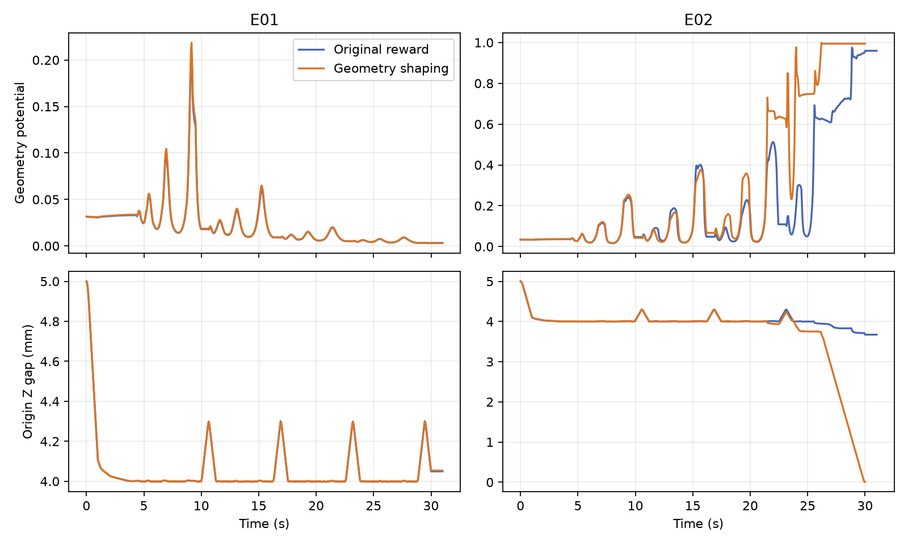

# 多针连接器：新旧奖励最小对照结果

2026-11-12｜B.2 开发验证已完成，完整 B.2 尚未验收。

**本轮配对有改善：原奖励0/2，新奖励1/2。改善集中在E02，E01没有实质改善。** 固定 SEARCH XY ±750 µm/s、加速度0.020 m/s²和被动 yaw 25%，完成4条共享训练采集及两组各101次更新。原奖励A在E01/E02成功0/2，新奖励B成功1/2：E02由7/9主孔配合超时变为9/9完整成功，E01两组仍0/9并超时。

## 评价结果

末态为原任务终点；峰力与力积分均统计至任务终点，失败回合保留为失败。

| 工况 | 奖励组 | 结果 | 末态主孔配合 | 成功时间/s | 距目标Z/mm | 峰力/N | 力积分/N·s |
|---|---|---|---:|---:|---:|---:|---:|
| E01 | A | 超时 | 0/9 | — | 4.0496 | 4.682 | 56.592 |
| E01 | B | 超时 | 0/9 | — | 4.0537 | 4.704 | 56.629 |
| E02 | A | 超时 | 7/9 | — | 3.6722 | 4.811 | 66.514 |
| E02 | B | 完整成功 | 9/9 | 30.020 | 0.0095 | 4.827 | 54.932 |

B组E02在29.918 s停止动作，在原有停稳保持期间于30.020 s确认成功，30 s动作预算没有延长。A组超时回合的任务终点为31 s，另有既定停止审核尾段。

E02的首次主孔轴向相交由27.248 s提前到24.236 s，提前3.012 s；这一量只说明针体与主孔深度区间相交，不能单独代表真正配合。B组在26.190 s首次达到九针真实主孔配合，A组在动作阶段未达到。最终轴向目标差由3.6722 mm降至0.0095 mm。峰力增加0.016 N，力积分减少11.582 N·s。两组均回撤3次。

E01两组均未与主孔发生轴向相交，末态X偏移分别为1.8502 mm和1.8500 mm；主孔配合均0/9。几何评分及推进曲线几乎重合，搜索漂移问题保留。

图中几何评分是原始位姿的物理评分，未把终局状态人为归零；奖励计算中的终局势函数归零另行校验。图线每50 ms取样；九针配合时间依据2 ms归档帧和原有限针体裁判计算。

## 共同设置与唯一学习变量

| 项目 | 两组共同设置 |
|---|---|
| SEARCH XY残差每轴上限 | ±750 µm/s |
| SEARCH XY加速度上限 | 0.020 m/s² |
| SEARCH XY速度限幅参数 | 900 µm/s |
| SEARCH被动yaw输出 | ×0.25，保留原被动状态更新；学习残差yaw不乘0.25 |
| 物理运行库与裁判 | 修复后的mesh接触运行库，原100 nm分层有限针体判据 |
| 学习器 | GRU-SAC，140维原观测、5维残差，种子2026110801 |
| 初始化与优化器 | 同一零更新、四条已审核回放检查点 |
| 数据与抽样 | 55,700条共同转移；相同均匀/重点序列采样与随机状态 |
| 更新预算 | A/B各101次critic更新；末次固定检查点评价 |
| 开发评价 | E01/E02相同初态、种子、控制设置与确定性动作 |

约7%是之前权限方案的名称，实际有效比例随策略与限幅变化，不能把本轮残差输出理解为固定7%混合权重。

A组使用原Newton奖励。B组增加用户提案的四截面几何势函数差分：截面0/250/250/750 µm、孔半径675/675/600/600 µm，10%间隙目标，平均平方和最差平方各0.5，Phi=1/(1+E)，lambda=1。折扣直接使用原转移中的gamma；完整终局Phi归零，抽样窗口末尾不归零。几何真值只用于训练评分，策略观测未增加针孔相对位姿。

原始物理轨迹和原奖励保持不变。B组按回合与周期索引，在采样批上替换奖励；每次更新记录实际奖励摘要、覆盖文件摘要和非奖励输入摘要。101批的非奖励输入逐批一致，两组初始网络/优化器/RNG来自同一个检查点，训练后actor摘要不同。评价仍使用原物理任务指标。

## 共享训练与检查

| 训练工况 | Y偏移/µm | yaw/° | 采集结果 | 成功时间/s |
|---|---:|---:|---|---:|
| T03 | -300 | -1.5 | 成功 | 14.632 |
| T01 | +300 | -1.5 | 超时 | — |
| T02 | +300 | +1.5 | 成功 | 28.972 |
| T04 | -300 | +1.5 | 超时 | — |

训练X均+300 µm、roll=-1°、pitch=+1°；四次采集使用共同未更新策略及原50 ms探索。两条失败轨迹同样经完整审核入池。E01/E02只用于开发评价，没有进入训练回放。

- 15项几何、序列边界、重点采样与审核边界测试通过。
- 旧开发轨迹及4条新训练轨迹的全回合折扣结算恒等式通过；旧E01/E02误差小于1e-15。
- 8条新归档通过物理、停稳、来源重放及额外的逐周期yaw倍率/SEARCH权限核查。
- 两组101批配对一致，原回放摘要未变，训练后检查点保存/恢复一致。
- 独立代码复核发现的“未触发SEARCH的合法成功被拒绝”和“中断后的未知成本被算成零”已在采集前修正。

## 与已有模型的关系及下一步

此前11/10训练后保留的冻结模型，在25%被动yaw下，E01末态7/9但超时，E02在23.720 s成功。本轮A/B使用25%设置重新采集的经验并从零更新网络重新短训，不能把历史模型作为本轮奖励单变量对照。**本轮B优于本轮A，但整体没有超过此前保留模型的这两例表现。**

这是单种子、两开发工况的固定数据筛查。E01搜索漂移未解决；新B的E02完成时间30.020 s，慢于此前保留模型的23.720 s，尚未超过已有最好表现。完整B.2和C未验收。

下一项待用户决定。针对E01仍无改善，进一步用A/B更新后的策略分别采集少量新经验，再继续更新和配对评价，检验新奖励能否引导更好的探索动作。本轮未执行该在线循环。

本轮验证了“同一批经验重新评分后，有限更新能否改变任务表现”。新奖励在E02出现收益，不能据此确认跨种子稳定性，也没有验证“新策略产生新经验、再学习”的完整探索循环。不依据本轮两例挑选新的奖励系数或追加试验。

## 成本与证据

新增8次科研初始化（4训练+4开发评价），1,196,590个原生子步，4次回放发布，A/B各101次更新、共202次；按登记累计初始化496→504。全部尝试保留，无重跑或额外在线采集。

[注册与控制干预](registration.json) · 配对检查（完整本地档案） · [完整数值对比](review/comparison.json) · [归档核验](verification.json) · 执行记录（完整本地档案） · [测试结果](final_unit_tests.log)

本轮执行入口为[实验脚本](run_experiment.py)，25%倍率由本实验适配器实施，通用训练默认入口未自动替换。检查点及奖励覆盖文件需共同保留；后续在线训练要继续显式登记倍率、奖励语义与新数据来源。已封存目录禁止重跑覆盖。只读复核可运行[结果分析](review_results.py)与[证据校验](verify_results.py)。
