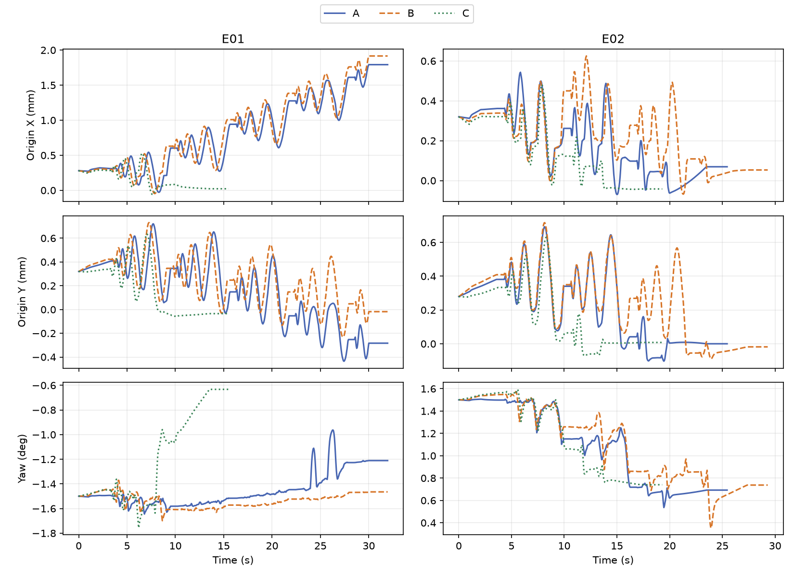

# 多针连接器普通SAC与GRU差异诊断

2026-11-13｜B.2只读分析完成。使用既有6条评价轨迹、12条训练记录、909次更新记录及初始/最终检查点。新增训练0次、仿真0次。

**最直接的证据是：C训练后在搜索早期形成更合适的负Y修正，并较早同时满足XY与姿态的接触入口条件；B前期仍偏正Y，错过早期入孔机会。** 这解释了本轮动作和轨迹如何分开，尚不足以证明网络结构是唯一根因。

| E01指标 | B：GRU新奖励 | C：普通SAC新奖励 |
| --- | ---: | ---: |
| 首次SEARCH时间/s | 3.454 | 3.236 |
| 首段SEARCH一秒的有效Y残差/µm·s⁻¹ | +21.875 | −22.929 |
| SEARCH中6—10秒的有效Y残差/µm·s⁻¹ | −17.136 | −39.595 |
| 8秒X/mm | −0.028 | +0.026 |
| 8秒Y/mm | +0.295 | +0.065 |
| 8秒yaw/° | −1.508 | −1.497 |
| 首次主孔轴向重叠/s | 无 | 8.564 |
| 首次九针主孔配合/s | 无 | 8.642 |

有效残差为限幅后“有残差命令减去零残差命令”，不是总运动速度，也不是把全部轨迹差异都归因于Y单轴。首段窗口各以自身SEARCH起点对齐，状态并不完全相同；下面用同一观测的离线计算补充检查。E02也有类似时序：C首次主孔重叠11.966秒、九针配合13.608秒；B分别21.746/23.538秒。

**不是仅因C初始策略碰巧更好。** 把B_E01的同一段完整观测依次输入两种初始/最终策略，在6秒前SEARCH行，C的归一化Y输出均值从+0.0931变成−0.0506，B从+0.0077变成+0.0141；换成C_E01的观测，结论相同（C从+0.0936到−0.0536，B从+0.0084到+0.0108）。因此输出方向变化确实发生在学习后，不能只用轨迹状态不同解释。此为固定观测上的输出比较，绝不是“初始策略重新跑实机会怎样”的反事实成功率证明。

**在线经验随后也发生分化。** C前两条初始轨迹均失败、无重点锚点；B有一条成功并有1个锚点，所以C并非靠更好的初始成功示范起步。第101次策略采集T02时，C在15.170秒成功并产生76个重点事件锚点，B在28.756秒成功并有44个锚点；其后各自学习自己产生的经验。支持“早期策略改变→不同入孔经历→后续训练”的解释，但不能仅靠日志分离各环节贡献。锚点数不是独立成功次数，且采样按事件种类再按锚点抽取，并非数量越多权重就同比增加。C首轮无事件，实际两条窗口均为均匀回退；B首轮每批都有重点窗口，规则一致不等于实际样本分布一致。

**当前对照不是在同一个MLP上只加GRU。** MLP是140→256→256；GRU是140→64投影→64维GRU→256输出头，actor参数分别104,458/53,194。GRU同时要学习压缩、循环状态和控制输出；在303次更新的小预算下，这可能影响学习速度，但现有记录不能证明它欠拟合或需要多少更新。MLP观测本来就含4帧力/力矩、上一动作、阶段和计时等信息，因此这两个开发任务未必需要额外长记忆才能完成；本轮成功支持“当前观测可供MLP解决这些点”，不能外推完整任务完全可观测。

**未发现支持“GRU根本没更新”或本批次历史恢复严重错位的证据。** 三组均303次优化，每组77,568学习行使用；B/C实际actor激活行分别71,407/69,974，C没有多拿更新。记录的B actor梯度范数最大0.04037、critic最大0.06754，均低于10的裁剪阈值；C对应0.04824/0.68651，也未触发该阈值。策略输出已有变化，未见NaN/失败更新。B最终策略重放自身观测与归档动作最大差约5.96×10⁻⁸，C约7.45×10⁻⁸。每隔100条SEARCH行抽查一次，GRU仅保留之前256步历史与全历史输出最大差约1.86×10⁻⁸（B轨迹）及7.45×10⁻⁹（C轨迹）。这削弱了“本次差异主要由256步burn-in不足造成”的解释，但只检查了最终actor、两条存量轨迹和抽样时刻，未覆盖critic或早期训练全过程，也不等价于证明没有梯度消失。

**判断与下一项。** 本轮可以较有把握地说“C学到的早期纠偏动作更有利，获得了更早的入孔经历”，不能说“GRU理论上更差”。网络容量/结构、单种子初始化、探索分布、采样回退和各自在线数据共同变化，尚不能唯一归因。优先保留C为当前候选，保留A作原奖励参考；不急着加GRU、改奖励权重或增加训练。若继续只读分析，可对照101/202/303次检查点定位负Y修正在哪轮形成，并在相同观测上检查critic动作偏好。本次未执行这些扩展，也未追加训练。

图按各自归档时间轴展示，包含归档的停止/审核尾段；成功时间以原评价收据为准。A为GRU原奖励，B为GRU新奖励，C为普通SAC新奖励。

证据：数值与离线输出（完整本地档案）、[只读分析脚本](analyze.py)、执行日志（完整本地档案）。离线推理仅用于解释动作差异，未生成额外任务结果。
