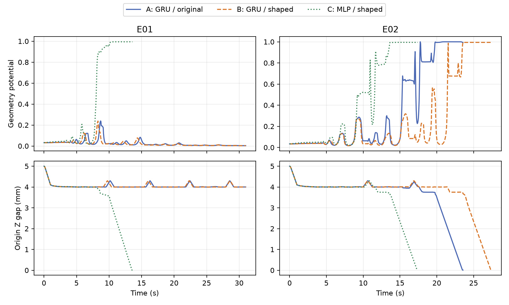

# 多针连接器三组从头在线小试：最终结果

2026-11-13。**本轮小试已完成，普通SAC＋新奖励C表现最好。** A/B均成功1/2，C成功2/2。结果没有支持“新奖励在GRU下更好”或“加入GRU更好”；单种子少量开发评价也不能证明普通SAC普遍优于GRU。

| 组别/工况 | 结果 | 任务结束/s | 末态主孔配合 | 峰力/N | 力积分/N·s |
| --- | --- | ---: | ---: | ---: | ---: |
| A_E01 | 超时 | 31.000 | 0/9 | 4.597 | 57.895 |
| A_E02 | 成功 | 23.580 | 9/9 | 4.698 | 39.877 |
| B_E01 | 超时 | 31.000 | 0/9 | 4.682 | 55.803 |
| B_E02 | 成功 | 27.438 | 9/9 | 4.838 | 51.593 |
| C_E01 | 成功 | 13.614 | 9/9 | 4.764 | 23.506 |
| C_E02 | 成功 | 17.420 | 9/9 | 4.623 | 28.065 |

A=GRU+SAC/原奖励；B=GRU+SAC/新奖励；C=MLP SAC/新奖励。超时在30秒触发，表中31秒含原有停止尾段；没有放宽搜索或成功条件。

A/B比较：新奖励未解决E01，E02比原奖励慢3.858秒，载荷指标也更高。本轮已执行真实在线反馈，不是只在旧数据上重新标奖励。B/C比较：同新奖励下C两工况均成功，E02比B快10.018秒；E01由B超时变为C在13.614秒成功。C在这些开发点值得保留为后续候选，但没有MLP＋原奖励D，不能把C的成功归因于新奖励本身。

每组空回放、全新网络/优化器；T03/T01初始采集→101次更新→更新策略采T02→101次更新→更新策略采T04→101次更新→E01/E02确定性评价。各4条训练、303次更新、77,568学习行使用（重复抽样），两次在线反馈循环。只评价最终303次策略，未按评价选checkpoint。A/B初始actor相同，首轮101批非奖励学习数据全部一致。其后各组独立采集，数据差异是在线学习的结果。

共同设置：SEARCH被动yaw输出25%，XY残差±750µm/s、加速度0.020m/s²，搜索速度参数900µm/s。所谓约7%不是恒定混合占比。每次两条完整128步学习窗口，一条均匀、一条事件重点（无事件均匀回退）；GRU另带256步真实burn-in，MLP只取对应学习行140维观测。真实相对孔位只参与训练奖励计算，不加入策略观测。原始回放奖励保持原样。

局限：单种子、四个训练初态、两个开发工况，未达到收敛或独立测试结论；GRU/MLP actor参数量分别53,194/104,458，比较的是这两套实现，不能单独归因于有无记忆。MLP140维观测已经包含短力历史。不同策略在线访问的数据和重点事件数量自然不同。完整B.2及C阶段仍未验收。

成本：18条轨迹完整审核、12次训练回放准入、909次更新；另保留1次中断尝试，总19次尝试。用户明确批准补采后，仅恢复C，未重跑A/B。已知18次初始化、2,445,380原生步；中断消耗未知，不能给出精确总成本。历史累计初始化已知下界522，另1次未知。C独立恢复账本的累计字段以原登记504为起点，不含A/B；跨阶段成本以合并账本为准。

下一项建议：保留A和C当前checkpoint，先用现有轨迹分析C为何更早找正、GRU在E01为何漂移，再做少量多种子重复。若继续追查新奖励收益，需在相同架构内检验（尤其缺失的MLP原奖励对照），不能仅凭C优于B判定奖励有效。本轮未自动追加训练。

图展示物理几何势和Z间隙，不是直接比较新旧训练累计回报。共享图例适用于两个工况，线型区分重叠曲线。

证据：[最终比较](review_final/comparison.json)、[合并账本](ledger_completed.json)、[补采授权登记](resume_authorization.json)、[最终校验](verification_resumed.json)、[成本比较](cost_comparison.json)、[31项测试](unit_tests.log)。中断时报告、原账本和未知成本收据继续保留。
