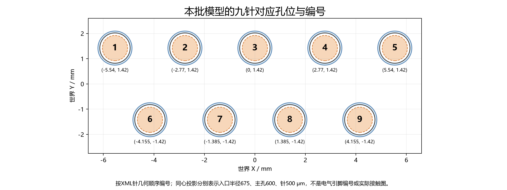
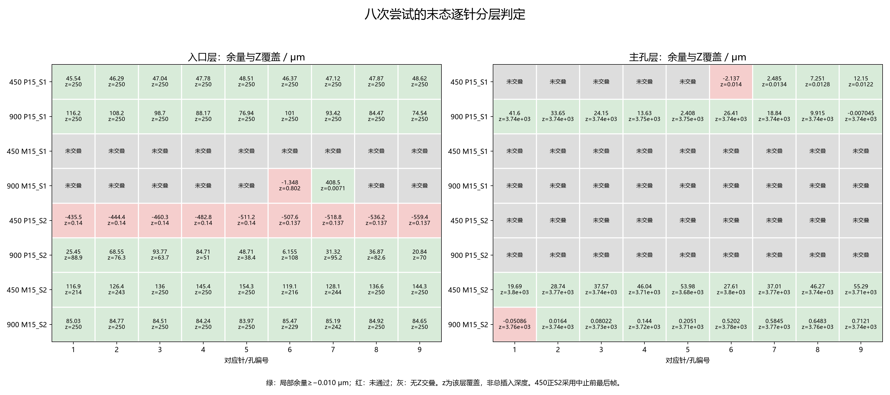
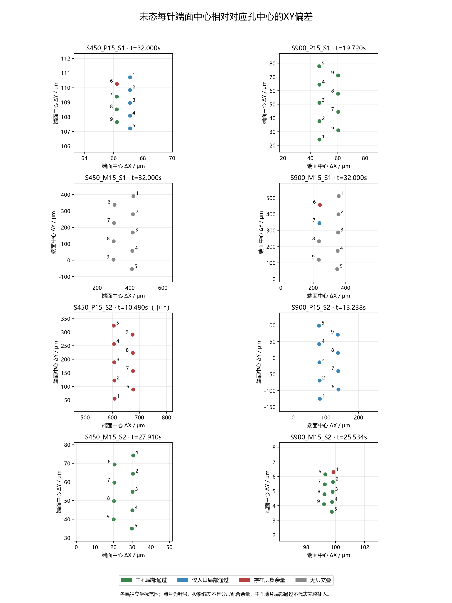

# 新450/900第一批：逐针孔位、最终偏差与逐回合失败复盘

本次复盘只读8次尝试的原始轨迹、实际模型、事件和审核记录，没有新仿真、网络推理或训练。已统一复算72条末态针孔对应关系、693条关键帧逐针记录，并与先前7个完整结果的几何关键帧交叉核对。原批次、标签、模型和冻结来源保留，科研累计仍455。完整B.2/C未验收。

**主要判断：本批不是一种统一的“插入失败”。** 两支正式成功；三支超时分别停在主孔台阶或入口；一支搜索中的真实超力；一支达到目标深度、停稳后仅纳米级几何未过；还有一支被外部STOP中断。取消次数提供了真实额外机会，900也有局部节时，但没有证据证明900全面优于450。

完整72针表见[逐针孔位与偏差](逐针孔位与偏差.md)，机器可读见[末态72行CSV](per_pin_final_72.csv)、[693行关键帧CSV](per_pin_keyframes.csv)及[全部几何与过程数据](postmortem_data.json)。四支450和四支900另作独立只读复核，见[450复核](agent450/复核.md)、[900复核](agent900/复核.md)。

## 判断口径：哪些数值能说明什么

实际模型针半径500μm、入口孔半径675μm、主孔半径600μm，理想平行轴径向间隙分别175/100μm；入口Z=0～250μm，主孔Z=250～4500μm。代码模块将任务说明为1.20mm孔径，项目名“clearance120”不代表120μm径向间隙；120μm参考超前限制也是另一参数。

本报告针1～9按XML针几何顺序，对应同XY位置的孔，不推断电气编号或插头正反面。世界孔位是上排1～5号X=−5.540、−2.770、0、2.770、5.540mm，Y=1.420mm；下排6～9号X=−4.155、−1.385、1.385、4.155mm，Y=−1.420mm。

注册目标完成区为公头原点|Z|≤20μm；程序在进入约−10μm的目标停止阈值时停驱动，再核验100ms连续保持。文中的“到位”是达到这一任务目标，不是针尖必须碰到4.5mm孔底。原点目标、针缘Z和各针主孔覆盖是不同的量。

逐针位置给出实际远端端面中心XYZ、对对应孔中心的ΔX/ΔY、针缘Z范围、入口/主孔有限圆柱余量及Z交叠。端面中心投影或轴线延长线只是诊断，真正的配合判据是有限圆柱与该Z层相交后的余量。负余量表示几何重叠；本批容差下限−0.010μm，即−10nm。没有Z交叠记“—”，不能当零误差或通过；只有十余nm的主孔薄片交叠，也不能称完整插入。

“最终”统一取物理停止审核末帧，450正yaw种子2只能取中止前最后RUNNING帧。触发前、决策停止、最深行动帧、任务判定末与审核末分别保留，不能用停止松弛后的姿态倒写触发状态。位姿几何来自2ms端点，原生峰载来自0.2ms子步汇总；除原生保护事件时刻外，不能把峰载和某一保存位姿当同一瞬间。

原点XY是公头刚体原点相对任务对准原点的误差，不是9孔算术质心误差。当前功能裁判采用Z、速度、载荷、穿透和逐针分层几何；遗留XY80μm/角0.5°字段不直接一票否决。因此不能用900正yaw S1的XY略超过80μm否认其成功，也不能用900负yaw S2的yaw更接近零判它一定优于450。

## 总结果与最终整体偏差

|回合|结束方式与仿真时间|真正结束的位置|搜索/恢复/预警|
|---|---|---|---|
|450 正yaw S1|30s TIME_LIMIT|入口已通过，受阻于250μm主孔台阶|3/2/1|
|900 正yaw S1|17.720s到目标，17.830s成功|九针达到目标深度并满足保持|3/1/1|
|450 负yaw S1|30s TIME_LIMIT|一直未进入主孔|3/2/0|
|900 负yaw S1|30s TIME_LIMIT|接近过真实原点，仍未进入主孔|5/4/0|
|450 正yaw S2|10.480s外部STOP|第一段搜索被中断，无自主结束结果|1/0/0|
|900 正yaw S2|11.2364s原生FORCE_LIMIT|第二段SEARCH，尚未到主孔|2/1/0|
|450 负yaw S2|25.910s到目标，26.012s成功|九针完整配合、保持通过|2/1/0|
|900 负yaw S2|23.534s到目标，24.534s严格拒绝|九针深入主孔，1号纳米几何未过|3/2/2|

|回合|最终X/Y/Z(μm)|最终roll/pitch/yaw(°)|原点XY范数(μm)|主孔局部通过|
|---|---|---|---:|---:|
|450 正yaw S1|66.663 / 108.877 / −3750.028|−0.00123 / +0.00001 / −0.01806|127.664|3，只有极薄交叠|
|900 正yaw S1|56.796 / 57.716 / −9.857|+0.09404 / −0.04959 / +0.27649|80.975|9|
|450 负yaw S1|358.939 / 170.106 / −4000.104|−0.00021 / −0.00082 / −2.30256|397.207|0|
|900 负yaw S1|293.110 / 276.487 / −4005.889|−0.16436 / +0.01645 / −2.33345|402.937|0|
|450 正yaw S2，中止帧|640.983 / 189.807 / −3999.862|+0.00005 / −0.00000 / +1.39249|668.495|0|
|900 正yaw S2|91.373 / −48.743 / −3928.526|−0.50905 / +0.26095 / +1.15620|103.561|0|
|450 负yaw S2|−16.202 / 36.950 / −9.353|−0.25636 / +0.59249 / −0.20294|40.346|9|
|900 负yaw S2|80.769 / −40.225 / −8.546|−0.64842 / +0.26861 / −0.01405|90.231|8，九针均有主孔覆盖|

严格成功为450的1/3个完整结果，另1外部中止；900为1/4。正yaw S2速度配对不完整；不能把中止当策略失败，也不能据小样本比例给两速度稳定排名。原点推进还包含约1mm初始接近，不能把“推进1.25mm”当作1.25mm主孔插入。

|回合|原生峰力(N)|原生峰扭矩(Nm)|原生峰穿透(μm)|保护判断|
|---|---:|---:|---:|---|
|450 正yaw S1|4.518|0.05686|6.519|未越硬限|
|900 正yaw S1|4.653|0.05588|11.772|未越硬限|
|450 负yaw S1|4.568|0.05460|4.369|未越硬限|
|900 负yaw S1|4.857|0.06274|6.136|未越硬限|
|450 正yaw S2，中止前|3.972|0.04385|3.033|未触自身硬保护|
|900 正yaw S2|5.518|0.06551|3.508|合力越5N|
|450 负yaw S2|4.663|0.06314|27.038|未越，但距30μm只约2.962μm|
|900 负yaw S2|4.892|0.06794|12.060|未越硬限|

这些是全过程所有接触的原生极值，不等于末态某一针的几何重叠，也不是同一时刻发生的三个量。正式成功不自动代表全过程保护裕度充足。

## 逐回合复盘

### 1．450正yaw S1：主孔台阶受阻，最后由时间结束

2.646s首次轴向卡滞：前400ms只净进4.908μm，轴向力约−2.716N，符合原卡滞触发条件。3.284～14.530s和15.082～26.328s两次完整搜索均耗尽，分别真实回撤250.080μm。26.888s第三次搜索启动，28.570s转INSERT。旧规则会在26.328s结束，本次继续后真正超过旧峰值约209.778μm，说明额外机会确实被使用，但没有完成插入。

28.690s行动最深针缘260.004μm：九针入口通过；仅1号针跨入主孔10.004μm，主孔余量−9.971μm，其余8针尚未与主孔相交。28.674s预警后仍继续INSERT约0.938s、净进94.371μm，29.612s又因400ms仅净进4.929μm而独立卡滞，转UNLOAD，30s结束。

30s触发帧6/7/8/9号主孔余量约−28.627/−27.878/−27.129/−26.380μm。停止松弛后，6号仍约−2.1375μm；7/8/9号虽局部通过，Z覆盖只有约0.0134/0.0128/0.0122μm。1～5号没有主孔交叠。最终1号端面投影偏差最大，约129.462μm；实际有主孔交叠的限制针为6号。yaw已近零，剩余横向偏差仍大于主孔100μm参考间隙。

**最可能原因：残留横向错位与主孔收窄台阶的联合几何阻挡，高置信。** 搜索形成了宽入口配合，却未形成九针同时进主孔的状态；最后余下时间不足再完成调整。这里是微米级负余量和毫米级目标深度差，不是仅被10nm验收口径误拒。不能把最差几何针6认定为唯一受力针。

### 2．900正yaw S1：先后卡过主孔，第三次搜索后成功

起初与450同样在2.646s卡滞、3.284s首搜。第一次搜索8.906s结束，恢复后9.464s二搜；11.956s原点曾距真实原点仅0.657μm，11.958s转INSERT，但仍未直接成功。12.244s预警时主孔仅4/9局部通过，6号主孔余量−47.707μm；12.600s再次轴向卡滞时仍4/9，最差为2号−20.625μm。位置接近零并不等于九针已经适配。

13.230s第三搜启动，14.018s再转INSERT。此时8/9主孔通过，1号仍−0.0775μm，之后才形成可持续推进的联合状态。17.720s达到目标Z时，主孔仍只有8/9通过，9号−0.3770μm且尚在运动；17.730～17.830s的51个保持帧才全部满足深度、几何、速度、载荷和穿透条件。

末态九针主孔覆盖3.735～3.748mm；9号主孔余量−7.045nm，按10nm容差通过，其余针为正。这个成功有完整保持和审核证据，但9号仍是贴壁余量很小的针，不应把“正式通过”理解成每针都留有较大几何裕度。首次预警后到普通卡滞只进约0.099μm，真正解除受阻的是后续第三次搜索，不能说预警放行后一直顺利插到底。

**成功机制：恢复后的搜索中心和接触姿态改变，第三次搜索形成了可推进的联合配合，高置信过程事实。** 第三搜属于超过旧额度的真实新增机会；SAC、被动导纳、噪声和锚点各自的独立贡献未被本批隔离。

### 3．450负yaw S1：入口就没通过，位置覆盖与yaw共同不足

2.628s首次卡滞；3.266～14.512s、15.064～26.310s两搜均用完，两次回撤后26.870s启动第三搜，30s超时。全程无SEARCH_ADVANCED或旋转预警。三个搜索中心距真实原点约514.225/569.785/340.917μm，实际最近原点约228.521/258.773/233.438μm；第二次中心反而更远，第三段仅有3.130s、实际扫到约125.6μm半径。

全行动最深针缘只有8.533μm，发生在1.048s早期；6号入口余量约−26.861μm，主孔从未达到。30s帧九针入口均不配合，负余量约−123～−399μm；停止后针缘退到入口上方，所有层余量变为无交叠，这不是“误差为零”。最终1号端面偏差约574.505μm，9号约298.508μm，yaw约−2.303°。

固定最终姿态、仅允许共同XY平移的轴线入口诊断，九针最佳最坏偏差仍约222.623μm，大于175μm入口平行轴参考间隙。它包含轴线延长线，不替代有限针裁判，但说明当前姿态不能只靠移动原点来补偿。新增动作主要补回250μm回撤，没有超过旧轴向峰值。

**最可能原因：偏置搜索中心/有限实际覆盖与未纠正的针阵姿态共同阻挡入口，高置信。** 未进入主孔，不能归为主孔深处卡死或纳米判据过严；也不能推断延长时间一定能成功。

### 4．900负yaw S1：多次扫近中心，仍未形成九针同时通过

3.266s开始搜索，前四段各约5.622s耗尽，完成四次约250.080μm恢复；28.082s第五搜启动，30s超时。无SEARCH_ADVANCED、无旋转预警。更多机会实际发生，却没有新的轴向突破；最高针缘仅38.104μm，未到250μm主孔。

第三、四段已分别接近真实原点37.792/9.930μm。26.648s最近原点时RPY约−0.661/−0.190/−2.107°，仅5针入口局部通过，6号入口余量−6.388μm，1/2/3号尚未与入口相交；该姿态仅以共同XY平移优化轴线，最佳最坏入口误差仍约203.924μm。因此“没有搜到中心”不足以解释这一支。

最终yaw−2.333°、原点XY402.937μm；停止触发时6号入口−34.904μm，停止松弛后为−1.348μm。末态仅7号有极薄入口局部通过，主孔全部未达。7号正余量大不代表整针进入，实际Z交叠仅约0.007μm。

**最可能原因：平移、yaw、roll/pitch和针前沿高度未形成九针共同入口配合，高置信。** 实际搜索半径约324～344μm、限幅较多是执行背景，但不能仅凭名义半径跑完判断覆盖已足够，也不能把失败全部归到某一个角通道。

### 5．450正yaw S2：外部中止，不能判断完整控制成败

3.566s首次卡滞，4.198s开始第一搜；10.480s因另一支900审核异常产生的批次STOP被中止。该段只运行6.282s、约2.98圈，没有自然耗尽，也未经历恢复。搜索中心距真实原点523.525μm，已完成部分的实际最大半径236.114μm，最近原点298.921μm。

中止前最后RUNNING帧，九针入口都不配合，余量约−435.550～−559.421μm，只有0.137～0.140μm薄交叠；主孔均未到。9号端面偏差约(674.263,291.193)μm，径向734.455μm。它当时确实没有对孔，但不能用未完成搜索推断30s完整结果。

中止前仿真有效、无本回合硬保护原因，原生峰力3.972N；之后接口中止才写入INVALID_INTERFACE_DATA/INVALID_SIMULATION。**已证实的结束原因：外部STOP，高置信。** 它没有停稳末态，不计策略自主失败，不用于完整450/900速度配对，也不假设继续运行必然成功。

### 6．900正yaw S2：第二段搜索中的横向合力尖峰

4.198s首搜，9.136s参考边界提前触发搜索结束，9.696s恢复后进入第二搜；11.2364s原生子步触发FORCE_LIMIT。原生峰值位于11.236～11.238s周期，合力5.518331N。该周期10个物理子步还保存轴向极值，轴向绝对值上界2.771438N；因此峰值时横向模长至少4.771908N。该结论来自原生周期统计，不是从两个2ms端点猜峰载方向。

11.236s保存端点合力约3.871N，尚未满足侧载软卸载的持续条件，随后原生子步捕获尖峰。全行动最高针缘111.589μm，任何针都未到主孔；触发前保存帧九针入口余量全正、最小6.805μm，但更早11.048s附近也曾有6号入口约−0.163μm。不能把前/后端点的配合状态直接套到未保存的峰时位姿。

**直接原因：原生合力硬保护，且横向分量显著，高置信。最可能机制：搜索接触、回弹/再碰撞或约束耦合引发瞬态，中等置信。** 主孔肩部卡死可排除；具体是针缘、D形导向还是其他接触体，缺峰时Fx/Fy向量与逐接触身份，不能唯一指定。不能把6号几何最差或900速度设置单独当已证明因果。

原始worker另因11.2364s物理停止与11.238s周期末决策相差1.6ms而被停止审核误拒。这是审核软件层面的第二问题。实际连续停止2.0016s、10008原生样本及末100ms稳定尾通过；修正时基后的完整补充审核通过，原FAILED/exit1记录和CONTACT_GUARD保留。审核修复没有消除真实5.518N超力，也没有修好控制接触问题。

### 7．450负yaw S2：第二次搜索后成功，几何余量较充足

3.734s首次卡滞；4.266～13.936s第一搜因参考边界提前结束，恢复250.080μm后14.526s二搜，19.418s转INSERT；25.910s到目标，26.012s通过100ms保持。两段搜索中心距原点525.816/190.938μm，第二段最近33.845μm，恢复后的中心明显更有利。

最终九针入口和主孔均通过，主孔覆盖3.682～3.797mm。1号主孔余量最小但仍+19.694μm，其余约+27.610～+55.285μm。端面最差偏差为1号约80.323μm，原点XY40.346μm；pitch约+0.592°仍能通过，说明成功应由联合几何判断。

不过其全过程原生穿透峰值27.038μm，距30μm硬线只有约2.962μm。末态余量较充足与过程接触裕度偏紧可以同时存在；这项峰值不能指认成1号针的末态穿透。

**成功机制：第二搜进入有利位置/姿态/接触状态后持续推进，高置信过程事实。** 它只有2搜/1恢复、0预警，没有实际越旧额度或经过预警放行。与旧450负yaw S2相比，新预算观测定义已改变，首次搜索开始后该槽数值也不同；同一23.382s新旧相对初始转角约1.478/1.524°。新轨迹满足风险角度与加载条件的最长保存连续段仅28ms，未到50ms。因此不能把它的成功单独归功于“取消风险终止”。

### 8．900负yaw S2：运动上到位，严格几何持续拒绝

4.266s首搜，9.888s和16.070s耗尽两段搜索并完成两次恢复；16.632s第三搜，17.704s转INSERT。旧额度本会在16.070s截断，本支随后真正超过此前峰值约3.963mm。22.562s首次旋转预警后同段INSERT继续0.972s、进952.285μm到目标；23.186s第二预警后的315.049μm包含在前一窗口内，不能相加。

23.534s到目标Z约−8.546μm，九针主孔覆盖3.705～3.783mm；此瞬间主孔0/9满足几何，1号最差−2.684μm，速度也未停稳。停止后改善，任务判定末/审核末变为8/9，仅1号约−50.867/−50.863nm，2号仅+16.399nm，其余主孔余量也只有约0.080～0.712μm。

停止后1秒的501个端点中，1号几何全部拒绝。最后100ms所有非几何条件通过：合力≤0.0441N、线速≤2.81e−9m/s；这些条件已连续满足0.924s。全过程峰力4.892N、扭矩0.06794Nm、穿透12.060μm均未越硬界限。**所以最终失败不是目标深度未到或末速度不稳，而是1号主孔余量超过10nm容差约40.9nm，高置信。**

按“设定深度到位、载荷不过大”的工程任务，这支有明确到位证据；正式结果仍保留TARGET_POSE_NOT_SETTLED。但它整体贴壁、主孔余量普遍不足1μm，也不能简单说只要改标签就得到和450相同的鲁棒成功。450同工况最差仍有19.694μm正余量，二者几何状态明显不同。900到目标比450早2.376s，属于目标深度时间差，不是成功保持时间的同口径胜出。

## 本批共同问题与下一步优先级

第一，搜索机会已增加，但实际覆盖和联合姿态仍是瓶颈。负yaw S1从3搜/2恢复增加到5搜/4恢复，依然未到主孔；900甚至扫到真实原点附近仍失败。应分别看搜索中心、实际轨迹、针阵姿态及九针层余量，不能只看搜索次数、原点XY或yaw。

第二，900不是实际恒速翻倍。以正yaw S1首段为例，两速度名义执行约11.246/5.622s，但实际最大半径约366.9/363.5μm，900没有覆盖得更靠近真实原点。后续锚点迁移才改变路径。接触和速度夹限显著，不能把更多圈数当更有效对孔；更快设置还出现一次原生超力，需要保留这个负结果。

实际刚体运动还存在明显速度瞬态，八次行动段的保存端点峰线速约10.7～13.4mm/s，两组都有。例如900正yaw S2在7.538s约13.0mm/s，低于20mm/s实际速度硬限，却显著高于三轴同时达到参考命令上限时约1.73mm/s的向量模长。参考速度限制和刚体实际速度保护是两层不同约束；这不是据一帧就能断言的数值失效，却提示接触释放、参考驱动动态和瞬态能量需要继续核对。该速度峰也不能直接当作11.2364s力保护的同一事件。

第三，正式成功标签和工程任务指标应分层报告。900负yaw S2达到深度并低载停稳，10nm几何拒绝主要反映边界；但900正yaw S1虽然正式通过，其9号也仅以数nm容差贴边通过。建议同时保留深度/耗时/硬保护、严格几何通过及最小余量，避免二值标签掩盖贴壁与余量充足的差别。任何容差或奖励修改都应先固定依据和新验证方案，不在这批档案上静默追改。

第四，不能从本批拆分SAC、被动yaw或某条规则的独立因果。两组共同取消次数导致的终止和加载旋转风险导致的强制处理，并同步改变预算观测语义；没有本批零残差/OFF及逐项反事实对照。冻结F4000、0更新，只证明这一冻结策略在新协议的行为，不证明新训练增益。

建议依次：补齐正yaw S2中止的速度配对并加强原生接触身份/峰时向量记录；针对负yaw S1做联合姿态与实际覆盖诊断；在工程到位/严格几何双口径及容差依据明确后，再安排更多探索种子和SAC后续训练。当前不宜直接全量改900、进一步加速、提高力限或仅靠增加回合时间强推。本阶段只交付复盘，不自动修改控制、判据或运行新批次。

原批次成本仍为8初始化、964410物理子步、82802任务推理、77877来源审核推理、0更新；本复盘新增这些科研操作均0。图中所有绿色仅代表所示有限层的局部通过，灰色表示无Z交叠；它们均不能脱离目标深度、保持和载荷条件独立判成功。
