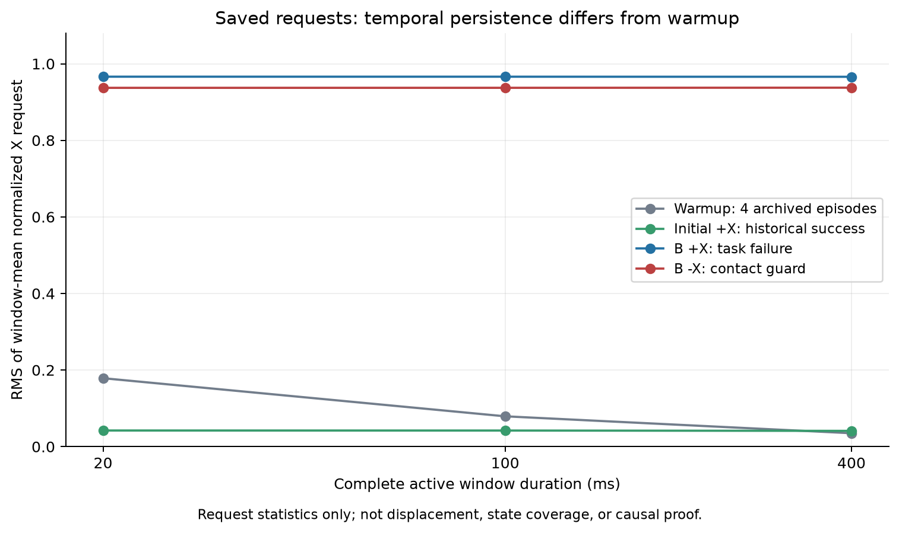

# D-sub9｜2026年10月滚动月报素材

<!-- migration-20261012 -->
**2026-10-12换机交接：** 正在备份到GitHub的 `backup/dsub9-handoff-20261012` 分支及 `handoff-20261012` 发布附件。完整恢复必须包含发布分包；恢复命令、最新状态和新机器环境限制见[迁移交接](../../../迁移交接_2026-10-12.md)。迁移不增加研究验收或计算授权；下方B.2当前事实保持，累计动态279、跟踪PAUSED。上传是否完成以发布附件中的 `remote_verification.json` 为准。
<!-- /migration-20261012 -->

<!-- b2-scope-current -->
**2026-10-11｜当前阶段B.2第3项；任务：冻结F0/F2000分层评价入口实现与离线核验，已完成。**

已实现独立数值门、冻结演员部署、42单元固定顺序与12+30动态准入门；33项关联标准库测试通过，一次新上下文审查及修复完成，绑定2805来源，旧529封存成员和200工具源保持。这里只验收入口实现与离线交付；真实张量读取、策略调用和新物理回合均0。

既有纯B2 25/25功能成功、附加精度15/25保持；F0/F2000旧四点评价各4份只读复用。开发比较共75单元=33复用+42待执行；32帧旧观测已登记，数值动作一致性尚未实测。前12个新评价全部保留并兼作非零动态预检，余30仅在审核通过后继续，普通任务失败按26s计分。

累计动态279，自动跟踪PAUSED，独立测试0；旧预算关闭，无新数值/物理/训练准入，完整B.2/C未验收。固定演员离散点审核不升级连续域或训练资格，旧3处接触覆盖缺口保留。

下一项（待开始）：单独取得32帧/64次调用、2张量读取、2演员及2原SACPolicy参照构造、600s数值门授权，验证旧动作/原路径/新部署完全一致；通过后再核对独立42回合物理授权。本次用户仅批准实现和离线检查，不执行这些计算。

强化学习保持论文主方法；B.2达到验收条件、准备进入C之前，主动提醒阶段性成果总结与汇总。

[本次入口与限制](../../learning_chain/b2_stratified_sac_evaluation_preparation_20261011/结果说明.md)；[最近真实基线](../../learning_chain/b2_stratified_zero_baseline_execution_20261011/结果说明.md)。以下历史资料保持各自时点。
<!-- /b2-scope-current -->

<!-- pc14-current -->
**PC-14（2026-10-08）：小边界合成数值门通过；物理backend与训练准入仍待。** PC-14合成数值门已验收：使用冻结CPU运行时，真实同种子零起点/空优化器与回放/三个RNG、完整检查点独立进程恢复和下一步参数/Adam/回放/终末边界/RNG/采样索引逐值一致通过；仅测量wall_s排除。166项只读收口检查通过，沿用PC-13的78项纯检查证据。实际总监督用时89.34s。

本轮合成更新4/4（父3/reader1）、显式测试状态前向32/32（各16），新合成回放400行，辅助模型构造4/4、CPU张量读取3/3。新物理/子步/正式更新/性能评价均0，累计动态208；完整B.2/C未验收。798旧封存成员、1057共享输入及36runtime文件保持。

下一项只做F12.5物理backend接入与准入材料的离线准备：连接固定物理profile、零更新部署/独立恢复和原保护审核，先形成可审阅候选。2次物理预检、拟21动态/2000正式批仍需独立的新授权与逐项准入；本次4/32合成数值额度已耗尽关闭，无结转或自动重试。自动跟踪PAUSED。

本次数字只计合成数值集成；资格[numeric_verified=true/training_admitted=false](../../../deliverables/paper_comparison/small_boundary_numeric_execution_20261008/numeric_qualification.json)。旧S/F0.39%继续门失败和PC-12两个停止上下文缺口保持。正常退出通过，额外故障/策略性能评价未进行。[结果说明](../../../deliverables/paper_comparison/small_boundary_numeric_execution_20261008/结果说明.md)、[原始复核](../../../deliverables/paper_comparison/small_boundary_numeric_execution_20261008/numeric_assessment.json)、[关闭账本](../../../deliverables/paper_comparison/small_boundary_numeric_execution_20261008/authorization_closure.json)。本阶段完成后暂停汇报，下方保留历史时点。
<!-- /pc14-current -->

<!-- pc13-current -->
**PC-13（2026-10-07）：C公平对照的数值门脚本已准备，真实数值门未授权/未执行。** PC-13数值集成门脚本准备完成：授权先查、父/reader共享排他账本、全新合成数据、CPU runtime绑定、零起点与完整检查点/独立进程恢复/下一更新逐值对照脚本已实现；78项关联纯检查通过，36个runtime文件哈希核验。一轮审查修复覆盖计算收据、关闭余额、进程超时、隔离库来源和辅助开销统计；真正4批/32状态门未执行，不能记数值通过或新资格。

本轮真实学习器构造/张量读取/网络前向/优化/经验发布/物理/子步均0，累计动态208、自动跟踪PAUSED，新数值/物理/训练授权无、旧预算关闭。765旧封存文件、1057共享输入保持。完整B.2/C仍未验收。

下一项申请并核验一次新的合成数值门授权：最多4更新事务（父3/reader1）、32显式测试状态（各16），新合成400行；物理/正式训练0。获明确授权后才用已绑定CPU解释器验证零起点、完整落盘和独立进程恢复。通过也不自动开启21动态/2000正式批；实际物理backend与新的物理/训练准入仍待。

旧S/F0.39%继续门失败保持；PC-12的9750/9752命令反算与2停止边界缺口不改。本轮没有新性能结论。[准备说明](../../../deliverables/paper_comparison/small_boundary_numeric_gate_20261007/结果说明.md)、[未授权数值候选](../../../deliverables/paper_comparison/small_boundary_numeric_gate_20261007/numeric_candidate.json)、[授权请求（未批准）](../../../deliverables/paper_comparison/small_boundary_numeric_gate_20261007/authorization_request.json)、[纯检查](../../../deliverables/paper_comparison/small_boundary_numeric_gate_20261007/offline_tests.json)。本阶段完成后暂停汇报，历史下一项保留当时口径。
<!-- /pc13-current -->

<!-- pc12-current -->
**PC-12（2026-10-07）：离线适配/协议候选完成；数值恢复、物理backend、训练准入未完成。** PC-12小边界离线适配与协议候选完成：四轴F12.5物理尺度、未缩放归一化a、完整检查点外层和固定21次一次性调度已实现；53项纯检查通过。9752个既有状态中9750个命令级反算通过（7362启用），另2个停止边界无法由旧记录重建完整命令上下文，保留缺口；不是完整轨迹等价或数值恢复验收。

新增物理/子步/学习器构造/真实检查点加载/网络前向/优化更新/经验发布均0，累计208，自动跟踪PAUSED、新训练准入无、旧预算关闭；730旧封存文件与1057共享输入保持。完整B.2/C仍未验收。

下一项先实现并审阅独立数值集成脚本与runtime连接，形成最多4合成事务/32测试状态的可审阅数值门，再另行取得明确计算授权后验证零起点、完整落盘与新进程恢复。当前不启动该计算。物理backend尚未连接；21动态/2000正式批及累计229仍只是未启用提案，不能由协议通过或旧余额自动开启。

旧S/F0.39%未过10%继续门保持；本轮不产生新策略性能结论。[候选说明](../../../deliverables/paper_comparison/small_boundary_execution_20261007/结果说明.md)、[未准入候选](../../../deliverables/paper_comparison/small_boundary_execution_20261007/qualification_candidate.json)、[纯检查](../../../deliverables/paper_comparison/small_boundary_execution_20261007/offline_tests.json)、[命令复算及缺口](../../../deliverables/paper_comparison/small_boundary_execution_20261007/command_equivalence.json)、[下一数值门](../../../deliverables/paper_comparison/small_boundary_execution_20261007/数值门清单.md)。本可交付阶段结束后暂停汇报，历史下一项保留当时口径。
<!-- /pc12-current -->

<!-- pc11-current -->
**PC-11收口（2026-10-07）：公平对照草案完成，实现/准入/执行未开始。** PC-11公平小边界登记草案完成：有条件只读继承25份B2/F0/S0/F2000/S2000评价，拟仅新增F12.5匹配训练，四轴物理尺度12.5μm/s与0.125mrad/s。拟21新动态/2000正式批（2预检＋19训练评价），数值门拟4合成更新/32测试状态单列；若以后获批，累计上限229。历史成本外推约2.10h、规划2–4h、拟整体硬限6h；不是新实测。

旧S/F用时改善0.39%未过10%门保持，补小边界对照不把旧S升级为通过。本项主要问题是小边界匹配训练的学习收益与减少对中干扰；S作参照，四轴幅度/权限差异不冒称单变量或完整因子消融。

本轮新物理/子步/检查点加载/网络推理/更新/经验发布0，实际累计208，自动跟踪PAUSED、新训练准入无、旧预算关闭。704旧封存文件及1057共享输入保持；草案完成不算新增训练能力，完整B.2/C仍待验收。

下一项只实现新F12.5薄适配与离线门，完成归一化动作/物理尺度一致、外层完整检查点、来源绑定和21次一次性驱动的可审阅候选。保持共享来源和共同key；继承门失败就停止本方案，不自动三组重训。数值/物理/训练计算须另有明确预算及准入，当前不启动。

[草案说明](../../../deliverables/paper_comparison/small_boundary_registration_20261007/结果说明.md)、[完整设计与路线](../../../docs/superpowers/specs/2026-10-07-small-boundary-fair-comparison-design.md)、[机器登记（非执行资格）](../../../deliverables/paper_comparison/small_boundary_registration_20261007/draft_contract.json)、[预算依据](../../../deliverables/paper_comparison/small_boundary_registration_20261007/budget_basis.json)。可交付阶段完成后暂停汇报；历史时点的旧下一项不作为当前授权。
<!-- /pc11-current -->

<!-- pc10-current -->
**PC-10收口（2026-10-07）：离线搜索路径证据交付已验收，完整B.2/C仍待。** PC-10离线搜索路径对照已完成：4份既有负Y档案/28,465周期，5段SEARCH/15,626周期。G两段最大净深度−6.140/−6.355μm，未超过旧峰值；参考到120μm圆后下一共同命令超界5.279/0.046nm，按原规则两次耗尽。S首段净深度100.021μm后退出并保持旧10.760s成功。启用命令、参考积分及边界公式核对无执行错误证据；不同演员/权限与前段历史未隔离，不能称唯一训练成因。停止F演员直接套G门控路线，保留匹配训练S及合理小固定边界公平对照方向。

本轮新增物理/子步/网络推理/梯度/经验发布均0，累计动态208；旧预算关闭、自动跟踪PAUSED、新训练准入无。生产1057输入及旧658封存文件保持。完整B.2/C、合理小边界重训、多种子和新的冻结最终测试仍待验收。

下一项仅准备S50与合理小固定边界的公平对照登记草案：共同零更新起点、匹配权限/尺度数据、相同登记预算和开发分布、实际成本分列；先审查新来源与保存恢复准入，再另行批准预算。F12.5现有结果只是部署缩放，不当作小边界匹配训练证据；不申请G加训、不扫描门槛或扩网络，四已消费位置不再称未见最终测试。当前不执行新训练。

[失败原因与路径图](../../../deliverables/paper_comparison/search_path_comparison_20261007/结果说明.md)、[一页路线决定](../../../deliverables/paper_comparison/search_path_comparison_20261007/路线决定.md)、[原始复算](../../../deliverables/paper_comparison/search_path_comparison_20261007/diagnosis.json)、[逐周期数据](../../../deliverables/paper_comparison/search_path_comparison_20261007/search_cycles.csv)。阶段完成后暂停汇报；下方保留各历史时点，旧“下一项”不作为当前执行授权。
<!-- /pc10-current -->

<!-- pc09-current -->
**PC-09收口（2026-10-07）：固定接触门控/较小边界部署预检完成；完整B.2/C仍待验收。** 新增8/8动态完成，累计208，7成功/1普通任务失败；8/8有效停稳，无硬保护或参考运行故障，未用0关闭，新优化/经验发布0。G50对中与B2完整轨迹相同、残差/网络调用0；负Y两次搜索耗尽，G功能1/2，B2/F50/F12.5各2/2。失败按26s罚时，平均用时分别12.555/7.288/7.992/15.165s；G较B2慢20.79%，本修复方案未达到整体任务预期。F12.5对中无接触、误差42.10μm，负Y误差100.80μm；附加80μm/0.5°为B2/F12.5/G各1/2、F50为0/2，功能与精度分列。45,660周期/456,600子步及45,660条奖励复算通过，真实网络调用/尝试21,658/21,658；4份B2/F50与旧同版本轨迹/动作/事件/结果一致。88相关检查、一次限定审查I1经作者反例关闭；生产1057输入和旧580封存文件保持，137维/4维不变。完整B.2/C及论文优势不据此验收。

**本方案结论：停止直接把现有F2000演员套上G50门控的部署路线。** G50对中完全保持B2、没有侧移/接触/网络调用，但负Y150μm两次搜索耗尽；G为1/2成功，B2/F50/F12.5各2/2。按26s失败罚时，G平均15.165s，比B2的12.555s慢20.79%；不能认定已解决任务，更不能进入正式论文优越性验收。这不是“全部残差SAC插入失败”。

F12.5可保留为合理小固定边界的候选参照：对中误差42.10μm、接触力0，负Y成功但误差100.80μm；该点比F50慢13.85%。它只是同一演员输出缩放的部署敏感性，不等于该尺度下公平重训。G的负YINSERT仅一次力阈值切换、198启用周期，SEARCH 7440启用周期；启用命令预测与执行一致，仅15周期参考缩减。数据不支持优先加迟滞或把失败归为“残差未执行”。两次搜索边界结束是既有正常恢复/预算判定，运行/保护没有故障。[具体事件与既有匹配训练S参考](../../../deliverables/paper_comparison/contact_gate_probe_20261007/failure_summary.json)只作归因，S旧同点成功10.760s，不算本轮新增样本。

**效率优先的下一项：只用现有F/G/匹配训练S负Y档案做一次离线搜索路径对照。** 按每段SEARCH对齐入口状态、真实XY运动、参考方向、四维请求和最终总命令，核对G为何沿参考边界耗尽、S的匹配训练为何能成功；区分可定位的实现错误与仅有支持的训练/权限不匹配假设。该读取任务新增物理、训练、网络推理0，不扫描门槛、不扩观测/网络/critic。随后出一页路线决定：有具体依据才为同权限起点的一次公平短训另行登记；无依据就停止G，收缩到已有匹配训练的阶段约束及合理小固定边界对照。当前不自动签发任何新训练。

本轮固定预算8/8收口、不重试，自动跟踪PAUSED。完整B.2姿态/联合范围、C完整机制、合理对照重训、多种子和新的冻结最终测试仍待；四个旧首次位置已消费，不能重新当未见测试。阶段完成后暂停汇报。

[结果与图](../../../deliverables/paper_comparison/contact_gate_probe_20261007/结果说明.md)、[原始复核](../../../deliverables/paper_comparison/contact_gate_probe_20261007/assessment.json)、[账本](../../../deliverables/paper_comparison/contact_gate_probe_20261007/run/ledger.json)。阶段完成暂停汇报；下方保留历史时点。
<!-- /pc09-current -->

<!-- pc08-current -->
**PC-08收口（2026-10-07）：残差实际作用归因已验收，候选仅为下一方案。** 离线37档案/245,221周期归因通过；已训练S八接触工况的峰值全部先于残差许可，14/14前缀与B2相同；对中F引入约100μm侧移和5.383mN接触。旧请求/即时差统计不是执行损失，总命令限幅已分列。新增动态/训练/策略调用/发布0，累计200；137维/4维及1057生产输入保持。

下一项实现并登记G50接触门控及F12.5较小固定边界的有界部署预检（拟8回合、训练0）；先通过权限/来源/保存与只读检查，才启动新预算。当前候选未实现、未准入、未执行。完整B.2/C及论文优势仍待；四首次位置已消费，旧预算关闭，自动跟踪PAUSED。 [结果与图](../../../deliverables/paper_comparison/residual_effect_diagnosis_20261007/结果说明.md)、[最小候选](../../../deliverables/paper_comparison/residual_effect_diagnosis_20261007/next_candidate.md)、[原始归因](../../../deliverables/paper_comparison/residual_effect_diagnosis_20261007/diagnosis.json)。阶段完成暂停汇报；下方记录保留历史时点。
<!-- /pc08-current -->

<!-- pc07-current -->
**PC-07收口（2026-10-07）：同版本公平对照与冻结后首次位置评价完成；完整B.2/C及论文优势不据此标已验收。** 新启动27/27，采样结束27，累计200/200；183,705控制周期/1,837,050物理子步，真实网络控制76,257次；新梯度/经验发布0，未用0关闭。

开发F相对B2：用时改善16.86%，综合继续信号未满足（峰值力均值增加5.57%超过5%）；开发S相对B2：用时改善17.18%，综合继续信号满足；开发S相对F：用时改善0.39%，综合继续信号未满足（用时改善不足10%）；F学习贡献对照：用时改善23.01%，综合继续信号未满足（峰值力均值增加5.57%超过5%）；S学习贡献对照：用时改善26.75%，综合继续信号满足；新位置F相对B2：用时增加1.61%，综合继续信号未满足（用时改善不足10%）；新位置S相对B2：用时增加1.38%，综合继续信号未满足（用时改善不足10%）；新位置S相对F：用时改善0.23%，综合继续信号未满足（用时改善不足10%）。

F0/S0是同种子随机初始化、0更新的确定性策略，动作并非全零；B2才是全零残差。10份训练后开发档案只读继承PC-06；新位置四象限各一点，仿真前固定，单训练种子小样本。63关联检查通过；独立审查1 Important经两种故障RED/GREEN关闭，未二次独立复审；生产1057输入保持。原始奖励/停稳/几何、计数、状态保持及来源按实际收口复核。

本轮未支持简单SEARCH-only约束相对合理对照的稳定优势。下一项先用现有档案做离线归因：核对分阶段动作、裁剪、残差实际运动和各工况时间贡献，再确定最多一次有依据的机制调整及较小固定边界对照；暂不追加训练、扩维或降低判据。 本轮四点已消费，后续调参不能复用它们作为未见最终测试；旧预算及自动跟踪保持关闭/PAUSED。 [结果与图](../../../deliverables/paper_comparison/frozen_comparison_20261007/结果说明.md)、[完整比较](../../../deliverables/paper_comparison/frozen_comparison_20261007/assessment.json)、[收口检查](../../../deliverables/paper_comparison/frozen_comparison_20261007/closure_verification.json)、[首次使用登记](../../../deliverables/paper_comparison/frozen_comparison_20261007/first_use_registration.json)。本阶段完成暂停汇报，旧PC-06及前序记录保留当时状态。
<!-- /pc07-current -->

<!-- v4-requalification-current -->
**PC-06收口（2026-10-07）：本轮修复及有限学习pilot已验收；完整B.2未验收。F/S各2000批，冻结开发点各5/5功能成功；独立进程代表复现2/2逐值一致，28/28有效停稳，参考故障/硬保护0。S相对F平均用时改善0.39%，未达到预登记的10%开发继续信号。**

新动态28/28，累计173；190,882控制周期/1,908,820物理子步；正式更新尝试/完成4000/4000；策略控制调用78,520，发布117,108条经验（F54,776/S62,332），未用预算0。两次普通搜索耗尽失败均发布，评价/恢复不入池。原关闭余量不重开，自动跟踪PAUSED。

441项关联离线检查通过；一次限定独立审查0 Critical/Important/Minor；28份原始档案的停稳、几何、奖励逐条复算通过；18次完整检查点读取门通过。1057项输入及源码ZIP逐项核验未变，PC-03/04/05与复杂度审查原封存保持。只重绑两个登记文件，137维/4维动作、网络、奖励、几何、保护和超参数保持；没有新增学习模块。

五点均为已用开发点、单训练种子，正式独立测试0；两次恢复复现不增加性能样本。旧B2控制指纹不同，未重新贴标签比较；本轮没有证明学习贡献、S优于B2、历史critic高估消除或完整C能力。下一项优先冻结当前控制器、137维学习器和超参数，预登记同一共同版本的B2配对评价、未用范围评价及必要的重复训练种子；据成功、用时和接触载荷判断是否值得扩展阶段约束。先补公平比较和学习贡献证据，不因本轮无运行故障就新增观测或算法层。本轮预算已全部消费并收口，下一物理/训练执行需新的登记，不能复用关闭余量。

[结果与图](../../../deliverables/paper_comparison/v4_learning_requalification_20261006/结果说明.md)、[原始复核](../../../deliverables/paper_comparison/v4_learning_requalification_20261006/assessment.json)、[收口检查](../../../deliverables/paper_comparison/v4_learning_requalification_20261006/closure_verification.json)、[冻结计划](../../../docs/superpowers/plans/2026-10-06-v4-learning-requalification.md)。本可交付阶段完成，按协作约定暂停汇报。
<!-- /v4-requalification-current -->

以下保留此前时点记录，其下一项以上述当前状态为准。

统计截至：2026-10-11（北京时间，B.2四点纯B2实际评价与三组对照）。实时状态见[项目进度跟踪](../../../项目进度跟踪.md)，此前材料保留历史口径。

## 一、本月综合摘要

2026-10-12补充：因电脑故障整理完整GitHub备份和换机交接，不增加训练或研究结果。研究仍停留于冻结F0/F2000分层评价准备完成，数值门/42新回合待执行。

最新截至2026-10-11：B.2第3项冻结F0/F2000分层入口离线完成，33项关联测试通过、一次新上下文审查完成。实际计算均0，累计279、PAUSED；入口资格与真实数值/动态资格分开。纯B2既有25/25功能与15/25附加精度保持；下一项是另准入32帧数值门。

**本次真实评价更新：** 本次新尝试21/21，复用旧4点；25点已审核25/25，功能成功25，普通任务失败0；保护0、无效0、未停稳0，另有档案/监督不完整尝试0；完整有效停稳矩阵=是。 本次环境构造尝试21、复位尝试21，已记录控制周期84567、物理子步845670；成本完整性=True，累计动态279。新策略调用/学习器/张量/更新/经验发布/独立测试均0；余额关闭，无重试或结转，自动跟踪PAUSED，完整B.2/C未验收。 下一项（待开始）：依据本次真实初始化与零残差证据，离线准备冻结F0/F2000在21新增开发点的同口径评价入口与有限42单元方案；先核对非零动作适用性和执行准入，不直接运行新策略评价或训练。

以下此前记录保留：

**本轮入口实现交付：** 独立21点纯B2评价入口已实现，46项新增标准库检查通过；实际初始化审计、一次性尝试、外部整包/单回合监督、完整档案及25点分层审核已接通。静态筛查不升级真实动态或非零SAC资格。 本轮新增物理回合/模型构造/策略调用/学习器/张量/训练更新/经验发布均0，累计动态258，自动跟踪PAUSED，独立测试0，完整B.2/C未验收；真实21次物理评价未执行，无新训练准入。 下一项（待开始）：取得并核对这一次21点纯B2有限物理授权，按已审阅入口检查真实复位并取得基线数据；旧4点只读复用。实际包收口后再准备冻结F0/F2000的21点分层开发评价，当前不追加同四点训练、不进入C。

以下此前离线范围及四点结果保留：

**本次离线准备（2026-10-11）：** 25点独立组合核对和针体入口筛查完成，21个新增组合静态筛查通过，最小入口余量下界44.1855μm；真实复位、完整碰撞、零残差动态及非零SAC范围资格仍待。 共同物理配置保持；旧四点范围指纹保留，25点另登记范围指纹。旧3处逐profile无接触缺口保留，同点A/B聚合依据不能自动扩到新点。 本项新增物理回合/模型构造/策略调用/学习器/张量/训练更新/经验发布均0，累计动态258，自动跟踪PAUSED，独立测试0，完整B.2/C未验收，无新物理或训练准入。

下一项（待开始）：实现并离线核验独立21点零残差纯B2评价入口。在每个实际回合内检查初始化并取得基线数据，旧4点只读复用；入口交付后另有新有限物理授权和逐项准入才执行。随后准备冻结F0/F2000的分层开发评价，不追加原四点短训，不启动C。

以下四点实际结果及历史材料保留：

四点纯B2配对评价及三组开发对照完成：纯B2/F0/F2000功能均4/4，平均耗时8.9020/8.9060/8.6595秒；F2000相对纯B2快2.72%，只有J02变快。附加80μm/0.5°精度为4/4、4/4、0/4；当前不支持整体性能提升或本四点传统B2功能失败的主张。

纯B2终末最小几何余量约50.896～68.866μm，F2000约−0.000013797～0.012344μm，接近原裁判边界；微小负值仍在1nm原容差内，功能标签不追改。扰动鲁棒性尚未验证，不能由余量直接宣称实机失败。

本次新增4/4动力学仿真回合、21324控制周期、213240物理子步，监督墙钟778.92秒；策略调用/学习器/张量/训练更新/经验池发布均0。累计动态258，余额0关闭，无重试或结转，自动跟踪PAUSED，独立测试0，完整B.2/C未验收，当前无新训练或物理准入。 课题主方法继续应用强化学习；纯B2为共同对照，普通SAC的负结果保留。B.2达到验收条件、准备进入C之前，主动提醒阶段性成果总结和汇总。 [四点实际结果](../../learning_chain/b2_pure_baseline_execution_20261011/结果说明.md)。

以下准备和此前材料保留当时口径，旧下一项已由本次实际结果接续。

四点纯B2配对入口准备完成；旧F0/F2000档案8/8通过只读复用核对，27项标准库测试通过，独立审查发现的两项重要问题和一项次要问题已修复并获定向确认。实际四点评价尚未执行。 入口绑定共同物理/控制/裁判和数值环境；零残差只取消学习修正，传统B2自身控制继续运行。[四点纯B2入口准备](../../learning_chain/b2_pure_baseline_preparation_20261011/结果说明.md)。

本次新增物理回合、物理模型加载、策略推理、张量读取、训练更新与经验发布均0；累计动态254，自动跟踪PAUSED，独立测试0，完整B.2/C未验收，当前无新科学执行准入。 主方法必须应用强化学习，当前先完成B.2并用开发结果定位不足。B.2达到验收条件、准备进入C之前，主动提醒用户进行阶段性成果总结和汇总；当前不启动C实现。

以下保留同日设计及此前综合材料，旧下一项已替代。

强化学习主线要求已落实，B.2分层工况与普通SAC评价方案已完成：25个开发工况（对中1、仅位置4、仅姿态4、联合16），其中4个已有联合点、21个新组合待适用性与执行资格。当前先补现有四点纯B2配对数据，不实现C机制。

2026-10-11用户要求：先完成B.2并用开发数据定位不足；候选主方法必须应用强化学习。B.2达到验收条件、准备进入C之前，必须提醒用户进行阶段性成果总结和汇总；当前不启动C实现。

开发结果先形成，再定位具体不足；接触歧义/响应预测只是待检验候选。评价规则和数据用途提前固定，不利用最终测试挑指标。本次为方案与标准库资料整理，新增物理/模型加载/推理/训练0；累计动态254，自动跟踪PAUSED，独立测试0，完整B.2/C未验收，当前无新科学执行准入。

以下保留2026-10-10原规划复评时点，方法与次序建议以本次用户要求为准：

原规划v1.2评估与连接器补充调研已完成研究建议：对象仍为D-sub9，恢复位置—姿态联合误差的重点；优先检验多点接触时纠偏方向依据不明确导致的受阻/错误修正。首选候选为“接触响应预测引导的XY/roll/pitch协同纠偏”，阶段/进展门控建议降为对照或辅助，尚未实施路线变更。

联合误差、多针、力历史、主动试探、平移转动原语和阶段门控均已有先例；任务对象不同不自动构成创新。需先证明本地同信息强传统方法存在有意义的不足，以及动作—响应序列确实有助决策；若局部有限差分/线性响应控制已解决，就不包装学习必要性。

主看可靠完成与联合误差范围，卡滞/恢复和含失败的耗时解释效果；精度作功能相关质量，载荷按模型可信度限定。尚未证明本地基线受到接触歧义影响，也未实施新方法。[评估结论](../../project_audit/connector_problem_method_review_20261010/原规划评估与研究建议.md)。

SCOPE20的2000批、F0/F2000功能各4/4、耗时改善2.77%未过原10%条件及SCOPE21附加精度4/4→0/4保持；F0不是纯B2。旧负Y零倾角长搜索只作开发线索，当前四个联合点不证明强基线缺陷或连续域。

本轮为原规划评估、文献/源码读取和研究建议；新增物理/模型加载/推理/训练0。累计动态254、自动跟踪PAUSED、独立测试0、完整B.2/C未验收；当前无新科学执行准入，旧预算关闭，历史结果与运行合同保持。

以下保留SCOPE21交付时点，其旧下一项已被本次计划替代：

B2-SCOPE-21四点耗时与精度离线归因已完成：读取8份既有F0/F2000档案、42171周期，未新增模型／张量／推理／物理／更新／经验。

J01增加3.096秒，其中SEARCH增加3.084秒；J02省下4.068秒，主要免去UNLOAD和SEARCH；四点平均改善2.77%未达10%。原80μm/0.5°附加精度为F0 4/4、F2000 0/4，未通过项均为XY，功能成功仍各4/4。

J01实际搜索XY路径71.95→200.06μm、退出更晚；J01/J03/J04搜索后INSERT再漂离中心。全部启用命令预测／执行一致，权限及42171条冻结奖励复算通过；未见丢动作或搜索审核误截断。既有功能判据和奖励未纳入附加终末XY精度，这是已确认目标缺项，不是唯一学习成因。

仍在B.2第3项“普通SAC训练与真实任务评价”。初始137维观测8档案相同，不能期待复位时首步按绝对象限区分；接触后仍有信息，不据此立即扩观测。入口状态不同，路径对照不等于演员物理反事实；critic、熵或数据顺序的唯一成因未确认。四点已用开发资料／单种子，原3处覆盖缺口及事后修订保持，完整B.2/C未验收，独立测试0。

SCOPE20的2000更新、最终功能4/4及独立恢复一致仍有效；旧失败和3685个历史封存成员保持。累计动态254、自动跟踪PAUSED、当前无新科学执行准入；本轮不修改运行时奖励、物理、观测或成功标签，不重开旧预算。

下一项（待开始）：离线准备普通SAC共同精度目标与奖励一致性候选。保留137维／4维、物理和共同保护、既有功能判据；明确80μm/0.5°开发精度用途、单一终末精度奖励候选及其与10%耗时条件的并列关系，登记同版本公平对照与一次有限预算。实质目标改变先提交可审阅方案；候选未实现，不直接加训或扩展C机制。

以下保留前轮时点：

B2-SCOPE-20四点普通SAC续训、匹配评价与独立恢复物理复现已完成并关闭。新增9/9回合全部成功、仿真有效且真实停稳，无硬保护或参考故障；正式更新尝试／完成2000／2000批。

F0与F2000同四点均4/4成功；平均惩罚任务耗时8.9060→8.6595秒，改善2.77%，未达到预登记的10%开发继续条件。J02改善48.39%，J01变慢39.29%，J03改善0.30%，J04变慢0.14%。结果支持运行链完成和有限开发点功能保持，尚不支持预期整体效率收益。

实际可训练预热链保存与独立恢复门通过后才开始在线采集；四个在线回合分别发布后完成500批更新，actor／critic／temperature／target各2000。最终完整运行状态独立恢复摘要一致，J01轨迹、动作、转移、事件、结果、停稳记录和峰值逐值一致。未额外执行恢复后的下一次梯度更新等价试验。

复用原F0评价4与预热4（19300行），不重跑旧8回合；新在线发布21671行。实际48878控制周期／488780物理子步／36751策略调用，整体监督2478.02秒（41.30分钟）；构造8／张量读取3／保存2／档案重建28（旧预热20＋新在线8）。累计动态254，一次授权已消费关闭，不重试、不结转；自动跟踪PAUSED，当前无新训练准入。

当前仍在B.2第3项“普通SAC训练与真实任务评价”。仅四个固定±75μm／±0.25°已使用开发点、一个训练种子；完整B.2/C未验收，独立测试0。原3处逐profile接触覆盖缺口及事后开发覆盖修订保持，不能由本轮成功推断连续姿态／联合范围或任意策略安全，也不能直接归因本轮效率未达标于这些缺口。

下一项（待开始）：只读取现有F0/F2000同点档案，按阶段分解任务时间、搜索路径、接触载荷、四维请求与实际命令、动作权限及奖励，优先解释J01退化与J02改善为何方向相反。提交可定位的原因证据和是否值得修改的路线决定；不加载模型或评分critic，新增物理／推理／更新0，不改10%判据、不补跑旧预算。完成离线证据后再决定是否形成新的有限候选。

以下保留前轮时点：

B2-SCOPE-19预热状态接入续训链及四点匹配评价候选已完成离线实现和独立审查，19项标准库检查通过；实际训练链恢复与续训尚未执行。

新增适配入口从SCOPE18已验证封套恢复普通SAC训练链；只把外层状态的binding换成独立的新授权，4份旧预热档案和收据字节保持。旧预热须逐份hash匹配，新的online来源须使用新授权。安装模型／优化器／温度、回放、终末边界和三个随机流，同时补齐预热审核随机流、累计抽样数与held动作；先核对完整安装状态，再保存并交给独立进程核对包含运行字段的完整状态，通过后才创建首个物理环境。

本轮科学库导入／模型构造／张量读取／预测／优化／物理／新经验均0，累计动态245、自动跟踪PAUSED。SCOPE18旧预热组件恢复数值通过仍有效；SCOPE13原F0评价4与预热4成功、文件访问失败，以及SCOPE16导入失败均保持。新候选未签发grant、未消耗claim，不重开任何旧授权或未用次数。

仍在B.2第3项“普通SAC训练与真实任务评价”。当前四点路线正式更新0、训练后评价未执行；原3处逐profile接触覆盖缺口和事后开发覆盖修订保留。范围仅四个固定±75μm／±0.25°开发点，完整B.2/C未验收，独立测试0。标准库检查与代码接入不等于真实训练链恢复通过、下一批更新等价或策略有效。

下一项：申请一次绑定本候选的新运行，新增9个动态回合（在线4＋F2000匹配评价4＋独立恢复物理复现1），每个在线回合完整审核发布后最多500批、共2000正式更新批。模型构造8、张量读取3、保存2、检查点档案重建28（旧预热20＋新在线8）；整体6小时、单物理20分钟、单reader30分钟。先过可训练预热链完整保存与独立恢复门，失败立即关闭、不重试、不结转。复用已绑定F0四点评价及4份预热，不重跑旧8回合；本次申请尚未批准，累计动态254仅为拟上限。

以下保留前轮时点：

B2-SCOPE-18按批准完成一次旧预热状态恢复数值验证并成功关闭，整体监督用时97.37秒，其中独立读取进程46.67秒。旧零检查点核对、预热重建、新检查点保存与独立组件恢复均通过。

父进程与独立读取进程分别从同一零起点和4份旧档案重建，完整状态摘要一致：19300行经验、14127行动作启用、388次四维均匀动作抽样（1552个标量）。独立进程已将模型、优化器、温度与随机状态写回运行对象，并核对独立重建的回放和终末边界；两次确定性预测均未改变模型或策略随机状态。本结果验证的是已登记封套内的组件状态；尚未创建可训练V4Chain或执行恢复后的下一次优化。

本次模型构造2、张量读取2、保存1、确定性预测2、旧档案重建8（父4＋独立进程4）；新增物理／正式更新／新经验均0，累计动态245，自动跟踪PAUSED。本次授权已耗尽关闭；SCOPE13原8回合、文件访问失败及SCOPE16导入失败证据保持，旧未用次数不结转。

当前仍在B.2第3项“普通SAC训练与真实任务评价”。四个固定±75μm／±0.25°开发点与原3处逐profile覆盖缺口保持，事后开发覆盖修订不撤销。当前四点路线的正式训练更新仍为0，训练后评价未做；完整B.2/C未验收，独立测试0。恢复数值通过不能证明物理续训、训练收益或论文优势。

下一项：离线接入并审查从第四份预热完整发布边界继续的训练入口，明确新封套到可训练V4Chain的转换、回放／终末边界／模型／优化器／温度／随机流及_audited_warm_rng等运行字段的恢复，形成一次有限续训及同四点训练后匹配评价的具体候选。复用已验证旧预热数据和初始评价，不重跑前8回合。先完成可审阅代码、恢复前后及下一步一致性的验证方案，再依据新候选确定计算次数、时限与准入；当前没有新训练授权。

以下保留前轮时点：

B2-SCOPE-17恢复入口导入规则已完成离线修复。相关标准库测试70项通过，独立审查已收口；本候选实际运行时导入和数值恢复尚未执行。

运行入口只为已绑定的纯NumPy工具tools.dynamics.safety增加精确名称例外；相邻模块、MuJoCo与物理环境仍被拒绝。由真实入口追踪24个仓库模块、182条立即导入记录及7条延迟导入记录，旧规则在该图中仅误拒绝safety，新规则通过源码级兼容性检查。数值重建内核、计数和失败关闭逻辑逐字保持。第三方包未执行或递归分析，延迟导入不视为已运行；该检查不等于实际恢复通过。

本轮科学库导入／物理／学习器／张量读取／网络前向／优化／经验发布均0，累计动态245；自动跟踪PAUSED。SCOPE16导入失败及关闭记录完整保留，本轮未重试。SCOPE13原F0评价4＋预热4成功、正式更新0及原文件访问失败保持；两次旧授权的未用次数均关闭，不重开、不重跑前8回合。

当前仍在B.2第3项“普通SAC训练与真实任务评价”。范围为四个固定±75μm／±0.25°开发点，原3处逐profile覆盖缺口及事后开发覆盖修订保留；完整B.2/C未验收，独立测试0。接口和离线检查通过不等于数值恢复通过，也不等于SAC有效。

下一项：申请一次独立的CPU状态重建验证，限学习器构造2、张量读取2、完整保存1、确定性预测2、旧档案回放重建8（父进程4＋独立进程4）；新增物理／优化更新／采集经验均0。整体最多30分钟，独立读取进程最多15分钟，失败关闭且不重试。通过后再准备从预热边界继续的训练及匹配评价方案；当前没有新的训练准入。

以下保留前轮时点：

B2-SCOPE-16按明确批准执行一次恢复数值门，实际监督用时10.03秒，在导入阶段失败并关闭。数值恢复未通过，原4份预热经验尚未完成本轮张量重建。

根因已由原始异常栈、源码依赖链与标准库复现确认：NoPhysics按tools.dynamics整个目录拦截，误拒绝action.py依赖的纯NumPy工具tools.dynamics.safety。此前61项离线测试通过，但漏查真实学习依赖链与拦截规则的兼容性；不能再把该测试结果当成可运行证明。这是本次首先观察到的直接阻塞，修正它仍不能推定后续恢复链可用。

科学运行时导入已开始；学习器构造、检查点读取、预测、保存、旧档案回放重建、新物理及优化更新实际均0。parent入口已进入，reader未启动；无新检查点。拥有的进程树与启动器退出已确认，账本CLOSED、授权CLOSED_ERROR收口，未用次数全部关闭、不结转、不重试。累计动态245，自动跟踪PAUSED。

当前仍在B.2第3项“普通SAC训练与真实任务评价”；SCOPE13原F0评价4＋预热4成功、正式更新0及失败记录保留。仅四个固定±75μm／±0.25°开发点，原3处逐profile覆盖缺口与事后开发覆盖修订仍在；完整B.2/C未验收，独立测试0。当前没有数值或训练执行准入。

下一项优先离线修正导入边界：逐个核对并允许确实只做数值处理的必要依赖，继续拒绝MuJoCo、物理环境和仿真执行模块；补上真实传递依赖链的兼容性反例。修复应另存新候选、保留旧封存，完成相关检查后再提出新的数值执行申请；本次关闭的授权不重开。

以下保留前轮时点：

B2-SCOPE-15预热状态重建与独立恢复数值门已完成离线接入。相关标准库测试61项通过，独立审查已收口；实际数值恢复尚未执行。

候选将核对原零检查点的全部网络、优化器、温度、计数和策略随机状态，按原顺序重建4份预热档案的19300行回放与终末边界，逐周期重放388次四维预热抽样。新检查点独立读取、重新构建、完整状态比较及运行对象恢复读回均已接入，尚无真实张量验证结果。

本轮新增物理／学习器／张量读取／网络前向／优化／经验发布均0，累计动态245；自动跟踪PAUSED。SCOPE13已完成F0评价4＋预热4成功、正式更新0的结果及原文件访问失败保持；旧17回合授权的未用部分关闭，不重开、不自动重跑前8回合。

当前仍在B.2第3项“普通SAC训练与真实任务评价”。范围为四个固定±75μm／±0.25°开发点，原3处逐profile覆盖缺口及事后开发覆盖修订保留；完整B.2/C未验收，独立测试0。接口和离线检查通过不等于数值恢复通过，也不等于SAC有效。

下一项：申请一次独立的CPU状态重建验证，限学习器构造2、张量读取2、完整保存1、确定性预测2、旧档案回放重建8（父进程4＋独立进程4）；新增物理／优化更新／采集经验均0。整体最多30分钟，独立读取进程最多15分钟，失败关闭且不重试。通过后再准备从预热边界继续的训练及匹配评价方案；当前没有新的训练准入。

以下保留前轮时点：

B2-SCOPE-14文件读写修复候选与恢复来源核对已完成：Windows瞬态访问拒绝在读、替换两端作最多0.5秒的有限重试，并受整体／最近有效阶段绝对截止约束。完整相关离线测试39项通过，含真实Windows文件锁、并发读写、受控子进程退出与原联合合同回归。

只读核对原4份预热档案：19300行，其中14127行允许残差动作，388次四维抽样（1552个标量），顺序、动作保持、资格／配置／策略hash及原物理内容一致。重建所需来源齐全；尚未构造回放张量、加载检查点或验证NumPy／Torch随机状态，因此完整数值恢复与无损续跑均未通过。

本轮新增物理／学习器／张量读取／网络前向／优化／经验发布均0，累计动态245；自动跟踪PAUSED，新执行准入无，旧17回合申请未用部分仍关闭。SCOPE13实际F0评价4＋预热4成功、正式更新0的结果不变。

当前仍在B.2第3项“普通SAC训练与真实任务评价”；原3处逐profile覆盖缺口和事后开发覆盖修订保留。范围仅四个固定±75μm／±0.25°开发点；完整B.2/C未验收，独立测试0。文件修复通过不代表SAC有效或任意未来文件操作不会失败。

下一项：离线接入“零起点＋4份既有预热档案”的状态重建与独立保存／恢复数值门，明确新来源绑定、所需数值操作及验收条件，形成可审阅候选后再提出具体执行申请。优先复用已完成物理档案；不直接加载旧零检查点跳进在线回合，不重开旧运行或自动重复前8回合。

[修复结果](../../learning_chain/b2_joint_io_repair_20261009/结果说明.md)、[恢复来源](../../learning_chain/b2_joint_io_repair_20261009/recovery_assessment.json)、[状态重建路线](../../learning_chain/b2_joint_io_repair_20261009/状态重建路线.md)。

以下保留前轮时点：

B2-SCOPE-13四点普通F50 SAC有限试跑因监督器文件访问异常中断，已完成本次尝试的证据收口：状态CLOSED_ERROR，实际物理回合8/17（F0评价4＋预热4，全部功能成功、有效停稳、无硬保护触发），完整原始档案8份，正式更新完成0/2000批，新回放发布4次。首个在线回合仅登记、未启动，不能计入物理尝试。

zero完整独立恢复通过。 监督器读取phase_deadline.json时发生PermissionError；同一读写函数的文件并发试验已复现访问冲突。这是运行实现缺陷，训练前后比较未形成，不能给学习改善或策略失效结论，也不能归因于原3处覆盖缺口。

累计动态245，本轮监督用时1736.053秒（28.93分钟），全部余额关闭，当前无继续训练准入，自动跟踪PAUSED；拥有的运行进程树退出已确认。预留上界与实际档案成本分别报告，不将未用上界当已执行计算。

当前阶段B.2第3项；完整B.2/C未验收，独立测试0，范围仍仅四个固定±75μm／±0.25°开发点。原3处逐profile覆盖缺口及SCOPE11事后修订保持，不把开发结果当独立验证。

下一项：仅离线准备新版本文件并发读写修复及硬时限回归，核对零起点＋4份预热档案能否精确重建继续所需的回放和随机状态，再形成具体的新执行方案。当前只有零更新检查点，没有预热后的完整检查点；不得直接宣称可无损续跑。本轮剩余9回合及2000批已关闭，不重试、不结转、不转借旧授权。

[试跑结果](../../learning_chain/b2_joint_sac_execution_20261009/结果说明.md)、[失败原因与修复路线](../../learning_chain/b2_joint_sac_execution_20261009/失败原因与修复路线.md)、[逐回合与成本](../../learning_chain/b2_joint_sac_execution_20261009/execution_summary.json)、[授权关闭](../../learning_chain/b2_joint_sac_execution_20261009/execution/authorization_closure.json)。

以下保留前轮时点：

B2-SCOPE-12四点普通F50 SAC离线接入与具体登记完成：联合位姿贯通采集、审核和检查点，原SAC数值内核保持；15项纯检查通过，4份旧零残差档案共同条件核对通过，独立审查3项问题已修复。

3处原逐profile缺口保持；按同一J点合并A/B支持有限开发准备，但不能保证训练效果。覆盖专项补验0。范围仅四个固定±75μm／±0.25°点；原完整范围、实际短训、真实恢复和独立评价仍待，完整B.2/C未验收。

本轮新物理／学习器／张量读取／推理／更新／经验发布均0，累计动态237；训练未准入，自动跟踪PAUSED，旧授权全部关闭。

下一项：申请一次新的17动态回合、最多2000正式更新批及7次构造／2次张量读取／2次保存的新运行，整体硬限6小时；先过零起点完整检查点真实独立恢复门，再固定完成F0评价4、预热4、在线4、F2000评价4、独立物理复现1。失败停止、不重试、不结转，累计动态最多254；不进入C。

主指标保持共同26秒正常失败罚时；F2000相对匹配F0均值改善≥10%且最终四点成功、无硬保护、有效停稳及恢复一致，才给开发继续信号。无效仿真、保护失败与全部峰值单列；不是独立效果验收。

[接入与登记说明](../../learning_chain/b2_joint_sac_preparation_20261009/结果说明.md)、[具体新申请（未批准）](../../learning_chain/b2_joint_sac_preparation_20261009/authorization_request.json)、[候选](../../learning_chain/b2_joint_sac_preparation_20261009/candidate.json)、[原始档案核对](../../learning_chain/b2_joint_sac_preparation_20261009/baseline_equivalence.json)。

以下保留前轮时点：

B2-SCOPE-11离线覆盖条件复核完成：8份动作档案重算与原审核一致。按同一J点合并A/B后，快速接触有效命令周期分别25／28／32／30，长保持1428／1767／2341／2510；下一次观测均有非零六维力／力矩信号。四点均有四轴正负方向，原4项工程恢复和24项峰值重叠证据保留。

建议把两种时序的覆盖要求按每个J点合并A/B检查，保留周期末接触定义与所有保护条件。覆盖专项新增回合建议0，下一项转普通SAC小规模训练的接入与具体登记。该建议来自开发档案复核，不是独立验证；SCOPE10按原逐profile判据的3处缺口及失败路线保持。

本轮新增物理／子步／学习器／推理／更新／经验发布均0，累计动态237；训练未准入，自动跟踪PAUSED，旧授权全部关闭。

当前阶段B.2第2项已交付本次复核；训练接入与执行尚未完成，完整B.2/C未验收。范围仅四个离散±75μm／±0.25°开发点，不扩展原±1.5°或连续域。观察到信号和命令作用不等于策略收益或任意动作安全。

下一项：准备四个离散J点上的普通F50残差SAC小规模训练与共同参照：接入既有学习／检查点代码，冻结数据用途、训练与评价顺序、具体次数／更新／墙钟上限和停止规则，完成离线接线检查后交付一次具体执行申请。覆盖专项补验建议0；运行来源或接口改变时重新判断受影响检查。

[复核与路线](../../learning_chain/b2_joint_coverage_review_20261009/结果说明.md)、[建议条件v2](../../learning_chain/b2_joint_coverage_review_20261009/recommended_gate_v2.json)、[逐周期统计](../../learning_chain/b2_joint_coverage_review_20261009/coverage_comparison.json)、[训练准备边界](../../learning_chain/b2_joint_coverage_review_20261009/pilot_preparation_scope.json)。

以下保留前轮时点：

B2-SCOPE-10固定12项联合点预检已执行并关闭：本轮尝试12/12，审核通过12，功能成功12、真实停稳12，未执行0项数量关闭。工程恢复覆盖4/4；A/B时序覆盖缺口3处（J03_A_AXIS、J04_A_AXIS、J02_B_CORNERS），缺口的逐周期接触／权限／有效作用分类已归档。3处快速块按原登记判据均缺少“周期末有接触且动作有效”的记录；其中J03_A_AXIS有3个、J04_A_AXIS有2个快速周期记录到周期内接触峰值，J02_B_CORNERS未记录到此类峰值。因此不能把这3处统称为“完全没有接触”，也不能据此推断改时序后的结果。本轮未达到全部登记覆盖要求，不能把有限成功升级为完整准入。

本轮实际累计动态237（原225＋本轮12）；归档54260控制周期／542600物理子步。学习器、张量读取、前向、优化和经验发布全0；训练未准入，自动跟踪PAUSED，全部本轮及旧预算关闭，无重试。

完整B.2/C未验收；四个±75μm／±0.25°联合开发点不等于原±1.5°范围，固定代表动作不是连续动作域安全证明。R为工程触发恢复，不计自然成功率；A/B不计策略学习收益。独立评价0，共同模型／保护／观测／奖励保持。

下一项：仅用现有档案离线设计覆盖缺口的最小处理方案：比较按动作获准时刻安排固定序列与明确收窄时序声明，给出是否需要新补验及其最小范围。已通过项保留，本轮数量已关闭；不重跑整套矩阵、不自动补采或训练。

[结果说明](../../learning_chain/b2_joint_preflight_execution_20261009/结果说明.md)、[路线决定](../../learning_chain/b2_joint_preflight_execution_20261009/路线决定.md)、[原始账本](../../learning_chain/b2_joint_preflight_execution_20261009/run/ledger.json)、[授权关闭](../../learning_chain/b2_joint_preflight_execution_20261009/authorization_closure.json)。

以下保留前轮时点：

截至本轮B2-SCOPE-09：B2-SCOPE-09联合点预检候选实现及离线验收完成：固定A/B日程、一次工程恢复夹具、覆盖审核、新授权与一次性预算门已接入；21项离线测试通过。既有J01_script的4834周期／4835观测只读回归与封存结果一致。 本轮新增环境创建、reset、物理积分、学习器、张量读取、网络前向、优化和经验发布全0；实际累计动态225。自动跟踪PAUSED，旧预算关闭。固定12项新物理预检仍未授权、未执行，237只是以后全部执行的累计上限。

下一步是明确新授权后的定向物理预检；当前尚未执行。以下保留前轮证据：

截至本轮B2-SCOPE-08：B2-SCOPE-08准入方案设计完成：8份J档案确认SEARCH保留旧INSERT受阻历史，返回INSERT前全部清空，活动INSERT时长最大0.402s；本项饱和现象不要求改137维观测。已核对同版本零倾角自然恢复254.143μm及297个屏蔽周期，继承流程依据，不冒称联合姿态恢复通过。 本轮新增物理、学习器/张量读取、网络前向、更新及经验发布全0。实际累计动态225，自动跟踪PAUSED，旧预算关闭。拟最多12次新动态（8动作＋4工程恢复）、训练0，若以后另获授权并全部执行累计上限237；当前未实施、未授权，不把237记为实际累计。

下一步先实现准入候选，不直接训练。以下保留此前阶段证据：

截至2026-10-09：B2-SCOPE-07离线复核8份J01～J04档案、42656周期及42664个137维观测，已完成。零残差接触信息有差异，8/8首次接触和力峰时均有残差权限；script只在每点50个SEARCH接触周期产生非零作用，未覆盖峰值当周期的非零动作。保留四个联合点作为待准入的匹配学习候选。 本轮新增物理、网络推理、训练更新和经验发布全0。实际累计动态225，自动跟踪PAUSED，旧预算关闭，无新物理或训练授权。SCOPE-06的9静态/16动态及原覆盖不足路线保持。

当前先推进联合点的准入缺项；此前SCOPE-06实测成功保留，不能据此开始训练。以下为此前阶段事实，历史下一项以本页当前状态为准。

B2-SCOPE-06一次执行已收口：静态审核9/9；动态尝试16/16、审核通过16/16、功能成功16/16、80μm/0.5°附加精度成功16/16。运行状态CLOSED_COMPLETE；本轮未用动态0，新授权已关闭。 本轮环境创建/复位完成各25次，67016控制周期/670160物理子步，整轮监督4516.837s；进程退出确认，学习器/张量读取/网络前向/优化/经验发布全0。实际累计动态225，自动跟踪PAUSED，原旧15回合未重开。 本轮接触覆盖8/16、script四轴命令作用覆盖8/8、接触时作用覆盖4/8、对称接触信息差异覆盖4/8，恢复事件覆盖0/16。±0.25°离散开发点不覆盖±0.5°边界、原±1.5°目标或连续域；固定0.1幅度且四轴相关的脚本不覆盖完整F50动作域，脚本不是SAC，非零差异不等于可辨识性或学习收益。完整B.2/C未验收，无新训练准入，独立测试0。 下一项只离线复核J01～J04的现有接触信息、动作许可与作用时序，判断4个有接触联合点是否支持限定姿态匹配学习候选，并列出恢复及动作域缺口。P01～P04保留为无接触功能对照；不追加它们填接触覆盖，不扩137维观测或物理范围，不进入C或训练。原±1.5°目标与当前±0.25°开发验证的验收边界须另行明确。 以下保留此前阶段摘要：

B2-SCOPE-01范围审计与最小预检方案完成，属于离线证据整理与规划，未新增物理或学习能力。PC-06/07/09的63份当前版本原始新回合均为初始零倾角；当前每轴初始输入限为±0.5°，旧pilot入口还把roll/pitch写死为0。原±1.5°目标不能直接套用，完整B.2仍待验收。

下一项优先实现B.2小倾角范围预检的离线运行器与准入检查，显式贯通实际初始角，保留当前v4模型/控制/保护。候选为每轴±0.25°的8个开发点，拟9次无积分初始化、最多16个零残差/脚本配对动态；先完成纯检查和审查，再申请具体新物理预算。运行器未实现，候选未授权，当前不执行。C的F12.5物理接入暂缓，既有PC-11～14成果保留。

本轮物理引擎加载、初始化、动态/子步、神经网络推理、张量读取、优化和经验发布均0；实际累计动态208，自动跟踪PAUSED，旧预算关闭。拟16动态若以后全部获准执行，累计上限224，现在不计入实绩。完整B.2/C未验收；±0.25°预检不能覆盖±0.5°边界或原±1.5°目标。

以下为各前轮交付的历史摘要：

PC-14合成数值门已验收：使用冻结CPU运行时，真实同种子零起点/空优化器与回放/三个RNG、完整检查点独立进程恢复和下一步参数/Adam/回放/终末边界/RNG/采样索引逐值一致通过；仅测量wall_s排除。166项只读收口检查通过，沿用PC-13的78项纯检查证据。实际总监督用时89.34s。 本轮合成更新4/4（父3/reader1）、显式测试状态前向32/32（各16），新合成回放400行，辅助模型构造4/4、CPU张量读取3/3。新物理/子步/正式更新/性能评价均0，累计动态208；完整B.2/C未验收。798旧封存成员、1057共享输入及36runtime文件保持。

PC-12小边界离线适配与协议候选完成：四轴F12.5物理尺度、未缩放归一化a、完整检查点外层和固定21次一次性调度已实现；53项纯检查通过。9752个既有状态中9750个命令级反算通过（7362启用），另2个停止边界无法由旧记录重建完整命令上下文，保留缺口；不是完整轨迹等价或数值恢复验收。 新增物理/子步/学习器构造/真实检查点加载/网络前向/优化更新/经验发布均0，累计208，自动跟踪PAUSED、新训练准入无、旧预算关闭；730旧封存文件与1057共享输入保持。完整B.2/C仍未验收。

<!-- pc11-monthly-0 -->
PC-11公平小边界登记草案完成：有条件只读继承25份B2/F0/S0/F2000/S2000评价，拟仅新增F12.5匹配训练，四轴物理尺度12.5μm/s与0.125mrad/s。拟21新动态/2000正式批（2预检＋19训练评价），数值门拟4合成更新/32测试状态单列；若以后获批，累计上限229。历史成本外推约2.10h、规划2–4h、拟整体硬限6h；不是新实测。 本轮新物理/子步/检查点加载/网络推理/更新/经验发布0，实际累计208，自动跟踪PAUSED、新训练准入无、旧预算关闭。704旧封存文件及1057共享输入保持；草案完成不算新增训练能力，完整B.2/C仍待验收。

<!-- pc10-0 -->
PC-10离线搜索路径对照已完成：4份既有负Y档案/28,465周期，5段SEARCH/15,626周期。G两段最大净深度−6.140/−6.355μm，未超过旧峰值；参考到120μm圆后下一共同命令超界5.279/0.046nm，按原规则两次耗尽。S首段净深度100.021μm后退出并保持旧10.760s成功。启用命令、参考积分及边界公式核对无执行错误证据；不同演员/权限与前段历史未隔离，不能称唯一训练成因。停止F演员直接套G门控路线，保留匹配训练S及合理小固定边界公平对照方向。 本轮新增物理/子步/网络推理/梯度/经验发布均0，累计动态208；旧预算关闭、自动跟踪PAUSED、新训练准入无。生产1057输入及旧658封存文件保持。完整B.2/C、合理小边界重训、多种子和新的冻结最终测试仍待验收。

PC-09：新增8/8动态完成，累计208，7成功/1普通任务失败；8/8有效停稳，无硬保护或参考运行故障，未用0关闭，新优化/经验发布0。G50对中与B2完整轨迹相同、残差/网络调用0；负Y两次搜索耗尽，G功能1/2，B2/F50/F12.5各2/2。失败按26s罚时，平均用时分别12.555/7.288/7.992/15.165s；G较B2慢20.79%，本修复方案未达到整体任务预期。F12.5对中无接触、误差42.10μm，负Y误差100.80μm；附加80μm/0.5°为B2/F12.5/G各1/2、F50为0/2，功能与精度分列。45,660周期/456,600子步及45,660条奖励复算通过，真实网络调用/尝试21,658/21,658；4份B2/F50与旧同版本轨迹/动作/事件/结果一致。88相关检查、一次限定审查I1经作者反例关闭；生产1057输入和旧580封存文件保持，137维/4维不变。完整B.2/C及论文优势不据此验收。

PC-08：离线37档案/245,221周期归因通过；已训练S八接触工况的峰值全部先于残差许可，14/14前缀与B2相同；对中F引入约100μm侧移和5.383mN接触。旧请求/即时差统计不是执行损失，总命令限幅已分列。新增动态/训练/策略调用/发布0，累计200；137维/4维及1057生产输入保持。

截至2026-10-07，PC-07同版本公平对照与冻结后首次位置评价完成。新启动27/27，采样结束27，累计200/200；183,705控制周期/1,837,050物理子步，真实网络控制76,257次；新梯度/经验发布0，未用0关闭。

开发F相对B2：用时改善16.86%，综合继续信号未满足（峰值力均值增加5.57%超过5%）；开发S相对B2：用时改善17.18%，综合继续信号满足；开发S相对F：用时改善0.39%，综合继续信号未满足（用时改善不足10%）；F学习贡献对照：用时改善23.01%，综合继续信号未满足（峰值力均值增加5.57%超过5%）；S学习贡献对照：用时改善26.75%，综合继续信号满足；新位置F相对B2：用时增加1.61%，综合继续信号未满足（用时改善不足10%）；新位置S相对B2：用时增加1.38%，综合继续信号未满足（用时改善不足10%）；新位置S相对F：用时改善0.23%，综合继续信号未满足（用时改善不足10%）。 以下保留以前时点摘要。

截至2026-10-07，本轮修复及有限学习pilot已验收；完整B.2未验收。F/S各2000批，冻结开发点各5/5功能成功；独立进程代表复现2/2逐值一致，28/28有效停稳，参考故障/硬保护0。S相对F平均用时改善0.39%，未达到预登记的10%开发继续信号。

新动态28/28，累计173；190,882控制周期/1,908,820物理子步；正式更新尝试/完成4000/4000；策略控制调用78,520，发布117,108条经验（F54,776/S62,332），未用预算0。两次普通搜索耗尽失败均发布，评价/恢复不入池。原关闭余量不重开，自动跟踪PAUSED。 [本轮结论](../../paper_comparison/v4_learning_requalification_20261006/结果说明.md)。下面保留此前时点摘要，历史“下一项”不作为当前任务。

<!-- search-boundary-fix-current -->
**共同搜索边界局部修复有限验收通过（2026-10-06 20:47），B.2仍未完成。** 新增3/3动态、完成3，累计145；26,395控制周期/263,950物理子步。B2零残差成功、F固定随机请求成功、S固定随机请求两次搜索耗尽后普通任务失败；3/3有效停稳、无参考故障/硬保护。正式更新、网络策略调用、回放发布和独立测试0；新未用0，旧26动态/4000批保持关闭，自动跟踪PAUSED。

共同控制器在参考圆内但下一搜索命令不可行时，任意相位沿用已有停止/回撤；当前已越界先报故障，第二次搜索正常耗尽，恢复次数未增加。S在8.754s结束第一段、9.382s真实恢复；原8.756s中断未重现，最终仍未插入，终末奖励−2。没有放宽120μm参考圆、80μm附加精度、几何或力保护；137维/4维动作与学习设置保持。

311项关联离线检查通过；一次独立审查1 Important经作者RED/修复/回归关闭，未二次独立复审。五点旧B2 16,563个SEARCH命令重算未变；新B2完整11,271点、F完整5,886点与各自旧轨迹逐值一致。两个生产文件总行数178→175，已移除第二层残差缩减，未新增学习模块。

下一项：按新共同控制指纹重新登记现有137维学习链准入及有限预算，复用现有审核/保存/恢复，完成真实训练和冻结评价。原PC-04源绑定不能沿用，本项开发数据未获学习授权；不重开已关闭执行、不加新维数或算法技巧。 [实际结果](../../../deliverables/paper_comparison/search_boundary_fix_20261006/结果说明.md)、[原始复核](../../../deliverables/paper_comparison/search_boundary_fix_20261006/assessment.json)、[账本](../../../deliverables/paper_comparison/search_boundary_fix_20261006/run/ledger.json)。
<!-- /search-boundary-fix-current -->

以下为此前时点记录，其下一项以本次修复状态为准。

<!-- project-complexity-audit-current -->
**客观代码/机制审查完成（2026-10-06，未实施新修复）。** 观测120→137是追加17个控制器/参考状态，动作仍4维；三份档案22,508条观测中，新增参考组6维可由旧字段重构，尚无新增字段收益证明。新旧SAC文件有200行完全相同，活动实现需要收缩。

最新v4仅完成2个随机预热，正式更新/策略调用0；累计动态仍142，B.2未完成、自动跟踪PAUSED。本轮新增动力学/优化/网络调用0，未修改生产代码。历史120维真实训练后的失败保留，不能用本次故障解释全部历史。

停止反例中，即使允许整个速度/加速度可达矩形，下一参考最小半径仍超120μm约4.21nm。优先修共同搜索边界的提前结束/既有恢复，并区分合格任务失败与运行故障；不再先扩展观测或学习器。虚拟120μm参考圆与80μm附加定位精度、200μm实际位移保护不同。有限零残差参考重算只支持筛查软边界缓冲，不证明动态修复。

当前残差SAC还包含边界重采样和尾段目标修正，不能称未经修改的标准SAC；零残差则只执行B2。暂时冻结137维与学习设置，控制稳定后再统一精简输入/复用实现。原26动态/4000批余量保持关闭，后续动态须新登记。 [完整审查](../../../deliverables/project_audit/complexity_20261006/客观审查与修复优先级.md)、[字段/代码核对](../../../deliverables/project_audit/complexity_20261006/audit_metrics.json)、[参考可达性](../../../deliverables/project_audit/complexity_20261006/reference_counterfactual.json)。
<!-- /project-complexity-audit-current -->

以下为前序时点记录，其下一项以本次审查及进度文件为准。

<!-- v4-learning-pilot-current -->
**137维学习链准入通过，有限pilot按实际结果收口（2026-10-06T17:41）。** 新增2/28动态，完成2，累计142/168；正式更新尝试0，完成0/4000（F0/S0）；余26动态与未尝试批量关闭，不结转。发布5885条经验。

420项相关离线检查与独立数值完整恢复通过。状态error，整轮已停止；11263控制周期/112630物理子步，实际策略调用0。开发继续信号：无法判断，矩阵不完整。实际问题：ValueError('Common reference failure')。 F负Y预热成功，S负Y预热SEARCH_REFERENCE_LIMIT；两者有效/停稳/无硬保护，S拒绝入池。尚未正式学习，不是已训练策略失效。

学习链实现/数值恢复通过不等于随机动作安全、学习收益或论文方法优于基线。五点是已使用开发点；独立测试0、多种子/硬件未做，B.2尚未验收。代表复现不增加性能样本。

下一项：本轮停止点已定位：零残差搜索基线已不可继续，过滤归零仍发出该基线。先补共同SEARCH边界可行性回退，再用此反例离线验证并登记新的少量动态；不重启本轮、不补26动态/4000批。 [证据与使用](../../../deliverables/paper_comparison/v4_learning_pilot_20261006/结果说明.md)、[审查/修复](../../../deliverables/paper_comparison/v4_learning_pilot_20261006/review.md)、[账本](../../../deliverables/paper_comparison/v4_learning_pilot_20261006/run/ledger.json)。

本轮最终封存以[V2清单](../../../deliverables/paper_comparison/v4_learning_pilot_20261006/delivery_manifest_v2.json)为准，[修订原因](../../../deliverables/paper_comparison/v4_learning_pilot_20261006/封存修订说明.md)；原候选保留。
<!-- /v4-learning-pilot-current -->

以下保留前序时点记录，其下一项以上述最新状态为准。

<!-- v4-continuation-current -->
**残差边界连续性修复及单回合实测通过（2026-10-06T16:08）。** 310项相关检查通过；新增1/1动态、完成1回合，11245控制周期/112450物理子步；累计140，余0关闭。正式训练/策略推理/回放发布/独立测试0，自动跟踪PAUSED，B.2未完成。

脉冲前4574个轨迹点逐值一致；第一层滤波比例0.963296598、连续性比例0.125000、合成比例0.120412075。实际触发滤波1周期，下一零动作B2没有参考失败；审核7359个实际SEARCH参考端点，越界0。本例FULL_SUCCESS，任务判定20.730s，峰值力24.474mN。

只证明已登记负Y单脉冲的有限连续性修复；不保证任意未来动作、lead裁剪、所有物理子步或整个策略空间安全。137维学习掩码/回放/SAC/完整检查点仍需新版本准入，未沿用旧120维权重或旧训练数据；本轮不是学习收益。 下一项：补齐137维学习链准入：阶段与经验掩码、整回合发布及无效隔离、共同奖励、完整模型/优化器/回放/RNG保存恢复，绑定新会话及源/模型/runtime。通过后另签发F/S相同新零网络起点的最多28回合/4000批pilot，累计提案上限168；当前尚无训练准入。随后冻结方法和检查点，登记未用范围的独立评价及重复复现，才审查B.2验收。 [结果](../../../deliverables/paper_comparison/v4_continuation_20261006/结果说明.md)、[独立核对](../../../deliverables/paper_comparison/v4_continuation_20261006/assessment.json)、[审查](../../../deliverables/paper_comparison/v4_continuation_20261006/review.md)。
<!-- /v4-continuation-current -->

### 以下为此前时点摘要；其“下一项”以本页最新状态为准

**2026-10-03目标澄清（实验统计仍截至12:43）：** 用户明确以论文研究闭环优先，允许调整几何、精度及方法。当前主孔实为1.15 mm、针径1.00 mm，名义单边间隙75 μm；推荐先评估新任务候选1.20 mm主孔/80 μm XY，并共同重评基线。只改阈值会同时帮助纯B2与候选，不能证明方法收益。详见[当前计划](../../../研究推进计划_当前版.md)；本次动态/推理/优化0，未实施新几何，B.2未通过、自动跟踪PAUSED。

<!-- stage-resume-current -->
**阶段权限配对恢复验证已收口（2026-10-03 12:43，北京时间）：保护触发后受控停止，完整配对效果尚不能判断。** [计划书](../../../docs/superpowers/plans/2026-10-03-stage-permission-resume.md)；[结果与图](../../../deliverables/learning_chain/b2_stage_permission_resume_20261003/result_analysis/结果说明.md)、[机器审核](../../../deliverables/learning_chain/b2_stage_permission_resume_20261003/result_analysis/assessment.json)。

比较纯B2、固定XY50残差F与仅SEARCH开放的同幅度S。纯B2：成功3/4个已完成点（计划4）；F冻结末次策略：未执行冻结开发点评价（计划4）；S冻结末次策略：未执行冻结开发点评价（计划4）。

新启动7/18动态、审核完成7个新回合，另引用12个历史回合，累计109/120；正式更新尝试3500、完成3500/5000批（F2000/S1500）。19/19个已完成回合有效且停稳；代表恢复未执行，不声称恢复通过。未执行11动态、未尝试1500批余量关闭，不结转。 已记录物理子步394980；成本记录完整。

继承4个B2和8个匹配预热，重新准入后从相同零更新网络起点出发，不沿用旧150映射回放或C2000权重。成功/保护/奖励不变；本轮相关离线协议与执行审查通过不等于实际效果通过。限定单训练种子和四个开发点；正式独立测试0、多种子证据未完成，B.2及完整C能力未验收。代表复现不增加性能样本。 自动跟踪PAUSED。

下一项：归档诊断已完成，保持整轮停止。下一方案优先解决搜索末段精度退化及F停止截断S评价的问题；先明确同批次比较、分支停止口径和新有限预算，再审核是否继续，不直接补跑关闭余量。

**实际停止点与诊断：** F2000负Y恢复推进后触发力保护（0.025000337 N），终末XY155.70 μm；F/S正Y均约74 μm未成功。两组独立零状态读取均通过（67.357/65.772秒）。[归档诊断与结论](../../../deliverables/learning_chain/b2_stage_permission_resume_20261003/result_analysis/诊断与结论.md)记录时序、动作统计、未完成项和下一步边界；没有新增critic评分、物理复跑或训练。
<!-- /stage-resume-current -->

### 本月前轮进展（历史口径，保留各自时点）

<!-- stage-permission-history -->
前轮归档状态（历史）：
**阶段权限配对可行性验证已收口（2026-10-03 10:46，北京时间）：运行故障阻止完成配对效果判断。** [计划书](../../../docs/superpowers/plans/2026-10-02-stage-residual-feasibility.md)；[结果与图](../../../deliverables/learning_chain/b2_stage_permission_20261002/result_analysis/结果说明.md)、[机器审核](../../../deliverables/learning_chain/b2_stage_permission_20261002/result_analysis/assessment.json)。

比较纯B2、固定XY50残差F与仅SEARCH开放的同幅度S。纯B2：成功3/4个已完成点（计划4）；F冻结末次策略：未执行冻结开发点评价（计划4）；S冻结末次策略：未执行冻结开发点评价（计划4）。

新启动12/30动态、审核完成12回合，累计102/120；正式更新尝试0、完成0/5000批（F0/S0）。12/12个已完成回合有效且停稳；代表恢复未执行，不声称恢复通过。未执行18动态、未尝试5000批余量关闭，不结转。 已记录物理子步733800；成本记录未完整，已记录量不是完整总量，未知调用不记为0。

新数据分别匹配权限，从相同零更新网络起点出发，不沿用旧150映射回放或C2000权重。成功/保护/奖励不变；92项相关离线协议和核心审查通过不等于实际效果通过。限定单训练种子和四个开发点；正式独立测试0、多种子证据未完成，B.2及完整C能力未验收。代表复现不增加性能样本。 自动跟踪PAUSED。

下一项：已定位固定60秒读取超时；先把新读取监督器接入下一执行版本，明确继承8份已审核F/S预热数据并完成两组零状态读取门，再在新登记范围中完成训练、评价与代表复现，避免重采12个已完成回合。本轮失败账本和关闭余量保留，自动训练不恢复。

读取诊断与修复：F零更新检查点完整状态离线比对通过（总65.863秒，恢复审核61.559秒），报告入口已修复；新的读取监督器5项针对性检查通过，尚未接入正式训练。原读取回执缺失与诊断末尾日志错误均保留，不补写历史成功。[诊断与最小修复](../../../deliverables/learning_chain/b2_stage_permission_20261002/failure_diagnosis.md)。
<!-- /stage-permission-history -->

### 本月前轮进展（历史口径，保留各自时点）

**冻结C2000夜间筛查收口（2026-10-02 21:29）：** 冻结部署筛查完成；存在可复现评价，允许下一阶段实现准备。新增10/10动态，累计90/90，训练0；余量关闭，自动跟踪PAUSED，B.2未完成。[结果与图](../../learning_chain/b2_frozen_c2000_closeout_20261001/result_analysis/结果说明.md)。

本次仅固定C2000确定性部署；原幅度0/4已测点成功。缩幅0/4已测点成功。代表复现以实际完整轨迹核验为准；当前独立评价、真正小边界训练对照未完成。

**效果判断：** 本轮没有解决策略失效：原幅度和已测缩幅均未达到四点成功目标。执行/复现通过不等于方法有效。

**100ms预热重启验证已收口（2026-10-01）：** 本方法尚未解决已观察到的学习后失效问题。C_online_y_neg_100在2000批策略下触发['FORCE_LIMIT']，周期峰值0.025161399 N；原轨迹有效性/真实停稳分别审核。 新增8/24动态、2000/5000正式批（C2000/A0），累计动态80/96、本方法累计2500批含旧故障500批。未执行余16动态/3000批关闭不结转；保存接口实际门与完整检查点按实测审计，独立测试未用，PAUSED，B.2未完成。[结果与图](../../learning_chain/b2_temporal_learning_restart_20261001/result_analysis/结果说明.md)、[机器审核](../../learning_chain/b2_temporal_learning_restart_20261001/result_analysis/assessment.json)。

保存故障已经由真实存取门和四个学习后检查点落盘/离线完整恢复核验；本次停止是实际力保护，非程序保存故障。8/8完整回合均有效停稳，起点4/4成功；在线0/4（3普通失败、1力保护）。保护回合未发布新经验，未获额外更新信用；最新C2000包含前7份审核学习档案和37,270条经验，触发原轨迹单独保留。 本轮在2000批随机在线负Y回合的力保护处结束，不是2500批确定性四点评价失败。C2500、固定最终四点、独立恢复动态及A对照均未执行；不能据此断言任意100ms方案无效、A一定更好、唯一原因已确定或critic高估已消除。

**上一学习验证（历史保存故障，2026-10-01）：** 运行故障阻止完成修复判定。共同零更新起点4/4成功；C完成500批、A0批，但我新增的保存代码接口使用错误，C500未落盘且无法恢复，学后评价0。保存修复已完成7项离线检查（模型/优化/物理0），不等于策略修复。新增4/24动态，累计72/92；余20动态/4500批关闭，旧余不使用，自动跟踪PAUSED，B.2未完成。[结果与图](../../learning_chain/b2_temporal_learning_validation_20261001/result_analysis/结果说明.md)、[保存修复](../../learning_chain/b2_temporal_checkpoint_write_fix_20261001/README.md)。

**上一配对预检（历史，2026-10-01）：** 完成8回合，实际8/8新动态、完成8回合、成功7（A对照4/4、C候选3/4），训练/网络前向/经验入池均0。采集机制预检通过，但不授予训练或证明策略修复。[实际结果与图](../../learning_chain/b2_temporal_warmup_execution_20261001/result_analysis/结果说明.md)、[独立离线核验](../../learning_chain/b2_temporal_warmup_execution_20261001/result_analysis/assessment.json)。8/8完成回合有效且停稳；累计动态68/68，本轮未执行0次和旧余2/7/19、2000批不结转。103协议通过、入口3处审查问题已修复，历史字节保持，自动跟踪PAUSED，B.2未完成。

**上一准备阶段（历史，2026-10-01）：** [100ms时间相关预热方案](../../learning_chain/b2_temporal_warmup_design_20261001/修复方案.md)已明确。8份归档显示：旧预热100ms窗口X平均请求均方根0.0792，B两失败约0.966/0.937；正负X初始120维观测相同，不能使用孔中心真值纠偏。[归档证据及图](../../learning_chain/b2_temporal_warmup_design_20261001/archive_analysis.json)、[最终18项协议](../../learning_chain/b2_temporal_warmup_design_20261001/final_green_protocol.json)通过；保持内核、权限清零、完整计数校验已准备，尚未接通物理入口。拟新2ms/100ms预热配对预检最多8动态/0训练，参数和停止规则明确，但未签发执行资格；本阶段物理/网络前向/优化0，累计动态仍60，旧余2/7/19与2000批不使用，PAUSED，B.2未完成。

**冻结B500独立评价已收口（2026-10-01）：** 本轮保护后受控停止，实际2/4新动态、训练0，0/2个已执行点成功；其余2点未执行。未保持历史初始四点全成功，单独降低actor学习率未通过本轮修复目标。正X峰值力降至0.00876439 N，但终末XY误差75.1 μm高于50 μm；冻结B从+100 μm越过中心，最终X=-72.4 μm/Y=20.0 μm，出现持续同向修正后的过冲。[逐点结果与两图](../../learning_chain/b2_actor_lr_b_eval_20261001/result_analysis/结果说明.md)、[独立审核](../../learning_chain/b2_actor_lr_b_eval_20261001/result_analysis/assessment.json)。2/2有效停稳，评价学习状态不变、经验入池0；累计动态60/62，余本轮2与旧7及19/2000不追加，自动跟踪PAUSED，B.2未完成。

前置只读核对已完成：B500检查点、1011绑定输入、22运行与12结果交付文件、4149历史封存摘要一致。随后独立评价获批并完成上述两点，保护后停止。[当时的范围核对记录](../../learning_chain/b2_actor_lr_b_eval_scope_20261001/evidence_recheck.json)保留其历史待确认状态。

**actor率有限对照已受控停止（2026-10-01）：** [真实数值验证](../../learning_chain/b2_actor_lr_execution_20260930/run/real_validation.json)4事务/8测试状态通过，[A500精确复现](../../learning_chain/b2_actor_lr_execution_20260930/run/a_reproduction.json)通过、B500冻结，768固定状态诊断完成。A第一个正X100μm评价力峰值0.025000445 N触发保护，6287周期有效且停稳；按预登记规则停止整组，B动态未执行，完整A/B效果未知。[分布图与结果](../../learning_chain/b2_actor_lr_execution_20260930/run_analysis/停止结果说明.md)：B旋转贴边降低，但X贴边均值57.35%高于A36.77%，相对初始KL8.052高于A7.060，不能称降率必然更稳。实际1000正式批/1新动态，累计58，余新7次和旧19/2000不执行、自动跟踪PAUSED；实现/复现通过，修复效果未证实，B.2未完成。

## 二、关键数字与证据

迁移时研究计数保持：累计279，新训练/物理/推理0，独立测试0；文件数量和备份字节数另见发布清单，不能计为研究能力。

| 最新离线入口 | 数量与状态 |
|---|---|
| 关联纯测试/来源 | 33通过 / 2805绑定 |
| 历史封存 / 共同工具 | 529成员 / 200工具保持 |
| 参照观测 | 32帧已登记，真实一致性未测 |
| 开发比较 | 75单元=33复用+42待执行；前12兼作预检 |
| 本次实绩 | 新物理/张量/策略/更新0；累计279 |

**本次真实评价更新：** | 场景 | 已审核/登记 | 功能成功 | 普通失败 | 附加精度80μm/0.5° | 含失败均值（秒） | 成功P50/P90（秒） | 平均SEARCH（秒） |
|---|---:|---:|---:|---:|---:|---:|---:|
| 对中 | 1/1 | 1 | 0 | 1 | 4.3300 | 4.3300/4.3300 | 0.0000 |
| 仅位置 | 4/4 | 4 | 0 | 0 | 4.3300 | 4.3300/4.3300 | 0.0000 |
| 仅姿态 | 4/4 | 4 | 0 | 4 | 4.3300 | 4.3300/4.3300 | 0.0000 |
| 联合 | 16/16 | 16 | 0 | 10 | 8.0508 | 8.6290/10.2860 | 2.7650 |

本次环境构造尝试21、复位尝试21，已记录控制周期84567、物理子步845670；成本完整性=True，累计动态279。新策略调用/学习器/张量/更新/经验发布/独立测试均0；余额关闭，无重试或结转，自动跟踪PAUSED，完整B.2/C未验收。

以下此前记录保留：

| 本轮入口项 | 结果 |
|---|---|
| 新标准库检查 | 46项通过 |
| 绑定输入 | 2379份，含数值文件和新封装 |
| 旧准备套件 | 26/27；1项旧目录时点假设失败，保留 |
| 拟新物理/实际物理 | 21 / 0 |
| 实际推理/更新/经验 | 0 / 0 / 0 |
| 当前累计/自动跟踪 | 258 / PAUSED |

以下此前数字保留：

| 本次离线准备项 | 结果 |
|---|---|
| 矩阵与新增数 | 25点：1对中/4位置/4姿态/16联合；旧4映射、新21 |
| 针体入口筛查 | 25/25；新21均通过，真实复位/全碰撞/动态仍待 |
| 初始入口径向余量下界 | 最小44.1855μm，与终末MAIN余量分列 |
| 初始最高Z上界 / 距MAIN间隔下界 | 33.3777 / 216.6223μm |
| 未来纯B2提案 | 新21次/304500周期/3045000子步/6小时；DRAFT |
| 本项物理/策略/训练/经验 | 全0；累计258、PAUSED、独立测试0 |

[离线原始计算](../../learning_chain/b2_stratified_scope_preparation_20261011/geometry_screen.json)。以下实际四点数据及旧准备数字保留：

| 方法 | 功能成功 | 附加精度 | 平均耗时（秒） | 平均终末XY（μm） |
|---|---|---|---:|---:|
| 纯B2 | 4/4 | 4/4 | 8.9020 | 36.60 |
| F0 | 4/4 | 4/4 | 8.9060 | 35.60 |
| F2000 | 4/4 | 0/4 | 8.6595 | 95.76 |

新4回合、旧8档案只读复用；四点同任务/位姿/共同版本。F2000相对纯B2耗时改善2.7241%，旧相对F0 2.77%及10%条件未通过保持。控制21324周期/213240子步，监督778.92秒，新增学习调用全部0，累计258。

[四点实际结果](../../learning_chain/b2_pure_baseline_execution_20261011/结果说明.md)；完整分位数、阶段/残差、载荷与几何余量见报告和JSON。以下为准备及此前数字。

| 本次入口准备项 | 核验结果 |
|---|---|
| 旧评价只读复用 | 8/8；F0/F2000各4，同任务/实际初始位姿/演员指纹，历史资格标签保留 |
| 封装验证 | 27项标准库测试通过；2重要、1次要审查问题修复并获定向确认 |
| 绑定输入 | 2254份；含共同源码、旧档案、基础解释器与NumPy/MuJoCo数值文件 |
| 新物理、推理、更新、经验 | 全0；当前无execution目录 |
| 未来单包提案 | 新4纯B2、每回合14500周期/145000子步；DRAFT，实际结果待 |
| 当前阶段与累计 | B.2第3项；累计254，PAUSED，独立测试0，完整B.2/C未验收 |

[四点纯B2入口准备](../../learning_chain/b2_pure_baseline_preparation_20261011/结果说明.md)；源码检查没有导入科学库，测试数量不计物理回合。以下为同日设计及此前数字。

| 本次设计与资料项 | 实际状态 |
|---|---|
| 开发矩阵 | 25点：对中1、仅位置4、仅姿态4、联合16 |
| 范围 | 4已有联合点，21新组合待适用证据；非整个连续域 |
| 首批对照提案 | 拟新4纯B2、旧F0/F2000各4只读复用；复用/准入待核查 |
| 现有训练结果 | 2000批、功能各4/4、耗时改善2.77%未过10%、附加精度4/4→0/4 |
| 新实验结果 | 0；4待补数据留空，累计254，PAUSED，独立测试0 |
| 阶段交接 | 主方法须RL；B.2验收后进入C前提醒成果汇总，当前未触发 |

[方案与指标](../../learning_chain/b2_stratified_evaluation_design_20261011/B2分层工况与普通SAC评价方案.md)。以下为原规划复评及此前证据：

| 本次复评项 | 事实与边界 |
|---|---|
| 原规划 | 2026-09-11 v1.2，文字/表格完整读取；本来包含位置姿态联合误差，原Word不修改 |
| 实物D-sub参考 | 文献25次/方法，位置噪声±1mm后P控制11/25、图像残差SAC16/25；非本项目强基线，未核联合倾角 |
| 联合多针参考 | Cao2024六维四针，TableII无预测接触优化44/50、预测+优化50/50；不证明所有传统法不足 |
| 仍有机制问题 | 同文完整流程5/160超60s，最终均成功；作者解释接触信息缺失/歧义导致多次尝试 |
| 候选机制 | 动作条件接触响应预测→小幅XY/roll/pitch协同纠偏；非已证明创新，局部线性响应是必要强对照 |
| 项目保持 | 新物理/模型加载/推理/训练0；累计254、PAUSED、独立测试0，完整B.2/C未验收 |

[原文与分母限制](../../project_audit/connector_problem_method_review_20261010/pose_baseline_literature.md)、[直接D-sub/感知边界](../../project_audit/connector_problem_method_review_20261010/补充来源与检索记录.md)。

以下为既有SCOPE21数字和证据：

| 本轮核对项 | 实际值 |
|---|---|
| 既有档案／周期 | 8／42171 |
| 新物理／模型／张量／前向／优化／经验 | 全0 |
| 累计动态／跟踪 | 254／PAUSED |
| 功能成功F0/F2000 | 各4/4 |
| 附加80μm/0.5°F0/F2000 | 4/4／0/4（XY未通过） |
| 训练后耗时改善 | 2.77%，未达10% |

| 点 | F0→F2000任务时间（秒） | INSERT差值 | UNLOAD差值 | SEARCH差值 | 总差值 |
|---|---:|---:|---:|---:|---:|
| J01 | 7.880→10.976 | +0.012 | +0.000 | +3.084 | +3.096 |
| J02 | 8.406→4.338 | -0.472 | -0.782 | -2.814 | -4.068 |
| J03 | 9.294→9.266 | -0.008 | +0.000 | -0.020 | -0.028 |
| J04 | 10.044→10.058 | -0.006 | -0.002 | +0.022 | +0.014 |

| 点 | F0终末XY（μm） | F2000终末XY（μm） | F2000终末角（°） | 80μm/0.5°附加精度 |
|---|---:|---:|---:|---|
| J01 | 49.18 | 100.49 | 0.119 | F0通过／F2000未通过 |
| J02 | 25.31 | 84.23 | 0.391 | F0通过／F2000未通过 |
| J03 | 28.43 | 98.09 | 0.109 | F0通过／F2000未通过 |
| J04 | 39.49 | 100.21 | 0.162 | F0通过／F2000未通过 |

[本次离线归因](../../learning_chain/b2_joint_efficiency_diagnosis_20261010/结果说明.md)、[路线决定](../../learning_chain/b2_joint_efficiency_diagnosis_20261010/路线决定.md)、[原始诊断](../../learning_chain/b2_joint_efficiency_diagnosis_20261010/diagnosis.json)。

以下保留前轮时点：

| 项目 | 本轮实际结果 |
|---|---|
| 新物理回合 | 在线4＋最终匹配评价4＋独立恢复J01复现1；9/9成功有效停稳 |
| 正式更新 | 2000尝试／2000完成；四个优化组件各2000，无更新错误 |
| 新发布经验 | 21671行；旧预热19300行另列，评价／复现不入池 |
| 实际控制／子步／策略调用 | 48878／488780／36751 |
| 构造／张量读取／保存／档案重建 | 8／3／2／28（旧预热20＋新在线8） |
| 整体监督耗时 | 2478.02秒；最终reader373.86秒，含物理复现 |
| 累计动态／自动跟踪 | 254／PAUSED；一次授权关闭，无新训练准入 |
| 开发继续／完整B.2／C／独立测试 | 未满足／未验收／未验收／0 |

| 开发点 | F0任务耗时（秒） | F2000任务耗时（秒） | 耗时改善 |
|---|---:|---:|---:|
| J01 | 7.880 | 10.976 | -39.29% |
| J02 | 8.406 | 4.338 | +48.39% |
| J03 | 9.294 | 9.266 | +0.30% |
| J04 | 10.044 | 10.058 | -0.14% |
| 四点均值 | 8.9060 | 8.6595 | +2.77%（未达10%） |

[本次结果](../../learning_chain/b2_joint_sac_continuation_execution_20261009/结果说明.md)、[原始指标](../../learning_chain/b2_joint_sac_continuation_execution_20261009/assessment.json)、[独立审查](../../learning_chain/b2_joint_sac_continuation_execution_20261009/review.md)。

以下保留前轮时点：

| 项目 | 本次状态 |
|---|---|
| 离线检查 | 19项通过；独立审查无未解决Critical／Important |
| 原始数据继承 | F0四点评价＋4份预热19300行／14127行动作启用／388次四维抽样 |
| 本轮新增模型／张量／更新／物理 | 0／0／0／0 |
| 累计动态 | 245 |
| 下一运行申请 | 9动态／2000批，未批准；预计累计最多254 |
| 完整B.2／C／独立测试 | 未验收／未验收／0 |

[本次候选结果](../../learning_chain/b2_joint_sac_continuation_preparation_20261009/结果说明.md)、[具体新申请（未批准）](../../learning_chain/b2_joint_sac_continuation_preparation_20261009/authorization_request.json)、[独立审查](../../learning_chain/b2_joint_sac_continuation_preparation_20261009/review.md)。

以下保留前轮时点：

| 本次检查 | 结果 | 解释 |
|---|---|---|
| 旧来源重建 | 4份，19300行／14127行动作启用 | 父与独立进程各复算一次，没有新增样本 |
| 预热随机动作 | 388次四维抽样 | 每次抽4值；逐周期保持动作与旧档案一致 |
| 保存与恢复 | 1个新检查点；独立完整状态摘要一致 | 模型等运行对象、重建回放及边界读回核对通过 |
| 确定性预测 | 2次 | 检查预测不改变完整模型／策略随机状态，不是性能评价 |
| 监督时间 | 整体97.37秒，内含读取进程46.67秒 | 未触发30分钟／15分钟上限，两棵受控进程树均退出 |
| 本次新增物理／正式更新／新经验 | 0／0／0 | 累计动态245；当前路线仍无训练后效果证据 |
| 完整B.2／C／独立测试 | 未验收／未验收／0 | 不扩大本次验收范围 |

[本次恢复结果](../../learning_chain/b2_warm_restore_execution_20261009/结果说明.md)、[独立读取回执](../../learning_chain/b2_warm_restore_execution_20261009/reader_reply.json)、[资格与边界](../../learning_chain/b2_warm_restore_execution_20261009/numeric_qualification.json)。

以下保留前轮时点：

| 本轮项目 | 实际结果 |
|---|---|
| 标准库离线测试 | 70项通过 |
| 本轮新增物理／张量读取／训练 | 0／0／0 |
| 累计动态 | 245 |
| 重建来源 | 4份旧预热，19300行 |
| 数值恢复／完整B.2验收 | 均未通过，实际数值门未执行 |

[本次结果](../../learning_chain/b2_warm_import_repair_20261009/结果说明.md)、[数值候选](../../learning_chain/b2_warm_import_repair_20261009/candidate.json)、[具体申请（未批准）](../../learning_chain/b2_warm_import_repair_20261009/authorization_request.json)。

以下保留前轮时点：

| 本轮项目 | 实际结果 |
|---|---|
| 正式数值入口 | 1次，导入失败；监督10.03秒 |
| 模型构造／张量读取／确定性预测 | 0／0／0 |
| 保存／旧档案重建 | 0／0 |
| 新物理／优化更新／新经验 | 0／0／0 |
| 独立reader／新检查点 | 未启动／未生成 |
| 进程退出／授权关闭 | 已确认／已关闭全部未用次数 |
| 累计动态／完整B.2、C验收 | 245／均未验收 |

[失败收口](../../learning_chain/b2_warm_reconstruction_execution_20261009/结果说明.md)、[根因证据](../../learning_chain/b2_warm_reconstruction_execution_20261009/failure_diagnosis.json)、[关闭记录](../../learning_chain/b2_warm_reconstruction_execution_20261009/authorization_closure.json)。

以下保留前轮时点：

| 本轮项目 | 实际结果 |
|---|---|
| 标准库离线测试 | 61项通过 |
| 本轮新增物理／张量读取／训练 | 0／0／0 |
| 累计动态 | 245 |
| 重建来源 | 4份旧预热，19300行 |
| 数值恢复／完整B.2验收 | 均未通过，实际数值门未执行 |

[本次结果](../../learning_chain/b2_warm_reconstruction_preparation_20261009/结果说明.md)、[数值候选](../../learning_chain/b2_warm_reconstruction_preparation_20261009/candidate.json)、[具体申请（未批准）](../../learning_chain/b2_warm_reconstruction_preparation_20261009/authorization_request.json)。

以下保留前轮时点：

| 本轮项目 | 实际结果 |
|---|---|
| 相关离线检查 | 39项通过 |
| 核对既有预热行 | 19300（非新增经验） |
| 允许残差动作行 | 14127 |
| 原四维随机抽样 | 388次 |
| 本轮新增物理/模型读取/训练 | 0/0/0 |
| 累计动态 | 245 |
| 完整数值恢复 | 未执行 |

[修复结果](../../learning_chain/b2_joint_io_repair_20261009/结果说明.md)、[恢复来源](../../learning_chain/b2_joint_io_repair_20261009/recovery_assessment.json)、[状态重建路线](../../learning_chain/b2_joint_io_repair_20261009/状态重建路线.md)。

以下保留前轮时点：

| 回合 | 状态 | 任务结果 | 任务用时(s) | 控制周期 |
|---|---|---|---:|---:|
| zero_F50_J01 | 完成 | FULL_SUCCESS | 7.880 | 4820 |
| zero_F50_J02 | 完成 | FULL_SUCCESS | 8.406 | 5083 |
| zero_F50_J03 | 完成 | FULL_SUCCESS | 9.294 | 5527 |
| zero_F50_J04 | 完成 | FULL_SUCCESS | 10.044 | 5902 |
| warmup_F50_J01 | 完成 | FULL_SUCCESS | 7.964 | 4862 |
| warmup_F50_J02 | 完成 | FULL_SUCCESS | 4.330 | 3045 |
| warmup_F50_J03 | 完成 | FULL_SUCCESS | 9.284 | 5522 |
| warmup_F50_J04 | 完成 | FULL_SUCCESS | 9.982 | 5871 |
| online_F50_J01 | 登记后未启动，已关闭 | 未执行 | — | 0 |

累计动态245，本轮监督用时1736.053秒（28.93分钟），全部余额关闭，当前无继续训练准入，自动跟踪PAUSED；拥有的运行进程树退出已确认。预留上界与实际档案成本分别报告，不将未用上界当已执行计算。

[试跑结果](../../learning_chain/b2_joint_sac_execution_20261009/结果说明.md)、[失败原因与修复路线](../../learning_chain/b2_joint_sac_execution_20261009/失败原因与修复路线.md)、[逐回合与成本](../../learning_chain/b2_joint_sac_execution_20261009/execution_summary.json)、[授权关闭](../../learning_chain/b2_joint_sac_execution_20261009/execution/authorization_closure.json)。

以下保留前轮时点：

| SCOPE-12本轮离线准备 | 结果 |
|---|---|
| 纯检查 | 15通过 |
| 真实旧零残差档案核对 | 4 |
| 共同绑定来源保持 | 2173文件 |
| 本轮新物理／训练 | 0／0 |
| 实际累计动态 | 237 |
| 下一次提案 | 17回合／2000批，未批准 |
| 独立测试 | 0 |

[接入与登记说明](../../learning_chain/b2_joint_sac_preparation_20261009/结果说明.md)、[具体新申请（未批准）](../../learning_chain/b2_joint_sac_preparation_20261009/authorization_request.json)、[候选](../../learning_chain/b2_joint_sac_preparation_20261009/candidate.json)、[原始档案核对](../../learning_chain/b2_joint_sac_preparation_20261009/baseline_equivalence.json)。

以下保留前轮时点：

| 本轮SCOPE-11离线复核 | 结果 |
|---|---|
| 重读动作档案 | 8 |
| 每个J点快速接触有效命令周期 | 25／28／32／30 |
| 每个J点长保持接触有效命令周期 | 1428／1767／2341／2510 |
| 快速段后续非零力／力矩观测 | 115／115 |
| 建议新增覆盖专项回合 | 0 |
| 本轮新增物理／训练 | 0／0 |
| 累计动态 | 237 |

[复核与路线](../../learning_chain/b2_joint_coverage_review_20261009/结果说明.md)、[建议条件v2](../../learning_chain/b2_joint_coverage_review_20261009/recommended_gate_v2.json)、[逐周期统计](../../learning_chain/b2_joint_coverage_review_20261009/coverage_comparison.json)、[训练准备边界](../../learning_chain/b2_joint_coverage_review_20261009/pilot_preparation_scope.json)。

以下保留前轮时点：

| 本轮SCOPE-10 | 实际结果 |
|---|---|
| 固定分母／尝试／审核通过 | 12／12／12 |
| 未执行数量关闭 | 0 |
| 当前累计动态 | 237 |
| 归档周期／子步 | 54260／542600 |
| 整体墙钟秒 | 3536.363 |
| 新学习／独立评价 | 0／0 |

[结果说明](../../learning_chain/b2_joint_preflight_execution_20261009/结果说明.md)、[路线决定](../../learning_chain/b2_joint_preflight_execution_20261009/路线决定.md)、[原始账本](../../learning_chain/b2_joint_preflight_execution_20261009/run/ledger.json)、[授权关闭](../../learning_chain/b2_joint_preflight_execution_20261009/authorization_closure.json)。

以下保留前轮时点：

| 本轮B2-SCOPE-09项目 | 已完成／未执行提案 |
|---|---|
| 离线测试 | 21项通过，引擎／学习导入拒绝门 |
| 旧真实档案回归 | J01_script，4834周期／4835观测，50接触作用周期 |
| A／B全局动作周期 | 408／816周期，含50和1周期保持块 |
| 新物理／学习 | 全0，实际累计225 |
| 拟新动态／单独静态 | 12／0，未授权、未执行 |
| 拟合计子步／整体墙钟 | 1740000／6小时 |
| 237 | 仅将来全部执行的累计上限 |

[接入与验收说明](../../learning_chain/b2_joint_admission_preflight_20261009/接入与验收说明.md)、[未授权执行申请](../../learning_chain/b2_joint_admission_preflight_20261009/authorization_request.json)、[来源绑定](../../learning_chain/b2_joint_admission_preflight_20261009/candidate_binding.json)、[离线测试](../../learning_chain/b2_joint_admission_preflight_20261009/offline_tests.txt)。

以下为前轮数字：

| 本轮B2-SCOPE-08项目 | 实际审查或未执行提案 |
|---|---|
| 既有联合档案/周期 | 8／42656，离线读取 |
| 返回INSERT清空历史 | 8/8；活动INSERT时长最大0.402s |
| 已核对SEARCH饱和 | 2468；SEARCH时钟未饱和 |
| 旧零倾角恢复 | 回撤254.143μm；屏蔽297周期 |
| 历史相关测试记录 | 31（当前来源22／旧B1 9），非新执行 |
| 拟新动态上限 | 12：8动作＋4工程恢复，尚未授权 |
| 拟子步/整体硬限 | 1740000／6h，尚未执行 |
| 新物理/推理/训练 | 全0；实际累计225 |
| 237 | 仅未来全部执行时的提案累计上限 |

[具体准入方案](../../learning_chain/b2_joint_admission_design_20261009/准入方案.md)、[未实施机器提案](../../learning_chain/b2_joint_admission_design_20261009/admission_proposal.json)、[状态与恢复证据](../../learning_chain/b2_joint_admission_design_20261009/evidence_review.json)、[继承矩阵](../../learning_chain/b2_joint_admission_design_20261009/inheritance_matrix.json)。

以下为前轮数字：

| 本轮B2-SCOPE-07项目 | 实际值 |
|---|---:|
| 既有联合档案／周期 | 8／42656 |
| 137维观测复核 | 42664 |
| 接触周期／同时有权限 | 18250／15122 |
| script非零／接触有效作用周期 | 596／200 |
| 联合点恢复事件 | 0 |
| 最小力峰余量 | 0.419mN，阈值的1.676% |
| 活动SEARCH时长饱和向量 | 2468，其中接触2214 |
| 无权限停止尾段时长饱和向量 | 3440 |
| 新物理／推理／训练／发布 | 全0 |
| 累计动态 | 225 |

[本轮证据](../../learning_chain/b2_joint_learning_review_20261009/结果说明.md)、[路线决定](../../learning_chain/b2_joint_learning_review_20261009/路线决定.md)、[逐周期复核](../../learning_chain/b2_joint_learning_review_20261009/analysis.json)、[观测裁剪复核](../../learning_chain/b2_joint_learning_review_20261009/information_refinement.json)。

以下为前轮实际数字：

| 本轮B2-SCOPE-06项目 | 实际值 |
|---|---:|
| 静态审核 | 9/9 |
| 动态尝试／审核 | 16/16／16/16 |
| 功能／附加精度 | 16/16／16/16 |
| 环境创建／复位完成 | 25／25 |
| 周期／子步 | 67016／670160 |
| 整轮监督s | 4516.837 |
| 累计动态 | 225 |
| 未用动态 | 0，关闭 |
| 新训练／推理／发布 | 全0 |
| 接触／script接触作用 | 8/16／4/8 |

前轮B2-SCOPE-03诊断时点：单独奖励复算3045/3045；仅在诊断进程统一标量类型后3046个137维观测等审核通过。原运行失败账本与26s记账项保留，诊断任务时间4.330s单列。

B2-SCOPE-01：63份原始新回合均初始零倾角；当前输入限每轴±0.5°，拟预检±0.25°。950封存成员、1057共享输入核验；本轮新物理/学习0、累计208。拟9静态/16动态未授权，历史墙时均值外推1.04h，规划1–3h、拟监督硬限6h，均非本轮实测。

PC-14：4/4合成更新、32/32显式状态、400新合成行；构造4/4、CPU读取3/3；整体89.34s、构造9.0760s、读取0.0779s。物理/正式训练/性能评价0、累计208。798旧封存/1057共享输入/36runtime文件保持；新数值授权已耗尽关闭。

PC-12：53纯检查，9750/9752命令状态反算（7362启用、2停止边界缺口）；730旧封存/1057共享输入保持；实际新增计算0、累计208。候选21动态/2000批未启用。

<!-- pc11-monthly-1 -->
PC-11：只读继承拟25评价；本轮计算0、实际累计208。未来提案21动态/2000正式批＋4合成事务/32测试状态，累计上限229未启用；2.10h历史外推/2–4h窗口/6h拟硬限。704旧文件与1057共享输入保持。

<!-- pc10-1 -->
PC-10：4既有档案/28,465周期；5搜索段/15,626周期；新增计算0，累计208。G最大净深度−6.140/−6.355μm，S100.021μm；两边界预测超圆5.279/0.046nm，658封存文件及1057生产输入保持。6专项+21相关纯档案检查通过。

PC-09：新增8/8动态完成，累计208，7成功/1普通任务失败；8/8有效停稳，无硬保护或参考运行故障，未用0关闭，新优化/经验发布0。G50对中与B2完整轨迹相同、残差/网络调用0；负Y两次搜索耗尽，G功能1/2，B2/F50/F12.5各2/2。失败按26s罚时，平均用时分别12.555/7.288/7.992/15.165s；G较B2慢20.79%，本修复方案未达到整体任务预期。F12.5对中无接触、误差42.10μm，负Y误差100.80μm；附加80μm/0.5°为B2/F12.5/G各1/2、F50为0/2，功能与精度分列。45,660周期/456,600子步及45,660条奖励复算通过，真实网络调用/尝试21,658/21,658；4份B2/F50与旧同版本轨迹/动作/事件/结果一致。88相关检查、一次限定审查I1经作者反例关闭；生产1057输入和旧580封存文件保持，137维/4维不变。完整B.2/C及论文优势不据此验收。 88关联离线检查、旧580文件与1057生产输入保持；PC-06两组各2000批未追加。

PC-08：离线37档案/245,221周期归因通过；已训练S八接触工况的峰值全部先于残差许可，14/14前缀与B2相同；对中F引入约100μm侧移和5.383mN接触。旧请求/即时差统计不是执行损失，总命令限幅已分列。新增动态/训练/策略调用/发布0，累计200；137维/4维及1057生产输入保持。 57关联检查通过；旧96+457封存文件保持；825个禁用回撤命令差单列保留。

PC-07开发公平对照（原10份训练后开发档案只读继承）：

| 方法 | 功能成功/尝试 | 附加精度成功 | 平均罚时/s | 平均峰值力/mN | 保护 | 缺失 |
|---|---:|---:|---:|---:|---:|---|
| B2 | 5/5 | 1 | 12.7060 | 19.6000 | 0 | 无 |
| F0 | 4/5 | 1 | 13.7208 | 19.6016 | 0 | 无 |
| S0 | 4/5 | 1 | 14.3652 | 19.6000 | 0 | 无 |
| F2000 | 5/5 | 0 | 10.5640 | 20.6926 | 0 | 无 |
| S2000 | 5/5 | 1 | 10.5228 | 19.6000 | 0 | 无 |

首次使用四位置比较：

| 方法 | 功能成功/尝试 | 附加精度成功 | 平均罚时/s | 平均峰值力/mN | 保护 | 缺失 |
|---|---:|---:|---:|---:|---:|---|
| B2 | 4/4 | 0 | 10.9500 | 24.6189 | 0 | 无 |
| F2000 | 4/4 | 0 | 11.1265 | 24.6342 | 0 | 无 |
| S2000 | 4/4 | 0 | 11.1010 | 24.6189 | 0 | 无 |

真实成本：新启动27/27，采样结束27，累计200/200；183,705控制周期/1,837,050物理子步，真实网络控制76,257次；新梯度/经验发布0，未用0关闭。 下方历史数字保留统计时点。

PC-06截至2026-10-07：

| 指标 | F | S | 口径 |
|---|---:|---:|---|
| 正式更新批数 | 2000 | 2000 | 尝试与完成各4000，无重复优化 |
| 冻结功能成功 | 5/5 | 5/5 | 已用开发点，复现不重复计数 |
| 附加80μm/0.5°成功 | 0/5 | 1/5 | 附加指标，不替代功能成功 |
| 平均任务用时/s | 10.5640 | 10.5228 | 所有冻结点，失败罚26s |
| 平均峰值力/mN | 20.6926 | 19.6000 | 每点子步峰值的平均 |
| 发布经验条数 | 54776 | 62332 | 只来自新预热/在线回合 |
| 独立进程代表复现 | 1/1 | 1/1 | 完整检查点；逐值一致 |

28/28有效停稳、参考故障/硬保护0；累计173；190,882周期/1,908,820子步，实际回合墙时合计2.088h，整轮含更新/保存/审核3.274h；策略控制调用78,520。正式独立测试0。 [完整复核](../../paper_comparison/v4_learning_requalification_20261006/assessment.json)。以下数字保留原统计时点。

本次最新：3/3新动态、累计145；26,395控制周期/263,950子步，回合墙钟合计1177.564s；训练/策略调用/经验发布/独立测试0。311关联离线检查通过，3/3有效停稳，无参考/硬保护。B2完整11,271点和F完整5,886点保持；S有两次正常参考耗尽，−2负结果保留。生产两文件178→175行，学习模块未增加。

| 新负Y150回合 | 功能结果 | 任务结束s | 峰值力mN | 终末奖励 |
|---|---|---:|---:|---:|
| B2零残差 | 成功 | 20.780 | 24.474 | +10 |
| S50固定随机保持 | 普通任务失败 | 17.480 | 24.474 | −2 |
| F50固定随机保持 | 成功 | 10.010 | 24.479 | +10 |

以下数字为前序时点记录，其“本次/最新”不替代顶部状态。

本次审查新增动力学/策略调用/优化0；累计动态142。最新v4预热1成功/1任务失败，正式更新/策略调用0；不能当作学后成功率。输入120→137、动作4；追加17项中参考组6项在22,508条档案观测可重构，尚无必要性/收益证据。指定v4学习9文件914行，执行器342行；新旧SAC200行文字相同。这些是机制/维护指标，不是学习成果。

前序单脉冲实测（10月6日16:08）：310项相关检查通过；新增1/1动态、完成1回合，11245控制周期/112450物理子步；累计140，余0关闭。正式训练/策略推理/回放发布/独立测试0，自动跟踪PAUSED，B.2未完成。 脉冲前4574个轨迹点逐值一致；第一层滤波比例0.963296598、连续性比例0.125000、合成比例0.120412075。实际触发滤波1周期，下一零动作B2没有参考失败；审核7359个实际SEARCH参考端点，越界0。本例FULL_SUCCESS，任务判定20.730s，峰值力24.474mN。 [独立核对](../../../deliverables/paper_comparison/v4_continuation_20261006/assessment.json)。

此前结论（其学习链待办已由后续记录更新）：只证明已登记负Y单脉冲的有限连续性修复；不保证任意未来动作、lead裁剪、所有物理子步或整个策略空间安全。137维学习掩码/回放/SAC/完整检查点仍需新版本准入，未沿用旧120维权重或旧训练数据；本轮不是学习收益。

<!-- stage-resume-numbers -->
历史配对统计（10月3日12:43）：新启动7/18动态、审核完成7个新回合，另引用12个历史回合，累计109/120；正式更新尝试3500、完成3500/5000批（F2000/S1500）。未执行11动态、未尝试1500批余量关闭，不结转。 19/19个已完成回合有效且停稳。已记录物理子步394980；成本记录完整。

| 本轮项目 | 实际结果 | 解释 |
|---|---|---|
| B2冻结开发点评价 | 成功3/4个已完成点（计划4） | 预热/在线回合不混入此分母 |
| F冻结开发点评价 | 未执行冻结开发点评价（计划4） | 预热/在线回合不混入此分母 |
| S冻结开发点评价 | 未执行冻结开发点评价（计划4） | 预热/在线回合不混入此分母 |
| 活动经验门 | F预热活动经验18909条、4个方向；S预热活动经验10089条、4个方向；活动数据门通过，完整读取门2/2；不是统计充分性证明。 | 不是统计充分性证明 |
| 完整代表复现 | 代表恢复未执行，不声称恢复通过 | 不作为新增性能样本 |
| 正式独立测试/多种子 | 0/未完成 | 本轮不支持正式泛化结论 |
<!-- /stage-resume-numbers -->

### 前轮关键数字（历史口径）

<!-- stage-permission-numbers -->
最新统计：新启动12/30动态、审核完成12回合，累计102/120；正式更新尝试0、完成0/5000批（F0/S0）。未执行18动态、未尝试5000批余量关闭，不结转。 12/12个已完成回合有效且停稳。已记录物理子步733800；成本记录未完整，已记录量不是完整总量，未知调用不记为0。

| 本轮项目 | 实际结果 | 解释 |
|---|---|---|
| B2冻结开发点评价 | 成功3/4个已完成点（计划4） | 预热/在线回合不混入此分母 |
| F冻结开发点评价 | 未执行冻结开发点评价（计划4） | 预热/在线回合不混入此分母 |
| S冻结开发点评价 | 未执行冻结开发点评价（计划4） | 预热/在线回合不混入此分母 |
| 活动经验门 | F预热活动经验18909条、4个方向；S预热活动经验10089条、4个方向；学习门通过，不是统计充分性证明。 | 不是统计充分性证明 |
| 完整代表复现 | 代表恢复未执行，不声称恢复通过 | 不作为新增性能样本 |
| 正式独立测试/多种子 | 0/未完成 | 本轮不支持正式泛化结论 |
<!-- /stage-permission-numbers -->

### 前轮关键数字（历史口径）

前轮冻结筛查（历史）新增10动态/训练0，累计90；基准与缩幅逐点分开，代表重放不增加性能样本。

上一真实预检A/C（历史）：A四点4/4、C四点3/4；C负X普通失败的末端XY为66.824 μm，高于50 μm成功门。C完整100ms窗口381个，X请求RMS 0.53540（A为0.08032）；四轴均取得正/负≥0.8请求。C接触有权限100ms窗口191个，X/Y双向命令有效改变量均满足≥1 μm/s门；这些证明采样机制有作用，不证明学习效果。

| 内容 | 实际完成 | 上限与解释 |
|---|---|---|
| 保存修复后零起点重启 | 新增8动态/2000批；累计80动态/本方法2500批 | 本方法尚未解决已观察到的学习后失效问题；新余量关闭 |
| 上一100ms学习验证（历史保存故障） | 零更新起点4/4；新增4动态、500批；C500/A0，学后评价0/有效检查点0 | 运行故障阻止完成修复判定；余20动态/4500批不执行，累计72/92 |
| 100ms预热真实预检 | 8完成、7成功、0未执行；训练/网络0 | 完成8回合，累计68/68；采集机制预检通过，但不授予训练或证明策略修复 |
| 旧预热/B的100ms窗口X均方根（历史） | 旧预热0.0792，B正/负X约0.966/0.937 | 动作请求的时间统计，不是状态覆盖率或危险概率 |
| 独立B实际评价结果 | 0/2已执行点成功、2未执行，2/2有效停稳 | 2/4新动态、训练0；累计60/62，未保持初始4/4 |
| B单独评价前证据复核 | B500及源/运行/交付/历史摘要一致，复核计算0 | 属于执行前历史记录，随后已获批并适配执行 |
| 真实数值验证 | 4私有事务/8测试状态；首actor差分B/A=0.09999992，其余一致 | 16/128；实现通过不等于策略有效 |
| 正式固定数据学习 | A500精确历史复现、B500冻结，共1000批 | 已达正式上限，不加训 |
| 固定分布诊断 | 初始/A/B各256，共768状态 | 同归档ACTIVE状态，无额外critic评分 |
| 两阶段新增物理合计 | A正X1点力保护；独立B正X任务失败、负X力保护，共3点均有效停稳 | 父轮1/8，独立B轮2/4，余7和2均不补；谱系累计60 |
| A力/穿透/转角 | 0.025000445 N / 7.00699μm周期末采样 / 0.198736° | 真越限，穿透采样不是子步峰值 |
| A完整轨迹 | 6287周期/62870子步，10.573s力保护、12.574s审核终点 | 评价经验入池0，训练状态不变 |
| X贴边概率/相对初始KL | A36.77%/7.060，B57.35%/8.052 | 固定状态随机分布，非物理危险概率 |
| 历史未用预算 | 19动态/2000批消耗0 | 不结转，跟踪PAUSED |

## 三、负结果与限制

换机复原不自动继承本机解释器、DLL和绝对路径资格；旧封存不改写，重新验证新环境。

最新限制：元数据与字节哈希不能证明新部署动作一致；离线假会话检查不能证明实际非零动态适用性或Windows监督路径已运行。旧3处接触覆盖缺口、完整B.2/C未验收保持。纯B2功能25/25成功，不能宣称传统方法功能失败率高；附加精度/余量问题与真实失败分列。旧SCOPE20清单误读的假报警已更正，139/139哈希和大小一致。

**本次真实评价更新：** 这25个离散开发点没有出现纯B2功能失败，不能据此声称传统方法在当前范围失败率高。 对中/仅位置/仅姿态/联合的登记均值分别为4.3300/4.3300/4.3300/8.0508秒。这是本限定离散矩阵的描述比较，不是重复试验的统计显著性、连续域或实物结论。 登记附加质量标准达标15/25。仅位置组为0/4，終末XY为99.858～99.934μm，最小几何余量为0.07029～0.14878μm。联合组为10/16；其中终末倾角超过0.5°的点为J12（0.6509°）、J23（0.9448°）。其余附加质量未达标点主要是终末XY超过80μm。 附加质量未达标点：P1, P2, P3, P4, J12, J14, J21, J23, J32, J43。80μm/0.5°是在本次执行前登记的诊断标准，未标定为产品失效界限；较小几何余量或较大倾角也没有经过额外扰动/实机验证，不能直接称鲁棒性失败。当前可核对的不足是特定组合的搜索耗时及功能成功后的终末质量差异，尚需同信息、同口径的SAC与合理传统对照来判断改善空间。 本次只有传统B2新数据；尚未形成21新点的SAC配对结果，不能认定强化学习提升或候选C方法成立。旧四点F2000的平均2.72%提速、附加精度0/4及单种子限制保持，不外推到新矩阵。 非零SAC、连续域和完整B.2/C尚未验收。

以下此前记录保留：

历史准备套件26/27通过；test_unauthorized_CLI_rejects_before_any_scientific_import的旧“execution目录不存在”断言在已执行四点评价后失败。原测试/档案保留；新入口实际CLI未授权/DRAFT拒绝及运行状态保持另行检查通过。

新入口离线通过不代表21点动态成功或非零SAC范围准入；嵌套Windows监督、初始化、载荷/穿透、停止和逐点结果仍待实际包验证。完整B.2/C未验收，原3覆盖缺口及单种子限制保留。以下此前限制保留：

**本次范围限制：** 静态针体筛查不证明导向壳体无碰撞、复位有效、动态可行或非零SAC资格。21新组合实测0，旧3逐profile缺口保留；旧四点全成功不能证明传统B2存在功能失败。6小时硬截止可能留下未执行点，不把不完整矩阵填满。

原四点F2000提速2.72%且精度下降的负结果保持，未按新指标追改10%条件。主方法必须用RL。以下此前限制保留：

范围仅4个已用联合开发点、原训练1个种子；25点中21个新组合及原3处逐profile动作/接触覆盖缺口仍待适用性证据。第3项后续普通SAC工作、第4项冻结后独立评价、第5项姿态/联合范围验收仍待，不把四点评价完成标为完整B.2完成。

四点未暴露传统B2功能失败，F2000只在J02提速，其余三点变慢；精度与几何余量退化，不支持整体提升。载荷峰值差异小，模型未标定，不能作为独立的强性能优势。

纯B2终末最小几何余量约50.896～68.866μm，F2000约−0.000013797～0.012344μm，接近原裁判边界；微小负值仍在1nm原容差内，功能标签不追改。扰动鲁棒性尚未验证，不能由余量直接宣称实机失败。

独立审查通过；NumPy几何计算未由审查员重执行，实际无失败样本，失败分流按代码检查未追加试验。以下为准备及此前限制。

入口封装和标准库检查不能代替真实Windows进程释放、物理停止及四点结果验证。F0是随机初始化零更新策略，不能替代纯B2；旧功能成功各4/4、平均耗时改善2.77%未达10%、附加精度4/4→0/4仍保留。范围仅现有4个离散联合点；25点方案中的21个新组合及原3处逐profile覆盖缺口保持待验证。

准备期间发现并修复进程PID误判、运行环境绑定不足、错误收据未入总账；对应标准库反例通过，仍未执行真实物理。封装通过不证明纯B2成功，也不证明普通SAC优于纯B2。

以下为设计及此前限制：

25点为局部离散开发矩阵，21个新组合尚未取得适用资格；原3处逐profile覆盖缺口不因本方案消失。开发结果可以用于提出不足与假设，评价规则和用途先登记，独立测试不回流调参。响应预测仅是未来可能辅助SAC的候选，不是已验证机制；纯传统或有监督控制不能替代课题主方法。

第一批纯B2匹配结果仍待，当前不能把F0/F2000变化直接视为相对强传统基线的提升。原10%条件失败、旧功能/精度标签及原模型限制保持；本次工况和候选JSON完成不代表新仿真/训练准入。

以下为原规划复评与此前限制：

联合误差、多针、力历史、主动试探、平移转动原语和阶段门控均已有先例；任务对象不同不自动构成创新。需先证明本地同信息强传统方法存在有意义的不足，以及动作—响应序列确实有助决策；若局部有限差分/线性响应控制已解决，就不包装学习必要性。

原有4个联合点仅开发/离散资格；原3处覆盖缺口保持。D-sub实物P控制弱对照不能替代调优导纳/倾角/搜索；Cao的预测+优化不属纯传统，且超搜索界失败不等于算法本质失败。现平台不支持电气/针脚损伤或实机载荷安全结论。

以下保留SCOPE21及前轮限制：

J01增加3.096秒，其中SEARCH增加3.084秒；J02省下4.068秒，主要免去UNLOAD和SEARCH；四点平均改善2.77%未达10%。原80μm/0.5°附加精度为F0 4/4、F2000 0/4，未通过项均为XY，功能成功仍各4/4。

仍在B.2第3项“普通SAC训练与真实任务评价”。初始137维观测8档案相同，不能期待复位时首步按绝对象限区分；接触后仍有信息，不据此立即扩观测。入口状态不同，路径对照不等于演员物理反事实；critic、熵或数据顺序的唯一成因未确认。四点已用开发资料／单种子，原3处覆盖缺口及事后修订保持，完整B.2/C未验收，独立测试0。

J01实际搜索XY路径71.95→200.06μm、退出更晚；J01/J03/J04搜索后INSERT再漂离中心。全部启用命令预测／执行一致，权限及42171条冻结奖励复算通过；未见丢动作或搜索审核误截断。既有功能判据和奖励未纳入附加终末XY精度，这是已确认目标缺项，不是唯一学习成因。

以下保留前轮时点：

F0与F2000同四点均4/4成功；平均惩罚任务耗时8.9060→8.6595秒，改善2.77%，未达到预登记的10%开发继续条件。J02改善48.39%，J01变慢39.29%，J03改善0.30%，J04变慢0.14%。结果支持运行链完成和有限开发点功能保持，尚不支持预期整体效率收益。

当前仍在B.2第3项“普通SAC训练与真实任务评价”。仅四个固定±75μm／±0.25°已使用开发点、一个训练种子；完整B.2/C未验收，独立测试0。原3处逐profile接触覆盖缺口及事后开发覆盖修订保持，不能由本轮成功推断连续姿态／联合范围或任意策略安全，也不能直接归因本轮效率未达标于这些缺口。

历史文件访问／导入失败保持；本轮运行成功与效率未达标分别记录。

以下保留前轮时点：

仍在B.2第3项“普通SAC训练与真实任务评价”。当前四点路线正式更新0、训练后评价未执行；原3处逐profile接触覆盖缺口和事后开发覆盖修订保留。范围仅四个固定±75μm／±0.25°开发点，完整B.2/C未验收，独立测试0。标准库检查与代码接入不等于真实训练链恢复通过、下一批更新等价或策略有效。 旧文件访问／导入误拦截失败保持，候选准备不增加效果证据。

以下保留前轮时点：

当前仍在B.2第3项“普通SAC训练与真实任务评价”。四个固定±75μm／±0.25°开发点与原3处逐profile覆盖缺口保持，事后开发覆盖修订不撤销。当前四点路线的正式训练更新仍为0，训练后评价未做；完整B.2/C未验收，独立测试0。恢复数值通过不能证明物理续训、训练收益或论文优势。 既有文件访问及导入误拦截失败保留；本次仅解除组件恢复的数值不确定性。

以下保留前轮时点：

当前仍在B.2第3项“普通SAC训练与真实任务评价”。范围为四个固定±75μm／±0.25°开发点，原3处逐profile覆盖缺口及事后开发覆盖修订保留；完整B.2/C未验收，独立测试0。接口和离线检查通过不等于数值恢复通过，也不等于SAC有效。 运行入口只为已绑定的纯NumPy工具tools.dynamics.safety增加精确名称例外；相邻模块、MuJoCo与物理环境仍被拒绝。由真实入口追踪24个仓库模块、182条立即导入记录及7条延迟导入记录，旧规则在该图中仅误拒绝safety，新规则通过源码级兼容性检查。数值重建内核、计数和失败关闭逻辑逐字保持。第三方包未执行或递归分析，延迟导入不视为已运行；该检查不等于实际恢复通过。

以下保留前轮时点：

根因已由原始异常栈、源码依赖链与标准库复现确认：NoPhysics按tools.dynamics整个目录拦截，误拒绝action.py依赖的纯NumPy工具tools.dynamics.safety。此前61项离线测试通过，但漏查真实学习依赖链与拦截规则的兼容性；不能再把该测试结果当成可运行证明。这是本次首先观察到的直接阻塞，修正它仍不能推定后续恢复链可用。 当前仍在B.2第3项“普通SAC训练与真实任务评价”；SCOPE13原F0评价4＋预热4成功、正式更新0及失败记录保留。仅四个固定±75μm／±0.25°开发点，原3处逐profile覆盖缺口与事后开发覆盖修订仍在；完整B.2/C未验收，独立测试0。当前没有数值或训练执行准入。

以下保留前轮时点：

当前仍在B.2第3项“普通SAC训练与真实任务评价”。范围为四个固定±75μm／±0.25°开发点，原3处逐profile覆盖缺口及事后开发覆盖修订保留；完整B.2/C未验收，独立测试0。接口和离线检查通过不等于数值恢复通过，也不等于SAC有效。 候选将核对原零检查点的全部网络、优化器、温度、计数和策略随机状态，按原顺序重建4份预热档案的19300行回放与终末边界，逐周期重放388次四维预热抽样。新检查点独立读取、重新构建、完整状态比较及运行对象恢复读回均已接入，尚无真实张量验证结果。

以下保留前轮时点：

只读核对原4份预热档案：19300行，其中14127行允许残差动作，388次四维抽样（1552个标量），顺序、动作保持、资格／配置／策略hash及原物理内容一致。重建所需来源齐全；尚未构造回放张量、加载检查点或验证NumPy／Torch随机状态，因此完整数值恢复与无损续跑均未通过。 当前仍在B.2第3项“普通SAC训练与真实任务评价”；原3处逐profile覆盖缺口和事后开发覆盖修订保留。范围仅四个固定±75μm／±0.25°开发点；完整B.2/C未验收，独立测试0。文件修复通过不代表SAC有效或任意未来文件操作不会失败。

以下保留前轮时点：

监督器读取phase_deadline.json时发生PermissionError；同一读写函数的文件并发试验已复现访问冲突。这是运行实现缺陷，训练前后比较未形成，不能给学习改善或策略失效结论，也不能归因于原3处覆盖缺口。 当前阶段B.2第3项；完整B.2/C未验收，独立测试0，范围仍仅四个固定±75μm／±0.25°开发点。原3处逐profile覆盖缺口及SCOPE11事后修订保持，不把开发结果当独立验证。

以下保留前轮时点：

3处原逐profile缺口保持；按同一J点合并A/B支持有限开发准备，但不能保证训练效果。覆盖专项补验0。范围仅四个固定±75μm／±0.25°点；原完整范围、实际短训、真实恢复和独立评价仍待，完整B.2/C未验收。 主指标保持共同26秒正常失败罚时；F2000相对匹配F0均值改善≥10%且最终四点成功、无硬保护、有效停稳及恢复一致，才给开发继续信号。无效仿真、保护失败与全部峰值单列；不是独立效果验收。 本次未运行新的真实检查点／Windows硬终止故障注入。

以下保留前轮时点：

建议把两种时序的覆盖要求按每个J点合并A/B检查，保留周期末接触定义与所有保护条件。覆盖专项新增回合建议0，下一项转普通SAC小规模训练的接入与具体登记。该建议来自开发档案复核，不是独立验证；SCOPE10按原逐profile判据的3处缺口及失败路线保持。 当前阶段B.2第2项已交付本次复核；训练接入与执行尚未完成，完整B.2/C未验收。范围仅四个离散±75μm／±0.25°开发点，不扩展原±1.5°或连续域。观察到信号和命令作用不等于策略收益或任意动作安全。 周期内峰值与周期末反馈继续分开；原3处逐profile缺口保持。本次不证明学习方法有效。

以下保留前轮时点：

本轮未达到全部登记覆盖要求，不能把有限成功升级为完整准入。 工程恢复覆盖4/4；A/B时序覆盖缺口3处（J03_A_AXIS、J04_A_AXIS、J02_B_CORNERS），缺口的逐周期接触／权限／有效作用分类已归档。3处快速块按原登记判据均缺少“周期末有接触且动作有效”的记录；其中J03_A_AXIS有3个、J04_A_AXIS有2个快速周期记录到周期内接触峰值，J02_B_CORNERS未记录到此类峰值。因此不能把这3处统称为“完全没有接触”，也不能据此推断改时序后的结果。 完整B.2/C未验收；四个±75μm／±0.25°联合开发点不等于原±1.5°范围，固定代表动作不是连续动作域安全证明。R为工程触发恢复，不计自然成功率；A/B不计策略学习收益。独立评价0，共同模型／保护／观测／奖励保持。 失败、未执行和峰值缺口原样保留，不通过补采改变分母。

以下保留前轮时点：

当前只验收程序实现和离线证据，真实联合点动作／恢复覆盖仍待实测；纯状态替身和旧档案回归不算新物理成功。完整B.2/C未验收，±0.25°离散点不等于原±1.5°范围，独立评价0、无训练准入；137维及全部共同模型／保护／奖励保持。

当前没有新回合可证明±1动作边界或联合姿态真实恢复通过；纯逻辑状态替身只核对代码路径。预计耗时仍为旧样本外推。以下保留前轮时点：

联合点完整动作域及真实恢复仍待实测；12次为代表性补验方案，不证明任意策略安全。2468次SEARCH饱和事实保持，其分支语义疑点已核对；不据此宣称完整Markov状态。31条相关测试只是读取历史结果（22条当前PC-06来源、9条旧B1），不是本轮新增测试通过。完整B.2/C未验收，±0.25°离散点不等于原±1.5°目标，独立测试0。

旧G50自然回撤时请求全零，不能替代非零F50恢复屏蔽压力检查；工程触发的R也不能解释为自然恢复成功率。以下保留前轮时点：

力峰距25mN保护阈值最少0.419mN（1.676%）；小幅相关脚本不代表完整动作域，联合点恢复事件0。2468个有权限SEARCH观测的受阻时长饱和（其中2214个有接触），另3440次仅在无权限停止尾段；首次接触无裁剪不能外推全程无裁剪。脚本按工况定方向，不能证明可部署辨识或学习收益。±0.25°离散点不能验收原±1.5°目标。完整B.2/C未验收，独立测试0。

零残差接触信息差异不等于有噪声可辨识；script在接触前按工况指定方向，不能替代可部署学习证据。原SCOPE-06覆盖不足路线保持。以下保留前轮限制：

本轮接触覆盖8/16、script四轴命令作用覆盖8/8、接触时作用覆盖4/8、对称接触信息差异覆盖4/8，恢复事件覆盖0/16。±0.25°离散开发点不覆盖±0.5°边界、原±1.5°目标或连续域；固定0.1幅度且四轴相关的脚本不覆盖完整F50动作域，脚本不是SAC，非零差异不等于可辨识性或学习收益。完整B.2/C未验收，无新训练准入，独立测试0。 原B2-SCOPE-03审核故障、关闭15回合和后续修复回归保持各自时点。

B2-SCOPE-01审计时尚无非零初始倾角训练/评价证据；原旧入口角度写死0。本轮新增登记脚本预检，仍无非零倾角匹配SAC训练；初始守卫±0.5°与原±1.5°目标的差异仍未解除。小范围脚本通过不证明学习收益或完整B.2；原S/F负结果与精度限制保持。

PC-14数值集成真实通过，不代表策略有效或物理训练准入；物理backend仍待。额外超时故障实测0。旧S/F0.39%负结果及PC-12两个停止上下文缺口保持，完整B.2/C未验收。

PC-12：2旧停止边界未重建完整上下文，未宣称全轨迹等价。真实零起点和Adam/RNG/回放恢复未验证，物理backend未连接；未准入候选缺计算授权必拒绝。旧S/F0.39%未过10%门不翻转，未新增策略效果证据。

<!-- pc11-monthly-2 -->
PC-11：旧S/F仅0.39%未过10%门，追加baseline不能翻转。新F12.5尺度和未缩放归一化回放尚未实现，旧元数据相同不是数值准入。单种子五开发点、四轴共同缩幅，不是泛化或完整权限×尺度消融。

<!-- pc10-2 -->
PC-10：G两次搜索未越过历史峰值，第二段251.097μm只是回收回撤；不同演员和接触历史未隔离，不能定唯一训练成因或断言G不可学。命令执行/参考积分一致、径向请求以内向为主，无依据优先加迟滞、扩大圆或扩网络。停止直接F→G部署；S旧成功不是新增样本。

PC-09：**本方案结论：停止直接把现有F2000演员套上G50门控的部署路线。** G50对中完全保持B2、没有侧移/接触/网络调用，但负Y150μm两次搜索耗尽；G为1/2成功，B2/F50/F12.5各2/2。按26s失败罚时，G平均15.165s，比B2的12.555s慢20.79%；不能认定已解决任务，更不能进入正式论文优越性验收。这不是“全部残差SAC插入失败”。

F12.5可保留为合理小固定边界的候选参照：对中误差42.10μm、接触力0，负Y成功但误差100.80μm；该点比F50慢13.85%。它只是同一演员输出缩放的部署敏感性，不等于该尺度下公平重训。G的负YINSERT仅一次力阈值切换、198启用周期，SEARCH 7440启用周期；启用命令预测与执行一致，仅15周期参考缩减。数据不支持优先加迟滞或把失败归为“残差未执行”。两次搜索边界结束是既有正常恢复/预算判定，运行/保护没有故障。[具体事件与既有匹配训练S参考](../../../deliverables/paper_comparison/contact_gate_probe_20261007/failure_summary.json)只作归因，S旧同点成功10.760s，不算本轮新增样本。

**效率优先的下一项：只用现有F/G/匹配训练S负Y档案做一次离线搜索路径对照。** 按每段SEARCH对齐入口状态、真实XY运动、参考方向、四维请求和最终总命令，核对G为何沿参考边界耗尽、S的匹配训练为何能成功；区分可定位的实现错误与仅有支持的训练/权限不匹配假设。该读取任务新增物理、训练、网络推理0，不扫描门槛、不扩观测/网络/critic。随后出一页路线决定：有具体依据才为同权限起点的一次公平短训另行登记；无依据就停止G，收缩到已有匹配训练的阶段约束及合理小固定边界对照。当前不自动签发任何新训练。

本轮固定预算8/8收口、不重试，自动跟踪PAUSED。完整B.2姿态/联合范围、C完整机制、合理对照重训、多种子和新的冻结最终测试仍待；四个旧首次位置已消费，不能重新当未见测试。阶段完成后暂停汇报。 两个已用位置和一个训练种子不足以证明泛化；小固定边界未重训，新门控未学习。

PC-08：S无法改变许可前已发生的峰值；开发收益集中负Y91.79%。旧裁剪字段高占比不等于动作未执行；F对中产生额外干扰。没有新增独立样本，也不能单凭四点断言过拟合或SAC整体无效。

PC-07：开发F相对B2：用时改善16.86%，综合继续信号未满足（峰值力均值增加5.57%超过5%）；开发S相对B2：用时改善17.18%，综合继续信号满足；开发S相对F：用时改善0.39%，综合继续信号未满足（用时改善不足10%）；F学习贡献对照：用时改善23.01%，综合继续信号未满足（峰值力均值增加5.57%超过5%）；S学习贡献对照：用时改善26.75%，综合继续信号满足；新位置F相对B2：用时增加1.61%，综合继续信号未满足（用时改善不足10%）；新位置S相对B2：用时增加1.38%，综合继续信号未满足（用时改善不足10%）；新位置S相对F：用时改善0.23%，综合继续信号未满足（用时改善不足10%）。 开发S相对B2共节省10.916s，其中负Y点贡献10.020s（91.79%）；收益主要集中在一个已使用开发点。该描述来自已有逐点记录，不作为新的调参或验收门槛。 初始0更新策略并非零残差；新位置评价仅单训练种子，四点使用后已消费，不能用于后续调参后的未见测试。未执行不伪装失败，合格保护不删除，运行故障不当普通失败。本轮优化/发布0，生产代码0变化；完整C与论文优势未完成。以下为前序时点限制。

PC-06：S负Y随机预热和零更新在线各一次普通搜索耗尽失败，两轮均有效停稳并进入回放，未漏用。冻结S负Y成功不单独证明学习贡献：采样模式从随机变为确定性，初始确定性策略对照尚缺。S相对F用时改善0.39%，未达到10%继续信号；旧B2来源不同，不作本轮优势比较。五点平均峰值力下降主要来自对中点：S该点策略调用0、峰值力0，而F为5.383mN。四个偏置点的平均峰值力仅改善0.08%；这是解释数据构成，不替代预登记五点主指标，也不证明学习收益。 单种子、已用开发点、未标定简化执行器；没有机械臂/夹爪或完整C证据。历史负结果保持。以下为此前时点限制。

最新负结果：S虽然不再因参考错误中断，最终Z仍−3.761mm，未插入；普通任务失败不能改成功。F是固定随机脚本成功，网络策略调用0，不是学后优势。新共同控制仅有限开发回归通过，完整学习来源资格、固定策略评价、多种子与独立测试仍未完成。一次审查的重要问题由作者检查关闭，未二次独立复审。

本次新增证据：故障状态的全速度/加速度可达矩形仍会越出虚拟参考圆至少约4.21nm，晚期归零不能救回；需要更早处置。有限参考反事实不能证明放宽0.1μm已经解决动力学问题。零残差=B2，残差SAC=B2＋学习修正；现有critic还有边界采样/尾段目标修正，不能称原样标准SAC。历史真实训练失败不能用本次0更新故障全部解释。

最新诊断：旧单步滤波的3个下一真实控制器参考失败已离线修复并做单回合触发验证，另3个正常耗尽保留；这是接口连续性问题，不是新物理失败或旧训练失败的唯一因果证明。只证明已登记负Y单脉冲的有限连续性修复；不保证任意未来动作、lead裁剪、所有物理子步或整个策略空间安全。137维学习掩码/回放/SAC/完整检查点仍需新版本准入，未沿用旧120维权重或旧训练数据；本轮不是学习收益。

历史PC-01发现：旧合成的6个命令级越界反例已在本轮离线修复；实际接入预检见顶部，不等于训练准入。共同协议/评价实现完成；B1新任务适配、残差v4会话和训练准入尚未完成，没有F/S新任务效果、多种子或独立测试证据。

最新：本轮消除了已测负Y的原越力路径，但第二次搜索仍顶压并耗尽预算，不能当任务成功。只重置驱动参考而保留已饱和的导纳内部额度不足以完成插入；内部500 μm不是实际位移500 μm。其余四点未执行，暂无新SAC收益或泛化证据。

新任务四个100 μm点无接触但精度失败；两个X150配合到位但角度失败；正Y150孔口旋转保护停止。功能筛查7/8为开发诊断，不追改1/8成功，也不证明候选优于基线。新判据和B2触发修复尚未执行。

<!-- stage-resume-limits -->
本轮判定：保护触发后受控停止，完整配对效果尚不能判断。纯B2：成功3/4个已完成点（计划4）；F冻结末次策略：未执行冻结开发点评价（计划4）；S冻结末次策略：未执行冻结开发点评价（计划4）。F预热活动经验18909条、4个方向；S预热活动经验10089条、4个方向；活动数据门通过，完整读取门2/2；不是统计充分性证明。

限定单训练种子和四个开发点；正式独立测试0、多种子证据未完成，B.2及完整C能力未验收。代表复现不增加性能样本。 保护、无效、运行故障与普通任务失败分别记录；未执行分支不补齐，较低载荷或较早失败不自动算收益。已记录物理子步394980；成本记录完整。

归档诊断已完成，保持整轮停止。下一方案优先解决搜索末段精度退化及F停止截断S评价的问题；先明确同批次比较、分支停止口径和新有限预算，再审核是否继续，不直接补跑关闭余量。
<!-- /stage-resume-limits -->

### 前轮负结果与限制（以下“本次/下一步”为归档当时口径）

<!-- stage-permission-limits -->
本轮判定：运行故障阻止完成配对效果判断。纯B2：成功3/4个已完成点（计划4）；F冻结末次策略：未执行冻结开发点评价（计划4）；S冻结末次策略：未执行冻结开发点评价（计划4）。F预热活动经验18909条、4个方向；S预热活动经验10089条、4个方向；学习门通过，不是统计充分性证明。

限定单训练种子和四个开发点；正式独立测试0、多种子证据未完成，B.2及完整C能力未验收。代表复现不增加性能样本。 保护、无效、运行故障与普通任务失败分别记录；未执行分支不补齐，较低载荷或较早失败不自动算收益。已记录物理子步733800；成本记录未完整，已记录量不是完整总量，未知调用不记为0。

已定位固定60秒读取超时；先把新读取监督器接入下一执行版本，明确继承8份已审核F/S预热数据并完成两组零状态读取门，再在新登记范围中完成训练、评价与代表复现，避免重采12个已完成回合。本轮失败账本和关闭余量保留，自动训练不恢复。
<!-- /stage-permission-limits -->

### 前轮负结果与限制（以下“本次/下一步”为归档当时口径）

本次仅固定C2000确定性部署；原幅度0/4已测点成功。缩幅0/4已测点成功。代表复现以实际完整轨迹核验为准；当前独立评价、真正小边界训练对照未完成。 缩幅部署不能当作新训练方法或公平消融收益。

C_online_y_neg_100在2000批策略下触发['FORCE_LIMIT']，周期峰值0.025161399 N；原轨迹有效性/真实停稳分别审核。 100ms预热单变量未达修复目标。保持停止，下一步依据已保存的触发策略、请求与真实轨迹定位持续偏置/收敛机制，形成新的单变量修复方案；不盲目加训或放宽保护。

新重启从零开始，不能把旧C500当成功恢复；真实完整存取门与策略收益分开。

保存修复已在单独目录完成：直接在排他二进制文件中序列化完整状态，flush/fsync后写入字节清单，再原子发布目录；原封存故障源码和0字节证据保持。7项离线检查全过，包含完整状态真实落盘、独立进程零更新状态加载、非空Adam合成张量往返、重复发布拒绝及写清单故障留档，新增模型前向/优化/物理均0。合成与零更新夹具不代表丢失的C500已恢复，也不证明策略效果。

上一保存故障阶段（历史，重启前）：我新增的检查点代码把只接受字节/文本的 `_flush_write` 接口误当作回调接口，触发 `TypeError: a bytes-like object is required, not function`。此前174项协议没有覆盖真实序列化保存路径。 C已完成500批更新，但首次保存留下0字节 `state.pt`，有效检查点0；进程已退出，C500训练状态无法恢复。学后在线、固定四点和独立恢复动态均未执行，不能判定100ms方法有效或无效。 保存修复7项离线检查通过，效果验证仍受阻。 本轮没有为追求完成次数补回合、追加更新或改保护。即使限定目标通过，也不能外推为独立泛化、唯一机制或完整B.2。

采集机制预检通过，但不授予训练或证明策略修复。C负X普通失败保留，且C四个点峰值力均略高于各自A；样本少，不能称成功率、载荷或效率改善。本次预检已实际接通采样/物理入口，但不是学习效果验收；协议修复与物理负结果分别保留。

新100ms预热方案只针对时间相关的数据差异；初始正负X观测完全相同，不能用孔中心真值补策略信息。保持采样器协议通过不代表物理入口已接通或策略修复。准备阶段的恢复计数漏洞已由三项先失败后通过的反例修正。

单独B实际评价已收口，0/2已执行点成功、2点未执行，未保持初始四点全成功。正X载荷下降但持续负X修正造成越过中心后的75.1μm终末误差，超过50μm；不能把更低载荷或更早失败称为性能修复。

原学习率500批策略在第一个确定性正X评价发生真实力保护，父轮当时停止且未测B。后续独立B轮已补充两点实际负结果：正负X初始偏差下的活动周期X请求均100%为负，负X最终误差扩大至115.8μm并触发力保护。降率旋转分布改善，却出现更强X偏置和更大整体KL，不能认定“学习率更低必然更稳”。这次早期固定数据筛选不覆盖2500批在线问题，不支持B.2完成或独立泛化。

通用process_exit对20标failed，账本和最终语义分类确认受控停止，无原生崩溃/写盘失败。日志字体缓存权限提示保留，后续真实验证与物理有效完成；没有将缓存警告归为任务根因。完整失败样本和成本保留，未选择性剔除。

## 四、图表与讲稿

换机汇报说明：“代码、当前记录与完整实验档案分别从Git分支和发布附件恢复；先核验数据，再适配环境。研究任务仍是B.2第3项。”

本轮流程：来源锁定 → 32帧数值门（待准入） → 前12固定评价兼作动态预检（待准入） → 余30（条件继续） → 75单元分层对照。讲稿：“我们仍在B.2第3项，已接通冻结普通SAC的共同评价入口，但没有新增训练或评价结果。先验证部署动作与旧策略一致，再检查非零动态；所有失败和尝试都保留。”现有25点基线图表保持。

**本次真实评价更新：** 本轮展示[25点逐点与分层结果表](../../learning_chain/b2_stratified_zero_baseline_execution_20261011/结果说明.md)；讲稿：“当前B.2第3项只取得纯B2分层基线，随后准备冻结SAC同场景对照；不能用文档或零残差通过宣称B.2全部完成。”

以下此前记录保留：

本轮展示[入口、检查与有限执行表](../../learning_chain/b2_stratified_zero_baseline_entry_20261011/结果说明.md)；没有新物理性能曲线。讲稿：“当前是B.2第3项，21点纯B2入口实现和离线检查完成，但真实21次尚未执行。下一包在每个回合内检查复位并取得共同基线，再做冻结SAC分层对照；进入C前汇总B.2成果。”

以下此前图表讲稿保留：

本次使用[25点资格/入口余量表](../../learning_chain/b2_stratified_scope_preparation_20261011/qualification_matrix.csv)；它是静态分析，不画成新增成功率或耗时曲线。

讲稿：“当前是B.2第3项，21新组合的离线准备完成。针体入口保守筛查通过，但实际复位和轨迹仍待。先准备21点纯B2一次性入口，再取得共同基线和冻结SAC开发结果，用数据定位不足；主方法保留RL，B.2进入C前先汇总。”

以下实际四点图表及此前讲稿保留：

[四点实际结果](../../learning_chain/b2_pure_baseline_execution_20261011/结果说明.md)包含四点耗时、成功/精度、几何余量、阶段与残差作用表；本次纯B2列已填真实结果，四个已用点不画成总体鲁棒域。

讲稿：“当前在B.2第3项，纯B2配对四点成功，平均8.902秒。普通SAC训练后平均快2.72%，但附加精度0/4、几何余量接近边界，尚不能主张整体提升。这四点也没有证明传统基线失败。接着准备25点独立组合范围，先采开发证据，再决定普通SAC调整；B.2完整验收前不进入C。”

以下准备和旧图表保留当时口径。

[四点纯B2入口准备](../../learning_chain/b2_pure_baseline_preparation_20261011/结果说明.md)中的四点三组表列出旧F0/F2000耗时，纯B2列明确写“尚未执行”，不生成虚构曲线。

讲稿：“当前在B.2第3项，四点纯B2入口已准备，旧8份SAC结果可复用。本轮27项封装测试通过，尚未新增物理数据。下一项只补四点纯B2，随后按成功、失败、耗时、载荷和终末质量对照，继续完成B.2；进入C前先汇总阶段成果。”

以下为设计和历史图表/讲稿：

本次汇报采用[25点分类与配对数据方案](../../learning_chain/b2_stratified_evaluation_design_20261011/B2分层工况与普通SAC评价方案.md)；数据表中的纯B2空格表示尚未执行，不能画成实验结果。后续分层结果产生后，再画位置×倾角性能表和成功/代价分布。

讲稿：“当前在B.2第3项。普通SAC主线继续，先补现四点纯B2匹配评价，再展开位置与倾角独立组合的开发评价，根据结果定位不足。后续主方法必须应用强化学习；B.2完成后先做阶段成果汇总，再进入C。”

以下保留原规划复评时点及历史讲稿：

本次使用[原规划保留/修改表、场景和三条路线比较](../../project_audit/connector_problem_method_review_20261010/原规划评估与研究建议.md)，属于研究建议而非新性能图。

讲稿：“对象仍是D-sub9，原规划本来研究位置和姿态联合误差。文献显示多针联合误差并非空白，但接触信号会有歧义，机器人可能不知道该平移还是转动。建议用小动作的实际接触反应指导协调纠偏，先和同信息简单强控制比较；阶段门控保留辅助，不能直接作为创新。”

以下保留SCOPE21历史图表和当时讲稿；其中旧下一项已替代：

| 点 | F0→F2000任务时间（秒） | INSERT差值 | UNLOAD差值 | SEARCH差值 | 总差值 |
|---|---:|---:|---:|---:|---:|
| J01 | 7.880→10.976 | +0.012 | +0.000 | +3.084 | +3.096 |
| J02 | 8.406→4.338 | -0.472 | -0.782 | -2.814 | -4.068 |
| J03 | 9.294→9.266 | -0.008 | +0.000 | -0.020 | -0.028 |
| J04 | 10.044→10.058 | -0.006 | -0.002 | +0.022 | +0.014 |

| 点 | F0终末XY（μm） | F2000终末XY（μm） | F2000终末角（°） | 80μm/0.5°附加精度 |
|---|---:|---:|---:|---|
| J01 | 49.18 | 100.49 | 0.119 | F0通过／F2000未通过 |
| J02 | 25.31 | 84.23 | 0.391 | F0通过／F2000未通过 |
| J03 | 28.43 | 98.09 | 0.109 | F0通过／F2000未通过 |
| J04 | 39.49 | 100.21 | 0.162 | F0通过／F2000未通过 |

讲稿：“仍在B.2第3项，普通SAC运行链已经完成，但四点用时收益被一快一慢抵消，附加精度从4/4降到0/4。已有功能成功口径不追改；下一项先准备共同精度目标和奖励一致性方案，不直接追加训练。”

以下保留前轮时点：

| 开发点 | F0任务耗时（秒） | F2000任务耗时（秒） | 耗时改善 |
|---|---:|---:|---:|
| J01 | 7.880 | 10.976 | -39.29% |
| J02 | 8.406 | 4.338 | +48.39% |
| J03 | 9.294 | 9.266 | +0.30% |
| J04 | 10.044 | 10.058 | -0.14% |
| 四点均值 | 8.9060 | 8.6595 | +2.77%（未达10%） |

讲稿：“仍在B.2第3项，四点普通SAC已完成2000批训练和真实评价，最终4/4成功，独立恢复复现一致。平均用时改善2.77%，未达到10%继续条件；接下来先离线解释一快一慢的原因，尚未完成完整B.2或进入C的新实验。”

以下保留前轮时点：

拟执行顺序：旧19300行预热 → 实际训练链完整恢复／保存 → 独立reader核对 → 在线J01至J04（各500批）→ F2000四点评价 → 独立恢复同点物理复现。

讲稿：“仍在B.2第3项，已把预热数据接入续训候选并完成离线审查。下一次可以复用原初始评价和预热，新增9个回合完成2000批短训及匹配评价。当前尚未开训，也没有新的策略收益结论。”

以下保留前轮时点：

证据链：旧零检查点＋4份旧预热 → 父进程重建并保存 → 独立进程读入＋从原档案复算 → 完整摘要及组件读回一致。

讲稿：“仍在B.2第3项。本次完成了旧预热状态的保存与独立恢复验证，19,300行数据可以保留使用，不需要重跑旧预热。接下来接入续训并准备训练后评价；本次没有新增训练更新，还不能判断SAC效果。”

以下保留前轮时点：

| 检查内容 | 本次证据 | 尚未证明 |
|---|---|---|
| 导入例外 | 仅safety精确名称；原文件hash与纯数值顶层结构核对 | 第三方运行时实际导入成功 |
| 仓库导入图 | 24模块，立即／延迟182/7条记录；旧缺陷复现、新规则通过 | 任意Python动态行为、外部库全依赖兼容性 |
| 原运行语义 | 数值内核、计数、关闭、进程监督逐字保持 | 新完整检查点及独立恢复 |
| 真实研究结果 | 原8回合成功／正式更新0；累计245 | SAC效果、完整B.2/C和独立测试 |

讲稿：“仍在B.2第3项。上次恢复入口误拒绝了必要的纯数值工具。本轮精确修正规则并补仓库真实依赖图检查，实际运行时与恢复仍待验证；正式更新为0，不能把离线修复写成策略效果。”

以下保留前轮时点：

依赖链：恢复入口 → SAC → 回放 → 动作工具 → safety数值工具（被目录级拦截误拒绝）。

讲稿：“仍在B.2第3项。本次实际恢复验证在依赖导入阶段失败，未构造模型或读取检查点。已有预热档案保留；先修复导入兼容性，数值恢复和正式训练仍未完成。”

以下保留前轮时点：

| 状态组成 | 候选实现 | 当前证据边界 |
|---|---|---|
| 零状态来源 | 完整有类型状态比较：网络／Adam／温度／策略RNG／全部计数 | 张量未加载 |
| 旧经验与预热随机流 | 原4档案重建19300行；按原种子核对388次四维抽样 | 实际数组及PCG64状态待数值门 |
| 独立恢复 | reader独立重建、完整摘要比较、运行对象恢复读回；再检查确定性预测 | 真实reader未运行 |
| 执行约束 | 一次性运行、父／reader共享计数、角色上限、拥有的进程树硬截止、失败关闭 | 标准库反例与受控子进程测试通过 |
| 研究结论 | 保留失败和开发范围限制 | 不能据此主张策略有效或完整B.2/C验收 |

讲稿：“仍在B.2第3项。本轮准备复用已有预热经验，已完成完整状态重建及独立恢复验证入口和离线测试。实际恢复待执行，正式更新仍为0，不能把工程准备写成策略效果。”

以下保留前轮时点：

| 状态组成 | 已有证据 | 当前结论 |
|---|---|---|
| 网络、优化器、温度 | 原零检查点独立恢复通过；更新0；档案演员hash一致 | 零状态可作为来源；重建张量未加载 |
| 回放、终末边界 | 原19300行完整、有序、hash对应 | 可按原算法重建；实际数组尚未验证 |
| 预热随机流 | 固定种子与388次四维抽样、逐周期held均记录 | PCG64完整状态与逐值抽样待数值核对 |
| 回放／边界随机流 | 尚未执行第一次抽样或更新 | 源码支持仍为初始态；真实状态待核对 |
| 策略Torch随机流 | F0为确定性预测，未执行在线采样 | 未变是源码支持的预期，尚无本轮张量证据 |
| 中断事务 | online J01仅登记；原进程已终止 | 目标为前一完整预热边界，不能称恢复中断事务 |

讲稿：“仍在B.2第3项。本轮修复文件访问冲突并验证截止与进程退出。已有预热资料可作为状态重建来源，但尚未完成完整数值恢复，正式训练更新仍为0。”

以下保留前轮时点：

图表使用本次逐回合表和实际成本表。讲稿：“当前仍在B.2第3项。B2-SCOPE-13四点普通F50 SAC有限试跑因监督器文件访问异常中断，已完成本次尝试的证据收口：状态CLOSED_ERROR，实际物理回合8/17（F0评价4＋预热4，全部功能成功、有效停稳、无硬保护触发），完整原始档案8份，正式更新完成0/2000批，新回放发布4次。首个在线回合仅登记、未启动，不能计入物理尝试。监督器读取phase_deadline.json时发生PermissionError；同一读写函数的文件并发试验已复现访问冲突。这是运行实现缺陷，训练前后比较未形成，不能给学习改善或策略失效结论，也不能归因于原3处覆盖缺口。本次结果仅用于开发，完整阶段和独立评价尚未验收。”

以下保留前轮时点：

图表采用SCOPE-12固定17回合顺序与实际/拟申请成本表。讲稿：“当前仍在B.2第3项，四点普通SAC接入已完成离线核对，真实训练尚未开始。原覆盖缺口保留，不能事先保证效果。下一轮先验证零起点恢复，再在相同四点比较训练前后，失败完整记录。”

以下保留前轮时点：

本轮图表采用结果说明中的四点覆盖表和三路线比较。讲稿：“当前仍在B.2。按同一工况合并单轴和组合测试，四点均已有快速与长保持接触证据；建议不再为交叉表补采，转普通SAC短训准备。此调整是开发阶段修改，原结果和失败保留，训练未启动。”

以下保留前轮时点：

本轮用结果说明的固定12行矩阵和成本表。讲稿：“仍在B.2，完成一轮有限预检并关闭授权。B2-SCOPE-10固定12项联合点预检已执行并关闭：本轮尝试12/12，审核通过12，功能成功12、真实停稳12，未执行0项数量关闭。工程恢复覆盖4/4；A/B时序覆盖缺口3处（J03_A_AXIS、J04_A_AXIS、J02_B_CORNERS），缺口的逐周期接触／权限／有效作用分类已归档。3处快速块按原登记判据均缺少“周期末有接触且动作有效”的记录；其中J03_A_AXIS有3个、J04_A_AXIS有2个快速周期记录到周期内接触峰值，J02_B_CORNERS未记录到此类峰值。因此不能把这3处统称为“完全没有接触”，也不能据此推断改时序后的结果。本轮未达到全部登记覆盖要求，不能把有限成功升级为完整准入。 本轮实际累计动态237（原225＋本轮12）；归档54260控制周期／542600物理子步。学习器、张量读取、前向、优化和经验发布全0；训练未准入，自动跟踪PAUSED，全部本轮及旧预算关闭，无重试。 下一步按真实路线结果处理，不自动进入C或训练。”

以下保留前轮时点：

本轮采用[程序／证据／预算表](../../learning_chain/b2_joint_admission_preflight_20261009/接入与验收说明.md)。讲稿：“仍在B.2，联合点预检程序已实现并通过离线检查。既有真实档案只读回归一致，但不能充当新覆盖。当前累计225，新拟12项尚未授权、未执行；先实测补动作与恢复缺口，之后才讨论匹配训练。”

以下保留前轮讲稿：

本轮采用[继承证据表、固定12项矩阵和成本表](../../learning_chain/b2_joint_admission_design_20261009/准入方案.md)。讲稿：“仍在B.2。这次查清受阻时长在SEARCH只是保留的旧历史，回到INSERT会清空，暂不改137维。旧零倾角恢复可以作为流程依据，但联合姿态还要定向补验。拟8次动作和4次恢复，先实现与离线检查；本轮物理0、累计225，不是已开启新预算。”

以下讲稿保留此前时点：

本轮采用[8档案峰值时序表、4组接触脉冲表、运动配对表及裁剪分类表](../../learning_chain/b2_joint_learning_review_20261009/结果说明.md)。讲稿：“现在仍在B.2，四个联合点有接触信息和可作用窗口，值得保留为候选。但力峰附近的小幅动作、恢复及部分状态时长饱和尚未补清，不能直接开训。此次全为离线分析，累计225不增加；下一步先定最少缺口预检和准入方案。”

以下讲稿保留前轮时点：

本轮使用[固定16项结果与8组对称信息表](../../../deliverables/learning_chain/b2_rebound_execution_20261008/结果说明.md)。讲稿：“目前仍在B.2。9项静态检查后，动态审核通过16/16；累计225。功能成功、接触作用和可辨识性分别计证据，完整B.2与C尚未验收，当前没有新训练准入。下一步按本轮路线先做离线分析。”

本轮使用[要求—证据—缺项及8点矩阵表](../../../deliverables/learning_chain/b2_scope_audit_20261008/范围审计与最小预检方案.md)，没有新实验曲线。当前讲稿：“普通残差学习已有位置范围证据，但姿态和联合范围还没有当前版本依据。我们先用守卫内的小倾角预检检查初始化、接触、动作和停止，再决定匹配训练；旧C数值成果保留，完整B.2/C仍未验收。”以下讲稿保留前轮时点：

PC-14采用[实际验证与成本表](../../../deliverables/paper_comparison/small_boundary_numeric_execution_20261008/结果说明.md)。讲稿：“小边界适配的实际SAC更新和完整独立恢复已经通过，4批和32测试状态额度用完；物理回合仍然0，没有新增策略优势证据。下一项先接物理backend，物理训练需另行准入。”

PC-12使用[阶段证据表](../../../deliverables/paper_comparison/small_boundary_execution_20261007/结果说明.md)，沿用PC-10原图。讲稿：“这轮把小边界学习的动作语义和一次性协议实现了，但还没有真实数值恢复或新训练；命令复算缺口与后台连接如实列出。”

<!-- pc11-monthly-3 -->
PC-11沿用PC-10证据图，不新增实验图。[预算与来源](../../../deliverables/paper_comparison/small_boundary_registration_20261007/budget_basis.json)。讲稿：“先补真正按小边界训练的合理对照，保留旧S没有明显优于F的负结果。相同起点和历史来源允许省重复成本，但必须重新审核新物理尺度与检查点；21次仍只是待批预算。”

<!-- pc10-3 -->
PC-10：[五段真实/参考/净深度图](../../../deliverables/paper_comparison/search_path_comparison_20261007/search_paths.png)、[四维请求和总命令](../../../deliverables/paper_comparison/search_path_comparison_20261007/actions_commands.png)。讲稿：“参考转了圈，针未必同步入孔；恢复向前运动要先扣除旧回撤。匹配训练S到达净推进门，而套用F的G耗尽。当前只支持收缩路线，不支持无证据加训或扩模块。”

PC-09：[全尝试时间](../../paper_comparison/contact_gate_probe_20261007/time_comparison.png)、[完整回合力峰](../../paper_comparison/contact_gate_probe_20261007/force_comparison.png)。讲稿：“这轮只验证冻结演员的权限和尺度。看对中干扰是否消除，再看偏置纠正是否保留；成功、工程运行和论文优势分别判断。”

PC-08：[峰值先于许可](../../paper_comparison/residual_effect_diagnosis_20261007/peak_before_action.png)、[限幅口径区别](../../paper_comparison/residual_effect_diagnosis_20261007/limiter_definitions.png)。讲稿：“学习链能工作，当前主要问题是权限与评价目标是否对得上。先查无接触残差干扰，并加入小固定边界对照，暂不盲目加训。”

PC-07当前图：[开发初始/训练后/B2比较](../../paper_comparison/frozen_comparison_20261007/development_comparison.png)、[四首次位置比较](../../paper_comparison/frozen_comparison_20261007/first_use_positions.png)、[图表数据](../../paper_comparison/frozen_comparison_20261007/figure_data.json)。

讲稿：“我们保持共同物理和检查点冻结，新增同版本B2及初始确定性策略，避免把初始网络表现当学习收益。开发F相对B2：用时改善16.86%，综合继续信号未满足（峰值力均值增加5.57%超过5%）；开发S相对B2：用时改善17.18%，综合继续信号满足；开发S相对F：用时改善0.39%，综合继续信号未满足（用时改善不足10%）；F学习贡献对照：用时改善23.01%，综合继续信号未满足（峰值力均值增加5.57%超过5%）；S学习贡献对照：用时改善26.75%，综合继续信号满足；新位置F相对B2：用时增加1.61%，综合继续信号未满足（用时改善不足10%）；新位置S相对B2：用时增加1.38%，综合继续信号未满足（用时改善不足10%）；新位置S相对F：用时改善0.23%，综合继续信号未满足（用时改善不足10%）。 目前仅一个训练种子和四个首次位置，下一项按证据决定继续研究或收缩假设，尚未证明论文优势。”以下为历史图表与讲稿。

PC-06当前图表：[冻结五点用时](../../paper_comparison/v4_learning_requalification_20261006/frozen_development.png)、[真实更新曲线](../../paper_comparison/v4_learning_requalification_20261006/actual_learning_curves.png)、[图表数据](../../paper_comparison/v4_learning_requalification_20261006/figure_data.json)。图中恢复复现不计入成功率，损失下降和熵/奖励比例不证明策略收益。

讲稿：“共同参考故障的修复通过了本轮真实学习检验。F和S各完成2000批更新，冻结五点均插入成功，两次完整检查点恢复逐值一致。不过S相对F的平均用时改善0.39%，未达到预登记10%信号；当前还不能证明学习贡献或优于B2。接下来保持实现冻结，先补同版本公平基线和未用范围、重复证据，再决定是否扩展新约束。”

以下图表与讲稿保留当时口径。

本次使用上方三回合结果表及[边界事件/实测证据](../../paper_comparison/search_boundary_fix_20261006/结果说明.md)。讲稿：“参考边界中断已在有限范围修复，S能够正常回撤和以负结果结束；B2基线保持，F随机脚本成功。我们尚未做本轮SAC更新，所以B.2与论文优势仍需真实学习和冻结评价。”不把2/3功能成功率当作学习方法总体成功率。

本次可直接使用审查报告中的17项观测表与三种控制方式表。讲稿：“当前瓶颈先在共同控制边界和失败分类；137维输入不是算法成功证明，420项离线检查也不是学习效果。先用最小修改恢复可评价的学习流程，再判断收益。”本轮未生成新的性能图或成功样本。

最新[实测和B.2三关表](../../../deliverables/paper_comparison/v4_continuation_20261006/结果说明.md)。讲稿：“残差边界连续性修复及单回合实测通过，尚缺学习准入、训练开发评价和冻结独立评价/复现。计算量约数小时，不等于方法成功日期。”

最新结果表：[零等价、脚本和B1逐回合结果](../../../deliverables/paper_comparison/v4_adapter_20261004/结果说明.md)。讲稿：“v4残差接入的有限预检通过；零残差完整轨迹一致2/2；非零F/S脚本完成2/2，脚本功能成功2（不代表SAC学习收益）；B1功能成功1/5个已执行点。独立审核16445个实际搜索参考端点，越界0。下一步仍需补齐新训练准入，不能将脚本效果当作SAC收益。”

最新数字表：[五点共同基线和接口反例](../../../deliverables/paper_comparison/protocol_v4_20261004/结果说明.md)。本轮无需新增轨迹图，沿用下方TV-09图。讲稿：“传统B2五点可以完成任务；公平对照协议已固定，但学习适配还有一处合成后参考边界缺口，下一步先修接口再有限验证。”

最新图：[新旧裁判对应物理轨迹](../../../deliverables/task_variants/layered_referee_20261004/results.png)、[搜索运动与净推进](../../../deliverables/task_variants/layered_referee_20261004/search_diagnosis.png)，[末段深度、配合与稳定](../../../deliverables/task_variants/layered_referee_20261004/completion.png)，同目录PDF。讲稿：“分层几何裁判修复已通过，五个开发工况全部功能成功。 新裁判仅按实际宽入口/窄主孔裁剪针圆柱后检查256面，仍用1nm容差。负Y新会话FULL_SUCCESS，20.780秒满足稳定保持；其11271个轨迹点的位姿、速度、接触力、命令和参考与前轮逐值一致，说明修正的是误判而非改善控制轨迹。本轮功能成功5/5，附加80μm/0.5°精度成功1/5。五个工况都有效、停稳且无硬保护。 下一步：冻结v4共同任务和当前传统B2基线，进入论文对照实验准备：统一所有基线的裁判、预算与开发分布，确定成功率、插入用时和接触载荷指标及最小消融，再登记有限学习/对照预算。当前五个开发点只证明基线能完成任务，不证明残差SAC增益；本轮没有启动新训练。”

<!-- stage-resume-figures -->

[PNG](../../../deliverables/learning_chain/b2_stage_permission_resume_20261003/result_analysis/online_results.png) / [PDF](../../../deliverables/learning_chain/b2_stage_permission_resume_20261003/result_analysis/online_results.pdf)：展示继承B2与7个已完成在线回合；各方向更新数不同，不能作为最终冻结策略成功率；未执行项不补数据。

最新讲稿：“我们保持成功与保护标准，比较同幅度固定残差F和仅SEARCH开放的S，并引用同版本纯B2。新启动7/18动态、审核完成7个新回合，另引用12个历史回合，累计109/120；正式更新尝试3500、完成3500/5000批（F2000/S1500）。纯B2：成功3/4个已完成点（计划4）；F冻结末次策略：未执行冻结开发点评价（计划4）；S冻结末次策略：未执行冻结开发点评价（计划4）。保护触发后受控停止，完整配对效果尚不能判断。代表恢复未执行，不声称恢复通过。工程通过、方法信号与正式泛化证据分别判断，B.2仍未完成。”
<!-- /stage-resume-figures -->

### 前轮图表与讲稿（历史口径）

<!-- stage-permission-figures -->

[PNG](../../../deliverables/learning_chain/b2_stage_permission_20261002/result_analysis/results.png) / [PDF](../../../deliverables/learning_chain/b2_stage_permission_20261002/result_analysis/results.pdf)：按回合名区分B2、预热、在线、冻结评价及代表复现；未执行项不补数据。

最新讲稿：“我们保持成功与保护标准，比较同幅度固定残差F和仅SEARCH开放的S，并重评纯B2。新启动12/30动态、审核完成12回合，累计102/120；正式更新尝试0、完成0/5000批（F0/S0）。纯B2：成功3/4个已完成点（计划4）；F冻结末次策略：未执行冻结开发点评价（计划4）；S冻结末次策略：未执行冻结开发点评价（计划4）。运行故障阻止完成配对效果判断。代表恢复未执行，不声称恢复通过。工程通过、方法信号与正式泛化证据分别判断，B.2仍未完成。”
<!-- /stage-permission-figures -->

### 前轮图表与讲稿（历史口径）

前轮冻结筛查讲稿（历史）：冻结当时最新C2000，先确定性评价，再按预登记条件进行单个XY缩幅部署筛查。本次仅固定C2000确定性部署；原幅度0/4已测点成功。缩幅0/4已测点成功。代表复现以实际完整轨迹核验为准；当前独立评价、真正小边界训练对照未完成。

[PNG](../../learning_chain/b2_temporal_learning_restart_20261001/result_analysis/validation_results.png)/[PDF](../../learning_chain/b2_temporal_learning_restart_20261001/result_analysis/validation_results.pdf)：全部登记回合，未执行不补齐。

[PNG](../../learning_chain/b2_temporal_learning_restart_20261001/result_analysis/last_episode_trace.png)/[PDF](../../learning_chain/b2_temporal_learning_restart_20261001/result_analysis/last_episode_trace.pdf)：原始完整轨迹含停稳尾段，无重跑。

本轮讲稿：“修正保存接口后，从共同零更新重启；真实完整存取与独立读取门先通过。新增8动态/2000批；累计80动态/本方法2500批。本方法尚未解决已观察到的学习后失效问题。C_online_y_neg_100在2000批策略下触发['FORCE_LIMIT']，周期峰值0.025161399 N；原轨迹有效性/真实停稳分别审核。 未把程序通过当作学习效果，B.2仍未完成。”

[PNG](../../learning_chain/b2_temporal_learning_validation_20261001/result_analysis/validation_results.png)/[PDF](../../learning_chain/b2_temporal_learning_validation_20261001/result_analysis/validation_results.pdf)：所有24个登记回合及未执行项，保护和普通任务失败区分。

[PNG](../../learning_chain/b2_temporal_learning_validation_20261001/result_analysis/last_episode_trace.png)/[PDF](../../learning_chain/b2_temporal_learning_validation_20261001/result_analysis/last_episode_trace.pdf)：最后零更新起点的完整位置/请求/载荷轨迹，非学后策略或重跑。

上一保存故障阶段讲稿（历史）：“我们保持原学习率和保护，只改变预热时间持续性。相关协议174项通过后实际验证，新增4回合、500批。我新增的检查点代码把只接受字节/文本的 `_flush_write` 接口误当作回调接口，触发 `TypeError: a bytes-like object is required, not function`。此前174项协议没有覆盖真实序列化保存路径。 C已完成500批更新，但首次保存留下0字节 `state.pt`，有效检查点0；进程已退出，C500训练状态无法恢复。学后在线、固定四点和独立恢复动态均未执行，不能判定100ms方法有效或无效。 保存修复7项离线检查通过，效果验证仍受阻。 保存故障、0字节暂存及余量关闭记录保留；有效检查点0，C500状态丢失，没有把程序检查通过当作学习收益。”

[PNG](../../learning_chain/b2_temporal_warmup_execution_20261001/result_analysis/preflight_results.png)/[PDF](../../learning_chain/b2_temporal_warmup_execution_20261001/result_analysis/preflight_results.pdf)：新A/C请求和真实轨迹；8个预定回合均执行，普通失败保留。

本阶段讲稿：“100ms保持预热入口已实现，通过103项协议及独立复审。真实预检完成8个回合，完成8回合；训练和网络前向均0，采集机制预检通过，但不授予训练或证明策略修复。我们保留全部尝试和真实停止证据，没有借协议通过或窗口统计宣称策略修复。”

[PNG](../../learning_chain/b2_temporal_warmup_design_20261001/request_persistence.png)/[PDF](../../learning_chain/b2_temporal_warmup_design_20261001/request_persistence.pdf)：20/100/400ms窗口请求持续性的归档对照，没有新增物理轨迹。

上一准备阶段讲稿（历史）：“降低actor学习率未恢复初始能力。我们进一步发现，旧预热动作在较长窗口内大多抵消，失败策略却持续同向。下一候选只改变预热的时间持续性，100ms保持采样器通过18项协议，下一步先做新的配对采集预检；尚无修复收益结论。”

[PNG](../../learning_chain/b2_actor_lr_execution_20260930/run_analysis/fixed_state_distribution_comparison.png)与[PDF](../../learning_chain/b2_actor_lr_execution_20260930/run_analysis/fixed_state_distribution_comparison.pdf)：初始/A500/B500在256归档状态的X/Y/roll/pitch随机贴边概率和确定性动作分布。图只能支持固定状态行为差异；不能当完整物理A/B性能图。9月危险价值与停止图继续标历史日期。

背景讲稿：“独立降低actor学习率的实现通过真实验证，两支500批已固定，原学习率学习状态精确复现。原学习率第一个物理评价触发力保护，父轮当时整组停止。随后另行批准的冻结B评价得到两个失败结果，未通过保持初始四点能力的要求。我们保留全部负结果，不补跑或盲目加训。”

新增[逐点结果PNG](../../learning_chain/b2_actor_lr_b_eval_20261001/result_analysis/development_results.png)/[PDF](../../learning_chain/b2_actor_lr_b_eval_20261001/result_analysis/development_results.pdf)与[正X轨迹PNG](../../learning_chain/b2_actor_lr_b_eval_20261001/result_analysis/x_positive_trajectories.png)/[PDF](../../learning_chain/b2_actor_lr_b_eval_20261001/result_analysis/x_positive_trajectories.pdf)，区分成功/普通失败/保护失败/未执行；初始与A为历史上下文，B为本轮实测。

本阶段讲稿：“冻结B独立评价实际完成2点，成功0点，未执行2点。降低actor学习率改善了正X接触载荷，但持续同向纠偏产生过冲，未满足初始四点全成功的保持要求。下一项需要针对横向偏置与接近完成时的收敛提出有针对性的候选，现阶段不宣称修复或B.2完成。”

## 五、下一项

迁移优先：完成完整附件恢复与校验；恢复后先核对新环境和最新入口，再处理待授权数值门。

下一项先取得32帧/64次调用数值门新授权：2张量读取、2演员、2原SACPolicy参照构造，600秒，物理/更新0。通过后才核对42回合独立物理授权，前12结果全部纳入、失败关闭余30。完整B.2到进入C前主动提醒阶段汇总。

下一项（待开始）：依据本次真实初始化与零残差证据，离线准备冻结F0/F2000在21新增开发点的同口径评价入口与有限42单元方案；先核对非零动作适用性和执行准入，不直接运行新策略评价或训练。

本次环境构造尝试21、复位尝试21，已记录控制周期84567、物理子步845670；成本完整性=True，累计动态279。新策略调用/学习器/张量/更新/经验发布/独立测试均0；余额关闭，无重试或结转，自动跟踪PAUSED，完整B.2/C未验收。

强化学习保持课题主方法，纯B2是共同传统对照。B.2完成、准备进入C之前，主动提醒阶段性成果总结与汇总。

[本轮结果](../../learning_chain/b2_stratified_zero_baseline_execution_20261011/结果说明.md)。

## 六、来源记录

2026-10-06T17:39｜[PC-04结果](../../../deliverables/paper_comparison/v4_learning_pilot_20261006/结果说明.md)、[核对](../../../deliverables/paper_comparison/v4_learning_pilot_20261006/assessment.json)、[审查](../../../deliverables/paper_comparison/v4_learning_pilot_20261006/review.md)。新增2/28动态，完成2，累计142/168；正式更新尝试0，完成0/4000（F0/S0）；余26动态与未尝试批量关闭，不结转。发布5885条经验。

2026-10-06T16:08｜[PC-03结果](../../../deliverables/paper_comparison/v4_continuation_20261006/结果说明.md)、[核对](../../../deliverables/paper_comparison/v4_continuation_20261006/assessment.json)、[离线反例](../../../deliverables/paper_comparison/v4_continuation_20261006/offline_check.json)、[审查](../../../deliverables/paper_comparison/v4_continuation_20261006/review.md)。310项相关检查通过；新增1/1动态、完成1回合，11245控制周期/112450物理子步；累计140，余0关闭。正式训练/策略推理/回放发布/独立测试0，自动跟踪PAUSED，B.2未完成。

2026-10-05T00:19｜[PC-02结果](../../../deliverables/paper_comparison/v4_adapter_20261004/结果说明.md)、[账本](../../../deliverables/paper_comparison/v4_adapter_20261004/run/ledger.json)、[独立核对](../../../deliverables/paper_comparison/v4_adapter_20261004/assessment.json)、[审查](../../../deliverables/paper_comparison/v4_adapter_20261004/review.md)。297项相关检查通过；新增9/9动态、完成9回合，81772控制周期/817720子步；累计139，未执行0关闭。网络调用/训练/独立测试0，自动跟踪PAUSED，B.2未完成。

2026-10-04T23:09｜[PC-01结果](../../../deliverables/paper_comparison/protocol_v4_20261004/结果说明.md)、[协议](../../../deliverables/paper_comparison/protocol_v4_20261004/protocol.json)、[审计](../../../deliverables/paper_comparison/protocol_v4_20261004/residual_integration_audit.json)、[审查](../../../deliverables/paper_comparison/protocol_v4_20261004/review.md)。272项相关检查通过；本轮新增动态/物理子步/网络调用/训练更新均0，累计动态130，自动跟踪PAUSED，B.2未完成。

2026-10-04 20:15｜[分层裁判结果](../../../deliverables/task_variants/layered_referee_20261004/结果说明.md)、[配置](../../../deliverables/task_variants/layered_referee_20261004/configuration.json)、[账本](../../../deliverables/task_variants/layered_referee_20261004/run/ledger.json)、[诊断](../../../deliverables/task_variants/layered_referee_20261004/diagnosis.json)、[审查](../../../deliverables/task_variants/layered_referee_20261004/review.md)。实际5/5动态，功能成功5、附加严格精度1；36165控制周期/361650物理子步，累计130，余0关闭。236相关检查通过，训练/网络/独立测试0，自动跟踪PAUSED，B.2未完成。

2026-10-04 19:36｜[25秒任务结果](../../../deliverables/task_variants/deadline25_20261004/结果说明.md)、[配置](../../../deliverables/task_variants/deadline25_20261004/configuration.json)、[账本](../../../deliverables/task_variants/deadline25_20261004/run/ledger.json)、[诊断](../../../deliverables/task_variants/deadline25_20261004/diagnosis.json)、[审查](../../../deliverables/task_variants/deadline25_20261004/review.md)。实际1/5动态，功能成功0、附加严格精度0；11270控制周期/112700物理子步，累计125，余4关闭。199相关检查通过，训练/网络/独立测试0，自动跟踪PAUSED，B.2未完成。

2026-10-04 19:14｜[分轴搜索结果](../../../deliverables/task_variants/reference_search_20261004/结果说明.md)、[配置](../../../deliverables/task_variants/reference_search_20261004/configuration.json)、[账本](../../../deliverables/task_variants/reference_search_20261004/run/ledger.json)、[诊断](../../../deliverables/task_variants/reference_search_20261004/diagnosis.json)、[审查](../../../deliverables/task_variants/reference_search_20261004/review.md)。实际1/5动态，功能成功0、附加严格精度0；11000控制周期/110000物理子步，累计124，余4关闭。184相关检查通过，训练/网络/独立测试0，自动跟踪PAUSED，B.2未完成。

2026-10-04 18:44｜[分轴搜索结果](../../../deliverables/task_variants/axis_search_20261004/结果说明.md)、[配置](../../../deliverables/task_variants/axis_search_20261004/configuration.json)、[账本](../../../deliverables/task_variants/axis_search_20261004/run/ledger.json)、[诊断](../../../deliverables/task_variants/axis_search_20261004/diagnosis.json)、[审查](../../../deliverables/task_variants/axis_search_20261004/review.md)。实际1/5动态，功能成功0、附加严格精度0；4483控制周期/44830物理子步，累计123，余4关闭。154相关检查通过，训练/网络/独立测试0，自动跟踪PAUSED，B.2未完成。

2026-10-04 18:21｜[统一参考修复结果](../../../deliverables/task_variants/compliant_search_20261004/结果说明.md)、[配置](../../../deliverables/task_variants/compliant_search_20261004/configuration.json)、[账本](../../../deliverables/task_variants/compliant_search_20261004/run/ledger.json)、[诊断](../../../deliverables/task_variants/compliant_search_20261004/diagnosis.json)、[审查](../../../deliverables/task_variants/compliant_search_20261004/review.md)。实际1/5动态，功能成功0、附加严格精度0；6321控制周期/63210物理子步，累计122，余4关闭。127相关检查通过，训练/网络/独立测试0，自动跟踪PAUSED，B.2未完成。

2026-10-04 17:39｜[导纳同步修复结果](../../../deliverables/task_variants/admittance_rebase_20261004/结果说明.md)、[配置](../../../deliverables/task_variants/admittance_rebase_20261004/configuration.json)、[账本](../../../deliverables/task_variants/admittance_rebase_20261004/run/ledger.json)、[诊断](../../../deliverables/task_variants/admittance_rebase_20261004/diagnosis.json)、[审查](../../../deliverables/task_variants/admittance_rebase_20261004/review.md)。实际1/5动态，功能成功0、附加严格精度0；8553控制周期/85530物理子步，累计121，余4关闭。94相关检查通过，训练/网络/独立测试0，自动跟踪PAUSED，B.2未完成。

2026-10-04 00:48｜[SEARCH载荷修复结果](../../../deliverables/task_variants/search_load_20261004/结果说明.md)、[配置](../../../deliverables/task_variants/search_load_20261004/configuration.json)、[账本](../../../deliverables/task_variants/search_load_20261004/run/ledger.json)、[失败诊断](../../../deliverables/task_variants/search_load_20261004/failure_diagnosis.json)、[审查](../../../deliverables/task_variants/search_load_20261004/review.md)。1新动态，正常失败/有效停稳，余4关闭；0训练。

2026-10-04｜功能任务/共同B2风险卸载归档：[结果](../../../deliverables/task_variants/functional_b2_20261003/结果说明.md)、[配置](../../../deliverables/task_variants/functional_b2_20261003/configuration.json)、[账本](../../../deliverables/task_variants/functional_b2_20261003/run/ledger.json)、[审查](../../../deliverables/task_variants/functional_b2_20261003/review.md)、两份完整轨迹和两张图。实际动态截止前一日23:57，未新增训练；负Y保护后关闭余7。

2026-10-03 19:37新任务预检：[账本](../../task_variants/clearance120_20261003/run/ledger.json)、[机器核对](../../task_variants/clearance120_20261003/assessment.json)、[守卫诊断](../../task_variants/clearance120_20261003/guard_diagnosis.json)、[结果与下一步](../../task_variants/clearance120_20261003/诊断与下一步.md)。8新动态、训练0；零动态归档复核通过，余1关闭。

2026-10-03论文目标澄清与参数只读核对：[计划修订](../../../研究推进计划_当前版.md)、[母头参数](../../../DSub9_Deliverables_V4/DSub9_Female_V3_参数说明.md)、[模型](../../../models/dsub9_pair.xml)、[实际碰撞构造](../../../tools/model/contact_development.py)、[成功判据](../../../tools/validation/run_b1_baseline.py)。解析9根针及孔参数，径向间隙计算通过；无新增实验、推理或训练。1.20 mm/80 μm尚为建议，非实施或验收结果。

2026-10-01接续范围核对：[B冻结证据复核](../../learning_chain/b2_actor_lr_b_eval_scope_20261001/evidence_recheck.json)。本次新增物理/前向/优化0，旧停止结果保持；最多4次单独B评价仅为待确认范围，不冒称实施或效果通过。

2026-10-01：用户明确回复“批准”，新授权单独保存；此前两次会话中断发生在实际启动前，只有授权记录，没有run/started/claim，核对后首次启动。**actor率有限对照已获批并启动（2026-10-01）：** 用户明确批准[封存候选](../../learning_chain/b2_actor_lr_execution_20260930/candidate_pin.json)及新上限16合成事务/128测试状态前向、768诊断状态、1000正式批/8动态；[授权](../../learning_chain/b2_actor_lr_execution_20260930/authorization.json)单独保存。真实数值验证已通过，实际消耗4合成事务/8测试状态，首次actor差分范数比约0.09999992，critic/温度一致、无权限屏蔽/注入回滚/保存恢复与跨分支拒绝通过。[启动快照](../../learning_chain/b2_actor_lr_execution_20260930/startup_assessment.json)截至2026-10-01T12:22:57+08:00，A复现进行中；实时进展见[运行账本](../../learning_chain/b2_actor_lr_execution_20260930/run/ledger.json)。A必须精确复现才B，评价任何保护完整停稳归档后停止整轮，运行/写盘/输入故障不重试；尚无新策略收益或B.2验收，旧余19/2000不执行，自动跟踪PAUSED。

2026-10-01收口：[原始轨迹](../../learning_chain/b2_actor_lr_execution_20260930/run/evaluation_A/episodes/x_pos_100/episode.json.gz)、[实际账本](../../learning_chain/b2_actor_lr_execution_20260930/run/ledger.json)、[独立审核](../../learning_chain/b2_actor_lr_execution_20260930/run_analysis/execution_audit.json)、[结果与图](../../learning_chain/b2_actor_lr_execution_20260930/run_analysis/停止结果说明.md)、[范围判定](../../learning_chain/b2_actor_lr_execution_20260930/run_analysis/assessment.json)、[独立审查](../../learning_chain/b2_actor_lr_execution_20260930/run_analysis/独立结果审查.md)。4事务/8测试/1000正式批/768诊断/1新动态；A首点力保护按门停止，B未测，修复未证实。收口审核新前向/优化/物理0，旧字节保持。启动旧文字“A复现进行中”与快照B_training不符，此处注明当时A500/B341、物理0；快照本身正确且未改。

2026-10-01独立B评价启动：**冻结B单独评价已获批并启动（2026-10-01）：** 用户确认上一条完整范围后回复“继续”，本轮独立适配、协议验证与最多4新动态/0训练已授权。[149项相关协议](../../learning_chain/b2_actor_lr_b_eval_20261001/related_green_results.json)全过，前向/优化/物理0；[完整B恢复预检](../../learning_chain/b2_actor_lr_b_eval_20261001/restoration_preflight.json)一致。独立审查及最终53项封存输入核对通过，[执行资格与授权摘要](../../learning_chain/b2_actor_lr_b_eval_20261001/execution_pins.json)已锁定。截至2026-10-01T13:36:05+08:00，新动态已预约1/4，状态healthy，正在按正X/负X/正Y/负Y顺序评价冻结B500；实际结果见[账本](../../learning_chain/b2_actor_lr_b_eval_20261001/run/ledger.json)。任何保护停稳归档后停止余点，故障不重试，训练0；旧7及19/2000不结转，自动跟踪PAUSED，B.2未完成。

2026-10-01独立B实际评价收口：**冻结B500独立评价已收口（2026-10-01）：** 本轮保护后受控停止，实际2/4新动态、训练0，0/2个已执行点成功；其余2点未执行。未保持历史初始四点全成功，单独降低actor学习率未通过本轮修复目标。正X峰值力降至0.00876439 N，但终末XY误差75.1 μm高于50 μm；冻结B从+100 μm越过中心，最终X=-72.4 μm/Y=20.0 μm，出现持续同向修正后的过冲。[逐点结果与两图](../../learning_chain/b2_actor_lr_b_eval_20261001/result_analysis/结果说明.md)、[独立审核](../../learning_chain/b2_actor_lr_b_eval_20261001/result_analysis/assessment.json)。2/2有效停稳，评价学习状态不变、经验入池0；累计动态60/62，余本轮2与旧7及19/2000不追加，自动跟踪PAUSED，B.2未完成。

2026-10-01时间相关预热方案与内核准备收口：**下一修复方案与采样器准备完成（2026-10-01）：** [100ms时间相关预热方案](../../learning_chain/b2_temporal_warmup_design_20261001/修复方案.md)已明确。8份归档显示：旧预热100ms窗口X平均请求均方根0.0792，B两失败约0.966/0.937；正负X初始120维观测相同，不能使用孔中心真值纠偏。[归档证据及图](../../learning_chain/b2_temporal_warmup_design_20261001/archive_analysis.json)、[最终18项协议](../../learning_chain/b2_temporal_warmup_design_20261001/final_green_protocol.json)通过；保持内核、权限清零、完整计数校验已准备，尚未接通物理入口。拟新2ms/100ms预热配对预检最多8动态/0训练，参数和停止规则明确，但未签发执行资格；本阶段物理/网络前向/优化0，累计动态仍60，旧余2/7/19与2000批不使用，PAUSED，B.2未完成。

2026-10-01｜100ms预热真实预检收口：**100ms预热配对预检已收口（2026-10-01）：** 完成8回合，实际8/8新动态、完成8回合、成功7（A对照4/4、C候选3/4），训练/网络前向/经验入池均0。采集机制预检通过，但不授予训练或证明策略修复。[实际结果与图](../../learning_chain/b2_temporal_warmup_execution_20261001/result_analysis/结果说明.md)、[独立离线核验](../../learning_chain/b2_temporal_warmup_execution_20261001/result_analysis/assessment.json)。8/8完成回合有效且停稳；累计动态68/68，本轮未执行0次和旧余2/7/19、2000批不结转。103协议通过、入口3处审查问题已修复，历史字节保持，自动跟踪PAUSED，B.2未完成。

2026-10-01｜100ms预热有限学习验证启动：**100ms预热学习验证已启动（2026-10-01）：** 用户明确要求直接做到验证结束。174项相关协议通过，独立审查3项Important已逐项反例修复；新资格已封存，共同零更新四点评价正在进行。候选C先执行至2500批和固定/独立恢复四点，再A同预算对照；原学习率3e−4、2ms策略/控制与全部保护阈值保持。上限新增24动态/5000正式批，此前68、累计上限92；任何保护/故障停止余量，不重试。前项预热原始false权限与committed0不改写，本阶段明确新资格重审后单独入池；旧余2/7/19及2000批不使用。自动跟踪PAUSED，学后效果及B.2仍待验证。[具体判据](../../learning_chain/b2_temporal_learning_validation_20261001/验证方案.md)、[实际账本](../../learning_chain/b2_temporal_learning_validation_20261001/run/ledger.json)。

2026-10-01｜100ms预热有限学习验证终点：**100ms预热学习验证已收口（2026-10-01）：** 我新增的检查点代码把只接受字节/文本的 `_flush_write` 接口误当作回调接口，触发 `TypeError: a bytes-like object is required, not function`。此前174项协议没有覆盖真实序列化保存路径。 C已完成500批更新，但首次保存留下0字节 `state.pt`，有效检查点0；进程已退出，C500训练状态无法恢复。学后在线、固定四点和独立恢复动态均未执行，不能判定100ms方法有效或无效。 保存修复7项离线检查通过，效果验证仍受阻。 实际新增4/24动态、完成500/5000正式批（C=500、A=0），累计动态72/92；余20次/4500批不执行、不结转。174项相关协议与源字节复核通过，离线审核物理/模型/优化0；原学习率、保护与成功门保持，自动跟踪PAUSED，B.2未完成。[结果与图](../../learning_chain/b2_temporal_learning_validation_20261001/result_analysis/结果说明.md)、[机器审核](../../learning_chain/b2_temporal_learning_validation_20261001/result_analysis/assessment.json)。

2026-10-01｜检查点接口错误已离线修复：7/7真实存取检查，实际计算0；[独立修复交付](../../learning_chain/b2_temporal_checkpoint_write_fix_20261001/README.md)。C500无法恢复，策略效果仍未知。

2026-10-01重启启动来源：**100ms预热重启验证已启动（2026-10-01）：** 用户要求继续，修复保存接口后另建执行版本从共同零更新重启；先做真实完整状态落盘与独立进程零计算重建，再执行initial/C学习/固定/恢复/A对照。新增上限24动态/5000批；此前72动态和失败500批保留，累计上限96动态/本方法5500批。原参数/保护/成功门不改；任一保护或故障停止、不重试，旧余量关闭，自动跟踪PAUSED，B.2未完成。[方案](../../learning_chain/b2_temporal_learning_restart_20261001/验证方案.md)、[账本](../../learning_chain/b2_temporal_learning_restart_20261001/run/ledger.json)。

2026-10-01重启终点来源：**100ms预热重启验证已收口（2026-10-01）：** 本方法尚未解决已观察到的学习后失效问题。C_online_y_neg_100在2000批策略下触发['FORCE_LIMIT']，周期峰值0.025161399 N；原轨迹有效性/真实停稳分别审核。 新增8/24动态、2000/5000正式批（C2000/A0），累计动态80/96、本方法累计2500批含旧故障500批。未执行余16动态/3000批关闭不结转；保存接口实际门与完整检查点按实测审计，独立测试未用，PAUSED，B.2未完成。[结果与图](../../learning_chain/b2_temporal_learning_restart_20261001/result_analysis/结果说明.md)、[机器审核](../../learning_chain/b2_temporal_learning_restart_20261001/result_analysis/assessment.json)。

2026-10-02 21:29｜夜间冻结筛查：**冻结C2000夜间筛查收口（2026-10-02 21:29）：** 冻结部署筛查完成；存在可复现评价，允许下一阶段实现准备。新增10/10动态，累计90/90，训练0；余量关闭，自动跟踪PAUSED，B.2未完成。[结果与图](../../learning_chain/b2_frozen_c2000_closeout_20261001/result_analysis/结果说明.md)。 本次仅固定C2000确定性部署；原幅度0/4已测点成功。缩幅0/4已测点成功。代表复现以实际完整轨迹核验为准；当前独立评价、真正小边界训练对照未完成。

<!-- stage-permission-monthly-source -->
2026-10-03 10:46｜阶段权限配对收口：[计划书](../../../docs/superpowers/plans/2026-10-02-stage-residual-feasibility.md)、[结果与图](../../../deliverables/learning_chain/b2_stage_permission_20261002/result_analysis/结果说明.md)、[机器审核](../../../deliverables/learning_chain/b2_stage_permission_20261002/result_analysis/assessment.json)、[运行账本](../../../deliverables/learning_chain/b2_stage_permission_20261002/run/ledger.json)。新启动12/30动态、审核完成12回合，累计102/120；正式更新尝试0、完成0/5000批（F0/S0）。纯B2：成功3/4个已完成点（计划4）；F冻结末次策略：未执行冻结开发点评价（计划4）；S冻结末次策略：未执行冻结开发点评价（计划4）。运行故障阻止完成配对效果判断。代表恢复未执行，不声称恢复通过；正式独立测试0，未执行18动态、未尝试5000批余量关闭，不结转。
<!-- /stage-permission-monthly-source -->

<!-- stage-resume-monthly-source -->
2026-10-03 12:43｜阶段权限配对收口：[计划书](../../../docs/superpowers/plans/2026-10-03-stage-permission-resume.md)、[结果与图](../../../deliverables/learning_chain/b2_stage_permission_resume_20261003/result_analysis/结果说明.md)、[机器审核](../../../deliverables/learning_chain/b2_stage_permission_resume_20261003/result_analysis/assessment.json)、[运行账本](../../../deliverables/learning_chain/b2_stage_permission_resume_20261003/run/ledger.json)。新启动7/18动态、审核完成7个新回合，另引用12个历史回合，累计109/120；正式更新尝试3500、完成3500/5000批（F2000/S1500）。纯B2：成功3/4个已完成点（计划4）；F冻结末次策略：未执行冻结开发点评价（计划4）；S冻结末次策略：未执行冻结开发点评价（计划4）。保护触发后受控停止，完整配对效果尚不能判断。代表恢复未执行，不声称恢复通过；正式独立测试0，未执行11动态、未尝试1500批余量关闭，不结转。
<!-- /stage-resume-monthly-source -->

### 2026-10-06｜复杂度与机制客观审查

来源：[完整报告](../../project_audit/complexity_20261006/客观审查与修复优先级.md)、[指标与三份档案SHA](../../project_audit/complexity_20261006/audit_metrics.json)、[75状态参考计算](../../project_audit/complexity_20261006/reference_counterfactual.json)。观测冗余、代码重复和当前可达性反例已核对；没有新动力学、SAC更新或策略推理，不增加B.2验收。本阶段属于管理/诊断审查，原始失败和封存保持。

### 2026-10-06 20:47｜PC-05共同搜索边界修复

来源：[实际结果](../../paper_comparison/search_boundary_fix_20261006/结果说明.md)、[机器复核](../../paper_comparison/search_boundary_fix_20261006/assessment.json)、[账本](../../paper_comparison/search_boundary_fix_20261006/run/ledger.json)、[一次审查/作者修复](../../paper_comparison/search_boundary_fix_20261006/review.md)。3动态、累计145，正式学习/策略调用/发布0；S任务失败负结果保留，全部有效停稳。311相关检查和16,563旧命令重算通过，B2/F整轨迹保持；未证明学习收益，自动跟踪PAUSED，B.2未完成。

### 2026-10-07｜PC-06真实学习与冻结评价收口

本轮修复及有限学习pilot已验收；完整B.2未验收。F/S各2000批，冻结开发点各5/5功能成功；独立进程代表复现2/2逐值一致，28/28有效停稳，参考故障/硬保护0。S相对F平均用时改善0.39%，未达到预登记的10%开发继续信号。 新动态28/28，累计173；190,882控制周期/1,908,820物理子步；正式更新尝试/完成4000/4000；策略控制调用78,520，发布117,108条经验（F54,776/S62,332），未用预算0。两次普通搜索耗尽失败均发布，评价/恢复不入池。原关闭余量不重开，自动跟踪PAUSED。

441关联检查通过、一次限定审查0重要问题，28档案逐条复核，18读取门及2独立物理复现通过；1057来源/ZIP与四份历史封存保持。 [结果](../../paper_comparison/v4_learning_requalification_20261006/结果说明.md)、[完整复核](../../paper_comparison/v4_learning_requalification_20261006/assessment.json)、[收口证据](../../paper_comparison/v4_learning_requalification_20261006/closure_verification.json)。下一项为同版本B2公平对照及未用范围/必要重复；本轮结束暂停汇报，不重开旧预算。

### 2026-10-07｜PC-07公平对照及首次位置收口

同版本公平对照与冻结后首次位置评价完成。新启动27/27，采样结束27，累计200/200；183,705控制周期/1,837,050物理子步，真实网络控制76,257次；新梯度/经验发布0，未用0关闭。 开发F相对B2：用时改善16.86%，综合继续信号未满足（峰值力均值增加5.57%超过5%）；开发S相对B2：用时改善17.18%，综合继续信号满足；开发S相对F：用时改善0.39%，综合继续信号未满足（用时改善不足10%）；F学习贡献对照：用时改善23.01%，综合继续信号未满足（峰值力均值增加5.57%超过5%）；S学习贡献对照：用时改善26.75%，综合继续信号满足；新位置F相对B2：用时增加1.61%，综合继续信号未满足（用时改善不足10%）；新位置S相对B2：用时增加1.38%，综合继续信号未满足（用时改善不足10%）；新位置S相对F：用时改善0.23%，综合继续信号未满足（用时改善不足10%）。

63关联检查通过；一次审查1 Important经RED/GREEN关闭，未二次独立复审。生产来源及原封存保持。 [结果](../../paper_comparison/frozen_comparison_20261007/结果说明.md)、[实际复核](../../paper_comparison/frozen_comparison_20261007/assessment.json)、[首次使用](../../paper_comparison/frozen_comparison_20261007/first_use_registration.json)。本轮未支持简单SEARCH-only约束相对合理对照的稳定优势。下一项先用现有档案做离线归因：核对分阶段动作、裁剪、残差实际运动和各工况时间贡献，再确定最多一次有依据的机制调整及较小固定边界对照；暂不追加训练、扩维或降低判据。 本轮四点已消费，后续调参不能复用它们作为未见最终测试；旧预算及自动跟踪保持关闭/PAUSED。

### 2026-10-07｜PC-08归因来源

离线37档案/245,221周期归因通过；已训练S八接触工况的峰值全部先于残差许可，14/14前缀与B2相同；对中F引入约100μm侧移和5.383mN接触。旧请求/即时差统计不是执行损失，总命令限幅已分列。新增动态/训练/策略调用/发布0，累计200；137维/4维及1057生产输入保持。 下一项实现并登记G50接触门控及F12.5较小固定边界的有界部署预检（拟8回合、训练0）；先通过权限/来源/保存与只读检查，才启动新预算。当前候选未实现、未准入、未执行。完整B.2/C及论文优势仍待；四首次位置已消费，旧预算关闭，自动跟踪PAUSED。 [来源](../../paper_comparison/residual_effect_diagnosis_20261007/结果说明.md)。

### 2026-10-07｜PC-09部署预检来源

新增8/8动态完成，累计208，7成功/1普通任务失败；8/8有效停稳，无硬保护或参考运行故障，未用0关闭，新优化/经验发布0。G50对中与B2完整轨迹相同、残差/网络调用0；负Y两次搜索耗尽，G功能1/2，B2/F50/F12.5各2/2。失败按26s罚时，平均用时分别12.555/7.288/7.992/15.165s；G较B2慢20.79%，本修复方案未达到整体任务预期。F12.5对中无接触、误差42.10μm，负Y误差100.80μm；附加80μm/0.5°为B2/F12.5/G各1/2、F50为0/2，功能与精度分列。45,660周期/456,600子步及45,660条奖励复算通过，真实网络调用/尝试21,658/21,658；4份B2/F50与旧同版本轨迹/动作/事件/结果一致。88相关检查、一次限定审查I1经作者反例关闭；生产1057输入和旧580封存文件保持，137维/4维不变。完整B.2/C及论文优势不据此验收。 **本方案结论：停止直接把现有F2000演员套上G50门控的部署路线。** G50对中完全保持B2、没有侧移/接触/网络调用，但负Y150μm两次搜索耗尽；G为1/2成功，B2/F50/F12.5各2/2。按26s失败罚时，G平均15.165s，比B2的12.555s慢20.79%；不能认定已解决任务，更不能进入正式论文优越性验收。这不是“全部残差SAC插入失败”。

F12.5可保留为合理小固定边界的候选参照：对中误差42.10μm、接触力0，负Y成功但误差100.80μm；该点比F50慢13.85%。它只是同一演员输出缩放的部署敏感性，不等于该尺度下公平重训。G的负YINSERT仅一次力阈值切换、198启用周期，SEARCH 7440启用周期；启用命令预测与执行一致，仅15周期参考缩减。数据不支持优先加迟滞或把失败归为“残差未执行”。两次搜索边界结束是既有正常恢复/预算判定，运行/保护没有故障。[具体事件与既有匹配训练S参考](../../../deliverables/paper_comparison/contact_gate_probe_20261007/failure_summary.json)只作归因，S旧同点成功10.760s，不算本轮新增样本。

**效率优先的下一项：只用现有F/G/匹配训练S负Y档案做一次离线搜索路径对照。** 按每段SEARCH对齐入口状态、真实XY运动、参考方向、四维请求和最终总命令，核对G为何沿参考边界耗尽、S的匹配训练为何能成功；区分可定位的实现错误与仅有支持的训练/权限不匹配假设。该读取任务新增物理、训练、网络推理0，不扫描门槛、不扩观测/网络/critic。随后出一页路线决定：有具体依据才为同权限起点的一次公平短训另行登记；无依据就停止G，收缩到已有匹配训练的阶段约束及合理小固定边界对照。当前不自动签发任何新训练。

本轮固定预算8/8收口、不重试，自动跟踪PAUSED。完整B.2姿态/联合范围、C完整机制、合理对照重训、多种子和新的冻结最终测试仍待；四个旧首次位置已消费，不能重新当未见测试。阶段完成后暂停汇报。 [来源](../../paper_comparison/contact_gate_probe_20261007/结果说明.md)。

### 2026-10-07｜PC-10离线路径来源

PC-10离线搜索路径对照已完成：4份既有负Y档案/28,465周期，5段SEARCH/15,626周期。G两段最大净深度−6.140/−6.355μm，未超过旧峰值；参考到120μm圆后下一共同命令超界5.279/0.046nm，按原规则两次耗尽。S首段净深度100.021μm后退出并保持旧10.760s成功。启用命令、参考积分及边界公式核对无执行错误证据；不同演员/权限与前段历史未隔离，不能称唯一训练成因。停止F演员直接套G门控路线，保留匹配训练S及合理小固定边界公平对照方向。 本轮新增物理/子步/网络推理/梯度/经验发布均0，累计动态208；旧预算关闭、自动跟踪PAUSED、新训练准入无。生产1057输入及旧658封存文件保持。完整B.2/C、合理小边界重训、多种子和新的冻结最终测试仍待验收。 下一项仅准备S50与合理小固定边界的公平对照登记草案：共同零更新起点、匹配权限/尺度数据、相同登记预算和开发分布、实际成本分列；先审查新来源与保存恢复准入，再另行批准预算。F12.5现有结果只是部署缩放，不当作小边界匹配训练证据；不申请G加训、不扫描门槛或扩网络，四已消费位置不再称未见最终测试。当前不执行新训练。 来源：[原始复算](../../../deliverables/paper_comparison/search_path_comparison_20261007/diagnosis.json)、[全部搜索周期](../../../deliverables/paper_comparison/search_path_comparison_20261007/search_cycles.csv)、[路线决定](../../../deliverables/paper_comparison/search_path_comparison_20261007/路线决定.md)。

### 2026-10-07｜PC-11登记草案来源

PC-11公平小边界登记草案完成：有条件只读继承25份B2/F0/S0/F2000/S2000评价，拟仅新增F12.5匹配训练，四轴物理尺度12.5μm/s与0.125mrad/s。拟21新动态/2000正式批（2预检＋19训练评价），数值门拟4合成更新/32测试状态单列；若以后获批，累计上限229。历史成本外推约2.10h、规划2–4h、拟整体硬限6h；不是新实测。 本轮新物理/子步/检查点加载/网络推理/更新/经验发布0，实际累计208，自动跟踪PAUSED、新训练准入无、旧预算关闭。704旧封存文件及1057共享输入保持；草案完成不算新增训练能力，完整B.2/C仍待验收。 下一项只实现新F12.5薄适配与离线门，完成归一化动作/物理尺度一致、外层完整检查点、来源绑定和21次一次性驱动的可审阅候选。保持共享来源和共同key；继承门失败就停止本方案，不自动三组重训。数值/物理/训练计算须另有明确预算及准入，当前不启动。 [机器草案](../../../deliverables/paper_comparison/small_boundary_registration_20261007/draft_contract.json)、[成本依据](../../../deliverables/paper_comparison/small_boundary_registration_20261007/budget_basis.json)、[设计](../../../docs/superpowers/specs/2026-10-07-small-boundary-fair-comparison-design.md)。

2026-10-07｜PC-12离线适配候选｜PC-12小边界离线适配与协议候选完成：四轴F12.5物理尺度、未缩放归一化a、完整检查点外层和固定21次一次性调度已实现；53项纯检查通过。9752个既有状态中9750个命令级反算通过（7362启用），另2个停止边界无法由旧记录重建完整命令上下文，保留缺口；不是完整轨迹等价或数值恢复验收。 新增物理/子步/学习器构造/真实检查点加载/网络前向/优化更新/经验发布均0，累计208，自动跟踪PAUSED、新训练准入无、旧预算关闭；730旧封存文件与1057共享输入保持。完整B.2/C仍未验收。 下一项先实现并审阅独立数值集成脚本与runtime连接，形成最多4合成事务/32测试状态的可审阅数值门，再另行取得明确计算授权后验证零起点、完整落盘与新进程恢复。当前不启动该计算。物理backend尚未连接；21动态/2000正式批及累计229仍只是未启用提案，不能由协议通过或旧余额自动开启。 来源：[说明](../../../deliverables/paper_comparison/small_boundary_execution_20261007/结果说明.md)、[纯检查](../../../deliverables/paper_comparison/small_boundary_execution_20261007/offline_tests.json)、[来源](../../../deliverables/paper_comparison/small_boundary_execution_20261007/source_bindings.json)。

2026-10-07｜PC-13数值门脚本准备｜PC-13数值集成门脚本准备完成：授权先查、父/reader共享排他账本、全新合成数据、CPU runtime绑定、零起点与完整检查点/独立进程恢复/下一更新逐值对照脚本已实现；78项关联纯检查通过，36个runtime文件哈希核验。一轮审查修复覆盖计算收据、关闭余额、进程超时、隔离库来源和辅助开销统计；真正4批/32状态门未执行，不能记数值通过或新资格。 本轮真实学习器构造/张量读取/网络前向/优化/经验发布/物理/子步均0，累计动态208、自动跟踪PAUSED，新数值/物理/训练授权无、旧预算关闭。765旧封存文件、1057共享输入保持。完整B.2/C仍未验收。 下一项申请并核验一次新的合成数值门授权：最多4更新事务（父3/reader1）、32显式测试状态（各16），新合成400行；物理/正式训练0。获明确授权后才用已绑定CPU解释器验证零起点、完整落盘和独立进程恢复。通过也不自动开启21动态/2000正式批；实际物理backend与新的物理/训练准入仍待。 来源：[说明](../../../deliverables/paper_comparison/small_boundary_numeric_gate_20261007/结果说明.md)、[检查](../../../deliverables/paper_comparison/small_boundary_numeric_gate_20261007/offline_tests.json)、[文件绑定](../../../deliverables/paper_comparison/small_boundary_numeric_gate_20261007/source_bindings.json)。

2026-10-08｜PC-14合成数值门执行｜PC-14合成数值门已验收：使用冻结CPU运行时，真实同种子零起点/空优化器与回放/三个RNG、完整检查点独立进程恢复和下一步参数/Adam/回放/终末边界/RNG/采样索引逐值一致通过；仅测量wall_s排除。166项只读收口检查通过，沿用PC-13的78项纯检查证据。实际总监督用时89.34s。 本轮合成更新4/4（父3/reader1）、显式测试状态前向32/32（各16），新合成回放400行，辅助模型构造4/4、CPU张量读取3/3。新物理/子步/正式更新/性能评价均0，累计动态208；完整B.2/C未验收。798旧封存成员、1057共享输入及36runtime文件保持。 来源：[结果](../../../deliverables/paper_comparison/small_boundary_numeric_execution_20261008/结果说明.md)、[复核](../../../deliverables/paper_comparison/small_boundary_numeric_execution_20261008/numeric_assessment.json)、[关闭](../../../deliverables/paper_comparison/small_boundary_numeric_execution_20261008/authorization_closure.json)。

### 2026-10-08｜B2-SCOPE-01范围审计来源

B2-SCOPE-01范围审计与最小预检方案完成，属于离线证据整理与规划，未新增物理或学习能力。PC-06/07/09的63份当前版本原始新回合均为初始零倾角；当前每轴初始输入限为±0.5°，旧pilot入口还把roll/pitch写死为0。原±1.5°目标不能直接套用，完整B.2仍待验收。 只读核验950个PC-06～14封存成员及1057共享输入；63原始档案按旧账本SHA复核。S/F0.39%未过原继续门、四首次位置附加精度均0/4、PC-12两个停止上下文缺口均保持。

[审计与方案](../../../deliverables/learning_chain/b2_scope_audit_20261008/范围审计与最小预检方案.md)、[候选](../../../deliverables/learning_chain/b2_scope_audit_20261008/candidate.json)、[实现计划](../../../docs/superpowers/plans/2026-10-08-b2-pose-scope-preflight.md)。本轮物理引擎加载、初始化、动态/子步、神经网络推理、张量读取、优化和经验发布均0；实际累计动态208，自动跟踪PAUSED，旧预算关闭。拟16动态若以后全部获准执行，累计上限224，现在不计入实绩。完整B.2/C未验收；±0.25°预检不能覆盖±0.5°边界或原±1.5°目标。

### 2026-10-08｜B2-SCOPE-02离线实现来源

B2-SCOPE-02小倾角预检离线实现与审查收口：实际初始角贯通、固定9静态/16动态顺序、一次性新授权及进程监督、完整上下文归档和只读命令/奖励/几何/停止审核已准备。这属于B.2姿态/联合范围预检准备，真实初始化和动态尚未执行。 33项新离线/无仿真进程检查、12项关联父进程检查通过；一次独立审查及修复记录留档。950历史封存成员、19个B2-SCOPE-01成员、1057共享输入和63原始档案复核保持。

[实现说明](../../../deliverables/learning_chain/b2_pose_scope_preflight_20261008/结果说明.md)、[离线检查](../../../deliverables/learning_chain/b2_pose_scope_preflight_20261008/offline_tests.json)、[审查](../../../deliverables/learning_chain/b2_pose_scope_preflight_20261008/review.md)、[新预算请求（未批准）](../../../deliverables/learning_chain/b2_pose_scope_preflight_20261008/authorization_request.json)。本轮物理引擎加载、真实初始化、动态/子步及全部神经网络/张量/优化/经验开销均0；实际累计动态208，自动跟踪PAUSED，旧预算关闭，当前无新训练准入。完整B.2/C未验收。±0.25°开发预检不覆盖±0.5°边界或原±1.5°目标，脚本作用不等于SAC收益。

### 2026-10-08｜B2-SCOPE-03执行与故障来源

B2-SCOPE-03获批一次性预检后，9/9静态初始化通过；P01_zero运行完成后，审核器标量类型比较报错，按规则关闭余下15个动态。动态尝试1/16、原运行审核通过0/16，动态范围未验收。

本轮10次环境创建/复位、3045控制周期、30450物理子步，全程监督260.759s，进程退出确认；学习器/张量/网络前向/优化/经验发布全0。累计动态209，自动跟踪PAUSED，旧预算关闭。

生产奖励独立复算3045/3045一致。原审核器误拒同值的float/NumPy标量；3个同值反例复现，仅在诊断进程统一标量类型后，命令/奖励/3046个137维观测/守卫/几何/停止复核通过，4个异常反例仍拒绝。封存代码与原失败状态不改。

[执行与故障说明](../../../deliverables/learning_chain/b2_pose_scope_execution_20261008/结果说明.md)、[授权收口](../../../deliverables/learning_chain/b2_pose_scope_execution_20261008/authorization_closure.json)、[根因证据](../../../deliverables/learning_chain/b2_pose_scope_execution_20261008/audit_diagnosis.json)、[路线决定](../../../deliverables/learning_chain/b2_pose_scope_execution_20261008/路线决定.md)。P01零残差原始记录及只读诊断支持功能成功、4.330s任务时间和物理停稳，但接触0、脚本未执行；联合动态、对称配对、恢复及匹配训练仍缺。完整B.2/C未验收，无新训练准入；±0.25°静态通过不覆盖±0.5°边界或原±1.5°目标。

### 2026-10-08｜B2-SCOPE-04修复来源

B2-SCOPE-04审核器离线修复与真实档案回归完成：同值Python/NumPy标量可正确比较，布尔与数值仍区分，非有限值和真实差异继续拒绝；混合大整数/浮点采用确切差，原容差不变。

最终14项新检查、6项原有审核回归通过；正式修订入口只读复核9份静态＋1份动态档案通过。P01的3045周期和3046个137维观测得到复核；一次只读审查的1项Important经作者反例及修复关闭。

[修复与使用](../../../deliverables/learning_chain/b2_scope_auditor_fix_20261008/结果说明.md)、[正式档案复核](../../../deliverables/learning_chain/b2_scope_auditor_fix_20261008/archive_reassessment_final.json)、[最终回归](../../../deliverables/learning_chain/b2_scope_auditor_fix_20261008/final_tests.txt)、[审查与处置](../../../deliverables/learning_chain/b2_scope_auditor_fix_20261008/review.md)。本轮新增仿真/初始化/子步/网络前向/优化/经验发布全0，累计动态209，自动跟踪PAUSED。原B2-SCOPE-03失败账本、NO_SCOPE_QUALIFICATION及15个未运行且已关闭的动态保持；完整B.2/C未验收，无新训练准入。现有P01无接触，脚本、联合动态及更大姿态范围仍缺。

### 2026-10-08｜B2-SCOPE-05接入与运行申请来源

B2-SCOPE-05已将修订审核器接入新的固定预检执行程序；新候选、来源绑定和领取目录独立，沿用原8点、zero/script顺序、控制器、模型、奖励和停止规则。

最终41项关联离线检查通过，2173项输入核验；实际worker审核步骤用旧P01完整记录及NumPy类型回放通过。一次只读审查的源码校验表绑定缺口已补齐，缺少/错误SHA会在执行前拒绝；真实未批准请求拒绝且未建claims。

[新程序与上限](../../../deliverables/learning_chain/b2_preflight_rebound_20261008/接入说明.md)、[离线检查](../../../deliverables/learning_chain/b2_preflight_rebound_20261008/offline_tests_final.txt)、[审查处置](../../../deliverables/learning_chain/b2_preflight_rebound_20261008/review.md)、[本次运行申请（未批准）](../../../deliverables/learning_chain/b2_preflight_rebound_20261008/authorization_request.json)。本轮新增仿真/初始化/动态/子步/网络前向/优化/经验发布全0，实际累计动态209，自动跟踪PAUSED。旧15个动态和旧授权保持关闭；完整B.2/C未验收，无新训练准入。离线接入不能替代新动态、接触/脚本作用或范围验证。

### 2026-10-08｜B2-SCOPE-06姿态预检执行来源

B2-SCOPE-06一次执行已收口：静态审核9/9；动态尝试16/16、审核通过16/16、功能成功16/16、80μm/0.5°附加精度成功16/16。运行状态CLOSED_COMPLETE；本轮未用动态0，新授权已关闭。

本轮环境创建/复位完成各25次，67016控制周期/670160物理子步，整轮监督4516.837s；进程退出确认，学习器/张量读取/网络前向/优化/经验发布全0。实际累计动态225，自动跟踪PAUSED，原旧15回合未重开。

本轮接触覆盖8/16、script四轴命令作用覆盖8/8、接触时作用覆盖4/8、对称接触信息差异覆盖4/8，恢复事件覆盖0/16。±0.25°离散开发点不覆盖±0.5°边界、原±1.5°目标或连续域；固定0.1幅度且四轴相关的脚本不覆盖完整F50动作域，脚本不是SAC，非零差异不等于可辨识性或学习收益。完整B.2/C未验收，无新训练准入，独立测试0。

下一项只离线复核J01～J04的现有接触信息、动作许可与作用时序，判断4个有接触联合点是否支持限定姿态匹配学习候选，并列出恢复及动作域缺口。P01～P04保留为无接触功能对照；不追加它们填接触覆盖，不扩137维观测或物理范围，不进入C或训练。原±1.5°目标与当前±0.25°开发验证的验收边界须另行明确。

[本轮实际结果](../../../deliverables/learning_chain/b2_rebound_execution_20261008/结果说明.md)、[实耗与授权关闭](../../../deliverables/learning_chain/b2_rebound_execution_20261008/authorization_closure.json)、[固定矩阵审核](../../../deliverables/learning_chain/b2_rebound_execution_20261008/run/assessment.json)、[路线决定](../../../deliverables/learning_chain/b2_rebound_execution_20261008/路线决定.md)。

### 2026-10-09｜B2-SCOPE-07联合点离线复核来源

B2-SCOPE-07离线复核8份J01～J04档案、42656周期及42664个137维观测，已完成。零残差接触信息有差异，8/8首次接触和力峰时均有残差权限；script只在每点50个SEARCH接触周期产生非零作用，未覆盖峰值当周期的非零动作。保留四个联合点作为待准入的匹配学习候选。

本轮新增物理、网络推理、训练更新和经验发布全0。实际累计动态225，自动跟踪PAUSED，旧预算关闭，无新物理或训练授权。SCOPE-06的9静态/16动态及原覆盖不足路线保持。

力峰距25mN保护阈值最少0.419mN（1.676%）；小幅相关脚本不代表完整动作域，联合点恢复事件0。2468个有权限SEARCH观测的受阻时长饱和（其中2214个有接触），另3440次仅在无权限停止尾段；首次接触无裁剪不能外推全程无裁剪。脚本按工况定方向，不能证明可部署辨识或学习收益。±0.25°离散点不能验收原±1.5°目标。完整B.2/C未验收，独立测试0。

[本轮证据](../../learning_chain/b2_joint_learning_review_20261009/结果说明.md)、[路线决定](../../learning_chain/b2_joint_learning_review_20261009/路线决定.md)、[逐周期复核](../../learning_chain/b2_joint_learning_review_20261009/analysis.json)、[观测裁剪复核](../../learning_chain/b2_joint_learning_review_20261009/information_refinement.json)。 新产出分析/观测明细、路线、文档快照与封存校验；无新训练或性能样本。

### 2026-10-09｜B2-SCOPE-08准入设计来源

B2-SCOPE-08准入方案设计完成：8份J档案确认SEARCH保留旧INSERT受阻历史，返回INSERT前全部清空，活动INSERT时长最大0.402s；本项饱和现象不要求改137维观测。已核对同版本零倾角自然恢复254.143μm及297个屏蔽周期，继承流程依据，不冒称联合姿态恢复通过。

本轮新增物理、学习器/张量读取、网络前向、更新及经验发布全0。实际累计动态225，自动跟踪PAUSED，旧预算关闭。拟最多12次新动态（8动作＋4工程恢复）、训练0，若以后另获授权并全部执行累计上限237；当前未实施、未授权，不把237记为实际累计。

联合点完整动作域及真实恢复仍待实测；12次为代表性补验方案，不证明任意策略安全。2468次SEARCH饱和事实保持，其分支语义疑点已核对；不据此宣称完整Markov状态。31条相关测试只是读取历史结果（22条当前PC-06来源、9条旧B1），不是本轮新增测试通过。完整B.2/C未验收，±0.25°离散点不等于原±1.5°目标，独立测试0。

[具体准入方案](../../learning_chain/b2_joint_admission_design_20261009/准入方案.md)、[未实施机器提案](../../learning_chain/b2_joint_admission_design_20261009/admission_proposal.json)、[状态与恢复证据](../../learning_chain/b2_joint_admission_design_20261009/evidence_review.json)、[继承矩阵](../../learning_chain/b2_joint_admission_design_20261009/inheritance_matrix.json)。 设计未实施，未新增物理样本、学习结果或独立测试。

### 2026-10-09｜B2-SCOPE-09实现与离线验收来源

B2-SCOPE-09联合点预检候选实现及离线验收完成：固定A/B日程、一次工程恢复夹具、覆盖审核、新授权与一次性预算门已接入；21项离线测试通过。既有J01_script的4834周期／4835观测只读回归与封存结果一致。

本轮新增环境创建、reset、物理积分、学习器、张量读取、网络前向、优化和经验发布全0；实际累计动态225。自动跟踪PAUSED，旧预算关闭。固定12项新物理预检仍未授权、未执行，237只是以后全部执行的累计上限。

当前只验收程序实现和离线证据，真实联合点动作／恢复覆盖仍待实测；纯状态替身和旧档案回归不算新物理成功。完整B.2/C未验收，±0.25°离散点不等于原±1.5°范围，独立评价0、无训练准入；137维及全部共同模型／保护／奖励保持。

[接入与验收说明](../../learning_chain/b2_joint_admission_preflight_20261009/接入与验收说明.md)、[未授权执行申请](../../learning_chain/b2_joint_admission_preflight_20261009/authorization_request.json)、[来源绑定](../../learning_chain/b2_joint_admission_preflight_20261009/candidate_binding.json)、[离线测试](../../learning_chain/b2_joint_admission_preflight_20261009/offline_tests.txt)。 无新物理样本、学习结果或独立评价。

### 2026-10-09｜B2-SCOPE-10物理预检来源

B2-SCOPE-10固定12项联合点预检已执行并关闭：本轮尝试12/12，审核通过12，功能成功12、真实停稳12，未执行0项数量关闭。工程恢复覆盖4/4；A/B时序覆盖缺口3处（J03_A_AXIS、J04_A_AXIS、J02_B_CORNERS），缺口的逐周期接触／权限／有效作用分类已归档。3处快速块按原登记判据均缺少“周期末有接触且动作有效”的记录；其中J03_A_AXIS有3个、J04_A_AXIS有2个快速周期记录到周期内接触峰值，J02_B_CORNERS未记录到此类峰值。因此不能把这3处统称为“完全没有接触”，也不能据此推断改时序后的结果。本轮未达到全部登记覆盖要求，不能把有限成功升级为完整准入。

本轮实际累计动态237（原225＋本轮12）；归档54260控制周期／542600物理子步。学习器、张量读取、前向、优化和经验发布全0；训练未准入，自动跟踪PAUSED，全部本轮及旧预算关闭，无重试。

完整B.2/C未验收；四个±75μm／±0.25°联合开发点不等于原±1.5°范围，固定代表动作不是连续动作域安全证明。R为工程触发恢复，不计自然成功率；A/B不计策略学习收益。独立评价0，共同模型／保护／观测／奖励保持。

下一项：仅用现有档案离线设计覆盖缺口的最小处理方案：比较按动作获准时刻安排固定序列与明确收窄时序声明，给出是否需要新补验及其最小范围。已通过项保留，本轮数量已关闭；不重跑整套矩阵、不自动补采或训练。

[结果说明](../../learning_chain/b2_joint_preflight_execution_20261009/结果说明.md)、[路线决定](../../learning_chain/b2_joint_preflight_execution_20261009/路线决定.md)、[原始账本](../../learning_chain/b2_joint_preflight_execution_20261009/run/ledger.json)、[授权关闭](../../learning_chain/b2_joint_preflight_execution_20261009/authorization_closure.json)。

### 2026-10-09｜B2-SCOPE-10接触时间口径更正

3处快速块按原登记判据均缺少“周期末有接触且动作有效”的记录；其中J03_A_AXIS有3个、J04_A_AXIS有2个快速周期记录到周期内接触峰值，J02_B_CORNERS未记录到此类峰值。因此不能把这3处统称为“完全没有接触”，也不能据此推断改时序后的结果。 **2026-10-09接触时间口径更正：** 周期末接触为0不等于整个周期无接触。J03/J04各有3/2个快速周期的内部接触峰值；原登记覆盖缺口与路线结论保留。见[更正说明](../../learning_chain/b2_joint_coverage_clarification_20261009/更正说明.md)。 本次只读既有档案，新增物理／训练0，累计237。下一项仍为离线覆盖方案设计，原判据及所有旧封存文件保持。

### 2026-10-09｜B2-SCOPE-11来源记录

B2-SCOPE-11离线覆盖条件复核完成：8份动作档案重算与原审核一致。按同一J点合并A/B后，快速接触有效命令周期分别25／28／32／30，长保持1428／1767／2341／2510；下一次观测均有非零六维力／力矩信号。四点均有四轴正负方向，原4项工程恢复和24项峰值重叠证据保留。

建议把两种时序的覆盖要求按每个J点合并A/B检查，保留周期末接触定义与所有保护条件。覆盖专项新增回合建议0，下一项转普通SAC小规模训练的接入与具体登记。该建议来自开发档案复核，不是独立验证；SCOPE10按原逐profile判据的3处缺口及失败路线保持。

本轮新增物理／子步／学习器／推理／更新／经验发布均0，累计动态237；训练未准入，自动跟踪PAUSED，旧授权全部关闭。

当前阶段B.2第2项已交付本次复核；训练接入与执行尚未完成，完整B.2/C未验收。范围仅四个离散±75μm／±0.25°开发点，不扩展原±1.5°或连续域。观察到信号和命令作用不等于策略收益或任意动作安全。

下一项：准备四个离散J点上的普通F50残差SAC小规模训练与共同参照：接入既有学习／检查点代码，冻结数据用途、训练与评价顺序、具体次数／更新／墙钟上限和停止规则，完成离线接线检查后交付一次具体执行申请。覆盖专项补验建议0；运行来源或接口改变时重新判断受影响检查。

[复核与路线](../../learning_chain/b2_joint_coverage_review_20261009/结果说明.md)、[建议条件v2](../../learning_chain/b2_joint_coverage_review_20261009/recommended_gate_v2.json)、[逐周期统计](../../learning_chain/b2_joint_coverage_review_20261009/coverage_comparison.json)、[训练准备边界](../../learning_chain/b2_joint_coverage_review_20261009/pilot_preparation_scope.json)。

### 2026-10-09｜B2-SCOPE-12来源记录

B2-SCOPE-12四点普通F50 SAC离线接入与具体登记完成：联合位姿贯通采集、审核和检查点，原SAC数值内核保持；15项纯检查通过，4份旧零残差档案共同条件核对通过，独立审查3项问题已修复。

3处原逐profile缺口保持；按同一J点合并A/B支持有限开发准备，但不能保证训练效果。覆盖专项补验0。范围仅四个固定±75μm／±0.25°点；原完整范围、实际短训、真实恢复和独立评价仍待，完整B.2/C未验收。

本轮新物理／学习器／张量读取／推理／更新／经验发布均0，累计动态237；训练未准入，自动跟踪PAUSED，旧授权全部关闭。

下一项：申请一次新的17动态回合、最多2000正式更新批及7次构造／2次张量读取／2次保存的新运行，整体硬限6小时；先过零起点完整检查点真实独立恢复门，再固定完成F0评价4、预热4、在线4、F2000评价4、独立物理复现1。失败停止、不重试、不结转，累计动态最多254；不进入C。

主指标保持共同26秒正常失败罚时；F2000相对匹配F0均值改善≥10%且最终四点成功、无硬保护、有效停稳及恢复一致，才给开发继续信号。无效仿真、保护失败与全部峰值单列；不是独立效果验收。

[接入与登记说明](../../learning_chain/b2_joint_sac_preparation_20261009/结果说明.md)、[具体新申请（未批准）](../../learning_chain/b2_joint_sac_preparation_20261009/authorization_request.json)、[候选](../../learning_chain/b2_joint_sac_preparation_20261009/candidate.json)、[原始档案核对](../../learning_chain/b2_joint_sac_preparation_20261009/baseline_equivalence.json)。

### 2026-10-09｜B2-SCOPE-13来源记录

B2-SCOPE-13四点普通F50 SAC有限试跑因监督器文件访问异常中断，已完成本次尝试的证据收口：状态CLOSED_ERROR，实际物理回合8/17（F0评价4＋预热4，全部功能成功、有效停稳、无硬保护触发），完整原始档案8份，正式更新完成0/2000批，新回放发布4次。首个在线回合仅登记、未启动，不能计入物理尝试。

zero完整独立恢复通过。 监督器读取phase_deadline.json时发生PermissionError；同一读写函数的文件并发试验已复现访问冲突。这是运行实现缺陷，训练前后比较未形成，不能给学习改善或策略失效结论，也不能归因于原3处覆盖缺口。

累计动态245，本轮监督用时1736.053秒（28.93分钟），全部余额关闭，当前无继续训练准入，自动跟踪PAUSED；拥有的运行进程树退出已确认。预留上界与实际档案成本分别报告，不将未用上界当已执行计算。

当前阶段B.2第3项；完整B.2/C未验收，独立测试0，范围仍仅四个固定±75μm／±0.25°开发点。原3处逐profile覆盖缺口及SCOPE11事后修订保持，不把开发结果当独立验证。

下一项：仅离线准备新版本文件并发读写修复及硬时限回归，核对零起点＋4份预热档案能否精确重建继续所需的回放和随机状态，再形成具体的新执行方案。当前只有零更新检查点，没有预热后的完整检查点；不得直接宣称可无损续跑。本轮剩余9回合及2000批已关闭，不重试、不结转、不转借旧授权。

[试跑结果](../../learning_chain/b2_joint_sac_execution_20261009/结果说明.md)、[失败原因与修复路线](../../learning_chain/b2_joint_sac_execution_20261009/失败原因与修复路线.md)、[逐回合与成本](../../learning_chain/b2_joint_sac_execution_20261009/execution_summary.json)、[授权关闭](../../learning_chain/b2_joint_sac_execution_20261009/execution/authorization_closure.json)。

### 2026-10-09｜B2-SCOPE-14来源记录

B2-SCOPE-14文件读写修复候选与恢复来源核对已完成：Windows瞬态访问拒绝在读、替换两端作最多0.5秒的有限重试，并受整体／最近有效阶段绝对截止约束。完整相关离线测试39项通过，含真实Windows文件锁、并发读写、受控子进程退出与原联合合同回归。

只读核对原4份预热档案：19300行，其中14127行允许残差动作，388次四维抽样（1552个标量），顺序、动作保持、资格／配置／策略hash及原物理内容一致。重建所需来源齐全；尚未构造回放张量、加载检查点或验证NumPy／Torch随机状态，因此完整数值恢复与无损续跑均未通过。

本轮新增物理／学习器／张量读取／网络前向／优化／经验发布均0，累计动态245；自动跟踪PAUSED，新执行准入无，旧17回合申请未用部分仍关闭。SCOPE13实际F0评价4＋预热4成功、正式更新0的结果不变。

当前仍在B.2第3项“普通SAC训练与真实任务评价”；原3处逐profile覆盖缺口和事后开发覆盖修订保留。范围仅四个固定±75μm／±0.25°开发点；完整B.2/C未验收，独立测试0。文件修复通过不代表SAC有效或任意未来文件操作不会失败。

下一项：离线接入“零起点＋4份既有预热档案”的状态重建与独立保存／恢复数值门，明确新来源绑定、所需数值操作及验收条件，形成可审阅候选后再提出具体执行申请。优先复用已完成物理档案；不直接加载旧零检查点跳进在线回合，不重开旧运行或自动重复前8回合。

[修复结果](../../learning_chain/b2_joint_io_repair_20261009/结果说明.md)、[恢复来源](../../learning_chain/b2_joint_io_repair_20261009/recovery_assessment.json)、[状态重建路线](../../learning_chain/b2_joint_io_repair_20261009/状态重建路线.md)。

### 2026-10-09｜B2-SCOPE-15来源记录

B2-SCOPE-15预热状态重建与独立恢复数值门已完成离线接入。相关标准库测试61项通过，独立审查已收口；实际数值恢复尚未执行。

候选将核对原零检查点的全部网络、优化器、温度、计数和策略随机状态，按原顺序重建4份预热档案的19300行回放与终末边界，逐周期重放388次四维预热抽样。新检查点独立读取、重新构建、完整状态比较及运行对象恢复读回均已接入，尚无真实张量验证结果。

本轮新增物理／学习器／张量读取／网络前向／优化／经验发布均0，累计动态245；自动跟踪PAUSED。SCOPE13已完成F0评价4＋预热4成功、正式更新0的结果及原文件访问失败保持；旧17回合授权的未用部分关闭，不重开、不自动重跑前8回合。

当前仍在B.2第3项“普通SAC训练与真实任务评价”。范围为四个固定±75μm／±0.25°开发点，原3处逐profile覆盖缺口及事后开发覆盖修订保留；完整B.2/C未验收，独立测试0。接口和离线检查通过不等于数值恢复通过，也不等于SAC有效。

下一项：申请一次独立的CPU状态重建验证，限学习器构造2、张量读取2、完整保存1、确定性预测2、旧档案回放重建8（父进程4＋独立进程4）；新增物理／优化更新／采集经验均0。整体最多30分钟，独立读取进程最多15分钟，失败关闭且不重试。通过后再准备从预热边界继续的训练及匹配评价方案；当前没有新的训练准入。

[本次结果](../../learning_chain/b2_warm_reconstruction_preparation_20261009/结果说明.md)、[数值候选](../../learning_chain/b2_warm_reconstruction_preparation_20261009/candidate.json)、[具体申请（未批准）](../../learning_chain/b2_warm_reconstruction_preparation_20261009/authorization_request.json)。

### 2026-10-09｜B2-SCOPE-16来源记录

B2-SCOPE-16按明确批准执行一次恢复数值门，实际监督用时10.03秒，在导入阶段失败并关闭。数值恢复未通过，原4份预热经验尚未完成本轮张量重建。

根因已由原始异常栈、源码依赖链与标准库复现确认：NoPhysics按tools.dynamics整个目录拦截，误拒绝action.py依赖的纯NumPy工具tools.dynamics.safety。此前61项离线测试通过，但漏查真实学习依赖链与拦截规则的兼容性；不能再把该测试结果当成可运行证明。这是本次首先观察到的直接阻塞，修正它仍不能推定后续恢复链可用。

科学运行时导入已开始；学习器构造、检查点读取、预测、保存、旧档案回放重建、新物理及优化更新实际均0。parent入口已进入，reader未启动；无新检查点。拥有的进程树与启动器退出已确认，账本CLOSED、授权CLOSED_ERROR收口，未用次数全部关闭、不结转、不重试。累计动态245，自动跟踪PAUSED。

当前仍在B.2第3项“普通SAC训练与真实任务评价”；SCOPE13原F0评价4＋预热4成功、正式更新0及失败记录保留。仅四个固定±75μm／±0.25°开发点，原3处逐profile覆盖缺口与事后开发覆盖修订仍在；完整B.2/C未验收，独立测试0。当前没有数值或训练执行准入。

下一项优先离线修正导入边界：逐个核对并允许确实只做数值处理的必要依赖，继续拒绝MuJoCo、物理环境和仿真执行模块；补上真实传递依赖链的兼容性反例。修复应另存新候选、保留旧封存，完成相关检查后再提出新的数值执行申请；本次关闭的授权不重开。

[失败收口](../../learning_chain/b2_warm_reconstruction_execution_20261009/结果说明.md)、[根因证据](../../learning_chain/b2_warm_reconstruction_execution_20261009/failure_diagnosis.json)、[关闭记录](../../learning_chain/b2_warm_reconstruction_execution_20261009/authorization_closure.json)。

### 2026-10-09｜B2-SCOPE-17来源记录

B2-SCOPE-17恢复入口导入规则已完成离线修复。相关标准库测试70项通过，独立审查已收口；本候选实际运行时导入和数值恢复尚未执行。

运行入口只为已绑定的纯NumPy工具tools.dynamics.safety增加精确名称例外；相邻模块、MuJoCo与物理环境仍被拒绝。由真实入口追踪24个仓库模块、182条立即导入记录及7条延迟导入记录，旧规则在该图中仅误拒绝safety，新规则通过源码级兼容性检查。数值重建内核、计数和失败关闭逻辑逐字保持。第三方包未执行或递归分析，延迟导入不视为已运行；该检查不等于实际恢复通过。

本轮科学库导入／物理／学习器／张量读取／网络前向／优化／经验发布均0，累计动态245；自动跟踪PAUSED。SCOPE16导入失败及关闭记录完整保留，本轮未重试。SCOPE13原F0评价4＋预热4成功、正式更新0及原文件访问失败保持；两次旧授权的未用次数均关闭，不重开、不重跑前8回合。

当前仍在B.2第3项“普通SAC训练与真实任务评价”。范围为四个固定±75μm／±0.25°开发点，原3处逐profile覆盖缺口及事后开发覆盖修订保留；完整B.2/C未验收，独立测试0。接口和离线检查通过不等于数值恢复通过，也不等于SAC有效。

下一项：申请一次独立的CPU状态重建验证，限学习器构造2、张量读取2、完整保存1、确定性预测2、旧档案回放重建8（父进程4＋独立进程4）；新增物理／优化更新／采集经验均0。整体最多30分钟，独立读取进程最多15分钟，失败关闭且不重试。通过后再准备从预热边界继续的训练及匹配评价方案；当前没有新的训练准入。

[本次结果](../../learning_chain/b2_warm_import_repair_20261009/结果说明.md)、[数值候选](../../learning_chain/b2_warm_import_repair_20261009/candidate.json)、[具体申请（未批准）](../../learning_chain/b2_warm_import_repair_20261009/authorization_request.json)。

### 2026-10-09｜B2-SCOPE-18来源记录

B2-SCOPE-18按批准完成一次旧预热状态恢复数值验证并成功关闭，整体监督用时97.37秒，其中独立读取进程46.67秒。旧零检查点核对、预热重建、新检查点保存与独立组件恢复均通过。

父进程与独立读取进程分别从同一零起点和4份旧档案重建，完整状态摘要一致：19300行经验、14127行动作启用、388次四维均匀动作抽样（1552个标量）。独立进程已将模型、优化器、温度与随机状态写回运行对象，并核对独立重建的回放和终末边界；两次确定性预测均未改变模型或策略随机状态。本结果验证的是已登记封套内的组件状态；尚未创建可训练V4Chain或执行恢复后的下一次优化。

本次模型构造2、张量读取2、保存1、确定性预测2、旧档案重建8（父4＋独立进程4）；新增物理／正式更新／新经验均0，累计动态245，自动跟踪PAUSED。本次授权已耗尽关闭；SCOPE13原8回合、文件访问失败及SCOPE16导入失败证据保持，旧未用次数不结转。

当前仍在B.2第3项“普通SAC训练与真实任务评价”。四个固定±75μm／±0.25°开发点与原3处逐profile覆盖缺口保持，事后开发覆盖修订不撤销。当前四点路线的正式训练更新仍为0，训练后评价未做；完整B.2/C未验收，独立测试0。恢复数值通过不能证明物理续训、训练收益或论文优势。

下一项：离线接入并审查从第四份预热完整发布边界继续的训练入口，明确新封套到可训练V4Chain的转换、回放／终末边界／模型／优化器／温度／随机流及_audited_warm_rng等运行字段的恢复，形成一次有限续训及同四点训练后匹配评价的具体候选。复用已验证旧预热数据和初始评价，不重跑前8回合。先完成可审阅代码、恢复前后及下一步一致性的验证方案，再依据新候选确定计算次数、时限与准入；当前没有新训练授权。

[本次恢复结果](../../learning_chain/b2_warm_restore_execution_20261009/结果说明.md)、[独立读取回执](../../learning_chain/b2_warm_restore_execution_20261009/reader_reply.json)、[资格与边界](../../learning_chain/b2_warm_restore_execution_20261009/numeric_qualification.json)。

### 2026-10-09｜B2-SCOPE-19来源记录

B2-SCOPE-19预热状态接入续训链及四点匹配评价候选已完成离线实现和独立审查，19项标准库检查通过；实际训练链恢复与续训尚未执行。

新增适配入口从SCOPE18已验证封套恢复普通SAC训练链；只把外层状态的binding换成独立的新授权，4份旧预热档案和收据字节保持。旧预热须逐份hash匹配，新的online来源须使用新授权。安装模型／优化器／温度、回放、终末边界和三个随机流，同时补齐预热审核随机流、累计抽样数与held动作；先核对完整安装状态，再保存并交给独立进程核对包含运行字段的完整状态，通过后才创建首个物理环境。

本轮科学库导入／模型构造／张量读取／预测／优化／物理／新经验均0，累计动态245、自动跟踪PAUSED。SCOPE18旧预热组件恢复数值通过仍有效；SCOPE13原F0评价4与预热4成功、文件访问失败，以及SCOPE16导入失败均保持。新候选未签发grant、未消耗claim，不重开任何旧授权或未用次数。

仍在B.2第3项“普通SAC训练与真实任务评价”。当前四点路线正式更新0、训练后评价未执行；原3处逐profile接触覆盖缺口和事后开发覆盖修订保留。范围仅四个固定±75μm／±0.25°开发点，完整B.2/C未验收，独立测试0。标准库检查与代码接入不等于真实训练链恢复通过、下一批更新等价或策略有效。

下一项：申请一次绑定本候选的新运行，新增9个动态回合（在线4＋F2000匹配评价4＋独立恢复物理复现1），每个在线回合完整审核发布后最多500批、共2000正式更新批。模型构造8、张量读取3、保存2、检查点档案重建28（旧预热20＋新在线8）；整体6小时、单物理20分钟、单reader30分钟。先过可训练预热链完整保存与独立恢复门，失败立即关闭、不重试、不结转。复用已绑定F0四点评价及4份预热，不重跑旧8回合；本次申请尚未批准，累计动态254仅为拟上限。

[本次候选结果](../../learning_chain/b2_joint_sac_continuation_preparation_20261009/结果说明.md)、[具体新申请（未批准）](../../learning_chain/b2_joint_sac_continuation_preparation_20261009/authorization_request.json)、[独立审查](../../learning_chain/b2_joint_sac_continuation_preparation_20261009/review.md)。

### 2026-10-10｜B2-SCOPE-20来源记录

B2-SCOPE-20四点普通SAC续训、匹配评价与独立恢复物理复现已完成并关闭。新增9/9回合全部成功、仿真有效且真实停稳，无硬保护或参考故障；正式更新尝试／完成2000／2000批。

F0与F2000同四点均4/4成功；平均惩罚任务耗时8.9060→8.6595秒，改善2.77%，未达到预登记的10%开发继续条件。J02改善48.39%，J01变慢39.29%，J03改善0.30%，J04变慢0.14%。结果支持运行链完成和有限开发点功能保持，尚不支持预期整体效率收益。

实际可训练预热链保存与独立恢复门通过后才开始在线采集；四个在线回合分别发布后完成500批更新，actor／critic／temperature／target各2000。最终完整运行状态独立恢复摘要一致，J01轨迹、动作、转移、事件、结果、停稳记录和峰值逐值一致。未额外执行恢复后的下一次梯度更新等价试验。

复用原F0评价4与预热4（19300行），不重跑旧8回合；新在线发布21671行。实际48878控制周期／488780物理子步／36751策略调用，整体监督2478.02秒（41.30分钟）；构造8／张量读取3／保存2／档案重建28（旧预热20＋新在线8）。累计动态254，一次授权已消费关闭，不重试、不结转；自动跟踪PAUSED，当前无新训练准入。

当前仍在B.2第3项“普通SAC训练与真实任务评价”。仅四个固定±75μm／±0.25°已使用开发点、一个训练种子；完整B.2/C未验收，独立测试0。原3处逐profile接触覆盖缺口及事后开发覆盖修订保持，不能由本轮成功推断连续姿态／联合范围或任意策略安全，也不能直接归因本轮效率未达标于这些缺口。

下一项（待开始）：只读取现有F0/F2000同点档案，按阶段分解任务时间、搜索路径、接触载荷、四维请求与实际命令、动作权限及奖励，优先解释J01退化与J02改善为何方向相反。提交可定位的原因证据和是否值得修改的路线决定；不加载模型或评分critic，新增物理／推理／更新0，不改10%判据、不补跑旧预算。完成离线证据后再决定是否形成新的有限候选。

[本次结果](../../learning_chain/b2_joint_sac_continuation_execution_20261009/结果说明.md)、[原始指标](../../learning_chain/b2_joint_sac_continuation_execution_20261009/assessment.json)、[独立审查](../../learning_chain/b2_joint_sac_continuation_execution_20261009/review.md)。

### 2026-10-10｜B2-SCOPE-21离线归因来源

B2-SCOPE-21四点耗时与精度离线归因已完成：读取8份既有F0/F2000档案、42171周期，未新增模型／张量／推理／物理／更新／经验。

J01增加3.096秒，其中SEARCH增加3.084秒；J02省下4.068秒，主要免去UNLOAD和SEARCH；四点平均改善2.77%未达10%。原80μm/0.5°附加精度为F0 4/4、F2000 0/4，未通过项均为XY，功能成功仍各4/4。

J01实际搜索XY路径71.95→200.06μm、退出更晚；J01/J03/J04搜索后INSERT再漂离中心。全部启用命令预测／执行一致，权限及42171条冻结奖励复算通过；未见丢动作或搜索审核误截断。既有功能判据和奖励未纳入附加终末XY精度，这是已确认目标缺项，不是唯一学习成因。

仍在B.2第3项“普通SAC训练与真实任务评价”。初始137维观测8档案相同，不能期待复位时首步按绝对象限区分；接触后仍有信息，不据此立即扩观测。入口状态不同，路径对照不等于演员物理反事实；critic、熵或数据顺序的唯一成因未确认。四点已用开发资料／单种子，原3处覆盖缺口及事后修订保持，完整B.2/C未验收，独立测试0。

SCOPE20的2000更新、最终功能4/4及独立恢复一致仍有效；旧失败和3685个历史封存成员保持。累计动态254、自动跟踪PAUSED、当前无新科学执行准入；本轮不修改运行时奖励、物理、观测或成功标签，不重开旧预算。

下一项（待开始）：离线准备普通SAC共同精度目标与奖励一致性候选。保留137维／4维、物理和共同保护、既有功能判据；明确80μm/0.5°开发精度用途、单一终末精度奖励候选及其与10%耗时条件的并列关系，登记同版本公平对照与一次有限预算。实质目标改变先提交可审阅方案；候选未实现，不直接加训或扩展C机制。

[本次离线归因](../../learning_chain/b2_joint_efficiency_diagnosis_20261010/结果说明.md)、[路线决定](../../learning_chain/b2_joint_efficiency_diagnosis_20261010/路线决定.md)、[原始诊断](../../learning_chain/b2_joint_efficiency_diagnosis_20261010/diagnosis.json)。

2026-10-10｜研究规划交付：[研究问题与证据推进计划表](../../project_audit/research_plan_20261010/研究问题与证据推进计划表.md)、[文档核查](../../project_audit/research_plan_20261010/document_verification.json)。调整任务优先级与阶段归属，补充公平基线、模型/信息适配、指标依据、机制对照、测试保留及停止条件；不计新增训练或研究能力。本次仅规划和资料维护，新增物理/训练/推理0；累计动态254，自动跟踪PAUSED，当前无新科学执行准入，独立测试0，完整B.2/C未验收。现行合同、运行实现、历史结果及已关闭预算保持。

2026-10-10｜计划1、2联合完成：[结果/候选/提纲](../../project_audit/literature_applicability_20261010/结果说明.md)、[文献](../../project_audit/literature_applicability_20261010/文献对照表.md)、[模型](../../project_audit/literature_applicability_20261010/model_audit.md)、[核验](../../project_audit/literature_applicability_20261010/verification.json)。11篇定向核查、3候选、优先验证搜索效率；全文/关键表格/摘要=6/1/4。新科学执行0，累计254、PAUSED，B.2/C未验收；第3项待开始。

2026-10-10｜原规划与连接器问题方法复评：[主报告](../../project_audit/connector_problem_method_review_20261010/原规划评估与研究建议.md)、[联合位姿文献](../../project_audit/connector_problem_method_review_20261010/pose_baseline_literature.md)、[学习机制](../../project_audit/connector_problem_method_review_20261010/learning_mechanism_literature.md)、[核验](../../project_audit/connector_problem_method_review_20261010/verification.json)。建议检验接触歧义下四轴协同纠偏，阶段门控降为辅助；创新/缺陷/效果均待验证，科学执行0，254/PAUSED保持。

2026-10-11｜[B.2分层工况与普通SAC评价方案](../../learning_chain/b2_stratified_evaluation_design_20261011/B2分层工况与普通SAC评价方案.md)、[文档核查](../../learning_chain/b2_stratified_evaluation_design_20261011/verification.json)。25点矩阵、旧8结果/待补4纯B2对照目录完成；明确RL主线、数据后诊断和B.2到C前总结提醒。方案而非新训练成果，首批执行入口和准入待准备。本次为方案与标准库资料整理，新增物理/模型加载/推理/训练0；累计动态254，自动跟踪PAUSED，独立测试0，完整B.2/C未验收，当前无新科学执行准入。

### 2026-10-11｜四点纯B2配对入口准备来源

[四点纯B2入口准备](../../learning_chain/b2_pure_baseline_preparation_20261011/结果说明.md)、[8档案核对](../../learning_chain/b2_pure_baseline_preparation_20261011/reuse_assessment.json)、[核验](../../learning_chain/b2_pure_baseline_preparation_20261011/verification.json)、[审查与修复](../../learning_chain/b2_pure_baseline_preparation_20261011/review.md)。旧档案8/8、27项标准库测试、2254绑定输入；新增科学执行0，累计254，PAUSED，完整B.2/C未验收。新4纯B2只为DRAFT准备，不重开旧预算。

### 2026-10-11｜四点纯B2实际评价及三组配对来源

[四点实际结果](../../learning_chain/b2_pure_baseline_execution_20261011/结果说明.md)、[结果](../../learning_chain/b2_pure_baseline_execution_20261011/assessment.json)、[几何](../../learning_chain/b2_pure_baseline_execution_20261011/geometry_assessment.json)、[审查](../../learning_chain/b2_pure_baseline_execution_20261011/review.md)、[核验](../../learning_chain/b2_pure_baseline_execution_20261011/verification.json)。新增4/4动态、21324周期/213240子步，旧8评价复用，纯B2/F0/F2000功能各4/4、附加精度4/4/0/4；均值8.9020/8.9060/8.6595秒。累计258，跟踪PAUSED，独立0，完整B.2/C未验收，当前无新执行准入。

2026-10-11｜B.2第3项21新组合离线准备：[结果](../../learning_chain/b2_stratified_scope_preparation_20261011/结果说明.md)、[几何](../../learning_chain/b2_stratified_scope_preparation_20261011/geometry_screen.json)、[未来提案](../../learning_chain/b2_stratified_scope_preparation_20261011/execution_candidate.json)、[核验](../../learning_chain/b2_stratified_scope_preparation_20261011/verification.json)。25点独立组合核对和针体入口筛查完成，21个新增组合静态筛查通过，最小入口余量下界44.1855μm；真实复位、完整碰撞、零残差动态及非零SAC范围资格仍待。 本项新增物理回合/模型构造/策略调用/学习器/张量/训练更新/经验发布均0，累计动态258，自动跟踪PAUSED，独立测试0，完整B.2/C未验收，无新物理或训练准入。

2026-10-11｜B.2第3项21点纯B2入口交付：[结果](../../learning_chain/b2_stratified_zero_baseline_entry_20261011/结果说明.md)、[检查](../../learning_chain/b2_stratified_zero_baseline_entry_20261011/verification.json)、[审查处理](../../learning_chain/b2_stratified_zero_baseline_entry_20261011/review_resolution.json)。独立21点纯B2评价入口已实现，46项新增标准库检查通过；实际初始化审计、一次性尝试、外部整包/单回合监督、完整档案及25点分层审核已接通。静态筛查不升级真实动态或非零SAC资格。 本轮新增物理回合/模型构造/策略调用/学习器/张量/训练更新/经验发布均0，累计动态258，自动跟踪PAUSED，独立测试0，完整B.2/C未验收；真实21次物理评价未执行，无新训练准入。 历史准备套件26/27通过；test_unauthorized_CLI_rejects_before_any_scientific_import的旧“execution目录不存在”断言在已执行四点评价后失败。原测试/档案保留；新入口实际CLI未授权/DRAFT拒绝及运行状态保持另行检查通过。

2026-10-11｜B.2第3项新21点真实纯B2：[结果](../../learning_chain/b2_stratified_zero_baseline_execution_20261011/结果说明.md)。本次新尝试21/21，复用旧4点；25点已审核25/25，功能成功25，普通任务失败0；保护0、无效0、未停稳0，另有档案/监督不完整尝试0；完整有效停稳矩阵=是。 本次环境构造尝试21、复位尝试21，已记录控制周期84567、物理子步845670；成本完整性=True，累计动态279。新策略调用/学习器/张量/更新/经验发布/独立测试均0；余额关闭，无重试或结转，自动跟踪PAUSED，完整B.2/C未验收。

### 2026-10-11｜冻结F0/F2000分层入口离线实现来源

[入口报告](../../learning_chain/b2_stratified_sac_evaluation_preparation_20261011/结果说明.md)、[最终核对](../../learning_chain/b2_stratified_sac_evaluation_preparation_20261011/verification_final.json)、[未授权请求](../../learning_chain/b2_stratified_sac_evaluation_preparation_20261011/authorization_requests.json)。本次只完成入口实现，真实计算0，累计279，B.2/C未验收。

2026-10-12｜[GitHub换机交接](../../../迁移交接_2026-10-12.md)：备份与恢复文档；不增加研究验收，实际上传结果以发布清单和远端验证为准。
