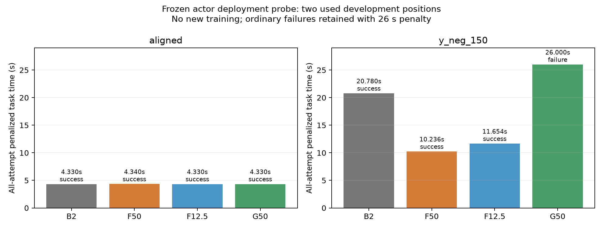
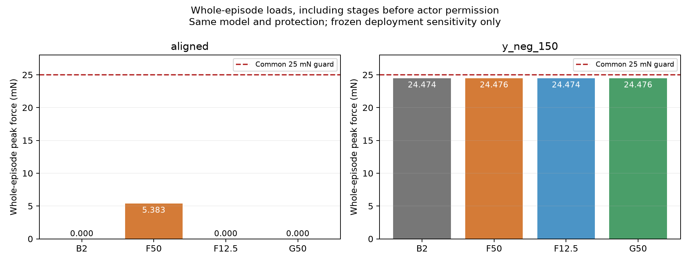

# PC-09接触门控与小固定边界部署预检

**固定部署预检已按实际结果收口；完整B.2/C与论文优势另行验收。** 新启动8/8、完成8，累计动态208，未用0关闭；新增优化和经验发布0。

| 方法 | 工况 | 功能结果 | 判定用时s | 峰值力mN | 80μm/0.5° | NN调用 | INSERT力门控阈值切换 |
|---|---|---|---:|---:|---|---:|---|
| B2 | aligned | FULL_SUCCESS | 4.330 | 0.000000 | 达标 | 0 | 不适用 |
| B2 | y_neg_150 | FULL_SUCCESS | 20.780 | 24.474139 | 未达标 | 0 | 不适用 |
| F50 | aligned | FULL_SUCCESS | 4.340 | 5.383435 | 未达标 | 2050 | 不适用 |
| F50 | y_neg_150 | FULL_SUCCESS | 10.236 | 24.476200 | 未达标 | 4608 | 不适用 |
| F12.5 | aligned | FULL_SUCCESS | 4.330 | 0.000000 | 达标 | 2045 | 不适用 |
| F12.5 | y_neg_150 | FULL_SUCCESS | 11.654 | 24.474125 | 未达标 | 5317 | 不适用 |
| G50 | aligned | FULL_SUCCESS | 4.330 | 0.000000 | 达标 | 0 | 0 |
| G50 | y_neg_150 | TASK_FAILURE | 18.000 | 24.476171 | 未达标 | 7638 | 1 |

两点都是已用开发工况、同一训练种子。B2零残差且没有网络；F50/F12.5/G50只读原F2000演员。F12.5的四个演员输出乘0.25，不是小尺度下重训；G50在SEARCH开放，INSERT以动作前测得5mN轴向反力开放，原共同保护同时生效。没有改模型、奖励、137维/4维或生产代码。

**本方案结论：停止直接把现有F2000演员套上G50门控的部署路线。** G50对中完全保持B2、没有侧移/接触/网络调用，但负Y150μm两次搜索耗尽；G为1/2成功，B2/F50/F12.5各2/2。按26s失败罚时，G平均15.165s，比B2的12.555s慢20.79%；不能认定已解决任务，更不能进入正式论文优越性验收。这不是“全部残差SAC插入失败”。

F12.5可保留为合理小固定边界的候选参照：对中误差42.10μm、接触力0，负Y成功但误差100.80μm；该点比F50慢13.85%。它只是同一演员输出缩放的部署敏感性，不等于该尺度下公平重训。G的负YINSERT仅一次力阈值切换、198启用周期，SEARCH 7440启用周期；启用命令预测与执行一致，仅15周期参考缩减。数据不支持优先加迟滞或把失败归为“残差未执行”。两次搜索边界结束是既有正常恢复/预算判定，运行/保护没有故障。[具体事件与既有匹配训练S参考](failure_summary.json)只作归因，S旧同点成功10.760s，不算本轮新增样本。

**效率优先的下一项：只用现有F/G/匹配训练S负Y档案做一次离线搜索路径对照。** 按每段SEARCH对齐入口状态、真实XY运动、参考方向、四维请求和最终总命令，核对G为何沿参考边界耗尽、S的匹配训练为何能成功；区分可定位的实现错误与仅有支持的训练/权限不匹配假设。该读取任务新增物理、训练、网络推理0，不扫描门槛、不扩观测/网络/critic。随后出一页路线决定：有具体依据才为同权限起点的一次公平短训另行登记；无依据就停止G，收缩到已有匹配训练的阶段约束及合理小固定边界对照。当前不自动签发任何新训练。

本轮固定预算8/8收口、不重试，自动跟踪PAUSED。完整B.2姿态/联合范围、C完整机制、合理对照重训、多种子和新的冻结最终测试仍待；四个旧首次位置已消费，不能重新当未见测试。阶段完成后暂停汇报。

## 复核证据与实际成本

4份B2/F50新档案与旧同版本完整trace、控制器事件、结果、外部事件、停稳样本、峰值及动作（除新增角色/原演员元数据）逐值一致。G50对中与B2完整轨迹一致：True。逐条动作前wrench与上一实际trace的归一化观测一致；演员输出与实际请求映射、门控/mask、终末和物理时间折扣均复核。

独立复算45,660条奖励、推进与时间，功能几何/附加精度、循环峰值/末点、实际停稳全部按原判据。成本45,660控制周期/456,600物理子步、真实网络成功/尝试21,658/21,658次；回合墙时合计2260.1s，读取/审核开销另在执行日志，不混成仿真时间。所有普通失败保留，26s罚时计入均值；保护不被算成成功。

88相关离线检查（38新+50旧）；一次fresh限定只读审查C0/I1/M0，初始化异常留档问题经作者两种无物理反例RED/GREEN及回归关闭，未二次独立复审。审查在物理资格前，未来结果由作者完整重读原档案核验；不冒称第二次独立效果审查。两次原F2000完整读取（准备与实际执行）均保持原完整状态，每回合前后模型/优化器/RNG保持；不宣称新G权限下训练状态恢复。

原1057生产输入、PC-06/07/08全部580封存文件重新核验保持；旧预算关闭、自动跟踪PAUSED。没有新增最终未见测试，四旧首次位置不用于本项选参。机械臂/夹爪、姿态联合范围、多种子、合理固定边界重训和论文统计仍缺。

[原始复核](assessment.json)、[配置](configuration.json)、[资格](qualification.json)、[实际账本](run/ledger.json)、[审查与修正](review.md)、[最终检查](closure_verification.json)、[阶段记录](progress.md)、[封存](delivery_manifest.json)。执行目录一次领取，不复跑；分析生成文件，封存后只在完整副本核对。
