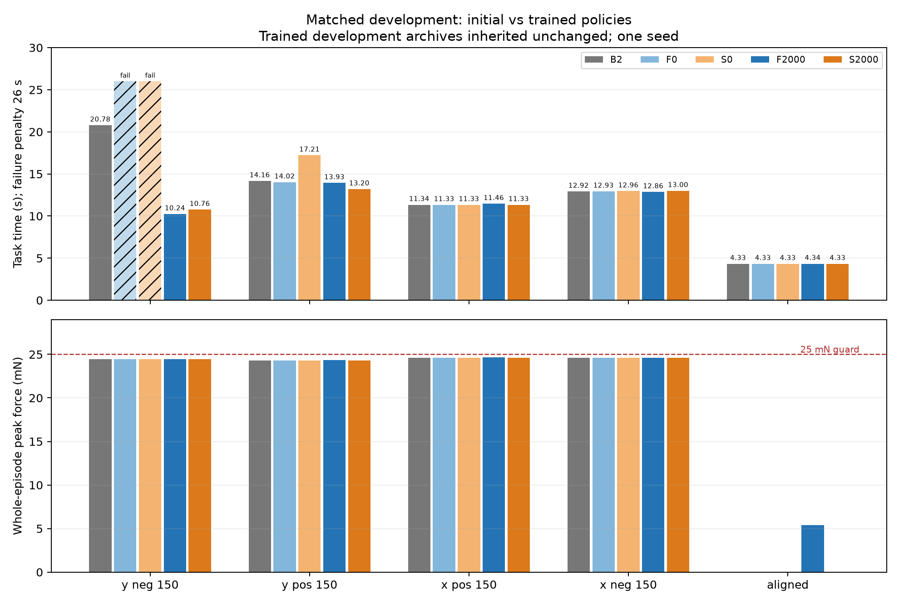
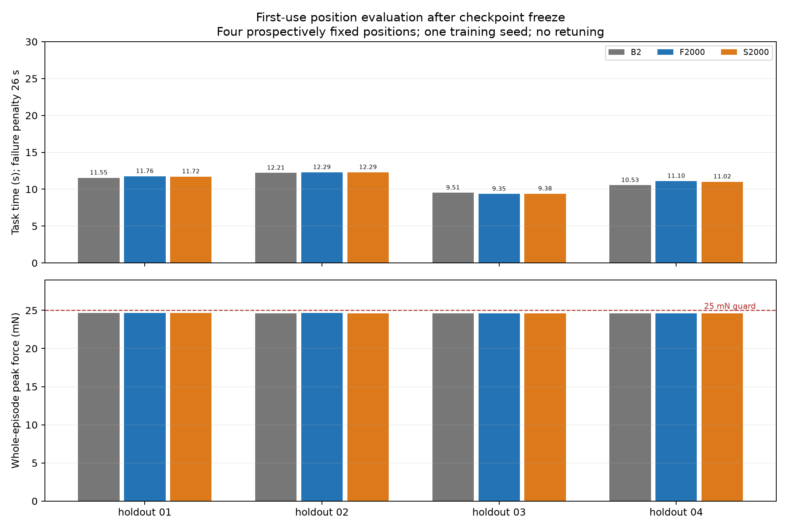

# PC-07冻结策略公平对照结果

截至2026-10-07。**同版本公平对照与冻结后首次位置评价完成。完整B.2/C及论文优势不据此标已验收。**

本轮判断：学习链和插入功能能够工作，开发点可见学习收益；当前简单SEARCH阶段约束尚无稳定优势。初始F/S分别4/5成功，训练后分别5/5；但四个新位置B2/F/S均4/4，F/S略慢于B2。位置范围的短训、保存/加载与冻结评价里程碑已完成，完整B.2范围及原任务6仍待验收。下一项先利用现有档案做离线归因，暂不追加大训练。

新启动27/27，采样结束27，累计200/200；183,705控制周期/1,837,050物理子步，真实网络控制76,257次；新梯度/经验发布0，未用0关闭。

B2是无学习的参考搜孔/插入控制器；F是固定边界残差对照；S仅在SEARCH阶段开放残差。0/2000表示优化批数，初始策略并非零残差；当前F/S保留已记录的critic处理，不称未经修改的标准SAC。

## 实际比较

开发F相对B2：用时改善16.86%，综合继续信号未满足（峰值力均值增加5.57%超过5%）；开发S相对B2：用时改善17.18%，综合继续信号满足；开发S相对F：用时改善0.39%，综合继续信号未满足（用时改善不足10%）；F学习贡献对照：用时改善23.01%，综合继续信号未满足（峰值力均值增加5.57%超过5%）；S学习贡献对照：用时改善26.75%，综合继续信号满足；新位置F相对B2：用时增加1.61%，综合继续信号未满足（用时改善不足10%）；新位置S相对B2：用时增加1.38%，综合继续信号未满足（用时改善不足10%）；新位置S相对F：用时改善0.23%，综合继续信号未满足（用时改善不足10%）。

开发五点：F2000/S2000十份记录来自PC-06原封存，不重采；其余均为本轮新采集。

| 方法 | 功能成功/尝试 | 附加精度成功 | 平均罚时/s | 平均峰值力/mN | 保护 | 缺失 |
|---|---:|---:|---:|---:|---:|---|
| B2 | 5/5 | 1 | 12.7060 | 19.6000 | 0 | 无 |
| F0 | 4/5 | 1 | 13.7208 | 19.6016 | 0 | 无 |
| S0 | 4/5 | 1 | 14.3652 | 19.6000 | 0 | 无 |
| F2000 | 5/5 | 0 | 10.5640 | 20.6926 | 0 | 无 |
| S2000 | 5/5 | 1 | 10.5228 | 19.6000 | 0 | 无 |

冻结后首次使用的四个位置，roll/pitch/yaw=0，其他物理条件保持。B2/F2000/S2000同点配对。

| 方法 | 功能成功/尝试 | 附加精度成功 | 平均罚时/s | 平均峰值力/mN | 保护 | 缺失 |
|---|---:|---:|---:|---:|---:|---|
| B2 | 4/4 | 0 | 10.9500 | 24.6189 | 0 | 无 |
| F2000 | 4/4 | 0 | 11.1265 | 24.6342 | 0 | 无 |
| S2000 | 4/4 | 0 | 11.1010 | 24.6189 | 0 | 无 |

“功能成功”表示当前几何和停稳裁判下完成插入，附加精度另按80μm/0.5°统计。四新位置三种方法附加精度均0/4，不能把功能成功解释为达到该附加精度。

开发S相对B2共节省10.916s，其中负Y点贡献10.020s（91.79%）；收益主要集中在一个已使用开发点。该描述来自已有逐点记录，不作为新的调参或验收门槛。

| 预登记点 | X/μm | Y/μm |
|---|---:|---:|
| holdout_01 | 72.199491 | 110.160914 |
| holdout_02 | -81.006345 | 113.365892 |
| holdout_03 | -120.252982 | -40.450915 |
| holdout_04 | 120.139772 | -43.402971 |

F0/S0为同种子随机初始化、0更新的确定性策略；它们不是全零动作。B2才是全零残差，无网络推理。F/S两组训练预算均为此前2000批，本轮新优化0；所有策略确定性。学习贡献在开发点与各自初始策略比较，新位置没有额外初始策略评价，不据此单独证明泛化的学习贡献。

继续信号沿用至少10%平均罚时改善、成功不减、保护不增、平均峰值力增幅不超过5%。该信号只是预登记开发筛查规则，不是发表阈值或统计显著性。每个工况的力/时间原值见assessment.json；尤其对中点没有接触时会拉低全组平均力，不能把总均值下降直接解释为偏置点载荷改善。

## 已核对的证据与局限

63项关联检查通过，原新增14反例RED后GREEN；一次独立审查发现1 Important：故障回合网络调用漏计，分别注入rollout/audit错误，两例RED实际0对期望7，再修正为从实际entry统一派生计数，最终63 GREEN。未二次独立复审。审查范围与作者修正见[review.md](review.md)。

生产1057项输入及PC-06原封存保持。B2负Y新回合11,271点、控制器事件及结果与PC-05完整逐值一致；零残差适配没有改变该基线轨迹。原完整检查点只读，评价前后完整模型/优化器/RNG逐值比较通过的事实按回合evaluation_checks记录，故障回合不冒充审核通过。本轮没有经验发布或优化入口。

原始档案按SHA、真实停稳、几何成功、周期峰值下界、逐条dt/推进/奖励/折扣、冻结方法指纹和调用计数复核。新奖励行复核183,705，继承10份原始开发资料另复核；审查未判定的物理与分析事项由这些实际记录补齐，不称独立审查已验证未运行结果。

固定27矩阵的有效普通失败和合格保护都保留；无效/未停稳/运行/来源/参考错误整轮停，未执行不填零力或失败。状态complete，错误：None；独立档案审核错误：[]。全部尝试和关闭余量在[账本](run/ledger.json)中保存。

实际回合墙时合计1.769h，整轮含读取与审核2.118h；物理周期、网络接口调用和优化批数分列。原rollout的policy_calls为提供器接口调用，本轮network_policy_calls才表示真实网络控制次数，B2固定0。故障路径也记已发生调用，未重试物理或优化。

这是一个训练种子、五开发点和四个首次位置的有限证据；不覆盖姿态/联合扰动、连续域、三个训练种子、硬件标定或机械臂/夹爪。四点已记录首次使用，后续方案调试不能再将它们作为未见最终测试。历史120维失败与critic高估并未由本次评价被统一解释或宣称消除。

## 下一项与复核

本轮未支持简单SEARCH-only约束相对合理对照的稳定优势。下一项先用现有档案做离线归因：核对分阶段动作、裁剪、残差实际运动和各工况时间贡献，再确定最多一次有依据的机制调整及较小固定边界对照；暂不追加训练、扩维或降低判据。 本轮四点已消费，后续调参不能复用它们作为未见最终测试；旧预算及自动跟踪保持关闭/PAUSED。

[预登记计划](../../../docs/superpowers/plans/2026-10-07-v4-frozen-comparison.md)、[资格](qualification.json)、[首次使用登记](first_use_registration.json)、[完整结果](assessment.json)、[收口复核](closure_verification.json)、[封存清单](delivery_manifest.json)。分析/绘图会写输出，封存后只能在完整副本中复核；不重启已领取run目录，原检查点及依赖runtime/source/schema仍需保留。

执行选择：复用原工作区；先做27次无训练固定评价、暂不盲目增加多种子；适配和测试仅放交付目录以保持原资格；原采集字段保持语义而新增真实网络计数；常规步骤沿用自主授权，未自动提交或清理。完整决定与审查保留事项见[计划](../../../docs/superpowers/plans/2026-10-07-v4-frozen-comparison.md)和[阶段记录](progress.md)。阶段完成暂停汇报。
