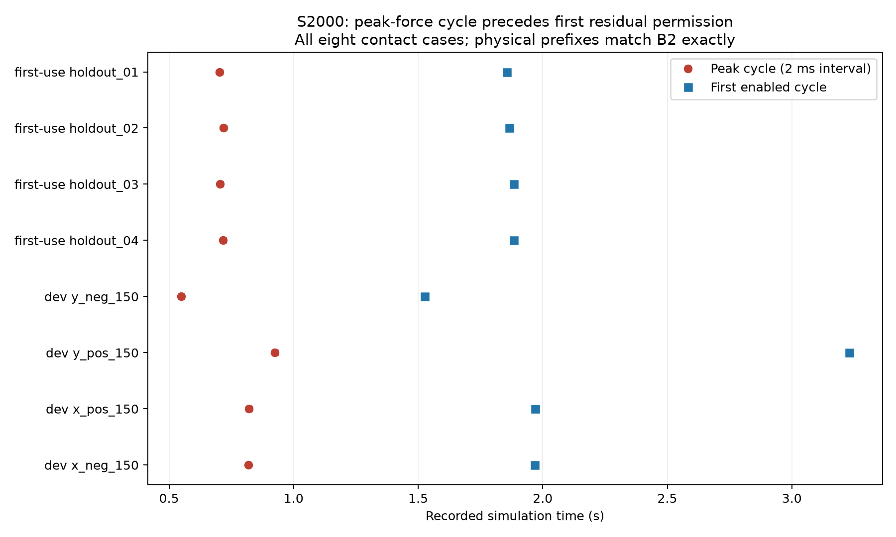
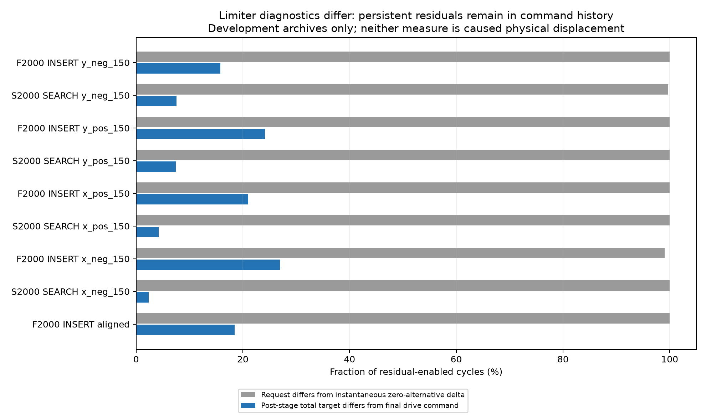

# PC-08残差实际作用归因

**归因完成；候选尚未实现或验证。** 只读37档案、245,221周期；新增动态/优化/网络策略调用/经验发布0，累计动态仍200。PC-07的96文件、PC-06的457文件和1057生产输入保持。

当前有限证据支持三项判断：S对这些工况启用得晚，无法改变已发生的力峰；F在无接触反馈阶段仍能引入不必要的扰动；旧“裁剪”字段不足以证明残差未被执行。没有证据据此宣布SAC整体无效或已解决全部历史问题。

## 实际归因

1. 已训练S四个有接触开发点和四首次位置共8个工况，全回合力峰值周期严格先于首个残差许可周期；14/14 S初始或已训练评价与B2在许可前完整轨迹前缀一致。对中S全程未启用、力0，另行记录，不伪造许可时刻。峰值仅定位到2ms周期区间，不推断子步时刻。
2. 开发S相对B2的省时10.916s中，负Y贡献10.020s（91.79%）；四首次位置S仍慢于B2约1.38%。这是收益集中和未见稳定优势，不足以单凭四点断言过拟合。
3. 对中F的INSERT启用2050周期，其中1859周期动作前测得wrench完全为0。该工况实际净侧移约100.210μm、全回合峰值力5.383435mN；B2/S没有侧移或接触。当前F在INSERT中普遍仍输出残差，不是只在有效接触时纠偏。
4. 对中F旧口径2050/2050“裁剪”，总命令确实受限仅378/2050；37份档案残差启用周期的最终预测命令与执行器记录一致。持续40μm/s残差已执行时，因上一命令含历史残差，零替代命令只来得及降到30μm/s，即时差10μm/s；不能据0.25比值称75%未执行。
5. 当前奖励为推进、时间、力/力矩及功能终末奖励，没有直接XY精度项（[源码](../../../tools/learning/reward.py)）。四新位置附加80μm/0.5°均0/4，功能成功另为4/4；不能把附加精度未达标当成软件判错，或声称功能成功已满足该精度。

| 开发档案阶段 | 启用周期 | 旧请求/即时差不等 | 总命令确实受限 | 零测得wrench仍启用 |
|---|---:|---:|---:|---:|
| F2000 y_neg_150 INSERT | 2208 | 2208 | 348 | 1775 |
| F2000 y_neg_150 SEARCH | 2400 | 2230 | 175 | 63 |
| S2000 y_neg_150 SEARCH | 2669 | 2661 | 203 | 31 |
| F2000 y_pos_150 INSERT | 3209 | 3209 | 774 | 1467 |
| F2000 y_pos_150 SEARCH | 2852 | 2160 | 171 | 48 |
| S2000 y_pos_150 SEARCH | 2529 | 2529 | 188 | 60 |
| F2000 x_pos_150 INSERT | 2484 | 2484 | 522 | 1575 |
| F2000 x_pos_150 SEARCH | 2725 | 2622 | 111 | 49 |
| S2000 x_pos_150 SEARCH | 2679 | 2679 | 113 | 50 |
| F2000 x_neg_150 INSERT | 2461 | 2438 | 664 | 1555 |
| F2000 x_neg_150 SEARCH | 3450 | 2568 | 107 | 24 |
| S2000 x_neg_150 SEARCH | 3515 | 3515 | 83 | 23 |
| F2000 aligned INSERT | 2050 | 2050 | 378 | 1859 |

## 下一项最小方案

先检验一条接触权限规则G50：SEARCH保持启用，INSERT只有已有5mN轴向反力门槛满足时启用；其余共同保护不变。同时保留F50并加入0.25尺度的F12.5，避免把权限收益混成单纯缩小动作的收益。采用现有137维/4维接口，不叠加新网络、critic技巧、奖励或进展模块。该候选只由开发点和既有5mN配置提出，四首次位置不用于挑参数。

[具体候选、8回合无训练预检和准入条件](next_candidate.md)。这8回合是下一项拟登记预算，当前执行0；不能跳过新权限在会话、观测、采集和审核中的一致性检查。只读原F检查点进行部署探测，不声称新门控下已训练或跨方法完整恢复。若出现明显退化，收口并复审研究假设，不再盲目加训。

## 复核与限制

17项手算反例先RED后GREEN；另2项持续残差/驱动限幅反例和2项启用/回撤命令差反例各RED后GREEN，最终57关联离线检查通过。代码只在本交付目录；生产0修改。原始来源和数组对齐、dt、动作前阶段、许可、有限数、峰值及完整前缀核对见[配置](configuration.json)和[全部归因](diagnosis.json)。旧clipped统计仍按其原定义保留，未改写历史档案或已训练的观测字段。

三份负Y档案（B2成功、F0/S0普通失败）各275个残差禁用的回撤周期，策略侧预测零命令、执行器接管Z回撤，共825个差异周期全部保留；不属于启用残差的预测失败。此前“所有周期都应一致”的收口断言被实际记录否定，已用两个反例纠正统计。命令差异的真实阶段明细见diagnosis.json和figure_data.json，不删失败或重跑物理。

effective_command_delta只是同一历史状态下的命令层对照。真实XY路径和旋转路径另计，分阶段整段包含停稳尾段，task_duration单列；不能把请求积分、命令差积分或物理路径互相替换。总命令限幅统计比较的是**已经过阶段上限**的目标与最终驱动预测，不包含无法由此恢复的更早阶段裁剪。

单训练种子、有限开发点与已消费的四首次位置；不新增独立效果样本，不覆盖姿态/联合扰动或机械臂/夹爪。B.2位置里程碑保持，完整B.2/C/论文优势仍待验收。阶段完成后暂停汇报，自动跟踪保持PAUSED。

[阶段记录](progress.md)、[审查](review.md)、[封存](delivery_manifest.json)。分析会写输出，封存后只在完整副本复核，不修改原封存依赖。
