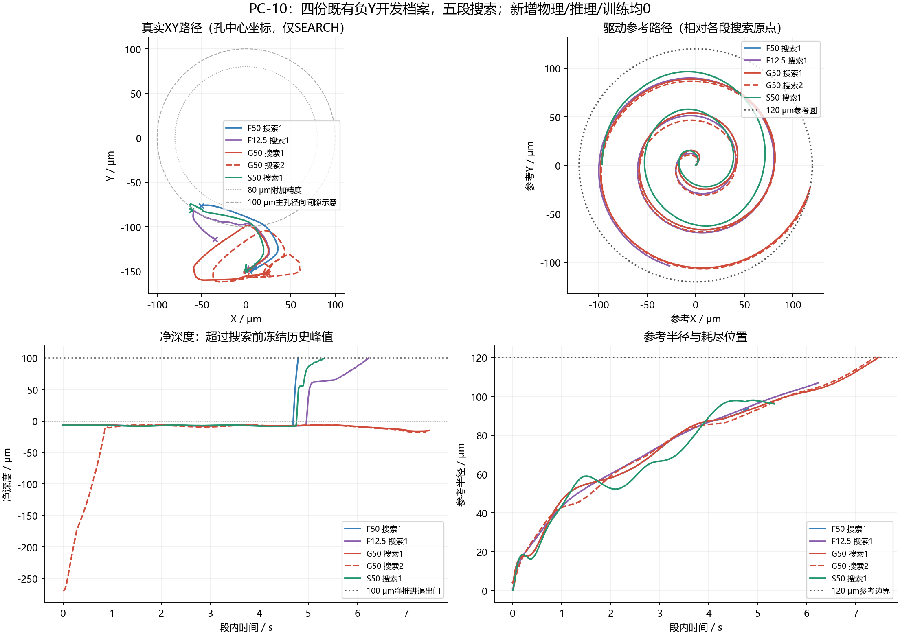
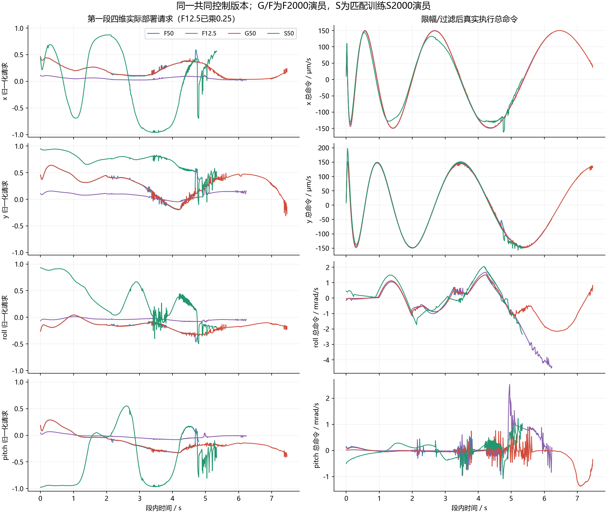

# PC-10 离线搜索路径对照

**结论：停止直接移植F2000演员到G50门控的部署路线；保留已有匹配训练S50及合理小固定边界的公平对照方向。** 确认的直接失败链是“真实针未超过旧峰值 → 驱动参考到达120μm圆 → 两次正常搜索结束 → TASK_FAILURE”。本轮没有定位需要修复的动作执行/参考积分错误；训练与权限不匹配仅为有支持的假设，没有证明G不可学或唯一根因。

本轮只读F50、F12.5、G50和匹配训练S50的既有负Y150μm开发档案：4份、28,465控制周期，其中5段SEARCH、15,626周期。新增动态/物理子步/网络推理/更新/发布均0，累计动态208；旧预算关闭、自动跟踪PAUSED、新训练准入无。S的10.760s旧成功仅是本轮归因参考，不能增加成功样本。

## 分段证据

| 方法/段 | SEARCH区间s | 真实XY净位移μm | 真实/参考路径μm | 最大净深度μm | 退出 |
|---|---|---|---|---:|---|
| F50/1 | 1.526–6.326 | (-60.60, +69.12) | 166.46/704.83 | 100.570 | SEARCH_ADVANCED |
| F12.5/1 | 1.526–7.760 | (-37.65, +33.96) | 201.57/929.43 | 100.010 | SEARCH_ADVANCED |
| G50/1 | 1.526–8.996 | (+21.14, -3.49) | 259.82/1100.20 | -6.140 | SEARCH_EXHAUSTED |
| G50/2 | 9.590–17.000 | (+1.45, -0.10) | 382.58/1086.66 | -6.355 | SEARCH_BUDGET_EXHAUSTED |
| S50/1 | 1.526–6.864 | (-61.40, +67.85) | 164.48/758.33 | 100.021 | SEARCH_ADVANCED |

实际XY使用原始物理位置；参考路径使用驱动参考。总命令积分是参考运动的核验，不能替换为残差造成的物理位移。SEARCH按动作前137维观测解码，不用滞后一周期的trace阶段，也不把停止尾段混入搜索。

## G为何耗尽

G第一段在8.996s、θ=18.655666rad结束；当前参考半径119.999999μm，下一**共同零残差**命令预测120.005279μm，超界5.279286nm。第二段在17.000s、θ=18.579837rad结束；下一预测120.000046μm，超界0.046079nm。两者均超过120μm+1pm判据，螺旋最终相位18.849556rad尚未达到，段内8s分别尚余0.530/0.590s。依据原始相位、参考、上周期命令独立复算了割线前馈、5/s跟踪、速度和加速度限幅，逐值匹配原事件；属于当前冻结规则的正常搜索结束，没有参考运行故障。它揭示边界规则会结束本路径，不证明此规则是应改的实现错误。

G第一段最大净深度−6.140μm，第二段−6.355μm，均未回到搜索前冻结峰值，更未跨越其后100μm的退出门。第二段实际向前251.097μm主要是在回收回撤距离，结束仍低于旧峰值17.953μm；不能把这段推进当作插入进展。两段最小中心XY误差98.527/106.537μm、末值154.323/154.599μm。参考走了约1100/1087μm，真实路径约260/383μm，参考已转圈不等于针在孔内按参考转圈。

15个参考过滤周期（第一段1、第二段14）均留档。四档案20,232个有权限周期的预测与真实执行命令一致；15,626个SEARCH周期参考积分最大误差见diagnosis.json。恢复第二段首周期4795的参考Z在prepare内按真实位姿重置4.043μm，有原B2_RECOVERY_RESUMED事件；专门复核，未放宽误差门，不把正常重置误报为命令丢失。

## S为何能成功，以及不能推出什么

S第一段6.864s在净深度100.021μm处退出，然后完成10.760s功能成功。F50和F12.5分别在6.326/7.760s跨过同一100μm门，亦成功。S搜索结束中心XY约102.080μm；完整功能成功依据深度、实际分层几何和停稳，不等于附加80μm精度成功。

G/S第一段入口真实位置差仅(0.004114,0.009406,0.000081)μm，但驱动参考、接触历史及演员不同，原始trace从第176行起已不同。F50/F12.5进入SEARCH之前已有不同的XY侧移，不能把F/G后续差异仅归因于搜索权限。

第一段部署四维请求的时间均值G为(0.1953,0.2974,−0.1610,−0.1283)，S为(−0.0122,0.7210,0.3440,−0.4267)。S的Y纠偏请求和roll/pitch方向组合明显不同；G仍保留F在INSERT+SEARCH训练下的响应。四维总命令、参考方向和真实路径在逐周期CSV与下图分列。角命令积分也是描述量，不能独立定位九针的哪一接触导致成功。

G请求相对当前参考径向分量的时间均值为−5.374/−7.106μm/s，两段均以内向为主；因此“持续向外残差把参考推到边界”也不受数据支持。到边界是前馈/跟踪/历史请求共同形成的完整路径结果，不能只凭总积分或均值定唯一因果。

**证据等级：** 已确认命令执行、参考积分、正常边界退出、净深度不足及S的成功路径；支持但未隔离演员与新权限/状态分布不匹配；没有支持门控抖动、残差未执行、参考崩溃或全部SAC插入无效。单点单训练种子、不同演员与前段历史，不构成受控学习因果或论文优势证据。

## 使用与验收

新目录`analyze.py`只读统计；`test_analysis.py`为6项手算专项，关联PC-08纯档案检查21项，共27项；不运行全历史物理/学习套件。`search_cycles.csv`含所有15,626搜索周期；`alignment.csv`按整数秒及共同θ=0,2,…,18rad取最近已存周期（不插值、不跑策略、不选阈值）。`diagnosis.json`包含完整入口/出口位姿、力、速度、四维均值、请求积分、执行命令积分与重算事件。

生产1057输入、PC-06/07/08/09全部658封存文件已逐项核验保持。冻结目录不重跑分析；纯检查可以再读，若要重新生成可在完整副本中进行。本次验收限于离线证据交付，完整B.2/C、合理边界公平重训、多种子及新的最终测试均未验收。

[一页路线决定](路线决定.md)、[原始统计](diagnosis.json)、[全部搜索周期](search_cycles.csv)、[对齐表](alignment.csv)、[计划](../../../docs/superpowers/plans/2026-10-07-search-path-comparison.md)。
