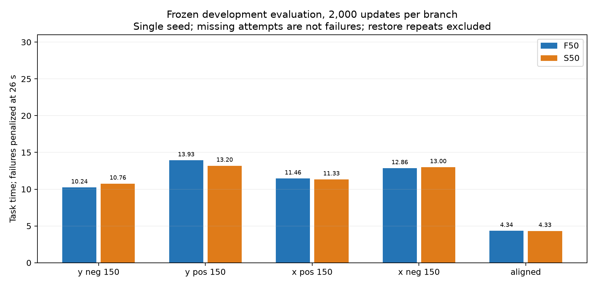
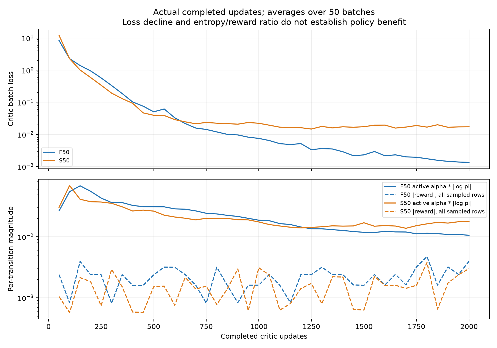

# PC-06修复与有限学习验证结果

截至2026-10-07。**本轮修复及有限学习pilot已验收；完整B.2未验收。F/S各2000批，冻结开发点各5/5功能成功；独立进程代表复现2/2逐值一致，28/28有效停稳，参考故障/硬保护0。S相对F平均用时改善0.39%，未达到预登记的10%开发继续信号。**

## 已解决到什么程度

上一轮S负Y在8.756s因共同搜索参考不可行而报错。本轮使用PC-05共同边界修复与continuation_v2，重新绑定新资格，沿用原学习器和算法设置。从同一新零网络起点真实采集、审核、训练、冻结评价及新进程恢复全部执行结束；28/28仿真有效、实际停稳，参考错误和硬保护均0。已登记故障路径在本轮没有重现，有限工程修复及pilot验收通过；不是任意未来动作安全保证。

新动态28/28，累计173；190,882控制周期/1,908,820物理子步；正式更新尝试/完成4000/4000；策略控制调用78,520，发布117,108条经验（F54,776/S62,332），未用预算0。两次普通搜索耗尽失败均发布，评价/恢复不入池。原关闭余量不重开，自动跟踪PAUSED。

两次S负Y普通任务失败（随机预热、首个零更新在线）均完整归档并发布，终末奖励−2；训练16回合合计14成功/2普通失败。冻结评价和恢复数据均不进入回放。初始F/S网络一致，最后actor指纹均变化，正式更新数由尝试日志、完成日志、优化器状态和完整检查点共同核对。

## 冻结评价与方法信号

| 指标 | F：固定50权限 | S：仅SEARCH开放 | 解释 |
|---|---:|---:|---|
| 正式更新 | 2000 | 2000 | 同起点、同超参数，各自新采集数据 |
| 功能成功 | 5/5 | 5/5 | 五个已用开发点 |
| 附加80μm/0.5°成功 | 0/5 | 1/5 | 保留附加精度指标 |
| 平均任务用时/s | 10.5640 | 10.5228 | 全部冻结点，失败罚26s |
| 平均峰值力/mN | 20.6926 | 19.6000 | 子步峰值，非周期末载荷 |
| 平均峰值力矩/mN·m | 0.14317 | 0.12901 | 力矩在G系 |
| 独立进程逐值复现 | 1/1 | 1/1 | 代表负Y，恢复不增加性能样本 |

逐工况如下，全部功能成功；150表示初始横向偏置150μm。

| 工况 | F用时/s | S用时/s | F峰值力/mN | S峰值力/mN |
|---|---:|---:|---:|---:|
| y_neg_150 | 10.236 | 10.760 | 24.476 | 24.474 |
| y_pos_150 | 13.928 | 13.196 | 24.345 | 24.311 |
| x_pos_150 | 11.458 | 11.332 | 24.651 | 24.602 |
| x_neg_150 | 12.858 | 12.996 | 24.608 | 24.612 |
| aligned | 4.340 | 4.330 | 5.383 | 0.000 |

五点平均峰值力下降主要来自对中点：S该点策略调用0、峰值力0，而F为5.383mN。四个偏置点的平均峰值力仅改善0.08%；这是解释数据构成，不替代预登记五点主指标，也不证明学习收益。

S相对F用时改善0.39%，未达到预登记继续信号（至少10%用时改善、成功数不减、保护不增、平均峰值力不增超过5%）。这是开发筛查规则，不是论文发表阈值。相同成功率与小幅指标差异不等于方法优势，不能为了有优势而事后改规则。

旧B2来源指纹不同，保留历史档案，S_vs_B2/pilot_signal为null，表示公平比较尚缺，不能解释为失败或成功。S_vs_F_signal为false。训练时随机失败、冻结时确定性成功存在采样方式差异，不能据此单独归因于学习。正式未用范围测试和重复训练种子尚未执行，完整B.2及C未验收。

损失或熵/奖励量级仅为诊断数据。图中熵已乘alpha且按活动行统计，奖励绝对值来自全部抽样行；比例不能证明唯一根因。本轮没有额外critic评分，不能宣称历史危险边界Q约+9.364对尾段−8.359的高估已消除。

## 实现与验证范围

本轮只修改原合同及原执行器两个登记文件，重新绑定PC-05控制来源、资格v2与预算145→173；相应测试更新。137维/4维动作、网络、学习率、奖励、几何和保护不变，没有新增v5学习包装或算法层。当前残差SAC含原critic边界采样/尾段目标修正，不称原样标准SAC；零残差是B2。

441项关联离线检查通过；一次限定独立审查0 Critical/Important/Minor，范围见[review.md](review.md)。28份原始档案SHA/停稳/几何成功/逐条dt奖励折扣/发布收据独立复算无错误，18完整检查点读取门通过；两次真实恢复逐值一致。独立复核奖励行190,882。1057项输入与源码ZIP逐项核对未变，四份前项封存全部保持。原项目全量测试、跨机/GPU、连续域安全和硬件标定不在本次验收范围。

本轮最大实测力24.7357mN，距25mN保护仅0.2643mN；有限无保护结果不表示载荷裕量充分。

实际物理回合墙时合计2.088h，整轮含更新、保存、读取及审核3.274h。JSON原子替换短暂占用恢复2次，仅重试同一文件，不重复物理或优化动作。检查点完整读回时已核对Adam步数、抽样索引、回放、RNG与持久化尝试/完成记录。

## 使用与下一项

[执行清单](执行清单.md)、[资格](qualification.json)、[实际账本](run/ledger.json)、[原始独立复核](assessment.json)、[收口验证](closure_verification.json)、[最终封存](delivery_manifest.json)。最终完整检查点：[F](run/checkpoints/F50_online_3/manifest.json)、[S](run/checkpoints/S50_online_3/manifest.json)，同目录state.pt包含模型/优化器/回放/RNG和尝试记录。

运行目录的一次性领取已关闭，不重新执行run_v4_learning_pilot --execute。分析/图表脚本会写输出，封存后只在完整副本中复核；执行需要已登记的项目来源、CPU runtime、历史schema依赖，不能把单个state.pt当作跨机独立部署包。滚动文档保存本次快照，原滚动文件随后更新不影响交付清单。

下一项优先冻结当前控制器、137维学习器和超参数，预登记同一共同版本的B2配对评价、未用范围评价及必要的重复训练种子；据成功、用时和接触载荷判断是否值得扩展阶段约束。先补公平比较和学习贡献证据，不因本轮无运行故障就新增观测或算法层。本轮预算已全部消费并收口，下一物理/训练执行需新的登记，不能复用关闭余量。 当前机械臂/夹爪尚未加入，仍为简化笛卡尔执行器和刚性多针接触仿真；论文优势需要真实、同条件的比较证据。本可交付阶段完成，暂停汇报。
