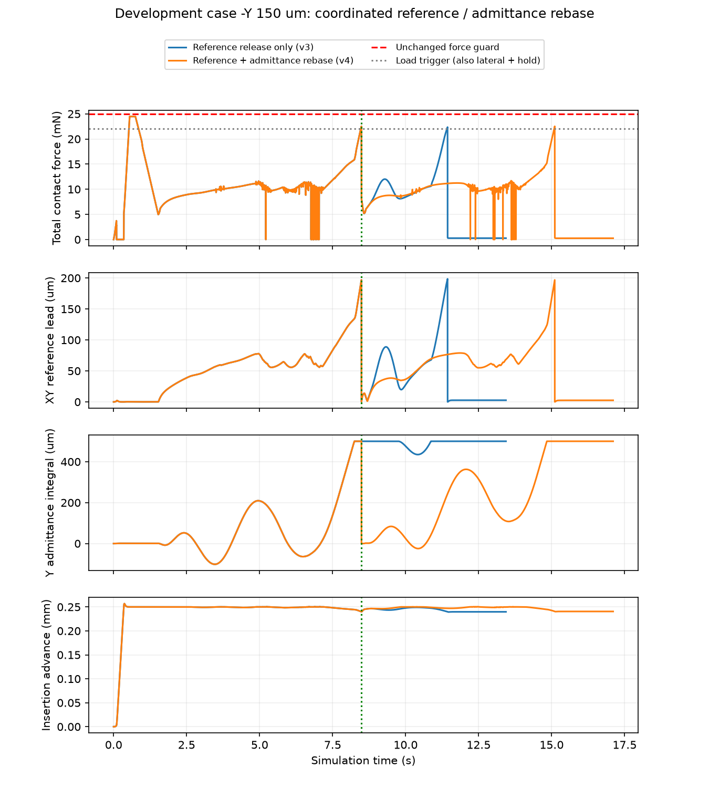

# XY参考与导纳状态同步重设：验证未解决插入失败

动态截至2026-10-04 17:39，北京时间。

**本轮局部修复实际生效，但该方法仍未解决负Y插入失败。** 同步清零导纳内部状态后，第二次搜索恢复了纠偏响应，却仍停在孔口，最终再次因持续高载荷耗尽两次搜索资格。全回合有效、无接触/运动保护并已真实停稳，不能据此记作插入成功。

实际执行1/5新动态，余4按首例必须成功的规则关闭，不重试、不结转。累计121；网络调用、SAC更新、独立测试均0，自动跟踪PAUSED，B.2未完成。

## 修改与验证范围

新增`RebasedLoadReliefSession`，仅在已有载荷卸载请求释放XY参考时，同步将导纳XY offset和velocity清零。角向状态、限幅统计、真实位姿/速度/时间、Z/姿态参考、保护事实全部保留。原导纳和旧会话未改写。每段XY内部额度仍为±500 μm；一次重设会重新开放额度，所以没有声称全回合累计仍受原500 μm额度约束。原两次搜索资格限定最多一次此类重设。

1.20 mm孔径、功能成功、附加80 μm/0.5°精度、25 mN总力、2.5°姿态及原搜索/时间边界均保持。负Y150首先验证，只有其成功才执行正Y150、±X150和对准；本轮这四点均未执行，旧成功档案不能充作新版本回归。

新增行为测试先失败后通过，最终94项相关检查通过；不是全历史项目测试。一次独立只读审查发现准备配置未纳入输入绑定，已补配置/模型摘要门和3个先失败后通过的反例，运行前及运行后均核验。审查未认证物理效果。详见[实施计划](../../../docs/superpowers/plans/2026-10-04-admittance-rebase.md)、[审查](review.md)、[最终测试](tests_final.txt)。

## 实际结果

| 指标 | 前轮仅释放参考v3 | 本轮同步重设v4 |
|---|---:|---:|
| 负Y150功能成功 | 否 | 否 |
| 停止原因 | SEARCH_BUDGET_EXHAUSTED | SEARCH_BUDGET_EXHAUSTED |
| 接触/运动保护 | 无 | 无 |
| 仿真有效/物理停稳 | 是/是 | 是/是 |
| 决定停止时刻 | 11.436 s | 15.106 s |
| 完整物理尾段结束 | 13.436 s | 17.106 s |
| 最终插入推进量 | 0.239755 mm | 0.240551 mm |
| 最终XY误差 | 173.914 μm | 179.907 μm |
| 九针保守最小配合余量 | −76.076 μm | −85.738 μm |
| 全回合峰值总力 | 24.474139 mN | 24.474139 mN |
| 控制周期/物理子步 | 6718/67180 | 8553/85530 |

本轮单例墙钟351.688 s；严格附加精度成功0/1，末态角度0.283822°、z=−3.759449 mm。目标约4 mm插入深度，实际仍只推进约0.24 mm。失败延后约3.67 s，末态横向误差略增，不能称效率或插入性能改善。两轮共同的峰值出现在干预前，峰值相同不是后半段轨迹相同。

独立离线复核完整档案摘要、连续终末判据、子步守卫及实际停稳，与运行裁决一致：[assessment.json](assessment.json)、[账本](run/ledger.json)、[原始完整轨迹](run/y_neg_150.json.gz)。

[可导出PDF](results.pdf)。均为已存轨迹，没有重跑补数据。

## 同步重设确实生效

1. 0.746 s原停滞卸载，1.526 s进入第一次搜索，与前轮相同。
2. 8.486 s载荷卸载触发，XY参考释放；内部XY累计量从−120.006/+500 μm变为0，XY导纳速度同步归零。8.488 s完整采样记录证明状态已改变。
3. 8.570 s进入第二次搜索，Y纠偏响应恢复；第二段在14.838 s重新触及+500 μm。
4. 15.106 s第二次搜索又满足持续高侧向/总载荷条件，无剩余资格而失败。此时并未达到8 s搜索时间或120 μm螺旋半径上限，也未触发实际位移保护；17.106 s停稳尾段结束。

新旧前4244个采样（至8.486 s）的实际位姿、速度、接触反馈、限速命令和参考逐值相同。同步重设后的搜索中，正Fy而Y导纳被限为0的采样由前轮829个变为135个，但两轮时长不同，这不是成功率统计或单位时间改善指标。[逐值比较](trajectory_comparisons.json)、[内部状态诊断](diagnosis.json)。

## 更直接的问题：搜索跟踪抵消卸载纠偏

当前搜索横向命令为：导纳速度＋螺旋切向速度＋“螺旋目标−实际相对位移”的位置反馈。导纳的累计纠偏只用于内部额度约束，没有进入螺旋位置目标；因此位置反馈可能把已经形成的卸载纠偏又拉回旧轨迹。

用上一控制采样的传感器/螺旋相位、该搜索段起点和存档导纳输出，重新分解第二次搜索的3266个原始XY命令，与存档原始命令误差为0。这里没有控制器调用或物理步。

其中642个采样同时满足输入Fy>5 mN、正向导纳>0.01 mm/s、Y累计量<499 μm且原始Y总命令为负。一个具体反例（命令输入时刻14.830 s，输出采样14.832 s）：

| Y向分量 | 数值 |
|---|---:|
| 接触反馈Fy | +12.625704 mN |
| 导纳卸载速度 | +0.500000 mm/s |
| 螺旋切向速度 | −0.040830 mm/s |
| 搜索位置反馈 | −0.565188 mm/s |
| 合成原始命令/限速后命令 | −0.106018/−0.106018 mm/s |
| 导纳内部累计量 | +498.953829 μm，尚未到500 μm |

这排除了“只有额度清零遗漏，修好就能插入”的充分性判断：在尚未饱和、卸载纠偏已经存在时，总命令也会反向。随后额度再次耗尽，载荷进一步升高。它是已验证的合成矛盾，不证明任何替代算法一定成功或所有接触成因已穷尽。[可复核分解](composition_probe.json)、[生成脚本](diagnose_results.py)。

## 下一步与阶段判断

本轮实现、有限实测和归档完成，**修复性能未通过**。不再把重复清零、增大500 μm额度或增加卸载次数作为下一主线，也不继续追加SAC。

下一方案优先将螺旋目标与导纳纠偏位移统一成一个受限参考，使位置反馈保留导纳已经积累的纠偏；明确各搜索段起点、积分含义以及合成后速度/位移边界。先利用上述642个已存反例做公式检查，再登记一轮有限负Y与共同回归。实际位移/参考领先、载荷和真实停稳门仍需保留，不能通过直接改实际位姿完成对准。

这个方向属于共同B2控制器修订，后续所有基线和残差方法应共享并重新绑定；不是本轮已实现的新算法，也不是SAC创新效果。新方案通过后，仍需完成新任务学习接口、公平对照、独立评价与多种子，才谈B.2和论文证据。
