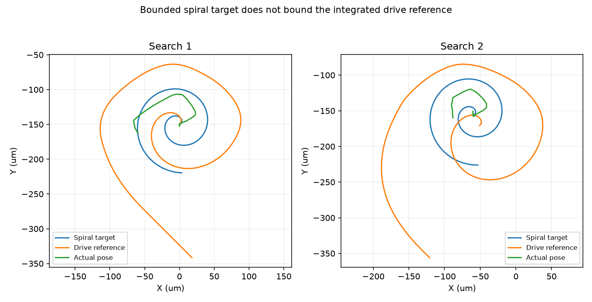
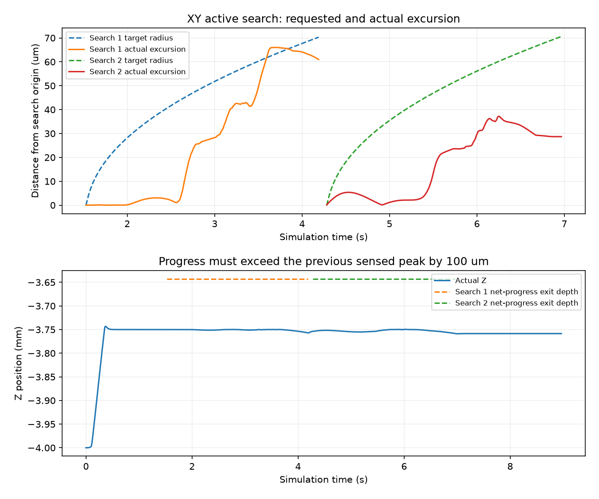

# 分轴搜索与净推进：本轮修复和有限验证结果

截至2026-10-04 18:44（北京时间）。**本轮实现和验证已完成，但仍未解决插入失败，B.2未验收。** 按预登记规则，在负Y150首例失败后关闭其余4例；发现新的驱动参考漂移问题后停止扩大实验。

## 实际结果

| 项目 | 本轮结果 |
|---|---:|
| 已运行/上限 | 1/5个开发回合 |
| 功能插入成功/附加80 μm与0.5°精度 | 0/1；0/1 |
| 仿真有效/真实停稳 | 1/1；1/1 |
| 硬接触保护/运动保护 | 0；0 |
| 停止原因 | 两次搜索资格耗尽 SEARCH_BUDGET_EXHAUSTED |
| 最终推进/约需推进 | 0.241475 mm / 4 mm |
| 最终XY/角度 | 180.508 μm / 0.271153° |
| 九针最小几何余量 | −87.355 μm，未配合 |
| 全回合最大接触力/穿透 | 24.4741 mN / 7.10649 μm |
| 停止/任务结算/物理尾段结束 | 6.966 / 7.966 / 8.966 s |
| 控制周期/物理子步/墙钟 | 4483 / 44830 / 174.876 s |
| 累计动态/本轮关闭余量 | 123 / 4 |
| 训练/网络调用/独立测试 | 0 / 0 / 0 |

自动跟踪PAUSED。两个载荷触发是22 mN总力与12 mN横向力持续20 ms的预防性卸载条件，并非25 mN硬保护触发。不能把“有效且停稳”写成插入成功。

## 本轮具体修复及证据

SEARCH的XY改为原有限螺旋位置搜索，同时冻结XY导纳内部offset/velocity；Z保留8 mN调载，角向仍一次导纳积分。INSERT、原卸载与有限一次参考/导纳重设保留。新搜索退出要求比本次开始前曾达到的最深Z再推进100 μm，不能从回撤起点计数。共享父类只增加可覆盖推进判据，旧控制器行为保留。

- 154项相关检查通过；3000组纯控制旧新对照命令和状态一致，未运行会额外消耗动态预算的历史全量测试。
- 真实旧回程反例：从回撤起点前进100.243 μm、仍比此前最深位置浅161.074 μm。旧判据退出，新判据继续搜索。该项是离线证据；本轮实测没有进入完整回撤恢复分支。
- 2675个实际SEARCH命令独立重算误差为0；XY内部offset/velocity冻结误差为0，停止尾段不记录陈旧搜索组成。
- 两次搜索冻结基准均与轨迹此前最深Z=−3.743180 mm相符，没有SEARCH_ADVANCED事件。
- 首次干预前764个样本（至1.526 s）的位姿、速度、接触、限幅命令和参考与上一轮完全一致。
- 一次独立只读审查完成。恢复公共入口非法输入会消耗重试的发现，按状态一致性问题处理；5种非法观测先失败后通过。无遗留审查项。

实现与审查证据：[计划](../../../docs/superpowers/plans/2026-10-04-axis-search.md)、[离线反例](offline_probe.json)、[最终检查](tests_final.txt)、[审查](review.md)、[轨迹前缀核对](trajectory_comparisons.json)、[完整独立核对](diagnosis.json)。

## 新出现的问题

| 搜索段 | 名义目标最大半径 | 实际XY最大位移 | 驱动参考最大位移 | 参考偏离目标最大值 | 结束 |
|---|---:|---:|---:|---:|---|
| 第一次 | 70.306 μm | 66.012 μm | 192.996 μm | 122.806 μm | 4.190 s，载荷卸载 |
| 第二次 | 70.603 μm | 37.208 μm | 209.286 μm | 146.501 μm | 6.966 s，载荷条件再次满足且预算耗尽 |

相对上一轮首次搜索仅2.208 μm，本轮主动运动明显增加，但运动不等于向孔内有效推进。两次搜索都没走到120 μm半径或8 s时限，便因载荷条件结束。

外层命令为“螺旋切向速度＋K×(目标位置−实际位置)”，内层笛卡尔执行器将该速度再积分到另一份驱动参考。在接触阻碍真实运动时，跟踪误差持续累积到驱动参考，所以120 μm螺旋目标界限并不约束驱动参考。归档逐周期参考积分核对误差小于2.8×10⁻¹³ μm，XY参考吻合未裁剪积分，未见XY领先裁剪改变这项漂移。200 μm是参考相对实际位置的逐分量门，表内193/209 μm是参考相对各段搜索起点的二维距离，两者不能混为越界。

例如4.190 s：目标约(+3.356,−219.618) μm，实际(−59.671,−162.081) μm，驱动参考(+18.070,−341.539) μm；横向力21.091 mN、总力22.658 mN。第二次结束时总力22.437 mN。当前证据确认参考漂移与载荷增大同时存在，并给出控制结构上的解释；没有单独消融证明这是失败的唯一原因，也未隔离摩擦参数的因果作用。

图中三条曲线分开显示了“规划目标”“驱动参考”和“实际运动”。[参考漂移机器诊断](reference_diagnosis.json)、[诊断图PDF](reference_diagnosis.pdf)。

[旧新对照图](results.png)、[对照PDF](results.pdf)、[推进图PDF](search_diagnosis.pdf)。

## 下一项与准入边界

下一项先修正搜索速度到驱动参考的映射：用螺旋目标相对当前驱动参考的误差生成跟踪速度，避免对真实位置跟踪误差再次积分；同时显式核对/约束每段XY驱动参考包络，保留原限速和加速度限制。所有真实运动仍由动力学求解，不能把实际位姿直接设置到目标。

先做这条映射的纯控制/旧轨迹反例检查，再为负Y目标工况及共同回归另登记有限预算。继续保留分轴控制、净推进、1.20 mm主孔、当前成功/保护与搜索次数，不新增SAC训练，也不补跑本轮关闭的4例。该下一方案尚未实施或验证，不能预先声称一定成功。

完成共同基线的有限回归后，仍需重新绑定学习任务、共同基线公平比较及独立评价，才可判断论文方法收益。当前负结果不能作为“新方法比基线更好”的证据。

## 使用与归档

本轮固定入口tools/validation/run_axis_search_preflight.py的run目录已占用，拒绝重跑；后续须新目录/新预算，不覆写档案。[账本](run/ledger.json)、[配置](configuration.json)、[配置绑定](preparation_binding.json)、[完整原始轨迹](run/y_neg_150.json.gz)、[成功/停稳独立审核](assessment.json)、[输入快照记录](snapshot_record.json)。

原五轮1113个封存文件核对一致；本轮884项执行输入在运行前后相同。可变项目资料保存当时快照后封存，历史实验不改写。最终封存与链接检查见[核验清单](verification.json)和[清单](delivery_manifest.json)。
