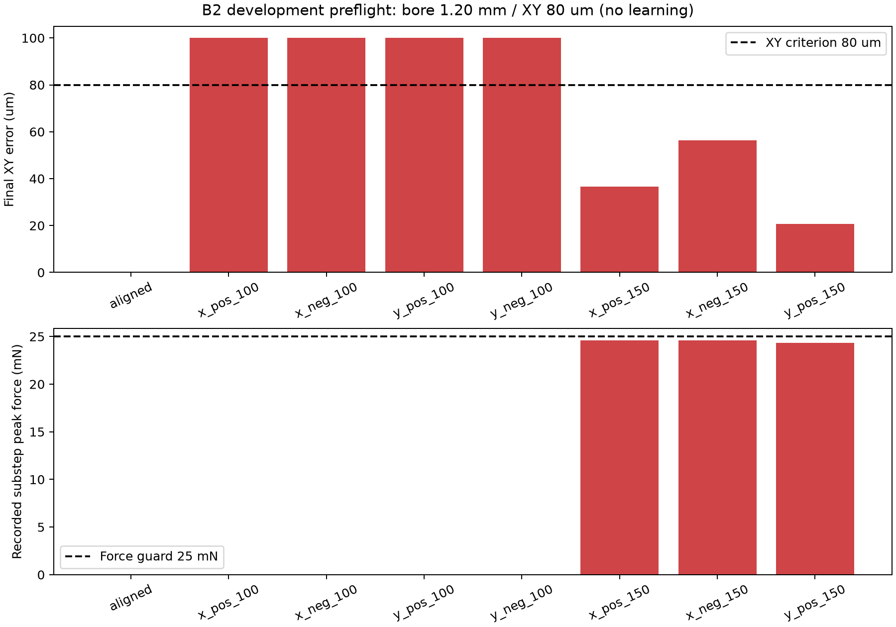

# 新任务纯B2开发预检结果

结论与下一步见[诊断与下一步](诊断与下一步.md)：功能配合与额外精度标准不一致，以及正Y150孔口旋转保护；本轮不进入训练。

实际启动8/9，完成8；成功1。训练0、策略网络0、独立测试0。

孔径1.20 mm，XY阈值80 μm；九针保守配合、原姿态/深度/载荷/穿透与真实停稳共同裁决。旧失败未改判。

| 工况 | 成功 | XY μm | 角度 ° | 峰值力 N | 最小针孔余量 μm | 接触周期 | SEARCH周期 | 原因 |
|---|---|---:|---:|---:|---:|---:|---:|---|
| aligned | 是 | 0.000 | 0.000 | 0.000000000 | 100.000 | 0 | 0 | GEOMETRIC_SUCCESS |
| x_pos_100 | 否 | 100.000 | 0.000 | 0.000000000 | -0.000 | 0 | 0 | TARGET_POSE_NOT_SETTLED |
| x_neg_100 | 否 | 100.000 | 0.000 | 0.000000000 | -0.000 | 0 | 0 | TARGET_POSE_NOT_SETTLED |
| y_pos_100 | 否 | 100.000 | 0.000 | 0.000000000 | -0.000 | 0 | 0 | TARGET_POSE_NOT_SETTLED |
| y_neg_100 | 否 | 100.000 | 0.000 | 0.000000000 | -0.000 | 0 | 0 | TARGET_POSE_NOT_SETTLED |
| x_pos_150 | 否 | 36.627 | 1.092 | 0.024602432 | 52.077 | 3625 | 2687 | TARGET_POSE_NOT_SETTLED |
| x_neg_150 | 否 | 56.433 | 0.651 | 0.024612255 | 43.052 | 4632 | 3668 | TARGET_POSE_NOT_SETTLED |
| y_pos_150 | 否 | 20.634 | 2.503 | 0.024311357 | -55.386 | 3070 | 0 | MOTION_VIOLATION |

控制周期32386、物理子步323860；新增累计117。未用1回合关闭，不结转。

以上是预登记开发点及纯B2结果，不能作为候选学习收益或正式成功率推断。峰值力来自运行时物理子步累计值；本次离线复核独立重算档案哈希、末端XY、接触/SEARCH周期、几何保持及物理停稳，未重建子步力。

assessment.json另列functional_pose_screen_only：仅作为下一任务定义的开发筛查，核对深度、九针配合、载荷、连续保持与真实停稳，不再额外要求80 μm和0.5°。它不是本轮成功标签，不追改既有结果，不构成新的动态评价或方法收益。

