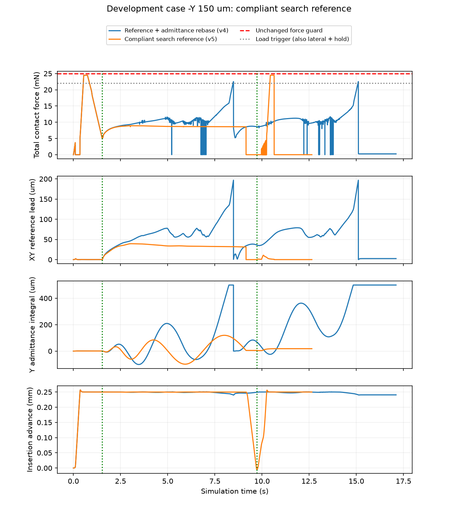
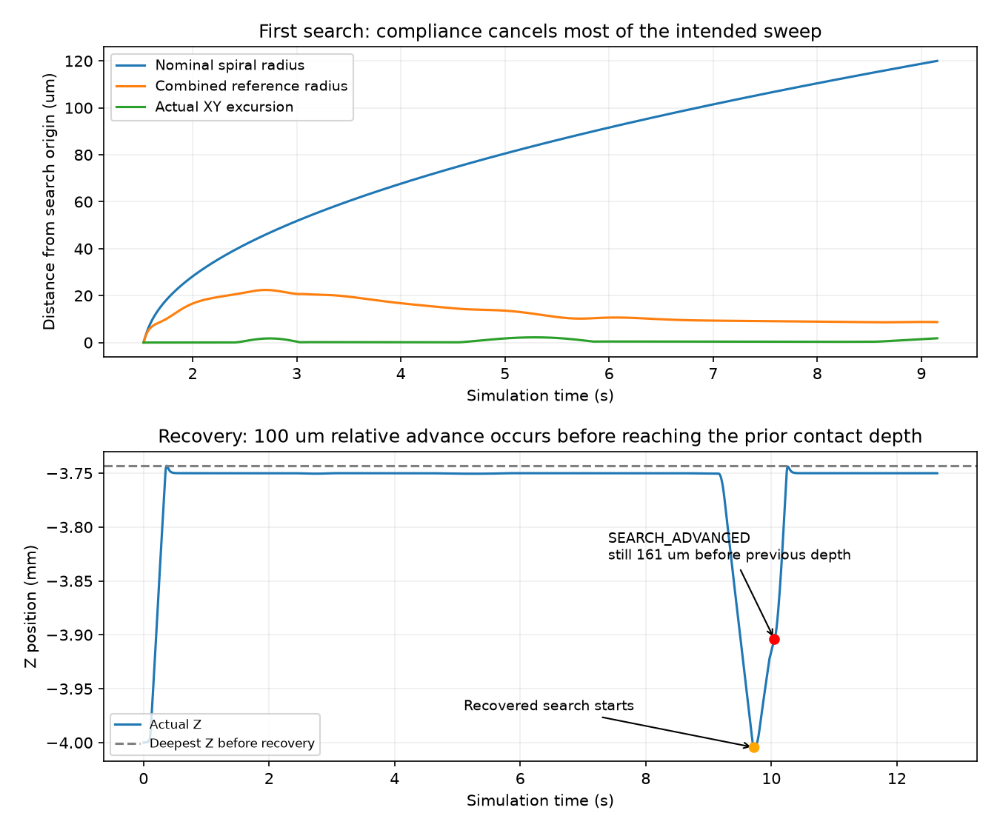

# 搜索/导纳统一参考：局部修复生效，插入仍失败

动态截至2026-10-04 18:21，北京时间。

**本轮没有解决负Y插入问题。** 合成关系按方案实际运行，先前那类“强正向导纳却合成反向命令”的现象在本回合中没有再出现；但当前XY导纳几乎抵消了主动螺旋搜索，随后恢复阶段过早返回INSERT，再次停滞。

实际1/5新动态、功能/附加严格精度0/1；仿真有效、无保护且实际停稳，剩余4回合关闭，无重试。累计122，训练/网络/独立测试0，自动跟踪PAUSED，B.2未完成。不能将“修掉一个机制”称为“整个任务已解决”。

## 本轮实现与证据

新控制器将每段累计导纳纠偏与螺旋轨迹合成同一个位置目标；目标投影到原120 μm搜索圆盘，同时调整前馈速度，保留200 μm实际位移门、原速度/加速度、25 mN/2.5°保护、两次搜索及20 s总时间。每段从当时实测位置和导纳状态重新定原点。Z载荷调节、角向导纳、功能成功及1.20 mm几何保持。

共享SearchRecovery仅提取正常SEARCH数学扩展点，改前快照保留；4300次纯控制观察序列的旧新命令和状态逐值相同。新增算法、接线与预算测试先失败后通过，相关范围最终127项通过。独立只读审查发现运行后输入异常未统一收口，已用3个反例修复；停止尾段陈旧控制组成也已由反例修正。不是全历史项目测试。

881执行输入、配置/模型摘要和源码快照在执行前固定；旧四阶段871个封存文件保持。见[计划](../../../docs/superpowers/plans/2026-10-04-compliant-search.md)、[审查](review.md)、[最终测试](tests_final.txt)、[旧控制提取核对](legacy_extraction_check.json)。

离线旧642个反向合成状态，新公式633个转为正向、9个仍反向，全部保留；这是固定旧状态的代数分析，未作为动态成功率。[离线探针](offline_formula_probe.json)。

## 真实结果

| 指标 | 负Y150 μm |
|---|---:|
| 结果 | TASK_FAILURE / SEARCH_BUDGET_EXHAUSTED |
| 功能/附加严格精度 | 0/1、0/1 |
| 仿真有效/物理停稳 | 是/是 |
| 接触/运动保护 | 均无 |
| 最终实际推进 | 0.249999 mm，目标约4 mm |
| 最终XY误差 | 150.318081 μm |
| 最终角度 | 0.008941° |
| 九针最小保守配合余量 | −51.148662 μm |
| 全回合峰值总力 | 24.474802 mN |
| 控制周期/物理子步 | 6321 / 63210 |
| 停止决定/尾段结束 | 10.642 s / 12.642 s |
| 单例墙钟 | 312.244 s |

正Y、±X及对准未执行。更小横向误差、更早停止或搜索段更低的载荷，都不能替代插入成功，也不是论文方法收益。

完整原始轨迹独立核对成功判据、连续保持、守卫事实及停稳，裁决一致：[机器核对](assessment.json)、[账本](run/ledger.json)、[完整轨迹](run/y_neg_150.json.gz)。新旧前764采样（至首次搜索1.526 s）的位姿、速度、力、限速命令和参考逐值相同。[比较](trajectory_comparisons.json)。

绿色竖线表示本轮进入搜索；[PDF](results.pdf)。

## 已核实的两个阻碍

**1. 合成一致了，但实际搜索几乎被补偿掉。** 首次搜索1.526～9.152 s，名义螺旋达到119.996 μm，合成位置目标最大仅22.403 μm，实际XY移动最大只有2.208 μm。120 μm投影边界未触发。搜索段峰值总力8.924 mN，最后因原螺旋半径耗尽转入恢复。

例如仿真8.000 s：名义目标XY为[+8.024, −110.171] μm，导纳累计纠偏为[−5.445, +118.708] μm，合成目标变为[+2.579, +8.537] μm。当前反馈顺应接触的方式抵消了主动横向扫动。数据支持“搜索运动不足”，尚未独立隔离接触摩擦与其他因素的贡献，不能把摩擦作为已证实的唯一原因。

**2. 恢复后的推进判据把回程当作新的有效进展。** 实际恢复从孔口附近回撤至z=−4.004498 mm；9.726 s重新搜索，10.050 s相对新起点推进100.243 μm便触发SEARCH_ADVANCED，返回INSERT。这时z=−3.904255 mm，仍比回撤前已达到的最深位置浅161.074 μm。触发点已有1个轻接触，不能说整个回程完全没有接触；关键是尚未超过回撤前深度。随后再次到原孔口停滞，因两次搜索资格已用完，10.642 s停止。

这两项分别是搜索执行方式和阶段进展语义问题；此前将失败主要归于内部饱和或命令合成，解释还不充分。

[PDF](search_diagnosis.pdf)、[诊断数据](diagnosis.json)。

全部3975个实际SEARCH原始命令从前一采样、每段原点和独立公式重构，误差为0；每段积分原点也一致。本轮“输入Fy>5 mN、Y导纳>0.01 mm/s、原始Y命令为负”的样本为0。这里只覆盖本回合与该明确条件，不代表任意状态都无冲突。[合成审核](composition_audit.json)。

## 下一方案与停止边界

本轮实现、有限验证和归档完成，性能未通过，保持停止。

下一方案建议直接采用接触搜索的分轴控制：SEARCH中XY按原有限螺旋轨迹主动搜索，Z保持8 mN载荷调节，角向保留导纳；INSERT保留原导纳。这样不会让XY接触反馈同时抹掉主动搜索。与此同时，恢复后的搜索退出应依据超过回撤前深度的净推进，避免把回程视作新的插入进展。

先利用本次完整轨迹检查分轴命令和净推进状态机，再另登记负Y及共同回归；不扩大孔径、次数、时间或保护，也不直接加训。该下一方案尚未实施，不能预告一定成功。本轮余4不复用。

此项是共同传统B2控制能力修订，所有残差方法后续应共享并重新绑定。新共同基线验证、学习接口准入、公平对照和独立评价仍未完成，不新增B.2验收或论文方法结论。
