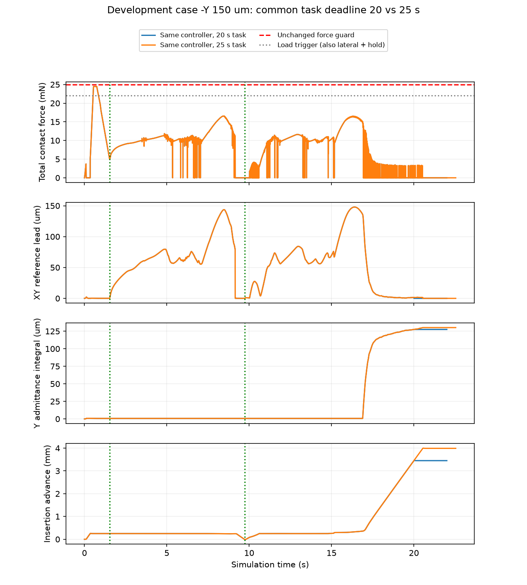
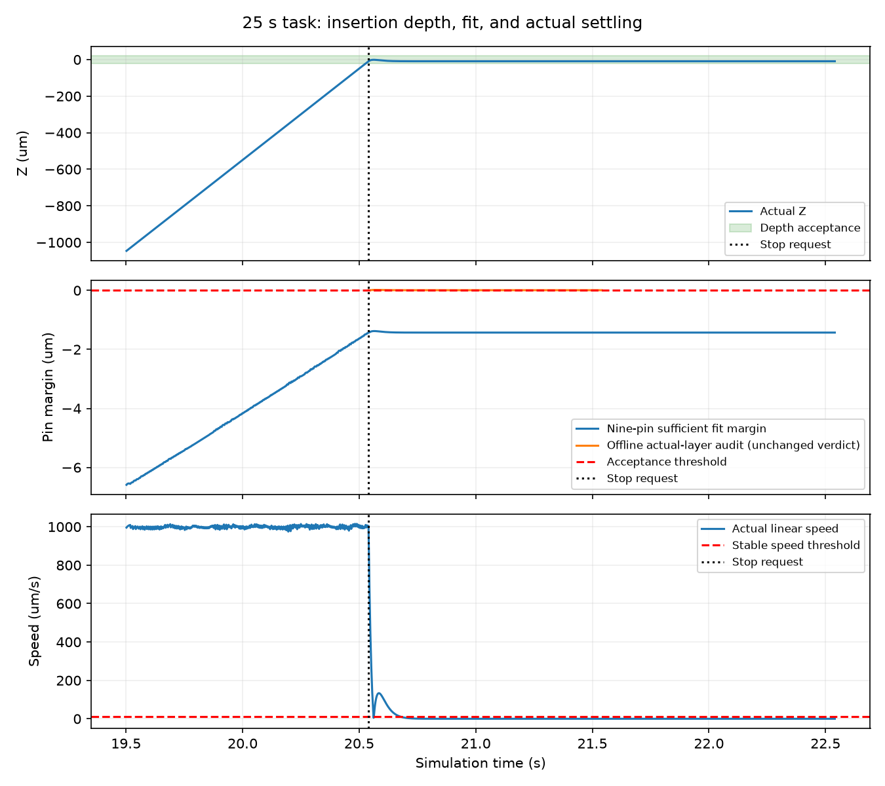

# 25秒共同任务有限验证结果

截至 2026-10-04 19:36:34，北京时间。

**已完成插入并真实停稳，但现行成功判据仍判失败；新增定位到整针保守几何裁判与分层孔不一致的问题。** 仅增加时间能解决到达深度的问题，尚未取得按现行合同定义的FULL_SUCCESS。本轮有限验证完成，不等于B.2或论文方法已验收。

## 核心结果

| 指标 | 原20秒任务 | 新25秒任务 |
|---|---:|---:|
| 最终插入推进 | 3.450839 mm | 3.990884 mm |
| 最终Z误差 | −549.161 μm | -9.116 μm |
| 停止原因 | TIME_LIMIT | TARGET_POSE_NOT_SETTLED |
| 到达目标面 | 未到达 | 20.540 s |
| 最终XY | 100.338 μm | 97.607 μm |
| 最终角度 | 0.409447° | 0.410250° |
| 现行整针几何余量 | −4.160 μm | -1.429353 μm |
| 正式功能成功 | 0/1 | 0/1 |
| 附加80 μm/0.5°精度成功 | 0/1 | 0/1 |
| 峰值力 | 24.474139 mN | 24.474139 mN |
| 仿真有效、真实停稳、无硬保护 | 是 | 是 |

停止请求20.540 s、任务判断结束21.540 s、物理尾段结束22.540 s。末态接触力及穿透均为0；最终深度、线/角速度、力/矩和穿透都合格，现行判定中仅九针几何项失败。程序的“TARGET_POSE_NOT_SETTLED”包括几何检查失败，**不代表本次物体仍在运动**。

## 单变量验证与成本

配置比对只发现deadline及任务/输入绑定元数据变化；模型哈希和控制器相同。前20秒10001点在六组物理/执行字段完全一致，原20秒失败未重写。7384个SEARCH命令独立重算最大误差3.03×10⁻¹⁶ m/s，参考半径最大119.995844 μm；完整回撤恢复及超过此前最深位置100 μm的净推进门保持正常。

199项相关测试通过，未运行会额外启动物理的裸全库pytest。新启动1/5动态，余4关闭，累计125；11270控制周期、112700物理子步，墙钟427.905秒。训练/网络/独立测试0，自动跟踪PAUSED。原1次领取账本已消费，入口拒绝重启，不能补跑关闭余量。

## 新定位：几何裁判过度保守

现行 `pin_clearance_m` 把整根针的两端及投影包络都与半径0.600 mm的主孔比较；实际入口半径0.675 mm、深度0.250 mm。它本来是充分条件，代码也声明可能拒绝边界可行姿态；此局限在本次成为唯一的终态失败项。不能把该负余量直接解释成实际主孔穿透1.43 μm。

独立离线分析按每根针与入口、主孔的实际Z区间相交，再求圆柱对256个孔壁切平面的最大支撑值；另以三角函数四次方程检查理想圆孔的径向极值。结果：

- 末态实际256面分层余量 **+0.0074505 μm**；理想圆孔分层余量 **+0.0073856 μm**。
- 501个停止后窗口样本逐项核对；最小瞬时余量为−0.000662 μm（256面）/−0.000748 μm（圆孔），均小于1 nm量级。
- 保持原深度、速度、力、矩和穿透条件，离线采用非负分层余量时，可连续合格 **0.860秒**，超过原0.1秒保持要求。这是诊断比较，**不修改本轮运行结果**。
- 每个针/孔层以65536个角度独立稠密表面采样，共18层核验；与解析极值的最大差9.08e-08 μm。另4个零物理步几何检查通过。

约7 nm的终态余量极小，只能说明“旧整针充分条件导致失败判定”有具体证据，不能证明误差扰动下稳健插入。裁判实现尚未接入运行会话，分析也没有借孔位真值修改控制命令；没有追加物理调用。

## 下一项与边界

优先修正并审核与实际分层孔一致的几何成功裁判，保持深度、稳定、保护及25秒共同任务；先用冻结轨迹离线检查裁判边界和数值稳定性，再登记必要的有限方向回归。旧失败结果保留，新裁判另立共同版本，所有基线一致应用；不继续延长动作时间，不启动SAC训练。本轮未执行4次关闭不结转。

正式功能成功0/1、附加严格精度0/1；XY97.607 μm仍超过附加80 μm。分层几何仅离线诊断，未替换运行裁判或授予训练准入；末态余量约7 nm，其他方向、重复性和独立评价均未证明，B.2未完成。 此前20秒失败、本轮失败及新诊断并列保存。若采用新裁判，应版本化报告并对所有基线共用，不能只为候选方法追认成功。没有论文方法优于基线的新证据。

## 执行裁定与审查限制

1. 保留原脏工作树，以输入/文档快照封存，不提交或清理；代价是复现依赖封存材料。
2. 只运行相关套件，避免未登记动力学；代价是不宣称全库测试通过。
3. 新审查agent因平台thread limit reached创建失败，复用前轮只读审查员；代价是不具备全新上下文。最终Critical/Important/Minor均0，无遗留Minor。
4. 实测、未来基线一致性及真实模型准确性不由代码审查背书；本轮以实测与离线诊断收口，未来版本另核；代价是不授予泛化、论文增益或训练准入结论。

首次测试RED为新入口未实现；实现后曾有1个测试夹具类型错误（198通过/1失败），修正后199通过，失败日志保留。配置离线比较曾使用错误metadata嵌套路径，断言暴露后修正审核脚本，生产配置未变。

## 证据与图

- [配置单变量核验](configuration_comparison.json)、[运行配置](configuration.json)、[领取及关闭账本](run/ledger.json)、[前20秒对比](trajectory_comparisons.json)
- [正式机器核对](assessment.json)、[末态分项核对](completion_diagnosis.json)、[控制重算](diagnosis.json)
- [分层解析核对](layered_geometry_audit.json)、[独立稠密核验与保持窗口](layered_geometry_validation.json)
- [审查](review.md)、[199项日志](tests_final.txt)、[封存核验](verification.json)、[文件清单](delivery_manifest.json)

图表同时提供同名PDF。历史7轮1599文件封存不变；本轮源文件和滚动资料保存当时快照。
