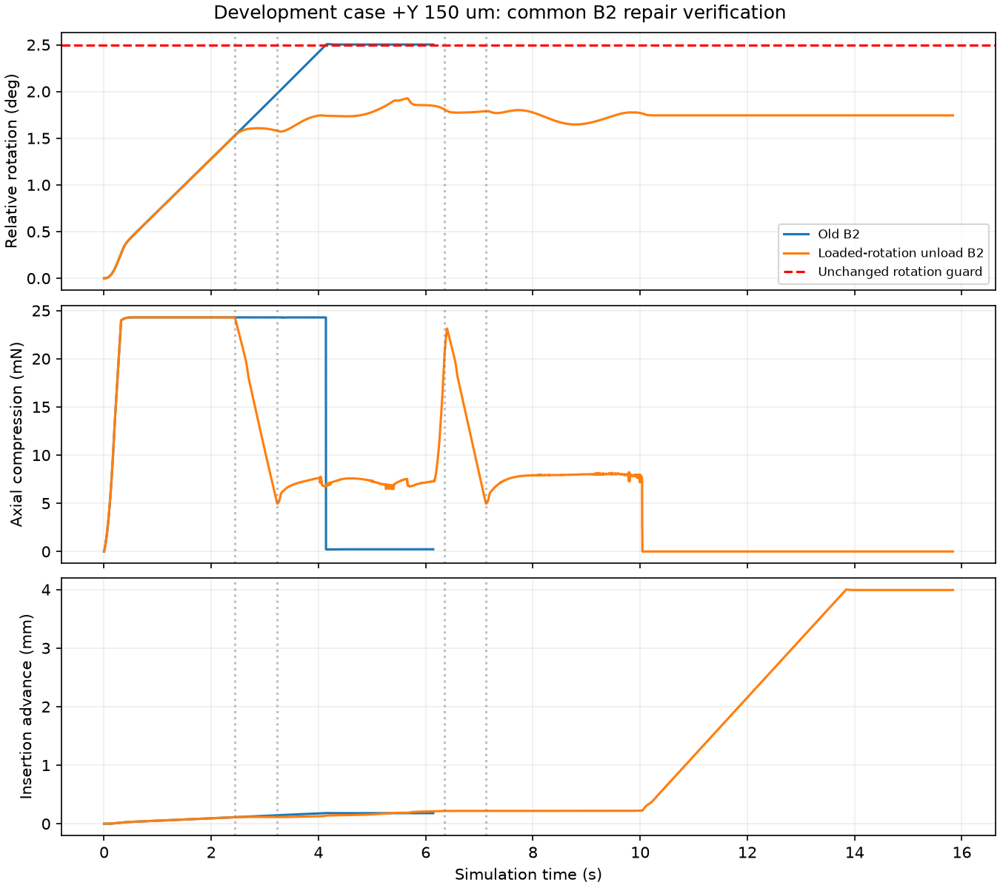
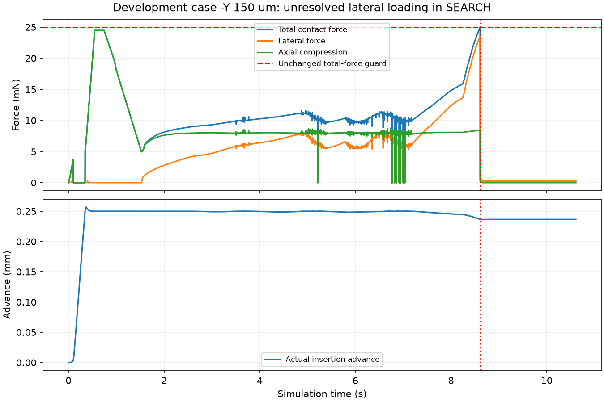

# 功能插入与共同B2风险卸载：修复验证结果

动态截至2026-10-03 23:57，北京时间；归档整理2026-10-04。实施计划见[本轮计划](../../../docs/superpowers/plans/2026-10-03-functional-b2.md)。

**已修复正Y150的入口倾斜故障，但共同基线尚未整体通过。** 功能成功与额外精度已分开，新B2风险卸载已实现并执行。预登记最多9回合，实际2：正Y150成功，负Y150搜索时力保护；按照预定规则停止余7，不重试、不结转。两回合均仿真有效、实际停稳；累计动态119。训练更新、网络调用、独立测试均0，自动跟踪PAUSED，B.2未验收。

## 修改与验证范围

- 几何保持上一版本：孔径1.20 mm、针径1.00 mm、256分段碰撞。旧1.15 mm/50 μm和上一1.20 mm/80 μm档案不改。
- 主成功改为目标参考深度20 μm、九针全轴保守孔内配合、原速度/载荷/穿透限制、0.1 s连续保持及整回合保护/真实停稳；它表示当前刚性模型内的功能插入，不表示电气接触或实物认证。80 μm/0.5°另报为严格精度子指标，不用任意大数绕过判据。
- 共同B2仅新增INSERT阶段风险触发：相对初始转角≥1.5°且轴向压载≥15 mN持续0.05 s，则进入原UNLOAD/SEARCH。控制器只读相对位移/转角和力矩，孔位、配合检查只供裁决。2.5°旋转保护、25 mN总力保护保持。
- 默认会话仍使用旧精度判据；新增显式功能会话。后续残差/B1等对照须接入相同任务与共同B2版本后重新准入，本次没有自动改写旧训练合同或学习入口。

## 实际结果

| 开发点 | 功能结果 | 严格精度 | 终末XY | 终末转角 | 深度误差/位置z | 九针最小配合余量 | 峰值总力 |
|---|---|---|---:|---:|---:|---:|---:|
| +Y150 μm | 成功并停稳 | 未通过 | 78.305 μm | 1.744° | −8.877 μm | +5.991 μm | 24.311357 mN |
| −Y150 μm | FORCE_LIMIT并停稳 | 未通过 | 171.279 μm | 0.304° | −3763.495 μm | −73.673 μm | 25.000156 mN |

尚未执行：±X150、对准、±X100、±Y100。不能宣称新共同B2覆盖9点通过，也不把2点开发结果当统计成功率。正Y功能成功但未满足0.5°，必须保留这个区别。

正Y7917控制周期/79170物理子步，负Y5305/53050；合计13222/132220。实际运行耗时约426.13 s（两回合墙钟总和），不含实现、测试和离线分析。

## 正Y：控制修复确有作用

旧回合在4.1382 s旋转保护，停在孔口。新回合2.440 s风险卸载、3.230 s进入SEARCH；6.348 s再次风险卸载，7.122 s再次SEARCH，随后完成插入。13.834 s开始终止停稳，14.074 s满足功能保持，15.834 s完整物理尾段结束。最大相对转角约1.927°，低于未放宽的2.5°保护。

新旧几何生成源码相同，触发前1221个控制采样（至2.44 s）的位姿、速度、力、穿透及命令逐值一致；此后才因风险规则改变。旧回合未到深度、不能通过新功能判据，因而这一个点的行为改善不能仅归因于放宽精度。证据：[因果边界核对](y_positive_causal_check.json)。但6 μm配合余量较小，尚未做参数敏感性或连续域复验，不能宣称普遍稳健。

## 负Y：本轮新发现的未解决问题

上一预检在正Y保护处停止，负Y150未执行；本轮是这个新几何开发点的首次实际验证，不能直接称为新规则引入的回归。

负Y0.746 s按旧AXIAL_STALL规则卸载，1.526 s进入SEARCH，之后长期停留在约0.25 mm推进量附近。8.608 s的最后一个保护前控制采样：侧向力23.511863 mN、轴向压载8.409277 mN，合力24.970455 mN；8.6098 s物理子步峰值25.000156 mN触发FORCE_LIMIT。控制采样与物理子步峰值不是同一时刻，不能混为一个测量。

**直接机制是SEARCH只调节轴向目标载荷，螺旋/跟踪仍会积累侧向接触载荷。** 当时转角只有约0.3°，本轮INSERT倾斜触发不覆盖这种情况。新增风险触发次数0；在4305个已保存观察上的新旧控制命令离线逐项相同。这是输入回放证据，不是额外旧控制器动态实验，不能证明所有力学成因已穷尽。

虽然越线幅度很小，仍按共同保护记失败；此前持续载荷爬升有轨迹支持，不能当作四舍五入误差删掉，更不能仅放宽保护线改为通过。证据：[负Y诊断](negative_y_diagnosis.json)。

## 工程检查与下一项

65项相关测试通过，包括新旧判据并存、几何/深度/连续保持反例、保护优先、风险持续/复位、搜索预算和异常归档；不是全项目测试。一次独立只读审查发现异常控制事件可能漏记，已补小账/大档案双路径并测试大档案失败；见[审查记录](review.md)。原210文件封存校验通过。本轮配置、修复运行库证明、执行时源码快照、逐回合轨迹、停稳样本及校验清单均保存。

**下一项建议只修SEARCH的总力/侧向载荷管理，再有限复验。** 优先在侧向载荷持续升高时暂停螺旋推进并卸载，同时审查是否需释放积累的参考跟踪误差；保持相同几何、成功定义、保护线和搜索次数预算。先用已有负Y轨迹检验触发时机，再以明确新预算单点复验，随后补新版本正Y及代表回归点；不直接执行本轮关闭的7回合，不靠无期限调参或扩大孔径回避问题。

新共同基线通过后，再统一接入残差会话、终末目标、观察/计时状态和奖励裁决，重新绑定准入，开展同版本、同预算的固定残差与阶段/进展候选比较。当前没有证明残差SAC有效或创新优于基线，不宜直接进入正式论文实验。

本阶段实施、有限验证与归档完成；**修复方案仅部分有效，整体性能验证未通过，按新问题停止。**
