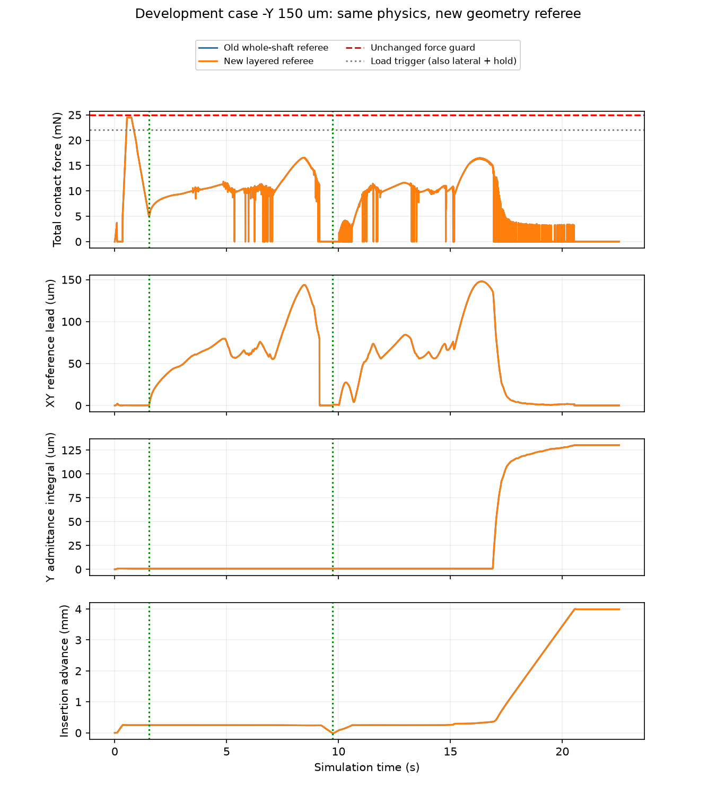
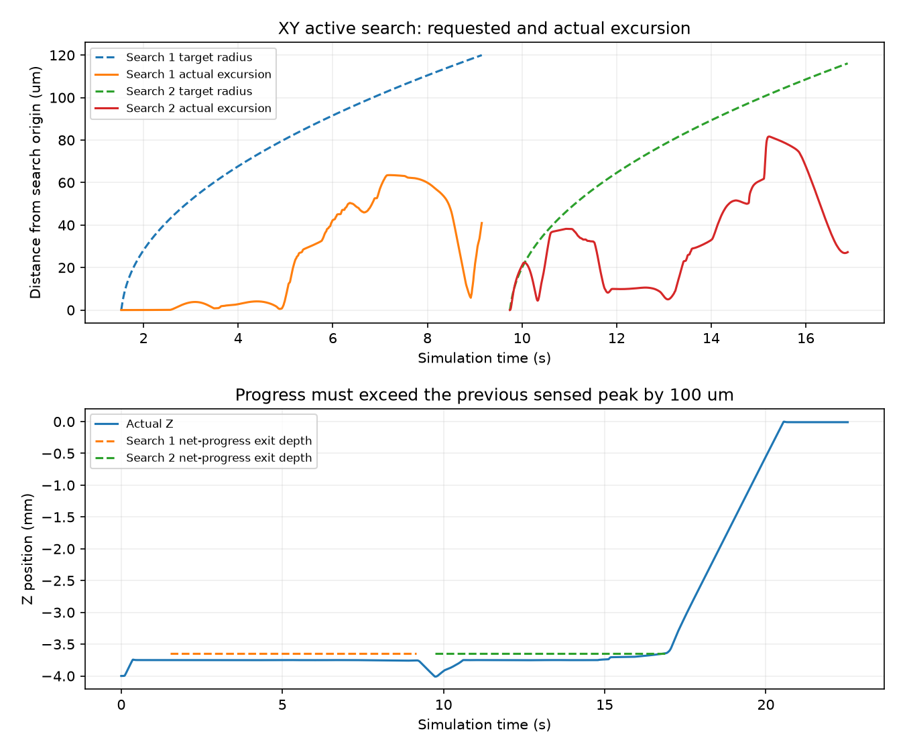
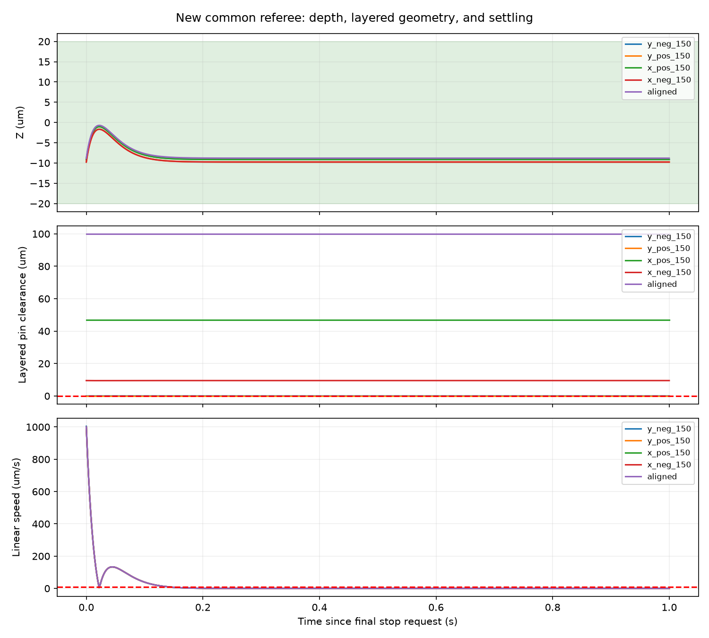

# 分层孔几何裁判修复与有限方向回归

截至 2026-10-04 20:15:01（北京时间）。

**分层几何裁判修复已通过，五个开发工况全部功能成功。** 本阶段实施和有限回归完成；不等于B.2学习评价或论文方法已验收。

## 实测结果

| 工况（μm） | 正式结果 | 原因 | XY（μm） | Z（μm） | 角度（°） | 分层余量（μm） | 峰值力（mN） | 附加严格精度 |
|---|---|---|---:|---:|---:|---:|---:|---|
| −Y150 | FULL_SUCCESS | GEOMETRIC_SUCCESS | 97.607 | -9.116 | 0.4103 | 0.007451 | 24.4741 | 否 |
| +Y150 | FULL_SUCCESS | GEOMETRIC_SUCCESS | 76.921 | -9.747 | 1.7203 | 0.013206 | 24.3114 | 否 |
| +X150 | FULL_SUCCESS | GEOMETRIC_SUCCESS | 29.910 | -9.144 | 1.0850 | 46.916344 | 24.6024 | 否 |
| −X150 | FULL_SUCCESS | GEOMETRIC_SUCCESS | 91.921 | -9.757 | 0.6943 | 9.512015 | 24.6123 | 否 |
| 对中 | FULL_SUCCESS | GEOMETRIC_SUCCESS | 0.000 | -8.800 | 0.0000 | 100.000000 | 0.0000 | 是 |

共启动5/5次新动态，功能成功5，附加80μm/0.5°成功1；余0关闭，累计130。有效5/5，真实停稳5/5。控制周期36165、物理子步361650、墙钟1093.363秒。训练/网络/独立测试0，自动跟踪PAUSED。

功能成功与附加XY/角度精度分开：装配深度、九针实际几何配合、稳定保持和保护共同决定功能成功；附加80μm/0.5°不是本版本的硬成功条件。未运行的工况不进入成功率分母。

## 修复了什么

旧 `pin_clearance_m` 把整根针的投影包络都塞进半径0.600mm的窄主孔，连实际处于0.675mm宽入口的针段也如此检查。它是充分条件，会误拒绝边界可行姿态。新模块 `tools/model/layered_task.py` 将圆柱与每个孔层的Z范围相交后，对实际256个切平面求支撑极值；入口台阶和九针主孔相交要求均保留。只由新 `LayeredReferenceSession` 使用，不改历史函数。

原1nm几何容差、20μm深度、0.1秒保持、速度/力/矩/穿透条件以及25秒、控制器、孔径和保护全部保留。几何真值只用于完成裁判，没有注入策略观测或动作。新共同版本为 **dsub9_clearance120_layered_25s_v4**，未来所有基线必须共用。

负Y复验在20.540秒到达目标面，20.780秒成功，22.540秒结束真实停稳尾段。完整11271点的六组物理/执行字段与旧25秒档案逐值一致；旧TASK_FAILURE档案不变，新回合正式FULL_SUCCESS。这证明本轮修正了裁判误判，**不是控制器轨迹优化，也不是残差学习效果**。

## 验证与局限

- 236项相关测试通过：真实干涉、宽入口反例、层边界、原容差、无主孔相交、异常姿态、四元数缩放、功能条件、接线与预算均覆盖。几何23项、入口14项有RED→GREEN日志。
- 已保存轨迹501个样本离线回放，新裁判连续合格0.86秒；旧裁判仍失败。生产算法与30组独立稠密表面核对最大差约2.09e-13 m，未增加物理步。
- 独立审查另核48姿态×8192角度，Critical/Important/Minor均0。因平台agent数量限制复用审查员，非全新上下文。
- 负Y末态分层余量+0.0074505μm；向外1nm仍合格，向外10nm即不合格。该量描述当前贴壁状态，不是已取得纳米定位精度，也不是扰动稳健性证明。
- 结果限当前开发点和仿真模型；负Y末态贴壁余量约7.45nm，向外10nm扰动即被拒绝。没有独立测试、多种子、硬件证据或方法优于基线的结论；B.2学习评价未完成，训练准入未授予。

## 下一项

冻结v4共同任务和当前传统B2基线，进入论文对照实验准备：统一所有基线的裁判、预算与开发分布，确定成功率、插入用时和接触载荷指标及最小消融，再登记有限学习/对照预算。当前五个开发点只证明基线能完成任务，不证明残差SAC增益；本轮没有启动新训练。

## 执行裁定

1. 按用户要求保留原脏目录与旧接口，不提交或清理，复现依赖源/文档快照。
2. 仅运行相关套件和登记动态，避免裸全库pytest新增物理；不宣称全库验收。
3. 平台agent thread limit限制导致复用独立只读审查员；仍有独立作者审核，但非fresh context。
4. 真实模型准确性、工程稳健性和浮点形式证明不在本次验收内；结论不外推到硬件、泛化或训练准入。无遗留审查Minor。

## 证据

- [配置](configuration.json)、[单变量配置比较](configuration_comparison.json)、[运行账本](run/ledger.json)、[正式核对](assessment.json)
- [完整负Y复现比较](target_reproduction.json)、[轨迹比较](trajectory_comparisons.json)、[完成条件分项](completion_diagnosis.json)、[命令/进展重算](diagnosis.json)
- [离线边界及回放](offline_validation.json)、[审查](review.md)、[236项测试](tests_final.txt)、[封存核验](verification.json)、[完整清单](delivery_manifest.json)

同目录有图表PDF。之前八轮1850封存文件保持，新的执行源码及六份滚动资料均保存当时快照。
