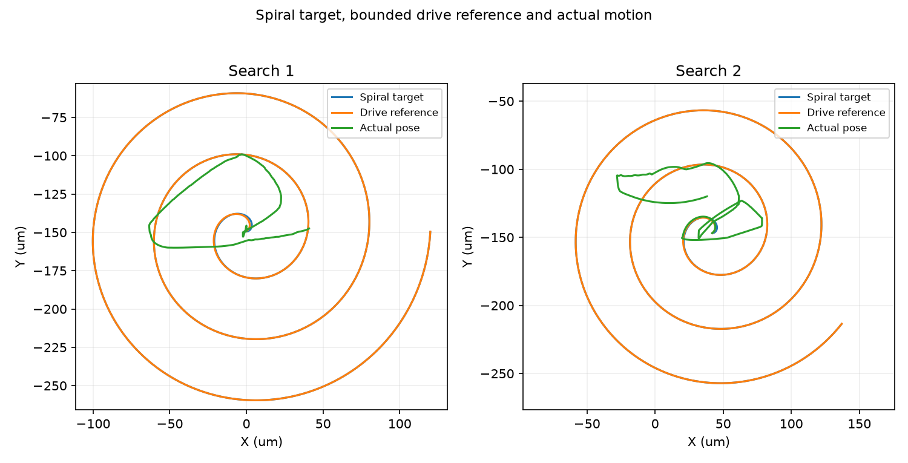
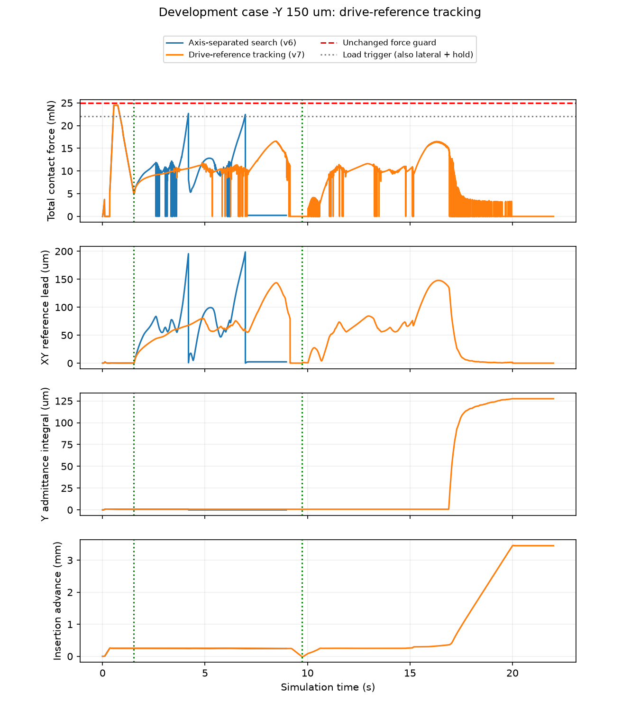

# 驱动参考一致性修复：有限验证结果

截至2026-10-04 19:14（北京时间）。**本工况的驱动参考漂移已修复，插入推进从前轮约0.241 mm改善到3.451 mm；20 s总时限内仍未完全成功，B.2未验收。** 本轮实现、审查、有限实测与归档完成，不等于论文方法收益已通过。

## 实际结果

| 项目 | 实际值 |
|---|---:|
| 新动态/本轮上限 | 1/5个开发回合，仅负Y150 μm |
| 功能成功/附加80 μm与0.5°精度 | 0/1；0/1 |
| 仿真有效/真实停稳 | 1/1；1/1 |
| 硬接触保护/运动保护 | 0；0 |
| 停止原因 | TIME_LIMIT，20 s总动作时限 |
| 最终推进/距零深度平面 | 3.450839 mm / 0.549161 mm |
| 最终XY/角度/九针几何余量 | 100.338 μm / 0.409447° / −4.16048 μm |
| 全回合峰值力/穿透 | 24.4741 mN / 7.10649 μm |
| 停止/任务结算/物理尾段结束 | 20 / 21 / 22 s |
| 控制周期/物理子步/墙钟 | 11000 / 110000 / 419.134 s |
| 累计动态/本轮关闭余量 | 124 / 4 |
| 训练/网络调用/独立测试 | 0 / 0 / 0 |

首例未FULL_SUCCESS，按预登记规则关闭其余4例，无重试。自动跟踪PAUSED。原主孔1.20 mm、功能判据和所有物理保护保持；没有将本轮失败改记成功。

## 修复内容与检查

旧搜索用“目标−实际位置”产生速度，执行器又把该速度积分到驱动参考，接触阻碍造成重复积累。新SEARCH用“目标−当前驱动参考”反馈，XY导纳仍冻结，Z8 mN控载及角向一次导纳、INSERT、净推进和原状态门保持。观测只增加执行器自己的相对参考与上一限幅命令，无孔中心真值输入。

前馈采用原螺旋相邻目标点的位移差，与离散周期积分一致。用实际执行器绑定的限速和加速度预测下一参考位置，当前或预测参考越出120 μm圆盘即受控停止。最后缩短的边界段若无法按原加速度制动，则按原搜索耗尽规则提前至多一个2 ms周期结束；不放宽圆盘、不直接改真实位姿。这个边界处理来自整段纯控制失败反例，本轮第一次搜索确实使用了该分支。

独立审查发现恢复后参考已重置、首命令仍可能使用旧观测。新会话改读env.reference/env.command当前状态，共享EpisodeSession在恢复重置后刷新观测。两项回归验证通过；初次会话测试构造缺少初始化字段的失败也如实保留，补全后用保存的旧方法复现真正失败，再验证修复版。

- **184项相关检查通过**；未运行含未登记动态的历史全量测试。
- 纯“实际位姿受阻”参考积分：旧最大参考319.364 μm，新119.996 μm；无MuJoCo物理步，不作为成功样本。
- 实测7384个SEARCH命令独立重算误差<3.1×10⁻¹⁶ m/s，限幅命令误差<1.2×10⁻¹⁶ m/s。
- 实测参考预测误差<6.1×10⁻¹¹ μm；SEARCH的XY导纳offset/velocity冻结误差均为0。
- 首次干预前764个样本（至1.526 s）的实际位姿、速度、接触、限幅命令、参考与前轮完全一致。
- 一次独立审查Important 1项已修复，无遗留项；不由代码审查推定历史模型资格或训练准入。

证据：[计划](../../../docs/superpowers/plans/2026-10-04-reference-search.md)、[检查](tests_final.txt)、[审查](review.md)、[纯控制反例](offline_probe.json)、[干预前对照](trajectory_comparisons.json)、[命令/参考/推进独立核对](diagnosis.json)。

## 实测中的变化

| 搜索段 | 时段 | 参考最大半径 | 参考对目标最大偏差 | 实际XY最大位移 | 搜索段峰值力 | 结束 |
|---|---|---:|---:|---:|---:|---|
| 第一次 | 1.526–9.150 s | 119.996 μm | 1.414 μm | 63.510 μm | 16.562 mN | 正常搜索耗尽，回撤恢复 |
| 第二次 | 9.742–16.886 s | 116.119 μm | 1.375 μm | 81.653 μm | 16.493 mN | 净推进100.118 μm，转INSERT |

前轮参考偏离目标最大122.806/146.501 μm，本轮降至约1.414/1.375 μm；没有再次触发搜索载荷卸载或SEARCH_REFERENCE_LIMIT。目标、参考、实际公头运动是不同量：参考跟踪正确，不意味着公头无接触阻碍地完全跟随。

第二次搜索从z=−4.009527 mm恢复，退出时z=−3.643062 mm，确实超过先前最深−3.743180 mm约100.118 μm；退出不是把回到旧孔口当作新进展。恢复后的首命令也包含在独立参考预测核对中。

转INSERT后，到20 s仅剩3.114 s，实际推进3.093901 mm，平均轴向速度0.993546 mm/s；该段各相邻控制记录Z都向前推进，峰值力15.041 mN。停止前速度约0.990926 mm/s，记录支持“正在插入时被时限截断”，不是前轮的搜索载荷失败。

[推进与搜索图](search_diagnosis.png)、[三图PDF](results.pdf)、[搜索PDF](search_diagnosis.pdf)、[参考PDF](reference_diagnosis.pdf)、[时间核算](deadline_analysis.json)、[全部搜索段几何/载荷统计](contact_feasibility.json)。

## 还不能宣称解决的问题

完整深度尚未达到，末态九针几何余量仍约−4.16 μm，XY100.34 μm也不满足附加80 μm精度。不能因为末段连续推进就宣称延时必然成功；后续还需真正到位、九针配合、稳定保持及完整停稳审核。此次只有一个开发工况，不能外推所有方向、独立测试或多种子，更不能作为残差SAC优于基线的论文结论。

## 下一步：只验证共同时间预算

建议新任务版本将总动作时限统一从20 s改为25 s。保留本轮控制器、孔径、功能/精度判据、力/姿态/穿透保护与两次搜索资格。两次约8 s搜索、卸载/回撤及约4 mm的插入行程，需要更充足的总时间；当前末段速度外推剩余约0.553 s，仅用于制定验证范围，不计作成功证据。

新25 s版本须对后续所有共同基线一致应用；本轮20 s失败保留，不回溯改判。另登记有限负Y及共同方向回归预算，不结转本轮余4例。若延时后仍有几何不合格、保护或停稳问题，应记录新失败并停止继续自动延时。该下一方案尚未实施；新训练仍未准入。

## 使用与封存

本轮固定入口tools/validation/run_reference_search_preflight.py已消费预算，有run目录会拒绝重启。使用[账本](run/ledger.json)、[完整轨迹](run/y_neg_150.json.gz)、[配置](configuration.json)、[配置绑定](preparation_binding.json)、[功能/停稳独立审核](assessment.json)只读复核。

前六轮1350个封存文件保持；887项执行输入在运行前后核对一致。根目录滚动资料保存当时快照，历史记录不改写。最终归档见[核验](verification.json)、[封存清单](delivery_manifest.json)。
