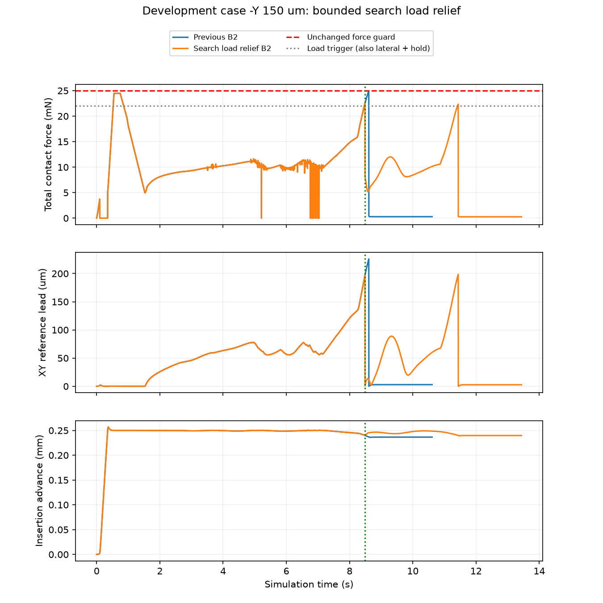

# SEARCH载荷卸载与参考释放：本轮验证结果

动态截止2026-10-04 00:48，北京时间。

**本方法没有解决负Y插入失败。** 新触发/参考释放实际生效，本回合没有接触或运动保护；但第二次搜索再次出现侧向载荷积累，两次搜索资格耗尽而正常失败停稳。不能把“没有越力”写成“插入成功”。按首例必须成功的预定门槛，本轮实际1/5动态，其余4关闭、不重试；累计120，训练/网络/独立测试0，自动跟踪PAUSED，B.2仍未完成。

## 改了什么

本轮保持1.20 mm孔径、功能成功、80 μm/0.5°附加精度、25 mN总力保护、2.5°旋转保护及原两次搜索/20 s时间上限。

SEARCH中侧向力≥12 mN且总力≥22 mN持续20 ms，进入原UNLOAD；在下一物理步前一次把XY控制参考对齐当前实测XY，保留实际qpos/qvel/time、Z/姿态参考、保护事实和原命令限速。低载荷后使用原下一次搜索资格重新搜索。不是移动/重置真实物体，也不是增加无限搜索次数。这个参考管理动作属于新的共同控制器能力，后续所有对照必须共享并重新绑定资格。

原SEARCH的实际位移越界、推进完成、超时及半径耗尽优先级保持。独立审查发现新触发可能抢先改阶段的问题，已加四个同周期反例，先RED后修复。相关检查最终81项通过；不是全项目测试。

## 实际结果与时序

| 指标 | 结果 |
|---|---:|
| 工况 | 初始负Y150 μm、零倾角 |
| 任务结果 | TASK_FAILURE / SEARCH_BUDGET_EXHAUSTED |
| 仿真有效/实际停稳 | 是/是 |
| 功能成功/严格精度 | 否/否 |
| 完成的实际推进 | 0.239755 mm，目标约4 mm |
| 终末XY误差 | 173.914 μm |
| 终末参考深度位置z | −3.760245 mm |
| 九针最小保守配合余量 | −76.076 μm |
| 全回合峰值总力 | 24.474139 mN，低于25 mN |
| 控制周期/物理子步 | 6718 / 67180 |
| 单回合墙钟 | 278.659 s |

1. 0.746 s：原停滞规则卸载；1.526 s：第一次SEARCH。
2. 8.486 s：新载荷触发，总力22.509565 mN、侧向20.910377 mN；一次释放XY参考误差+129.668/−148.257 μm。
3. 8.570 s：载荷下降后进入第二次SEARCH。旧同点在8.6098 s触发25 mN保护；本轮越过了该故障时刻。
4. 11.436 s：第二次SEARCH又满足持续高载荷条件，没有剩余搜索资格，按约定失败并停止；不是8 s搜索超时，也不是实际位移越界。13.436 s完整物理停稳尾段结束。

新旧前4244个采样（至首次新触发8.486 s）的真实位姿、速度、接触力、命令及参考逐值相同，之后参考释放和实际载荷下降均有记录。证据：[轨迹比较](trajectory_comparisons.json)、[机器裁决](assessment.json)、[原始账本](run/ledger.json)。

正Y150、±X150及对准本轮均未执行；此前成功档案保留，不能将其记作新版本回归通过。

## 新定位到的具体机制

**只释放驱动参考，没有处理导纳内部已耗尽的Y纠偏额度。** 原导纳将累计命令纠偏限制在±500 μm。8.248 s时，Y内部额度已达到+500 μm，但实际Y从初始位置反而移动约−9.23 μm；此后即使接触力指向+Y卸载，导纳Y速度也被额度限为0。

本轮SEARCH中共有949个控制采样同时满足“Y额度达到上限、Fy为正、导纳Y输出0”，其中693个采样的总Y命令仍为负，即螺旋/位置跟踪继续向相反方向推进。11.434 s，Fy约+20.432 mN，导纳Y输出0，总Y命令约−0.221 mm/s，Y参考又领先实际位置约−196 μm。参考释放后这个内部额度仍被保留，因此第二次搜索再次顶压。

同一已存状态的纯控制公式核对：原额度下Y导纳输出0；仅在克隆状态中将Y偏移清零则输出+0.185 mm/s。此项没有物理步，只证明额度在该状态确实抑制了卸载响应，不证明“直接清零”就能完成插入，也不是已实施的新控制方案。诊断见[failure_diagnosis.json](failure_diagnosis.json)。这里的500 μm是导纳内部累计命令，不等于真实物体已经移动500 μm；不能混为位移事实。

## 判断与下一项

本轮是“越力路径得到干预，功能任务仍失败”。不增加搜索次数、不放宽保护、不把新失败删除，也不继续追加SAC训练。

下一修复应集中在**搜索命令合成、导纳积分额度与参考释放之间的一致性**：明确搜索/卸载重新定参考时，导纳内部状态应如何重设或做抗饱和处理；保留实际运动/参考领先边界，避免只把500 μm上限调大。同步防止螺旋在有效卸载纠偏已被限死时继续顶压。先用上述已存状态完成一项有边界的方案，再另登记有限负Y验证及共同回归。不能由这份诊断推定唯一原因已经穷尽或下一方案必定有效。

本阶段代码、限定验证和归档完成，**整体修复效果未通过；余4关闭，B.2未验收**。旧两阶段共426个封存文件保持；运行源码、配置、错误/控制事件、完整轨迹及停稳审核均保存。复现实验须从对应源快照和运行库证明开始，不直接重跑已经消费预算的入口。
