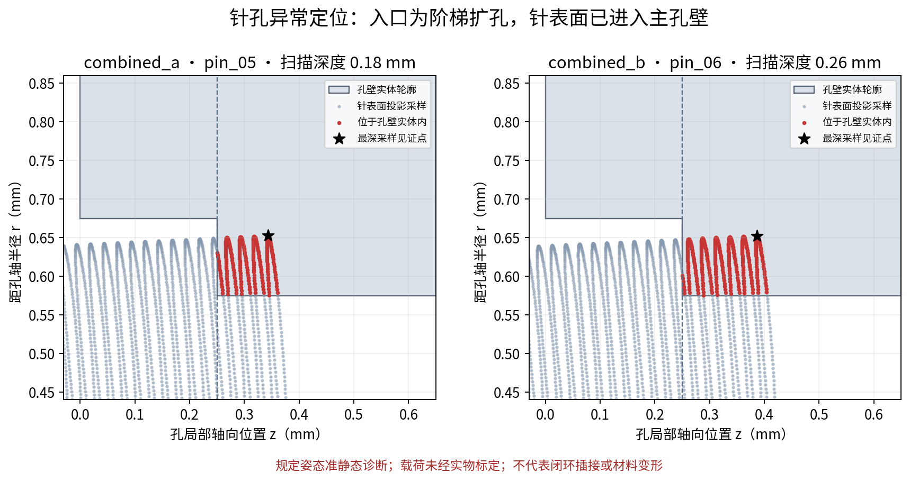
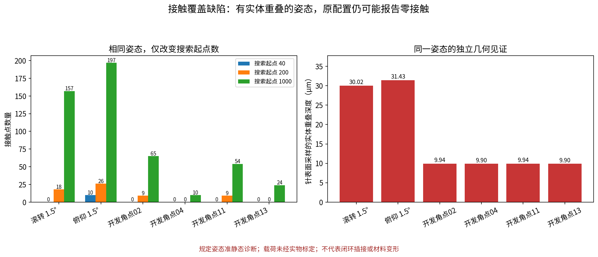
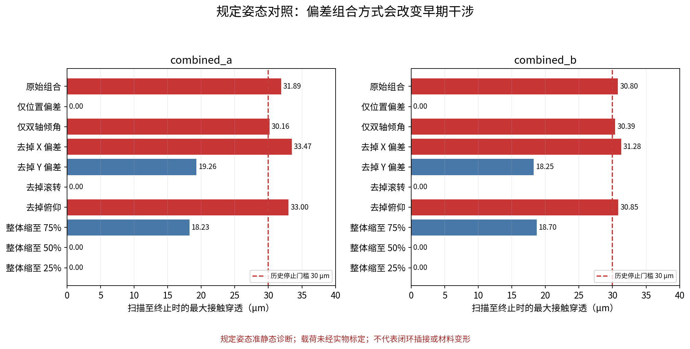

# V1 控制开发适用性诊断

日期 2026年9月14日

**结论：接触异常诊断已形成证据，当前 V1 碰撞配置尚不满足接触反馈控制开发的进入条件。** 可以继续设计接口和搭建自由空间动态框架，但接触闭环、B1 验收和 SAC 正式训练应等待接触检出覆盖问题修正并复验。

这次未修改原始几何、接触参数、30 μm 停止门槛或 V1 报告。全部新增结果来自规定姿态 `mj_forward`；不存在自由动力学或实物实验。

## 组合工况为什么超限

独立解析几何计算确认：组合姿态下，部分针表面已经进入主孔壁实体。孔入口是直径 1.35 mm、深 0.25 mm 的圆柱浅扩孔，其后接直径 1.15 mm 主孔，存在入口台阶。公头姿态在扫描中保持固定，接触反力不能让公头自行纠偏，所以继续推进会保持或增加干涉。

这支持“规定组合姿态与阶梯孔存在真实的模型几何干涉”，不是实物卡滞结论，也不代表针脚发生等量材料变形。位置偏差、双轴倾斜及九针阵列的空间位置共同决定干涉，不能归结为单一 X 偏差或直接认定应扩大孔径。

| 工况 | 首次接触深度 mm | 首次超限深度 mm | 超限时最大接触穿透 μm | 最深接触对象 |
|---|---:|---:|---:|---|

| combined_a | 0.110 | 0.180 | 31.894 | pin_05 / hole_sdf_05 |
| combined_b | 0.120 | 0.260 | 30.802 | pin_01 / hole_sdf_01 |



图为径向—轴向投影，不是 CAD 干涉体积或单一剖面。红点是针表面采样中位于孔壁内部的点。

## 两类穿透指标必须分开

原指标 `max(0,-contact.dist)` 是 MuJoCo 实际找到的接触点中的最大负距离；独立指标是在针表面采样，计算该点距孔壁实体边界的负距离。两者的采样位置和定义不同，不能要求数值相等，不能把独立值直接代入原有 30 μm 门槛。

独立采样的最大值是已发现的重叠证据下界，不是连续表面最大值的证明。采样未发现重叠也不代表绝对无干涉。检查只覆盖相应针孔，不认证 D 形壳或其他交叉碰撞的完整性。

| 工况与姿态 | 针表面实体重叠见证 μm | 见证针 | 360角点/161轴点细化到720/321 |
|---|---:|---|---|

| combined_a 首次超限姿态 | 77.508 | pin_05 | 77.508 μm |
| combined_b 首次超限姿态 | 77.361 | pin_06 | 77.361 μm |

## 新发现的接触覆盖缺陷

在相同的几何、姿态和接触参数下，独立几何见证存在实体重叠，但原 SDF 搜索配置会遗漏相应针孔接触。滚转 +1.5°、4 mm 深度的姿态中，约 30.02 μm 的采样重叠与零接触同时出现。仅提高搜索起点数就能检出接触，说明 SDF 接触搜索覆盖不足是实际问题；只增迭代次数在已测姿态中没有相同效果。

MuJoCo 的 SDF 接触搜索使用多个初始点寻找局部极小值，搜索起点和迭代次数是独立设置。依据：[MuJoCo SDF 扩展文档](https://mujoco.readthedocs.io/en/3.1.2/programming/extension.html)。本次具体数值来自本机 MuJoCo 3.9.0 实测，不由该旧版说明推定。



开发角点04和13在200个搜索起点时仍然零接触，1000个起点才检出。增加到200或1000个搜索起点不是已经验收的修复方案。需要对完整开发集复验接触覆盖、方向、载荷和动态性能，并测量计算成本；不能仅凭某一姿态重新出现接触就放行。

## 偏差拆分与开发范围



保持其他项不变时，去掉滚转或 Y 偏差可使原组合扫描不再触发 30 μm 门槛；仅保留双轴倾斜仍会超限。整体缩小到 75% 后，A/B 均扫描到目标深度，最大接触穿透约 18 μm。它们仍只是扫描对照，不能算成装配成功或控制能力。

候选开发集使用 X/Y 各 ±25 μm、roll/pitch 各 ±0.5° 的16个角点及16个固定种子随机点（种子20260914）。32 条扫描均到达4 mm，最大接触穿透 4.543 μm。
但对该开发集在0.5、1、2、4 mm的 128 个姿态进行独立抽样核对后，发现 15 个姿态遗漏了至少一对存在超过1 μm实体重叠见证的针孔接触。因此这个候选范围也不能按原SDF配置宣布通过。1 μm仅用于避免将数值边界误差标作漏检，不是新的安全阈值。

## 敏感性与夹持参考点

| 工况 | 对照 | 终止深度 mm | 最大接触穿透 μm |
|---|---|---:|---:|

| combined_a | 空间步长 5 μm | 0.180 | 31.894 |
| combined_a | 空间步长 2 μm | 0.176 | 30.360 |
| combined_a | low_response | 0.180 | 31.894 |
| combined_a | high_response | 0.180 | 31.894 |
| combined_a | 绕建议夹持点旋转 | 0.000 | 82.289 |
| combined_b | 空间步长 5 μm | 0.260 | 30.802 |
| combined_b | 空间步长 2 μm | 0.258 | 30.523 |
| combined_b | low_response | 0.260 | 30.802 |
| combined_b | high_response | 0.260 | 30.802 |
| combined_b | 绕建议夹持点旋转 | 0.000 | 98.853 |

加密空间网格将A/B首次超限定位到0.176/0.258 mm，改变了阈值跨越的采样位置，没有消除几何干涉。这不是动态时间步收敛试验。low/high response同时改变多个等效接触参数，只是参数包对照，不能分离出单个摩擦或刚度参数的因果贡献。

夹持点对照保持名义夹持中心位置，再绕 `(0,0,-14.5 mm)` 旋转，因此改变了公头插合原点的实际位置，不能与“同一最终姿态只换坐标表达”混淆。该构造在扫描起点就已超限，提示动态 reset 必须先给出实际公头目标姿态，再计算夹持点位置并检查初始重叠。它不证明建议夹持位置不可行；当前夹持中心仍未经实测。

## 进入下一步的处理结论

1. 保留V1全部历史结果和压力工况；不改孔径、不放宽门槛来掩盖问题。
2. 优先解决SDF接触搜索覆盖：固定同姿态见证点，评估搜索设置、碰撞表示及几何边缘处理。回退polygon32可作独立对照，但也需要覆盖及精度核验。
3. 修复后至少复查原12工况、组合拆分工况、候选开发角点和随机点；同时核对接触方向与计算成本。需要增加开发区间内的深度采样，不能将现有离散点外推为连续域保证。
4. 可同步建立自由空间动力学、命名坐标系和接口。接触闭环要先通过上述覆盖复验；随后独立检查受力运动、停止回撤及动态时间步敏感性。
5. `闭环接口协议.md` 是下一阶段的接口设计，不代表环境、B1、安全守卫或SAC已经实现。

## 复现与证据

从项目工作树运行：

```powershell
& 'D:\KEYANRUJIAN\python.exe' -X utf8 -B -m tools.validation.diagnose_v1_applicability
& 'D:\KEYANRUJIAN\python.exe' -X utf8 -B -m tools.reporting.report_v1_applicability
& 'D:\KEYANRUJIAN\python.exe' -X utf8 -B -m pytest tests/contact/test_applicability.py -q -p no:cacheprovider
```

主数据为 `diagnostic_results.json`：包含62条主扫描、10条扫描敏感性、几何见证、接触覆盖审计、同姿态搜索参数对照、源文件SHA-256及生效参数。两份用户提供的模型备忘录保存在 `inputs/`，其中建议和待验证项不当作实测事实。

分支基线为 `a289a277d69a445e7491aaf74af92b1201d4f5d9`；新增诊断代码以结果中的源码哈希追溯。正式输出均在本目录，与旧 `reports/` 分开。
