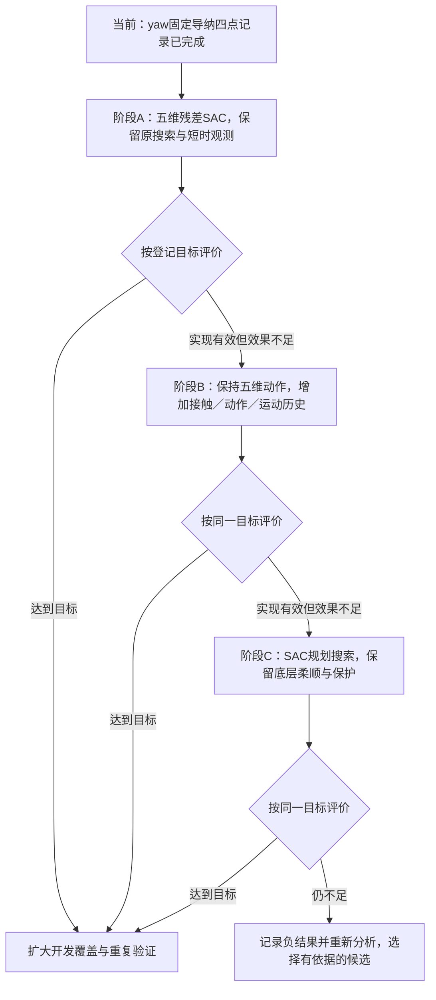

# 五维残差SAC、时序信息与SAC自主搜索：整体路线计划书

> **阅读说明：这是研究路线与候选方法的计划书，不是已经完成的算法交付或训练执行记录。**
> 本次按用户确定的顺序编写：先尝试五维残差SAC；效果仍不足时再加入较长的接触、动作与实际运动历史；仍不足时再尝试由SAC规划搜索。此前建议的搜索暂停、模仿学习等保留为候选，不自动加入第一阶段。

| 文档项 | 内容 |
|---|---|
| 文档编号 | B2-SAC-YAW-ROADMAP-20261023 |
| 版本与日期 | v1.0／2026-10-23 |
| 所属阶段 | B.2第3项；对应原第3项控制、第4项学习、第7项评价、第8项记录 |
| 目标（Goal） | 逐步验证五维动作、较长历史与自主搜索能否改善联合位置／姿态偏差下的九针插入表现 |
| 架构（Architecture） | A、B阶段保留传统螺旋搜索与固定导纳，SAC提供有界修正；C阶段才替换预设搜索轨迹，底层导纳与共同保护继续保留 |
| 技术基础（Tech Stack） | 现有Python、MuJoCo、SAC训练链、N2动力学与九针分层几何判据 |
| 依据（Spec） | 本轮用户确定的三阶段顺序；现有[训练合同v3](../../stage_b/训练合同_v3.md)作为历史四维接口依据，五维实施需另写版本化补充，不覆盖旧合同 |
| 事实与状态 | 首组yaw固定导纳四点完成0/4；A/B/C均未实现或执行。实时执行状态只在[项目进度跟踪](../../../项目进度跟踪.md)维护 |
| 本次范围 | 计划与索引整理；新增物理初始化、策略调用、训练更新均为0，科研初始化累计仍372 |

## 目录

1. [路线与使用原则](#route)
2. [已有证据与共同条件](#evidence)
3. [阶段A：五维残差SAC](#stage-a)
4. [阶段B：增加接触、动作与运动历史](#stage-b)
5. [阶段C：由SAC规划搜索](#stage-c)
6. [阶段判断与评价规则](#evaluation)
7. [模块与候选方法登记表](#modules)
8. [工程对应与重点核查](#engineering)
9. [交付、预算与记录格式](#records)
10. [证据、参考与版本记录](#references)

## 1. 路线与使用原则

**主路线：A五维残差SAC → 若不足则B增加较长历史 → 若仍不足则C由SAC规划搜索。**

本文件的A/B/C是**B.2内部的方法验证步骤**，不等同于项目总体A/B/C阶段；进入这里的C步骤，不代表完整B.2已验收或项目总体C已经启动。

若查看器不支持Mermaid，以上加粗文字就是等价路线。

- 先验证当前阶段，不预先把三个阶段全部堆在同一个模型上。前一阶段达到目标后，不为使用更多模块而自动升级。
- “原来的SAC”指复用经过核对的算法与训练流程，不等于直接运行旧四维演员或把旧经验机械补成五维。
- A阶段不默认加入搜索暂停、长历史、GRU、模仿学习、可变导纳、主动yaw扫描或新的接触门控。它们的取舍见第7节。
- 技术接口失败、仿真无效、动作未生效和训练效果不足分别处理。前几项不能作为“该算法不行”的证据。
- 本文确定研究顺序与比较原则；后续实施计划再冻结具体动作尺度、训练规模、评价目标及执行成本。本文不启动任何训练，也不重开旧预算。

## 2. 已有证据与共同条件

### 2.1 可以据此开展计划的事实

| 已有证据 | 对本路线的含义 | 不能推出的结论 |
|---|---|---|
| 旧普通残差SAC允许在INSERT和SEARCH介入；另有仅SEARCH的S类版本 | A阶段应明确沿用哪一权限版本；本路线以普通版本为起点，不默认为S类 | 不能说旧SAC只在插入阶段起作用 |
| 旧动作是X、Y、roll、pitch四维，没有yaw残差 | A阶段先补齐直接输出yaw修正的能力 | 不能认为旧检查点已经具备yaw学习能力 |
| 本轮被动yaw导纳确实生效，正负yaw表现不同；四点均超时 | 有理由验证学习纠偏是否改善协调 | 尚不能确定唯一失败原因，也不能认定传统控制普遍失效 |
| 少数针端曾发生微米级孔口浅探入，但无针进入主孔段 | 评价应保留逐针诊断，并区分入口与主孔 | 不能描述为已稳定插入主孔后的卡死 |
| 搜索中存在指令持续运动、实际横移很小的阶段 | B阶段可考察动作—运动—载荷历史；暂停和受阻监督值得列作候选 | 不能仅凭低速认定具体针孔卡滞原因 |
| 旧四帧力历史首尾相隔6 ms | A不是完全无历史；B增加的是更长、更完整的时序信息 | 不能把A/B说成“无历史／有历史”的绝对对比 |

### 2.2 A、B阶段共同起点

| 项目 | 沿用条件 |
|---|---|
| 物理模型 | 当前N2动力学；本路线不改变针孔尺寸、摩擦、质量惯量或接触模型 |
| 初始姿态 | 已接通的 `R = Rz(yaw) Ry(pitch) Rx(roll)`；原接口省略yaw的兼容行为保持 |
| 位置误差 | X/Y是公母头装配原点在任务坐标中的初始单轴偏差，不是给各针分别设置独立误差 |
| 传统搜索 | 最新450 μm/s螺旋搜索与现有搜索范围，保持同版本配置 |
| Z向控制 | 沿用搜索力2 N及原推进／卸载调节，不新增SAC的Z动作 |
| 保护与时间 | 25 s任务时限、5 N／0.1 N·m保护、相对起点2.5°旋转保护，其他共同保护沿用 |
| 姿态导纳 | 保留roll/pitch及已实现的独立Mz→yaw导纳；首轮不同时学习导纳参数 |
| 成功与停稳 | 沿用现有九针分层几何、任务结果与停止审核，不用浅探入替代成功 |
| 策略信息 | 可部署的载荷、相对起点运动、执行器及控制器状态；真实孔位误差、逐针接触与配合真值不进入部署策略 |

现有四点为：X/Y各+0.30 mm、roll−1°、pitch+1°，yaw依次+1°、−1°、+1.5°、−1.5°。它们都是**已使用开发点**，不是未见最终测试。

## 3. 阶段A：在原残差SAC基础上加入第五维yaw

### 3.1 要回答的问题

在不同时引入长历史或改变搜索策略的前提下，新增主动yaw残差，能否改善整体位置—姿态协调与九针插入表现？

### 3.2 改动范围

五维归一化策略动作：

`a = [a_x, a_y, a_roll, a_pitch, a_yaw]`。

对应六维速度修正：

`Δu = [s_x·a_x, s_y·a_y, 0, s_roll·a_roll, s_pitch·a_pitch, s_yaw·a_yaw]`。

| 修改项 | 要做的内容 | 边界 |
|---|---|---|
| 动作与学习器 | actor输出、critic动作输入、动作归一化、策略分布、熵与回放记录统一适配五维 | 不能只修改演员最后一层，其他位置仍暗含四维 |
| 命令合成 | 将yaw残差与同一周期的基线命令合成，再经过共同限制 | yaw导纳只更新一次；区分请求、阶段屏蔽、限幅后命令与实际运动 |
| 观测一致性 | 必要的前次残差、yaw导纳状态、累计修正等字段与新接口一致 | 保留原短时历史；这些必要字段适配不等于提前进入B阶段 |
| 阶段权限 | 沿用普通残差版本的INSERT/SEARCH合法权限；卸载、停止、回撤及终止时屏蔽残差 | 不把旧演员直接改套S类或G类门控；任何权限变更单独登记 |
| 版本与恢复 | 新建五维接口、模型、检查点与经验版本，保留旧四维记录 | 旧权重和经验不默认无损兼容；首版优先使用独立五维训练起点 |
| 尺度与时钟 | 核对N2载荷归一化、角向动作尺度、策略保持周期、实际Δt与折扣 | yaw尺度参照同版本roll/pitch作为候选，实施前冻结，不把0.02 rad/s导纳上限直接当作SAC残差幅值 |

**特别核查：旧动作合成器存在SEARCH的XY分量300 μm/s上限，而当前传统搜索为450 μm/s。** 接入时必须统一同版本配置，确保零残差不会因套用旧接口而悄悄把当前基线降速。该兼容修正要同时用于配对基线，不能形成额外优势来源。

### 3.3 实施与验收任务

- [ ] A0：明确实际复用的普通SAC入口、算法版本、观测白名单及当前N2基线，形成五维补充设计与配置。
- [ ] A1：先验证五维映射、正负yaw残差、禁用阶段掩码、全部限幅及回合状态重置，再接通最小实现。
- [ ] A2：验证零残差与同版本基线一致；验证非零yaw请求能够进入实际受限命令；核对阶段切换、恢复和完整检查点保存／恢复。
- [ ] A3：完成登记的五维SAC训练与匹配开发评价，保留所有有效失败与无效尝试，记录实际成本。
- [ ] A4：按第6节复盘。达到目标则扩大验证；效果不足且证据指向信息或历史不足时，进入B阶段。

**本阶段不预先改变奖励目标、网络历史结构、搜索路线、搜索暂停规则或导纳参数。** 若实施发现必须调整共同接口，需在记录中区分兼容修正和方法新增。

## 4. 阶段B：增加接触、动作与实际运动历史

### 4.1 进入理由与假设

A阶段接口和训练链有效，但同类当前观测下仍反复选择不合适的动作，或无法区分滑动、受阻、卸载与短暂脱离接触时，考察历史信息是否有用。

**假设：**同一瞬时合力合矩可能来自不同的逐针接触组合；动作及其后续运动、载荷变化能够增加判断线索。历史不保证唯一识别针孔状态，也不能在没有接触信息时凭空识别真实yaw误差。

### 4.2 增加的信息

| 历史字段 | 建议记录 | 考虑加入的原因 |
|---|---|---|
| 接触载荷 | 同一参考点与坐标约定下的六维力／力矩 | 观察接触建立、载荷积累、释放和方向变化 |
| 策略与执行动作 | 过去的策略请求、基线及受限执行命令 | 分清“策略想做什么”和“实际允许做什么” |
| 实际运动 | 相对位移／转动、线／角速度、轴向进展 | 分清继续滑动、持续受阻和真实推进 |
| 参考误差与阶段 | 参考与实际运动差、当前阶段及有效掩码 | 避免将参考积累当成实际运动，避免混淆搜索与回撤 |

### 4.3 优先采用的实现

- B1先做固定窗口历史堆叠，初步考察约0.1～0.4 s的覆盖范围；具体窗口与取样间隔依据已有事件时长登记，不默认全部以2 ms输入网络。
- A的五维动作、搜索与导纳、阶段权限、奖励目标和共同保护保持。B的新增变量首先限于历史内容与必要输入结构。
- 输入只使用作出当前动作之前已获得的信息；不得包含未来载荷、执行后结果或真实针孔误差。
- 回合开始、短历史填充、时间戳、采样间隔及有效位必须明确；训练／验证按轨迹或工况划分，不随机拆分相邻帧制造信息泄漏。
- 只有B1仍有明确的时间表达不足时，才登记B2比较GRU或TCN。若使用循环网络，经验采样、连续序列和隐藏状态处理必须同步适配，不能只替换网络层。

### 4.4 实施与验收任务

- [ ] B0：用已有开发轨迹检查历史是否包含受阻、滑动或接触变化的额外线索；分类或预测改善不等于插入能力改善。
- [ ] B1：登记窗口、字段和采样方式，实现历史堆叠及时间对齐检查，保持五维动作不变。
- [ ] B2：在配对训练条件下比较A与B；分别报告完成、保护、用时、载荷及失败过程，不只看训练奖励。
- [ ] B3：有依据时再比较循环／时序网络；不把它作为B阶段的必选起点。
- [ ] B4：按第6节复盘。若仍不足，按用户主路线进入C的独立设计与试验，保留B的负结果。

## 5. 阶段C：搜索运动由SAC规划

### 5.1 改变什么

只有到此阶段，才删除SEARCH中的预设XY螺旋轨迹。SAC决定有界的XY搜索运动及roll/pitch/yaw名义姿态动作；固定导纳提供接触柔顺，Z方向仍沿用现有力调节，停止、卸载、回撤和硬保护继续由共同逻辑执行。

**“搜索交给SAC”不等于让SAC直接输出关节力矩，也不等于取消碰撞、导纳或九针验收。**

| 项目 | C阶段定义 |
|---|---|
| 搜索路线 | 不再由螺旋发生器提供名义XY轨迹；SAC输出有界搜索运动目标 |
| 姿态动作 | 继续覆盖roll、pitch、yaw；与导纳接触修正的合成方式独立登记，避免重复计入 |
| 动作尺度 | 按自主搜索任务定义合理权限，不机械沿用只能微调的旧残差尺度；最终共同速度、姿态与载荷保护保持 |
| 插入阶段 | 首轮保留B的插入控制，仅替换搜索阶段的规划来源，避免同时重做整套回合逻辑 |
| 历史信息 | 初步沿用B已核对的信息设置，便于隔离“搜索规划来源”变化；无长历史版本可作为后续消融 |
| 搜索范围与时间 | 保留共同任务范围和时限；原螺旋相位不再作为有效状态，适配相关观测、经验和终止条件 |

### 5.2 原因与局限

自主规划可能学会反向移动、停留试探或更合适的平移—转动组合，但需要同时学会搜索覆盖和信息获取，样本需求可能更大。**B未成功不自动证明螺旋是原因，也不保证C更好。**

### 5.3 实施与验收任务

- [ ] C0：核对A/B失败过程，记录为何仍要比较自主搜索；明确其动作语义、名义目标与导纳合成方式。
- [ ] C1：只在SEARCH替换螺旋规划，移除或版本化相关相位／边界状态，保持其他共同执行逻辑。
- [ ] C2：检查搜索权限是否足以覆盖任务区域，验证静止、反向、转动及受限动作，不用旧小残差权限冒充全权搜索。
- [ ] C3：与同版本强传统对照及最佳A/B候选配对评价，记录探索成本、覆盖不足、保护失败与普通超时。
- [ ] C4：达到目标则扩大验证；否则形成负结果与原因清单，不自动增加一组未经分析的新模块。

## 6. 阶段判断与评价规则

### 6.1 “不行”必须区分原因

| 情况 | 正确处理 | 是否足以据此升级下一阶段 |
|---|---|---|
| 映射、限幅、阶段掩码、恢复、记录或数值有效性存在错误 | 修复当前阶段并核对受影响证据 | 否，不能称方法失败 |
| 残差请求非零，但命令层被抵消或持续裁剪 | 核对实际可控权限与共同限制 | 否，先确认策略确实能够起作用 |
| 训练尚未达到预登记规模，或更新／回放链无效 | 完成原登记检查和训练，或按实际中断收口 | 否，不能以训练未完成替代效果结论 |
| 实现有效，登记训练与评价完成，但未达到目标 | 分析失败机制，保存完整负结果 | 是，按A→B→C顺序提出下一阶段 |
| 只在现有四点出现成功，扩大覆盖表现不稳定 | 保留开发结果，继续约定范围验证 | 不能认定稳定成功率或完整B.2已完成 |
| 达到目标且扩大验证保持 | 固化当前最简有效版本 | 不必自动加入下一模块 |

### 6.2 共同评价指标

| 优先级 | 指标 | 解释要求 |
|---|---|---|
| 第一 | 九针功能完成数／有效回合数，普通任务失败与保护失败分别统计 | 单点一次是完成指示，不是成功概率估计；无效仿真单列，不删除 |
| 第二 | 全工况任务用时及成功回合用时 | 失败罚时沿用同版本登记口径，防止只看成功子集得到假改善 |
| 第二 | 峰值力、力矩，保护触发与停稳结果 | 不能靠突破共同约束换取成功 |
| 第三 | 实际位置与姿态、真实推进、逐针入口／主孔几何状态 | yaw数值减小、Mz减小或局部浅探入不能单独替代成功 |
| 诊断 | 分阶段策略权限、动作请求／有效命令、实际运动与恢复事件 | 用来解释改善或失败，不等同未经对照的物理因果贡献 |
| 成本 | 初始化、物理子步、策略调用、样本、更新及墙时 | 三阶段都记录，不能只比较最终最优回合 |

每阶段执行前登记同一评价目标、开发工况、训练种子与规模、评估次数、允许的调整范围及收口条件。**本计划不凭空指定一个成功率百分比或承诺达到某值。** 具体目标需结合初始开发覆盖制定，不能训练结束后按结果倒定标准。

### 6.3 比较对象与数据用途

- A：当前同版本固定导纳＋螺旋基线，对比五维残差SAC；零残差一致性先于效果比较。
- B：保持动作、基线、奖励与评价条件，比较A的短时观测和B的较长历史。
- C：共同信息与保护下，对比最佳残差候选和SAC规划搜索；动作语义变化及计算成本明确列出。
- 如据结果主张学习优于传统控制，需要补充具有合理主动yaw纠偏或阶段协调能力的强传统对照；不能将当前四点失败当作传统方法的普遍上限。
- 当前四点、旧八点及已读历史资料均为开发数据。新工况一旦用于挑模块或参数，就不得再标为未见最终测试。
- 阶段目标达到后，再进行更广正负方向覆盖和多个训练种子检验；同一确定性初始点机械重复不能替代鲁棒性验证。

## 7. 模块与候选方法登记表

**登记表记录“为何考虑、何时使用”，不表示所有模块都会加入。** M为主路线组成，K为条件候选；后续试验与报告引用编号，避免改名后丢失比较关系。

### 7.1 主路线模块

| 编号 | 模块／方法 | 使用阶段 | 使用原因 | 必须说明的局限 |
|---|---|---|---|---|
| M01 | 固定导纳与Z向力调节 | A/B/C保留 | 复用已有接触柔顺与执行能力，让学习聚焦纠偏 | 柔顺不保证对准；本轮被动yaw未在两种方向都回正 |
| M02 | 五维残差SAC | A开始 | 补齐旧四维动作缺失的yaw主动修正能力 | 需要新接口与匹配训练，旧检查点不能直接证明新场景有效 |
| M03 | 原螺旋搜索 | A/B保留 | 提供基本覆盖，先检验增加yaw和信息是否已足够 | 固定路线可能限制局部动作；该问题在C中单独比较 |
| M04 | 接触、动作与实际运动历史 | B条件加入 | 利用动作响应区分滑动、受阻和接触变化 | 历史不必然消除接触歧义，不能补出未观测的目标位姿 |
| M05 | SAC规划搜索运动 | C条件加入 | 摆脱预设路线，比较自主平移与姿态协调能力 | 探索与覆盖难度增加，不保证比残差方法更好 |
| M06 | 现有阶段切换、卸载恢复与共同保护 | 全阶段保留 | 保证失败处理和效果比较的基本一致性 | 保留既有能力不等于已新增接触状态识别或智能恢复 |
| M07 | 九针成功判据、日志与成本记录 | 全阶段保留 | 区分浅探入、真实完成、保护失败与无效仿真 | 逐针真值用于诊断和裁判，不能混入部署策略 |

### 7.2 条件候选：不得未经分析自动叠加

| 编号 | 候选方法 | 考虑加入的原因 | 适合启动的证据／时机 | 当前安排与代价 |
|---|---|---|---|---|
| K01 | 螺旋暂停／减速、搜索倍率或中心调整 | 小残差可能无法抵消持续横扫；已有指令在动而实际慢的记录 | 显示持续基线运动妨碍局部姿态修正 | A首轮不加；先比较可解释规则，再考虑让SAC学习倍率，单列消融 |
| K02 | 有界主动yaw试探／角向搜索 | Mz大小和符号不一定直接指向真实yaw误差 | 被动反馈无回正趋势，需要通过试探获取响应 | A首轮不加固定扫描；可用于强传统对照或后续教师，控制幅度与载荷 |
| K03 | 新的受阻监督或接触门控 | 避免无效顶推、在不适当阶段输出修正 | 载荷、进展和执行误差支持新增规则 | 不直接复用旧F演员套新门控；历史G部署退化已说明权限与训练须匹配 |
| K04 | GRU／TCN等时序编码 | 固定窗口可能难以表达更长或不同时间尺度的过程 | B的历史有信息增益，但固定堆叠仍有表达不足 | B后续候选；增加序列回放、时间对齐与恢复检查成本 |
| K05 | 行为克隆预训练＋SAC | 减少从随机探索开始寻找成功动作的负担 | 已有同动作接口、包含有效纠偏的成功示范，且探索成为瓶颈 | 非必选；旧yaw为0成功轨迹不能替代yaw纠偏示范 |
| K06 | 规则教师、人工示范或规划教师 | 为K05提供可执行轨迹，寻找合理动作顺序 | 教师能在相同物理模型与保护下通过九针成功判据 | 新物理运行计入成本；不以修改坐标、关碰撞或放宽判据制造成功 |
| K07 | 仿真真值教师／特权训练信息 | 在仿真中较容易构造可行纠偏或训练上界 | 普通教师难获示范，且已明确训练期信息协议 | 属于新训练方案；当前真值仅诊断的约定不被自动修改。教师依赖隐藏真值的动作未必能被力觉学生模仿 |
| K08 | 分阶段训练／课程学习 | 降低一开始同时探索XY、roll/pitch、yaw的难度 | 学习曲线或覆盖记录表明联合任务探索困难 | 可先XY＋yaw再加入倾斜；所有比较分支共享课程，最终不降低完整任务标准 |
| K09 | 可变导纳／分阶段角向阻尼 | 对准时需要可动，进入后可能需要抑制摆动 | 固定参数在不同阶段存在可重复冲突 | 后续单列；避免同时改变动作策略和柔顺参数而无法归因 |
| K10 | 受约束旋转中心／接触模型辅助规划 | 多针约束下平移与转动耦合，局部旋转中心可能影响接触 | 确认存在有意义的约束接触，且可用状态支持建模 | 优先作为强传统或教师候选；当前微米级浅探入不能直接当作稳定支点 |

### 7.3 示范与时序方法的共同注意事项

- 力觉学生在尚未接触且观测相同的两种隐藏yaw状态下，可能无法模仿真值教师给出的相反动作。优先生成包含接触／试探与可观测响应的示范。
- 残差示范必须记录相对所选基线、经同一接口执行的动作；若示范完全等于基线，标签可能全零，不能据此声称学到了新增纠偏。
- BC监督动作与RL回放经验用途分别记录。失败轨迹可以用于诊断、普通RL或经核验的恢复片段，不整体标为成功专家示范。
- 单纯将当前力历史换成长历史，不等于已经构成接触状态估计器；若新增状态分类标签、辅助损失或教师信息，单独列为变更。

## 8. 工程对应与重点核查

本节只标明后续实施位置与验收对象，不表示本次已修改这些代码。具体函数与测试步骤在相应阶段的实施计划中展开。

| 范围 | 当前参考文件 | 后续交付／核查点 |
|---|---|---|
| 四维动作与合成 | [action.py](../../../tools/learning/action.py)、[v4_action.py](../../../tools/learning/v4_action.py) | 独立五维映射、同版本限幅、经验动作及有效命令；拟新增 `tools/learning/five_axis_action.py` |
| 会话与阶段权限 | [residual_session.py](../../../tools/learning/residual_session.py)、[v4_session.py](../../../tools/learning/v4_session.py) | 五维会话、缓存、阶段切换和状态清理；拟新增 `tools/learning/five_axis_session.py` |
| yaw基线 | [yaw_admittance.py](../../../tools/control/yaw_admittance.py)、[yaw_pilot.py](../../../tools/validation/yaw_pilot.py) | 复用已核对的初始化与yaw导纳；防止重复更新或在切换时丢失 |
| 观测 | [observation.py](../../../tools/learning/observation.py)、[v4_observation.py](../../../tools/learning/v4_observation.py) | A仅做五维必要字段适配；B再新增长历史；拟新增 `tools/learning/five_axis_observation.py` |
| 学习、经验与恢复 | [v4_sac.py](../../../tools/learning/v4_sac.py)、[v4_replay.py](../../../tools/learning/v4_replay.py)、[sac_checkpoint.py](../../../tools/learning/sac_checkpoint.py) | 动作维度、熵、掩码、回放和完整恢复逐项检查；旧四维档案保留 |
| N2与奖励尺度 | [newton_damping.py](../../../tools/learning/newton_damping.py)、[newton_profile.py](../../../tools/learning/newton_profile.py) | 采用当前载荷域，不直接套用旧毫牛级归一化／奖励配置 |
| 实验入口与检查 | [run_yaw_pilot.py](../../../tools/validation/run_yaw_pilot.py)、现有 `tests/learning/` | 独立五维运行入口、零残差／动作作用／重置与恢复检查，实际执行前再登记运行成本 |
| 执行约定 | [训练合同v3](../../stage_b/训练合同_v3.md) | 拟新增五维补充合同，记录与旧版的差异；不把本文作为已通过的训练资格 |

重点检查五类问题：**维度未改全；合法阶段掩码失配；旧限幅改变当前基线；历史／恢复带入上一回合状态；仿真真值或未来信息泄漏。** 各阶段对应检查未通过时，不作效果解释。

## 9. 交付、预算与记录格式

### 9.1 每阶段应留下的材料

| 材料 | 最低内容 |
|---|---|
| 实施前登记 | 工况与用途、方法版本、共同基线、动作与信息权限、训练规模、评价目标、成本上限及收口规则 |
| 配置与来源 | 源码／模型／配置指纹、运行时、种子、网络与输入输出版本 |
| 实际记录 | 观测、请求动作、基线、有效命令、实际运动、载荷、阶段事件、奖励、逐针离线诊断与停稳 |
| 评价与失败分析 | 全部尝试、无效原因、功能完成、保护、用时、载荷及分阶段动作作用 |
| 阶段决定 | 继续当前阶段、扩大验证、进入B/C或选择某K模块的证据与原因 |
| 成本账本 | 初始化、物理子步、策略调用、采样与更新、墙时；未执行项明确为0或待开始 |

### 9.2 阶段决定记录模板

| 日期／阶段 | 方法与配置版本 | 数据用途／范围 | 功能与保护结果 | 主要失败证据 | 成本与限制 | 决定及引用的M/K编号 |
|---|---|---|---|---|---|---|
| 待实际执行后填写 | 待登记 | 开发／验证用途提前确定 | 不预填成功 | 区分实现、权限、学习与接触问题 | 按实际计数 | 说明继续或切换的依据 |

### 9.3 文件维护方式

- 本文件维护路线、原则与候选方法；实际阶段状态只更新[项目进度跟踪](../../../项目进度跟踪.md)。
- [项目当前入口](../../../项目当前入口.md)负责查找，[项目交付总览](../../../项目交付总览.md)负责交付索引，[当月滚动月报](../../../deliverables/monthly_progress/2026-10/月报素材_2026-10.md)整合阶段成果。
- 历史实验、失败、合同和冻结摘要保留，不以新计划改写旧记录。后续新增方法、奖励或共同条件，增加版本变更说明。
- 本次仅形成计划，不新增物理、网络推理或训练，不恢复SAC或旧42/75预算；下一项是A阶段的具体接口设计与实施准备。

## 10. 证据、参考与版本记录

### 10.1 项目证据

- [首组四工况yaw固定导纳结果](../../../deliverables/learning_chain/b2_yaw_pilot_v2_20261023/四工况结果.md)：四点普通超时、yaw方向差异与成本。
- [yaw阶段机制审核](../../../deliverables/learning_chain/b2_yaw_pilot_v2_20261023/mechanism_assessment.json)：各阶段yaw通道与无主孔进入的审核。
- [逐针孔口核对](../../../deliverables/learning_chain/b2_yaw_pilot_v2_20261023/pin_entry_followup_20261023/问题1_逐针入孔确认.md)：极浅探入与稳定入孔的区别。
- [浅探入后的搜索核对](../../../deliverables/learning_chain/b2_yaw_pilot_v2_20261023/pin_entry_followup_20261023/浅探入后搜索核对.json)：搜索阶段实际运动与受阻记录。
- [历史残差作用归因](../../../deliverables/paper_comparison/residual_effect_diagnosis_20261007/结果说明.md)：F/S权限、搜索启用、裁剪口径及无接触扰动。
- [历史门控部署失败记录](../../../deliverables/paper_comparison/contact_gate_probe_20261007/failure_summary.json)：旧演员直接换权限的限制。
- [位置—姿态文献与场景对照](../../../deliverables/literature_pose_coupling_20261021/场景文献对照与建议.md)：相关研究的传感器、任务与yaw适用范围。

### 10.2 方法参考及适用边界

| 方法参考 | 支持考虑的方向 | 不能直接外推的部分 |
|---|---|---|
| [Johannink等：Residual Reinforcement Learning for Robot Control](https://arxiv.org/abs/1812.03201) | 传统控制提供结构，RL学习接触修正 | 积木装配结果不等于当前九针yaw收益 |
| [Beltran-Hernandez等：Learning Force Control for Contact-rich Manipulation Tasks with Rigid Position-controlled Robots](https://arxiv.org/abs/2003.00628) | 学习与传统力控／导纳结合 | 不能据此宣布本项目某动作空间最优 |
| [Nguyen等：Symmetry-aware Reinforcement Learning for Robotic Assembly under Partial Observability with a Soft Wrist](https://arxiv.org/abs/2402.18002) | 触觉、本体感知历史与示范辅助学习 | 软腕及对称单件任务与九针刚体不同 |
| [Shen等：Learning-based robot assembly method for peg insertion tasks on inclined hole using time-series force information](https://journal.hep.com.cn/bir/EN/PDF/10.1016/j.birob.2024.100209) | 时序力觉辅助接触判断与姿态调整 | 其水平误差已预先消除，不是当前联合搜索的直接证据 |
| [Nair等：Overcoming Exploration in Reinforcement Learning with Demonstrations](https://arxiv.org/abs/1709.10089) | 示范辅助探索与行为克隆损失 | 原文基于DDPG/HER，不是当前SAC预训练的现成实现 |

### 10.3 版本变更

| 版本 | 日期 | 变更与依据 |
|---|---|---|
| v1.0 | 2026-10-23 | 按用户确定的A→B→C顺序形成路线；将此前建议的暂停、门控、示范、可变导纳等单列候选；明确“效果不足”、共同条件和查阅入口 |

**执行者说明：**本文件是整体路线。进入某阶段时，再按 `superpowers:writing-plans` 形成对应的逐任务实施计划，并用 `superpowers:executing-plans` 执行；不要将本文所有未勾选项当作立即执行指令。
