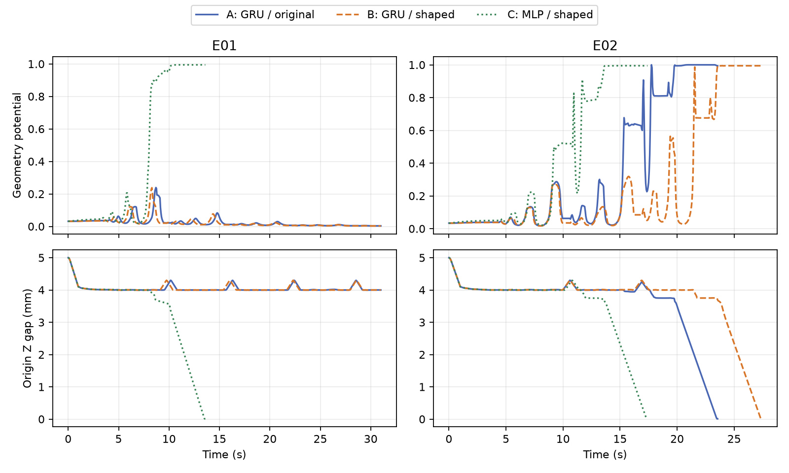

# 多针连接器工作进展与研究内容汇总

**整理日期：2026-11-16｜当前阶段：B.2 强化学习训练与开发验证。**

本文汇总已归档实验、只读诊断及本对话中讨论的改进方向。实验数据截至2026-11-13；后续控制与网络建议属于讨论方案，尚未实施。本文是截至日期的汇总快照，实时状态仍以《项目进度跟踪》为准。

## 1. 当前结论与完成边界

已打通多针连接器的仿真接触、柔顺搜索、五轴残差控制、普通SAC/GRU-SAC训练、在线采集、检查点恢复与开发评价链路。近期完成奖励对照和三组从头在线小试，并用现有轨迹定位早期Y纠偏差异与重复搜索造成的X漂移机制。

**本轮普通SAC＋新奖励表现最好，但尚不能证明普通SAC普遍优于GRU，也没有证明新奖励具有稳定优势。完整B.2和后续C阶段均未验收。**

| 内容 | 当前状态 | 结论边界 |
| --- | --- | --- |
| 普通SAC与GRU-SAC共同运行链路 | 已实现并开展小试 | 接口可运行不等于策略已收敛 |
| SEARCH权限调整、被动yaw减权 | 已在指定实验中应用 | 通用入口不能默认继承实验适配器设置 |
| 新旧奖励共享数据对照 | 已完成 | 新奖励改善E02，E01未改善 |
| A/B/C从头在线小试 | 已完成 | 单种子、每组4条训练、2个开发评价点 |
| 纠偏形成轮次、末态与X漂移诊断 | 已完成 | 存量数据诊断，不是完整动力学因果对照 |
| 浅层配合后局部对齐控制 | 已讨论，未实施 | 触发信号、控制切换和效果均待验证 |
| 当前观测直连＋GRU历史分支 | 已讨论，未实施 | 合理候选，不保证优于普通SAC |
| 多种子、广覆盖、独立最终测试 | 尚未完成 | 不能报告普遍成功率或最终算法排序 |

## 2. 研究目标与现有技术内容

研究对象为九针多针连接器，目标是在初始位置、姿态存在偏差且策略不知道真实针孔相对位置时，通过接触反馈实现搜索、对齐和插入。强化学习是主方法，传统控制用于基础柔顺执行及共同对照。

现有链路包含：

1. **接触与几何模型：** 分层孔口/主孔、有限针体几何审核、接触运行库与异常记录。
2. **基础控制：** 接近、螺旋搜索、插入、卸载和回撤重搜；策略叠加X/Y、roll/pitch/yaw五维残差，轴向推进由基础控制负责。
3. **学习系统：** 普通SAC和GRU-SAC、回放采样、训练奖励覆盖、优化器及检查点保存恢复。
4. **验证系统：** 逐周期轨迹、逐针配合、动作来源、载荷、成本和失败记录；训练准入与开发评价分开。

策略使用140维观测，包含短时力/力矩历史、相对运动、上一动作和控制器状态等。普通SAC输入已有4帧力/力矩历史，不能视为完全没有历史信息。真实孔位不进入策略观测；新奖励可以在仿真训练时使用几何真值。实机若无法获得这些真值，不能直接假定可原样在线计算该奖励。

## 3. 近期关键设置与修复

| 设置 | 本轮小试采用值或语义 |
| --- | --- |
| SEARCH被动yaw输出 | 原输出乘0.25；学习残差yaw不乘该系数 |
| SEARCH每轴XY残差上限 | ±750 µm/s |
| SEARCH XY执行加速度上限 | 0.020 m/s² |
| 搜索速度参数 | 900 µm/s |
| 决策周期 | 2 ms |
| 动作预算 | 30 s；另有既定停止保持/审核尾段 |
| 几何数值容差 | 100 nm；不是每轴位置精度要求 |
| 回放学习窗口 | 每次两条128步窗口；GRU另带256步burn-in |

“约7%残差权限”是此前方案的简称，**不是恒定7%的控制混合权重**。实际有效输出受策略幅值、速度/加速度限幅和过滤共同影响。

近期完成了D形导向壁原生多点接触法向不一致的修复，原T04完整回归通过审核但任务仍超时。数值有效与任务成功分别统计。当前载荷预警运行域下，合力阈值触发记录而非单独否决成功；这不等于已经证明满足实机载荷要求。

同一历史冻结GRU下，仅将SEARCH被动yaw减至25%，E01末态改善到7/9主孔配合，但仍超时；E02保持成功，用时23.720 s。后续新训练策略不能与该历史策略直接构成奖励单变量对照。

## 4. 搜索奖励检查与最小对照

### 4.1 对最初问题的修正

原SEARCH阶段并非没有奖励或训练样本。需要研究的是：原奖励对搜索中的位置、姿态联合改善是否提供足够有效的学习信号，而不是简单补上一个原先空白的阶段。

新方案在原奖励上加入四截面几何势函数差分：以几何误差构造Phi=1/(1+E)，奖励增量采用lambda×[gamma×Phi(next)−Phi(current)]，lambda=1。具体截面为0/250/250/750 µm，对应孔半径675/675/600/600 µm，采用10%间隙目标，平均平方误差和最差平方误差各占0.5。

完整终局的势函数归零，抽样窗口末尾不人为归零；折扣沿用原转移值。原始回放保留，训练时按回合与周期索引覆盖奖励。这允许重新使用已有经验，但仍需更新网络才能改变策略；固定数据训练本身不能验证新动作带来新经验的在线探索效果。

### 4.2 共享数据、仅改变奖励的筛查结果

2026-11-12完成4条共享训练轨迹，两组各101次更新，随后分别评价E01/E02。

| 奖励 | E01 | E02 |
| --- | --- | --- |
| 原奖励 | 超时，末态0/9主孔配合 | 超时，末态7/9 |
| 新奖励 | 超时，末态0/9主孔配合 | 成功，30.020 s，末态9/9 |

新奖励在这一配对中改善E02，但未解决E01。30.020 s为原有停稳保持期间确认成功的时刻，没有延长30 s动作预算。该结果尚未超过此前保留模型E02的23.720 s表现，后者来自不同训练经历。

来源：[新旧奖励最小对照报告](deliverables/learning_chain/reward_shaping_yaw025_minimal_20261112/本轮结果.md)。

## 5. 三组从头在线小试

### 5.1 设计与执行

| 组别 | 算法 | 奖励 | 主要比较目的 |
| --- | --- | --- | --- |
| A | GRU＋SAC | 原奖励 | 与B比较奖励作用 |
| B | GRU＋SAC | 新奖励 | 新奖励循环网络方案 |
| C | 普通MLP SAC | 新奖励 | 与B比较两套网络实现 |

每组从全新网络、优化器和空回放开始：T03/T01初始采集→101次更新→采T02→101次更新→采T04→101次更新→最终E01/E02确定性评价。每组4条训练轨迹、303次更新，包含两次更新策略重新采集经验的在线反馈循环；不按评价结果挑选中间检查点。

A/B初始actor一致，第一轮101批的非奖励学习数据一致。之后各组独立采集，策略不同会带来经验和事件采样分布不同。每组77,568个学习行使用是重复抽样总数，不是新增独立样本数。

### 5.2 最终开发评价

| 组别/工况 | 结果 | 任务结束/s | 末态主孔配合 | 峰力/N | 力积分/N·s |
| --- | --- | ---: | ---: | ---: | ---: |
| A / E01 | 超时 | 31.000 | 0/9 | 4.597 | 57.895 |
| A / E02 | 成功 | 23.580 | 9/9 | 4.698 | 39.877 |
| B / E01 | 超时 | 31.000 | 0/9 | 4.682 | 55.803 |
| B / E02 | 成功 | 27.438 | 9/9 | 4.838 | 51.593 |
| C / E01 | 成功 | 13.614 | 9/9 | 4.764 | 23.506 |
| C / E02 | 成功 | 17.420 | 9/9 | 4.623 | 28.065 |

超时在30 s触发，31 s包含既定停止尾段。

- A/B：新奖励没有改善E01，E02反而慢3.858 s，载荷指标也更高。
- B/C：相同新奖励下，C在这两个开发点均成功，且E02比B快10.018 s。
- 缺少“普通SAC＋原奖励”组，不能把C的成功单独归功于新奖励。
- 单种子、小预算、两个开发点不足以判断收敛性能、总体成功率或GRU的理论优劣。

本轮18条有效轨迹完成审核、12次训练回放准入、909次更新；C另有1次中断且未保存完整成本记录。用户批准补采后完成C，总尝试19次。已知原生步2,445,380；历史累计初始化已知下界522，另有1次未知成本尝试，不给出虚假的精确总成本。

来源：[三组最终报告](deliverables/learning_chain/threeway_online_yaw025_20261112/三组最终结果.md)。

图展示物理几何势与Z间隙，不直接比较新旧训练累计回报；共享图例适用于两个工况，重叠曲线由线型区分。

## 6. 已完成的轨迹与学习诊断

### 6.1 普通SAC更早形成负Y纠偏

“首段搜索一秒”指最终评价首次进入SEARCH后的一秒，不是第一轮训练。“有效Y残差”指同一状态下，限幅/过滤后的有RL命令减去将RL置零后重组的命令；不是总速度、实际位移，也不是完整关闭RL的反事实结果。

| E01指标 | B：GRU新奖励 | C：普通SAC新奖励 |
| --- | ---: | ---: |
| 首次SEARCH一秒有效Y残差 / µm/s | +21.875 | −22.929 |
| 8 s时X / mm | −0.028 | +0.026 |
| 8 s时Y / mm | +0.295 | +0.065 |
| 8 s时yaw / ° | −1.508 | −1.497 |
| 首次九针主孔配合 / s | 无 | 8.642 |

C早期负Y增量有利于减小当时的正Y偏移，随后较早入孔；B最初偏正Y。但单轴朝原点移动不保证九针几何整体改善，不能把五轴残差全程判成正作用或负作用。

在同一B_E01观测历史上读取不同检查点，得到以下归一化Y输出均值（不是速度）：

| 更新次数 | B首次SEARCH一秒 | C首次SEARCH一秒 | B在6 s前SEARCH | C在6 s前SEARCH |
| --- | ---: | ---: | ---: | ---: |
| 0 | −0.00063 | +0.08551 | +0.00765 | +0.09311 |
| 101 | +0.03853 | −0.04668 | +0.03568 | −0.08244 |
| 202 | +0.00912 | −0.05106 | −0.02417 | −0.06912 |
| 303 | +0.03324 | −0.03330 | +0.01409 | −0.05059 |

C在首轮101次更新后形成负Y，早于T02成功采集，当时只有两条失败经验。B在202次时较宽窗口曾转负，303次又转正，应描述为“早期纠偏未稳定保留”，不能说GRU从未学到。固定观测输出不能证明202次策略真实运行就会成功。

### 6.2 E01的X漂移主要暴露重复搜索机制

冻结螺旋半径0.4 mm、螺距0.1 mm，四圈参考终点相对本段中心位于(+0.4 mm, 0)。搜索耗尽后重启以当前位置设置新中心，恢复过程不会自动把XY送回初始中心。

B_E01五次搜索起点的X约为0.298→0.630→1.009→1.384→1.761 mm，末态1.916 mm。A同样经历五段搜索，末态X约1.793 mm。主要位移累积发生在SEARCH期间，不能将其全部归为回撤动作本身。

**B的X残差总体为负，仍出现正X漂移；因此末态偏正X不能直接证明GRU输出了错误的正X残差。** C在第一次搜索耗尽前进入插入，避开了反复重设中心的路径。这是共同基础搜索可能暴露的失效模式，尚未证明为GRU独有。

### 6.3 浅层配合不等于主孔捕获，也不等于没有反馈

前述逐针诊断发现，B_E01曾有部分针在入口浅层出现几何配合，但未进入主孔轴向重叠阶段。因此，“没有找到孔”应具体表述为未形成可持续推进的主孔配合，不能解释为全程没有浅入、没有力/力矩变化或完全没有可学习信号。

部分针浅层配合提示可能接近有效入口，但不能证明只剩yaw误差。X/Y、roll/pitch/yaw仍可能相互耦合，且几何真值事件不等于实机可直接识别的事件。

### 6.4 任务结束位姿与成功语义

| 组别/工况 | X/µm | Y/µm | roll/° | pitch/° | yaw/° |
| --- | ---: | ---: | ---: | ---: | ---: |
| A / E01 | +1792.502 | −283.660 | +0.009109 | +0.001725 | −1.210944 |
| A / E02 | +69.179 | +0.014 | +0.045229 | −0.062163 | +0.692448 |
| B / E01 | +1916.435 | −18.222 | 约0 | 约0 | −1.465120 |
| B / E02 | +53.137 | −18.246 | −0.186594 | −0.226073 | +0.737373 |
| C / E01 | +22.333 | −34.902 | −0.754401 | −1.208377 | −0.632937 |
| C / E02 | −42.162 | +7.846 | +0.059346 | −0.057922 | +0.740514 |

取任务结束时刻，而非更晚审核尾段；坐标采用已有任务/母端坐标系。当前成功审核结合九针分层几何、轴向深度、速度/保持、力矩与穿透等条件，不独立采用继承配置里的每轴0.5°角度阈值。因此C_E01被判成功，不代表满足额外的每轴角度≤0.5°工艺要求。

三个只读诊断未新增仿真或训练，并核验51项原账本和检查点哈希未变。证据：

- [普通SAC与GRU差异](deliverables/learning_chain/threeway_diagnosis_20261113/诊断结论.md)
- [残差、末态与学习轮次](deliverables/learning_chain/residual_round_diagnosis_20261113/诊断结论.md)
- [X/Y漂移机制](deliverables/learning_chain/xy_drift_diagnosis_20261113/诊断结论.md)

## 7. GRU未显示优势的解释边界

已确认两组网络并非“同一个SAC仅加GRU”：MLP是140→256→256，GRU是140→64投影→64维GRU→256动作头；actor参数分别104,458和53,194。GRU同时承担当前观测压缩和历史编码，在当前小预算下可能不利于即时纠偏，但尚未唯一定位根因。

其他未隔离因素包括：初始化、探索轨迹、事件重点采样回退、后续各自采集的数据和训练预算。C首次无重点事件而回退均匀抽样，B有重点事件；共同采样规则并不保证实际样本分布相同。

未发现“GRU没有更新”、NaN或抽查动作恢复严重错位的证据。最终actor在抽样状态上，完整历史与仅最近256步历史输出几乎一致，说明这些状态下更早历史影响很小；不证明所有训练时刻均无记忆作用，也不证明没有梯度问题。

每个128步学习段覆盖0.256 s，256步burn-in覆盖0.512 s且不反向传播。该设置可能限制跨较长时间关系的学习，但**不能等同于GRU只能记住0.256 s，也不能据此认定窗口长度就是失败根因**。

## 8. 已讨论但尚未实施的两个改进方向

### 8.1 浅层配合后的局部联合对齐

候选流程为：SEARCH搜索→疑似浅层接触/配合→局部ALIGN→可持续推进后INSERT。

出现可信候选入口后，暂停或显著减弱螺旋XY参考推进，在有限区域内由策略联合调节XY/yaw；基础柔顺控制维持轴向推进，并与策略共同调节roll/pitch。若局部尝试失败，保留候选区域信息，避免无条件以漂移后的当前位置持续重启。

需要先解决：实机可观测信号触发与持续性判定、误触发、控制权平滑切换、局部边界、失败退出和模式观测。当前SEARCH的XY导纳已经冻结，主导XY的是螺旋参考跟踪；仅冻结螺旋角度却保留强参考回拉，仍可能与策略对抗。

这是值得验证的控制候选方案，但它也可能帮助普通SAC。若研究GRU贡献，两组必须共用相同的分阶段控制器。切换动作权限会改变策略面对的环境，旧策略不能默认已具备接管局部对齐的能力。

### 8.2 保留即时控制能力，补充GRU历史信息

候选结构为“当前观测→MLP即时特征；观测/动作历史→GRU历史特征；两路融合→策略输出”。让GRU补充过去动作引起的接触变化，同时保留当前信息直接参与纠偏的路径。

后续需要按真实接触响应时间尺度评估学习窗口或记忆更新频率，避免盲目加长序列或粗暴降采样。需要容量接近的MLP对照，不能把更多参数的收益等同于记忆收益。

目标应是证明历史信息带来可重复的任务改善，而非预设GRU必须胜出。已有观测足以解决某些工况时，普通SAC可能仍更高效。研究参考：[Ni等，ICML 2022：循环无模型强化学习基线](https://proceedings.mlr.press/v162/ni22a.html)。该论文提供一般方法依据，不是本项目性能证明。

## 9. 建议的后续验证顺序与暂停边界

以下为建议，不是已启动实验或新增预算授权。

1. **利用存量轨迹检查可观测性：** 对照几何浅层事件与力、力矩、位移变化，检查能否可靠识别候选入口，以及失败训练轨迹是否也存在中心漂移。
2. **检查历史的增量价值：** 用当前观测/动作与加入历史两种输入预测后续接触变化或推进；按整条轨迹划分验证，防止相邻帧泄漏。小数据结果仅作筛查。
3. **形成最小实施方案：** 分别定义分阶段控制和网络改造，避免同时改变控制、奖励、网络而无法归因。
4. **后续获准训练时再比较：** 固定共同控制器、奖励、观测、工况和交互预算，采用多个种子，报告成功、耗时、载荷及成本；另做历史消融，检查记忆是否实际帮助任务。
5. **最终测试隔离：** E01/E02已用于多轮分析，属于开发数据；独立最终测试不用于调参或选择方案。

本次只整理文档，未追加训练、仿真、检查点优化或控制器修改。B.2完整验收条件尚未满足，不因文档交付推进为已验收。

## 10. 主要证据与项目入口

| 资料 | 用途 |
| --- | --- |
| 项目当前入口（完整本地档案） | 快速找到近期结果 |
| 项目进度跟踪（完整本地档案） | 实时状态、能力与历史阶段日志 |
| 项目交付总览（完整本地档案） | 交付使用与证据索引 |
| 当前研究计划（完整本地档案） | 研究约束与计划；旧段落按历史时点理解 |
| 11月滚动月报（完整本地档案） | 当月汇报材料 |
| [三组最终校验](deliverables/learning_chain/threeway_online_yaw025_20261112/verification_resumed.json) | 本轮归档一致性证据 |
| [三组合并账本](deliverables/learning_chain/threeway_online_yaw025_20261112/ledger_completed.json) | 执行、补采与成本记录 |

本汇总中的历史测试通过数、哈希检查与实验结果来自各自归档，不代表2026-11-16重新运行了这些测试。文档中的本地链接指向当前工作区；分享给其他设备时需同时提供对应附件或调整路径。
