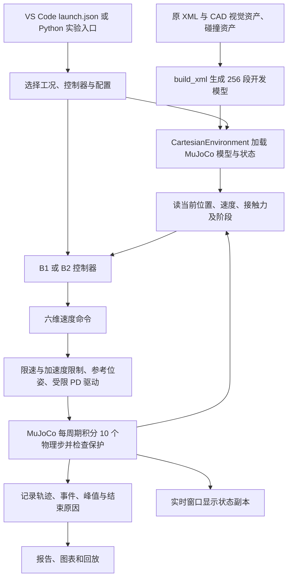

# 课题阶段与仿真代码关系说明

核对日期：2026-09-22。本文回答两件事：当前成果对应总体规划的哪一步，以及现有代码怎样连接成一次仿真。内容按当前本地源码和保存结果核对；本文未启动新动力学试验，也未修改控制器。

**当前处于总体规划的“平台与基线”阶段，主线推进到八项任务中的任务 5——B2 强基线与批量评价。任务 2、3 仍有训练前的收尾与验收工作；尚未进入残差 SAC。** B2-5.2 是 B2 开发内部的小任务编号，不是总体第二阶段。

项目工作目录：[dsub9-v1-contact-validation](D:/dsub9项目计划/first_stage_sim/.worktrees/dsub9-v1-contact-validation)。后文所有源码链接均指向这里，而不是外层 `first_stage_sim` 下可能存在的另一份文件。

## 一 与原规划逐项对应

依据：[总体规划 v1.2](D:/dsub9_plan/计划文档/D-sub9机器人学习型装配_课题整体规划_v1.2.docx) 第 8 节、[八项任务 v1.2](D:/dsub9_plan/计划文档/一阶段下一阶段任务_v1.2_2026-09-11.docx)。原规划的四个总体阶段依次是：平台与基线、学习与候选创新、仿真研究闭环、实物扩展。实物扩展后置；完整 CR5 模型不是启动 SAC 的必要前提。

| 原任务 | 当前已有成果 | 当前状态与缺口 |
|---|---|---|
| 1 V1 开发适用性检查 | 解释原接触问题，保留 SDF，建立凸分块替代开发模型与覆盖检查 | 已形成限定开发范围内的结论；不是实物接触准确性认证 |
| 2 统一闭环与 SAC 接口 | 接口设计稿；已有 reset、observe、step、stop、条件回撤等底层接口 | 部分实现。现有 step 接收六维速度，不是接收四维残差并返回奖励的完整训练接口 |
| 3 动态闭环与速度基准 | MuJoCo 动力学执行、力反馈、停止回撤、时间步对照和运行耗时记录 | 动态实现已可用于限定工况开发；原开发验收仍有未通过记录，不能称训练环境全面通过 |
| 4 B1 固定导纳 | 7 个固定开发工况、14 个零反馈/B1 配对回合，参数与日志保存 | 固定导纳实现和开发对照已完成。同轴几何达标；有接触偏差工况仍失败 |
| 5 B2 强基线与批量评价 | 有限搜索、恢复、7 工况配对、退出条件 V2 试验、切换诊断 | 当前主线。还需有边界的调优、训练前验收收尾、独立测试协议及基线冻结 |
| 6 普通四维残差 SAC | 原规划和接口设计 | 尚未实现训练链、策略权重、训练与独立评价结果 |
| 7 阶段与进展残差约束 | 候选研究方案 | 尚未实现和验证；不能把目前规则搜索切换当成已经完成创新方法 |
| 8 正式仿真证据与展示 | 已积累月报图、回放、日志与复现入口 | 展示素材已有，但正式多种子学习对照、消融、敏感性和论文证据尚未完成 |

任务不是八个等工作量的方框，因此不能由“做到第 5 项”推导“完成了 5/8 或 62.5%”。前面的实现、限定开发许可、全面验收是不同状态。

原动态报告保留 `DYNAMIC_DEVELOPMENT_GATE_FAIL`：部分停止时间要求和分辨率/时间步一致性未通过。后续 B1 诊断解释了部分停止变慢和局部分辨率敏感，但没有据此把原结论改成全部通过。可继续限定工况诊断，不应直接宣称已经具备验收完毕的训练平台。

目前 B2 七工况对照中，B1/B2 都只有同轴完整几何达标；B2 使 X 偏差和联合 B ×0.75 深度到位，但最终 XY 或姿态仍超容差。退出条件 V2 没有改善，保留旧基线。最新 B2-5.2 只读既有轨迹，定位出横向和轴向规则同时变化这一混杂因素。

这些结果不意味着必须把所有偏差工况都做成功才允许 SAC。原任务 5 明确不要求 B2 必须优于 B1；需要的是认真调优、行为可解释、适用范围和数值可靠性清楚、评价公平且可复现。后续应给基线调试设置边界，完成必要收尾后进入任务 6，而不是无限追加接触诊断。

主要证据：[B1 报告](D:/dsub9项目计划/first_stage_sim/.worktrees/dsub9-v1-contact-validation/deliverables/b1_fixed_admittance/B1固定导纳_开发报告.md)、[动态验证报告](D:/dsub9项目计划/first_stage_sim/.worktrees/dsub9-v1-contact-validation/deliverables/dynamic_actuator_v1/动态执行器验证报告.md)、[B2 七工况报告](D:/dsub9项目计划/first_stage_sim/.worktrees/dsub9-v1-contact-validation/deliverables/b2_search_recovery/matrix_v1_7cases/B2-4七工况对照报告.md)、[最新切换诊断](D:/dsub9项目计划/first_stage_sim/.worktrees/dsub9-v1-contact-validation/deliverables/b2_switch_diagnosis/diagnosis_v1/B2-5.2切换诊断报告.md)。

## 二 仿真由谁负责什么

VS Code 负责编辑、启动和调试 Python；Python 程序负责组装模型、调用控制器和推进回合；MuJoCo 负责根据驱动力与接触反力计算运动；查看器负责显示。只打开 XML 能查看模型，但不会自动运行本项目的 B1/B2 控制算法。



这里存在两个时间尺度：控制器每 0.002 s 更新一次命令；MuJoCo 每 0.0002 s 积分一次。因此一个控制周期含 10 个物理步。名义 500 Hz 控制、5000 Hz 物理步是仿真时间设置，不代表计算机一定能实时运行。

## 三 从原模型到 MuJoCo 的加载关系

1. [models/dsub9_pair.xml](D:/dsub9项目计划/first_stage_sim/.worktrees/dsub9-v1-contact-validation/models/dsub9_pair.xml) 保存原场景结构、针尺寸、孔位置、SDF 孔参数、质量惯量、碰撞分组及接触参数。
2. 该 XML 引入 [dsub9_visual.xml](D:/dsub9项目计划/first_stage_sim/.worktrees/dsub9-v1-contact-validation/models/includes/dsub9_visual.xml) 和 [dsub9_collision.xml](D:/dsub9项目计划/first_stage_sim/.worktrees/dsub9-v1-contact-validation/models/includes/dsub9_collision.xml)。前者引用 [assets/visual](D:/dsub9项目计划/first_stage_sim/.worktrees/dsub9-v1-contact-validation/assets/visual) 中的 SolidWorks 导出视觉网格；碰撞资产另行定义。视觉网格的碰撞位掩码为零，不直接承担接触计算。
3. [contact_development.py 的 build_xml](D:/dsub9项目计划/first_stage_sim/.worktrees/dsub9-v1-contact-validation/tools/model/contact_development.py:45) 读取原 XML，取出孔尺寸与孔位置，在生成的 XML 中移除 SDF 孔和插件定义，加入凸分块孔。原磁盘文件不被覆盖，D 形导向与视觉资产保留。
4. 运行入口显式创建 `CartesianEnvironment(segments=256)`。这里的 256 是每个孔层的圆周分块数；入口层和主孔层分别生成。生成器与环境类的函数默认值仍是 128，当前正式入口传入 256 才决定当前分辨率。
5. [cartesian.py 构造函数](D:/dsub9项目计划/first_stage_sim/.worktrees/dsub9-v1-contact-validation/tools/dynamics/cartesian.py:60) 用 `MjModel.from_xml_string(build_xml(256))` 编译模型，再创建 `MjData` 保存当前位姿、速度、接触等状态。它还覆盖物理步长并按配置启用 MPR 碰撞后端。

**当前实时仿真不直接加载导出的 [dsub9_convex256_b1_mpr.xml](D:/dsub9项目计划/first_stage_sim/.worktrees/dsub9-v1-contact-validation/deliverables/model_exports_256/dsub9_convex256_b1_mpr.xml)。** 那份文件是便于单独查看和交付的模型快照；只修改它，不会改变当前 Python 动态入口生成的模型。

原 SDF 插件仍在 [plugins/dsub9_hole_sdf](D:/dsub9项目计划/first_stage_sim/.worktrees/dsub9-v1-contact-validation/plugins/dsub9_hole_sdf)，解析距离参考实现仍在 [hole_reference.py](D:/dsub9项目计划/first_stage_sim/.worktrees/dsub9-v1-contact-validation/tools/sdf/hole_reference.py)。它们属于原 SDF 路径；目前 B1/B2 的凸分块孔碰撞不调用该 SDF 插件。

当前动态对象是固定母头和具有 6 个自由度的公头。受限笛卡尔驱动代表末端执行器的作用，尚未建立完整 CR5 关节链、夹爪柔性或真实传感器。

## 四 参数究竟在哪里

当前工程还没有统一的一个配置文件。应区分启动参数、模型参数、控制参数和一次实验实际保存的参数。

| 要理解或改变的内容 | 当前来源 | 怎样进入仿真 |
|---|---|---|
| Python、工作目录、模式、策略和工况选择 | [.vscode/launch.json](D:/dsub9项目计划/first_stage_sim/.worktrees/dsub9-v1-contact-validation/.vscode/launch.json) | 启动 visual_sim 并传入 args；不直接定义力学参数 |
| 针孔尺寸、质量惯量、摩擦、solref/solimp 等接触响应 | [models/dsub9_pair.xml](D:/dsub9项目计划/first_stage_sim/.worktrees/dsub9-v1-contact-validation/models/dsub9_pair.xml) | 被生成器读取并编译；当前质量 0.05 kg、重力为零，均为开发假设 |
| 工况列表、初始 X/Y/roll/pitch | [run_b1_baseline.py 的 cases](D:/dsub9项目计划/first_stage_sim/.worktrees/dsub9-v1-contact-validation/tools/validation/run_b1_baseline.py:84)；数值定义在 [ContactCase](D:/dsub9项目计划/first_stage_sim/.worktrees/dsub9-v1-contact-validation/tools/validation/run_contact_cases.py:92) | case 传入 env.reset；米和弧度为内部单位 |
| 物理步长、控制周期、速度/加速度、PD 刚度、驱动力上限和保护 | [DynamicConfig](D:/dsub9项目计划/first_stage_sim/.worktrees/dsub9-v1-contact-validation/tools/dynamics/cartesian.py:17) | 创建环境时传入或使用默认值；夹持点 G 另在环境构造函数中定义 |
| B1 虚拟质量、阻尼、修正速度与累计修正预算 | [AdmittanceConfig](D:/dsub9项目计划/first_stage_sim/.worktrees/dsub9-v1-contact-validation/tools/control/fixed_admittance.py:13) | 创建 FixedAdmittance 时读取；与 XML 中公头真实仿真质量不是一回事 |
| B2 搜索、无进展判断、恢复和总时长 | [SearchConfig](D:/dsub9项目计划/first_stage_sim/.worktrees/dsub9-v1-contact-validation/tools/control/search_recovery.py:10)；批量入口读取 [candidate_v1.json](D:/dsub9项目计划/first_stage_sim/.worktrees/dsub9-v1-contact-validation/deliverables/b2_search_recovery/candidate_v1.json) | 是否读取 JSON 取决于入口，见下一节 |
| V2 退出资格的低载荷保持等参数 | [ExitGateConfig](D:/dsub9项目计划/first_stage_sim/.worktrees/dsub9-v1-contact-validation/tools/control/search_exit_v2.py:12) | SearchRecoveryV2 使用；这是一版未改善的实验条件 |
| 几何完成容差和保持时间 | [run_b1_baseline.py 的 FINISH](D:/dsub9项目计划/first_stage_sim/.worktrees/dsub9-v1-contact-validation/tools/validation/run_b1_baseline.py:16) | B1/B2 共用；到目标深度后还要检查 XY、姿态、速度和保持时间 |
| 某一次实验实际使用了什么 | 该回合 JSON 的 environment、controller、case、finish_criteria | 这是追溯该结果的依据，不能用今天默认值代替历史值 |

三个容易混淆的参数：`force_limit_N=0.05` 是每个驱动力分量的限制；`stop_force_N=0.025` 是接触合力触发停止的阈值；`search_force_N=0.008` 参与搜索期间的 Z 速度反馈。它们作用不同，不能视为同一个“插入力设置”。

## 五 三种运行入口怎样串联

### A 在 VS Code 中做实时仿真

调用路线是：[launch.json](D:/dsub9项目计划/first_stage_sim/.worktrees/dsub9-v1-contact-validation/.vscode/launch.json) → [visual_sim.main](D:/dsub9项目计划/first_stage_sim/.worktrees/dsub9-v1-contact-validation/tools/usage/visual_sim.py:386) → 创建 256 段环境、选 case → [run_live](D:/dsub9项目计划/first_stage_sim/.worktrees/dsub9-v1-contact-validation/tools/usage/visual_sim.py:325) → 选择控制器 → 调用回合函数。

| VS Code 项目 | 实际行为 |
|---|---|
| 01 查看模型 | 构建模型、显示；不运行控制回合 |
| 02 / 06 回放 | 读取已有轨迹，在显示副本中更新姿态；不重新计算该回合动力学 |
| 03 B1 实时 | FixedAdmittance → run_episode，原入口动作预算 6 s |
| 04 B2 实时 | SearchRecovery → run_search_episode，默认动作预算 20 s |
| 05 V2 实时 | SearchRecoveryV2 → 同一个 run_search_episode，默认动作预算 20 s |

实时 B2 当前直接创建 `SearchRecovery()`，采用 Python `SearchConfig` 默认值，**不读取 candidate_v1.json**。实时 V2 也用类默认参数。2026-09-22 已核对：这些默认值目前与 JSON 和冻结回合对应值一致。但两条加载路径不会自动同步；以后改 JSON，不会自动改变 GUI 实时入口。

实时结果保存到 [deliverables/interactive_sessions](D:/dsub9项目计划/first_stage_sim/.worktrees/dsub9-v1-contact-validation/deliverables/interactive_sessions) 下的新目录，包含 `session.json`、完整 `run.json.gz`、源码快照、结果图和小结。人为关闭未完成回合会保存部分轨迹，不算完整结果。

### B 我之前运行正式对照的方法

正式 B2 入口是 [run_b2_search.main](D:/dsub9项目计划/first_stage_sim/.worktrees/dsub9-v1-contact-validation/tools/validation/run_b2_search.py:130)。它读取参数 JSON，构造 SearchConfig，按指定工况创建环境与控制器，调用同一回合函数，保存原始日志及源码指纹。七工况批次最终汇总在 [matrix_v1_7cases](D:/dsub9项目计划/first_stage_sim/.worktrees/dsub9-v1-contact-validation/deliverables/b2_search_recovery/matrix_v1_7cases)。B2 配对中的 B1 也使用 20 s 动作预算，以保证该批比较公平；不能把原 6 s B1 和该批 20 s B1 混作完全相同实验。

正式 V2 入口是 [run_b2_exit_gate.main](D:/dsub9项目计划/first_stage_sim/.worktrees/dsub9-v1-contact-validation/tools/validation/run_b2_exit_gate.py:30)。它读取已冻结的 B2 七工况索引配置，核验模型、代码与参数，再创建 SearchRecoveryV2；新增两次动力学运行，与旧回合比较。它不从 candidate_v1.json 重新取搜索参数。更改该 JSON 不会自动改变这个正式 V2 入口。

上述运行一般不需要打开查看器：Python 直接调用 MuJoCo。之后报告程序读取结果文件画图、输出 GIF。VS Code 实时入口复用同样的核心回合与执行器，只额外增加暂停、显示和独立结果保存。

2026-09-21 的 B2-5.2 使用 [diagnose_b2_switch.py](D:/dsub9项目计划/first_stage_sim/.worktrees/dsub9-v1-contact-validation/tools/validation/diagnose_b2_switch.py)，只读四份记录并重建控制命令，没有重新跑物理仿真。这与本次代码讲解也属于不同工作。

### C 查看模型和回放为什么也会看到 qpos 赋值

[DisplayModel](D:/dsub9项目计划/first_stage_sim/.worktrees/dsub9-v1-contact-validation/tools/usage/visual_sim.py:69) 单独复制模型与数据，把真实计算或保存的姿态复制给显示副本。在这里修改显示副本 `qpos` 是为了呈现已有状态，不会驱动实际物理环境。

真实动态环境只在 reset 时设定初始实际位姿；运行中的实际运动由 `mj_step` 积分产生。显示副本可以逐帧赋值，两者不矛盾。查看器显示模式的切换也不改变真实环境的碰撞模型。

## 六 顺着一轮控制循环读代码

先读 [run_search_episode](D:/dsub9项目计划/first_stage_sim/.worktrees/dsub9-v1-contact-validation/tools/validation/run_b2_search.py:51)。它是把控制、动力学、保护、恢复和结束判断串起来的核心回合函数。下面是教学伪代码，省略了恢复状态机和错误处理，不可代替正式实验入口：

```python
env.reset(case)                       # 设置初始偏差并清空本回合状态
while 回合没有结束:
    row = env.observe()              # 读已计算的状态，不推进时间
    obs = policy_observation(row, initial_position)
    command = controller.command(obs, dt=0.002)
    row = env.step(command)           # 内含 10 个物理子步及保护检查
    record(row)                      # 保存刚执行完这一步的状态和命令
    检查成功、总时间、无进展、停止和恢复
```

`controller.command` 返回 `[vx, vy, vz, wx, wy, wz]`：前三项 m/s，后三项 rad/s，是世界/任务坐标下、关于 M 点的速度命令。它不是目标 XYZ 坐标，也不是六维力，更不是 CR5 六个关节的速度。

B1 的 [FixedAdmittance.command](D:/dsub9项目计划/first_stage_sim/.worktrees/dsub9-v1-contact-validation/tools/control/fixed_admittance.py:38) 根据 Fx、Fy、Tx、Ty 更新四个修正速度，Z 使用固定推进速度。这里“固定”指虚拟质量、阻尼等参数固定，不表示 XY 或姿态不能动。

B2 的 [SearchRecovery.command](D:/dsub9项目计划/first_stage_sim/.worktrees/dsub9-v1-contact-validation/tools/control/search_recovery.py:74) 在此基础上根据 INSERT、UNLOAD、SEARCH、WAIT_RECOVERY、FAILED 模式选择动作。回撤的准入与实际执行还要由回合管理器和环境完成，不是控制器单独改一个模式名就能回撤。

随后进入 [CartesianEnvironment.step](D:/dsub9项目计划/first_stage_sim/.worktrees/dsub9-v1-contact-validation/tools/dynamics/cartesian.py:194)：

1. 检查命令是否合法；停止或回撤阶段按对应规则处理。
2. [limit_command](D:/dsub9项目计划/first_stage_sim/.worktrees/dsub9-v1-contact-validation/tools/dynamics/safety.py) 限制速度和每周期变化量。
3. 用受限速度积分“参考位姿”，限制参考位姿相对实际位姿的超前量。
4. 根据参考误差与速度误差计算 PD 驱动力/力矩，并裁剪驱动分量；将关于 M 的驱动换算到夹持点 G 施加。
5. `mj_step` 根据质量惯量、施加驱动与接触作用推进真实状态；随后 `mj_forward` 更新当前状态的接触与派生量。
6. 每个物理步检查数值有效性、力/力矩、穿透、实际运动边界，并累计峰值。
7. 10 个物理步后返回一行观测，交给下一轮控制。

因此，当针受到孔壁阻挡时，参考命令仍可能要求向下，但实际位移可以停滞。实际运动取决于受限驱动与接触的共同作用；命令速度、限速后速度和实际速度是三个不同量。

当前接触测量来自 MuJoCo 约束力，标为 `simulation_contact_wrench`。`contact_wrench_M` 是关于 M 的六维接触量，`contact_wrench_G` 是换算到 G 的量，两者都用世界轴表达；不是已经安装真实传感器得到的完整读数。G 当前局部位置为 (0, 0, −14.5 mm)。

## 七 读日志才能闭合这条理解链

一次正式回合的完整记录包含四类内容：

| 字段或文件 | 意义 |
|---|---|
| case、environment、controller、finish_criteria | 当次初始条件、实际配置、控制参数和完成条件 |
| trace | 每 2 ms 保存的状态与命令序列 |
| events、policy_events、termination | 执行器事件、策略切换、回合最终为什么结束 |
| peaks | 每 0.2 ms 物理步累计的峰值；不应只在 2 ms 曲线中找最大值代替它 |
| results_index.json / session.json | 结果文件位置、执行状态、指纹等索引；不是控制器自身 |
| source_snapshot | 保存当时若干核心源码，配合历史模型输入指纹追溯；不是包含全部资产与依赖的独立工程副本 |

最适合跟踪的 trace 字段是 `position_m`、`reference_qpos`、`raw_command_world`、`limited_command_world`、`velocity_world`、`drive_wrench_M`、`contact_wrench_M`、`policy_phase` 和 `phase`。

**每一行是执行完该控制步后的记录。** 同一行 raw_command 是刚执行的命令；该行更新后的力与位姿通常作为下一步输入。分析“这条力产生了哪个动作”时要看下一行，避免错位一个控制周期。

例如 X 工况在 10.774 s 的共同状态输入下，下一条旧版原始 Z 命令为 1 mm/s，V2 为 0.4 mm/s；但旧版受加速度限制后第一步仅为 0.410 mm/s。这个数值差别可以在“控制器输出 → 限速 → 实际运动”的链条中分别找到，不应都称作插入速度。

## 八 在 VS Code 中自己沿链条观察

先选 04、X +100 μm。熟悉运行后再调试；不用同时打开所有源码。按下列顺序设置断点：

| 断点位置 | 重点观察 | 要回答的问题 |
|---|---|---|
| visual_sim.run_live 中创建 controller 后 | args.policy、case、controller.config | 这次究竟选了什么参数和工况 |
| run_search_episode 中 controller.command 前后 | obs、controller.phase、command | 力和相对位移怎样变成六维速度 |
| cartesian.step 限速后 | self.raw_command、self.command | 命令有没有被裁剪或限制变化率 |
| cartesian.step 中 mj_step 后 | self.data.time、self.data.qpos、self.data.qvel | 真实状态究竟移动了多少 |
| run_search_episode 中 record 后 | trace[-1]、env.events、controller.events | 刚才的动作怎样被保存，阶段为何切换 |

F10 是执行下一条 Python 语句，F11 是进入函数；它们不等于前进一个控制周期。MuJoCo 窗口中的 N 则由本项目控制入口前进一个 2 ms 控制步。调试器断住时窗口暂时不刷新属于正常现象；先继续执行 Python，再通过窗口的 P/N 控制运行。

可给控制器断点设条件 `obs.time_s > 10.7`，直接观察 X 搜索恢复后的切换，而不必单步执行数千次。调试暂停和查看器节流会增加墙钟耗时，这种运行不应用于比较无界面训练吞吐。

修改实验时，先辨认要改哪一层，并另存版本和结果。冻结代码/模型有指纹检查，直接修改可能使历史结果核验报“输入变化”；这表示实验条件变了，应建立新的候选版本，不应关闭检查来伪装原结果复现。尤其不要直接运行旧 B1 批量 main 覆盖正式固定文件；现有 GUI 实时入口会为每次运行创建独立目录。

## 九 SAC 将来接在哪里

现阶段是 `B2 命令 → 总命令限制与受限驱动 → MuJoCo`。计划中的训练链是 `B2 命令 + 四维 SAC 残差 → 总命令限制与受限驱动 → MuJoCo`。四维残差只对应 X、Y、roll、pitch，Z 推进仍由基线承担。

任务 6 还需训练环境适配层，把四维归一化动作变成带单位的速度残差，构造观测与奖励，正确区分终止和时间截断，并保存策略权重。任务 7 再研究阶段与进展如何调整残差权限。现有 CartesianEnvironment 是下层执行环境，不会因为已有 step 方法就自动成为完整 SAC 环境。

当前物理计算走普通 MuJoCo CPU 路径，没有部署 GPU 并行物理训练；4060/5070Ti 尚未用于本项目 SAC。GPU 可用于后续网络训练，但是否能加速整体训练，还取决于环境仿真吞吐和并行实现，需要实际测量。

下一项研究仍是前次约定的 X 单变量定点试验：短时暂停额外 XY 搜索、保留原轴向反馈，并事先明确暂停时间、预算累计与恢复规则。其后应汇总任务 2、3、5 的训练前剩余项，再决定冻结基线和进入 SAC 的条件。本说明本身不算完成新的试验。
