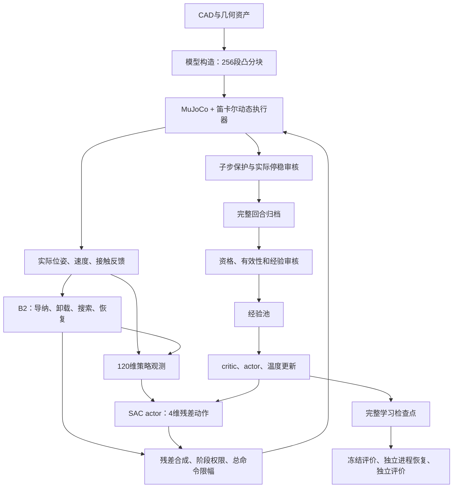
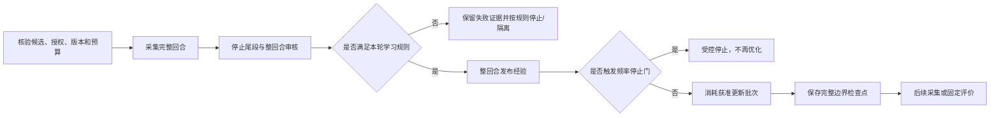

# D-sub9 项目技术导读与学习路线

编写日期：2026-09-29。面向项目负责人、后续接手者，以及希望理解代码而不只是看实验结果的学习者。

这份导读回答：项目研究什么、用了哪些技术、关键文件如何协作、一轮训练怎样发生、应该先学什么，以及如何接续工作。它是架构与学习入口；实时状态仍以[项目进度跟踪](项目进度跟踪.md)为准，已交付证据查[项目交付总览](项目交付总览.md)。本文中的状态和版本是编写日快照，不另维护一套实时待办。

本文按当前实际源码和已核对的运行记录整理。阅读不需要启动仿真或重新训练。

## 1. 先用一段话理解项目

项目在一个简化的 D-sub9 多针插接仿真中，让公头在存在位置误差、接触和卡滞的情况下完成插入。先建立可靠的几何与接触模型，再用传统导纳、搜索与恢复控制形成基线；随后让 SAC 学习一个受限的小修正量，叠加在传统控制命令上。最终研究阶段与进展相关的残差约束是否比合理调优的固定约束更有效。

研究结果需要同时回答：能否插成功、接触载荷和穿透是否可接受、是否真正停稳、完成需要多久，以及收益是否能通过公平对照和独立评价重复出现。

当前是**简化笛卡尔执行器上的刚性插接研究**。完整机器人关节模型、真实夹爪、针脚弹性和真实传感器标定尚未成为本轮闭环的一部分。项目内的力阈值是未标定仿真模型的工程保护值，不可直接作为实物阈值。

### 1.1 三组名称必须分清

| 名称 | 含义 | 不要混淆成 |
|---|---|---|
| B1 | 固定四轴导纳控制基线 | 阶段 B.1 |
| B2 | 在导纳基础上增加有限搜索、卸载与恢复的传统控制基线 | 阶段 B.2或SAC本身 |
| B.1 / B.2 | 项目阶段：残差接口与准入 / 小规模学习与评价 | 两个传统控制器 |
| 残差 SAC | 学习修正量，再与B2命令合成 | 从头学习所有六轴控制、替换整个B2 |
| Q值 | 网络对状态与动作未来收益的估计 | 成功概率、直接测得的物理安全性 |
| 已实现 / 已验收 / 有收益 | 代码存在 / 指定验收通过 / 实验效果有证据 | 同一个完成状态 |

### 1.2 论文的暂定主线

问题：固定的残差权限，能否同时适应较大误差纠偏和接近成功时的精细对准？

暂定主张：在相同任务、共同保护和可比预算下，阶段与进展相关的权限分配，比合理调优的固定边界更能兼顾两者，并相对纯B2体现价值。

需要的比较包括纯B2、固定边界残差SAC、较小固定边界、仅阶段约束、阶段与进展约束。结论由结果决定，不要求每一层必然优于上一层；也不能为了体现创新而削弱普通SAC基线。

依据：[研究推进计划](研究推进计划_当前版.md)、[暂定指标与图表口径](deliverables/learning_chain/b2_repaired_cycle_v2_20260928/指标与图表口径_暂定.md)。

## 2. 30分钟建立全局认识

以下时长只是阅读顺序的参考，不是学习完成的承诺。

| 顺序 | 读什么 | 阅读后应能回答 |
|---|---|---|
| 1，约5分钟 | 本文第1、3、5节 | 研究目标是什么，物理和学习如何连接？ |
| 2，约5分钟 | [当前入口](项目当前入口.md)与[进度文件](项目进度跟踪.md)顶部 | 当前工作目录在哪里，现在哪一步已经停下？ |
| 3，约5分钟 | 本文第6、7节 | 一个动作如何变成实际运动，一轮数据什么时候能学习？ |
| 4，约10分钟 | 本文第8节的核心文件表 | 看动作、观测、奖励、更新和恢复分别找哪个文件？ |
| 5，约5分钟 | 本文第11、12节 | 下一步学什么，如何避免误读历史结果？ |

首次阅读不要从根README的构建命令开始，也不要按日期把所有诊断目录逐一读完。根README保留了早期几何阶段的历史语义，具体运行包才决定某次实验使用什么版本。

## 3. 技术栈与各自的职责

版本来自当前独立学习环境的包元数据、锁定依赖及运行库记录；表格不是“推荐升级到这些版本”的安装指令。

| 层次 | 技术及本机记录 | 在本项目中做什么 |
|---|---|---|
| 主语言与运行 | Python 3.13.5；项目最低要求为3.11 | 控制、回合管理、数据审核、训练、实验组织和绘图 |
| 数值运算 | NumPy 2.1.3 | 向量、坐标变换、动作限幅、观测和数组处理 |
| 物理仿真 | MuJoCo 3.13.0，当前有限周期使用专门绑定的容量修复版运行库 | 刚体动力学、碰撞、接触反力、实际速度与停稳过程 |
| 模型描述 | MJCF/XML，STEP/STL及凸分块几何 | 描述刚体、视觉网格、碰撞几何、自由度和参数 |
| 深度学习 | PyTorch 2.12.1+cpu | actor、双critic、梯度更新、优化器状态及检查点 |
| 策略网络组件 | Stable-Baselines3 2.8.0 | 复用SACPolicy网络和分布组件；项目自己组织更新与采集 |
| 环境接口 | Gymnasium 1.2.3 | 包装reset/step、动作空间与观测空间；不是物理引擎 |
| 原生代码 | C/C++、CMake、MSVC、Windows DLL | 早期解析SDF插件；另有本次MuJoCo碰撞算法容量修复，两条用途不同 |
| 测试 | pytest 8.3.4 | 单元、协议、回归、资格拒绝和指定的物理验证 |
| 绘图 | Matplotlib 3.11.2；Pillow等配套依赖 | 轨迹、力、误差、损失和对照结果图 |
| 进度界面 | Python标准库HTTP服务 + HTML/JavaScript | 读取已落盘进度，每5秒刷新；不是训练控制台 |
| 实验数据 | JSON、gzip JSON、PyTorch `.pt`、SHA-256清单 | 保存配置、逐周期经验、学习状态和证据关联 |
| 项目管理 | Git / worktree、Markdown、PowerShell | 保存代码版本、隔离工作目录、运行脚本和维护资料 |

**不是直接调用SB3的`SAC.learn()`就完成训练。** [sac_update.py](tools/learning/sac_update.py)使用SB3网络组件，但项目自行处理活动动作掩码、物理时间折扣、精确停止尾段、整回合审核、预算和检查点。

### 3.1 环境为什么不能随便替换

- Python解释器：`tmp/learning_cpu_20260924/Scripts/python.exe`。
- 本轮修复版MuJoCo包：`tmp/mujoco_3_13_horizon_fixed_runtime/mujoco/`，由[runtime记录](deliverables/learning_chain/b2_repaired_cycle_20260928/runtime.json)绑定。
- [runtime.py](tools/learning/runtime.py)负责选择并核对运行库，而不只看一个版本号。
- [pyproject.toml](pyproject.toml)是基础项目依赖声明，**不是完整学习环境锁文件**；精确依赖见[requirements.lock.txt](deliverables/residual_interface/learning_tensor_20260924/requirements.lock.txt)。该学习环境的MuJoCo采取单独限定路径，不能随手安装另一个包替代。
- 原生崩溃修复改变了DLL。旧DLL上的实验不能自动当成新DLL下的公平对照，相关复用需要证据。

`tmp/`名称不代表全部内容都能清理；这里含有当前有效的解释器和运行库。

## 4. 目录地图：先判断文件属于哪一类

```text
工作树根目录
├─ 项目当前入口.md                  日常导航
├─ 项目技术导读与学习路线.md        本文：架构与学习入口
├─ 项目进度跟踪.md                  唯一实时状态和下一项
├─ 项目交付总览.md                  已交付能力、证据与使用入口
├─ 研究推进计划_当前版.md           研究问题、阶段和验收边界
├─ docs/
│  ├─ stage_b/                     训练合同、配置、范围冻结
│  └─ superpowers/                 已有设计与实施记录
├─ DSub9_Deliverables_V4/           原始CAD及参数资料
├─ assets/                         视觉和碰撞几何资产
├─ models/                         早期MJCF模型与include模板
├─ plugins/dsub9_hole_sdf/          早期解析孔SDF原生插件
├─ tools/
│  ├─ mesh/、model/                几何处理及模型构造
│  ├─ dynamics/                    实际动力学、驱动和底层限制
│  ├─ control/                     B1与B2传统控制
│  ├─ learning/                    残差、回合、数据、SAC、检查点与准入
│  ├─ validation/                  实验入口、审核、进程监督与只读进度页
│  ├─ reporting/                   结果整理与报告生成
│  └─ visualization/               模型、轨迹和历史可视化工具
├─ tests/                          对应模块的测试与专项验证
├─ deliverables/
│  ├─ native313_baseline_matrix/   新版共同环境基线证据
│  ├─ residual_interface/          B.1接口与准入交付
│  ├─ learning_chain/              B.2各次实验、诊断和修复证据
│  └─ monthly_progress/            每月同一份滚动汇报材料
├─ reports/                        早期几何/接触和报告资料
├─ build/                          构建与导出产物，不必然是合格运行版本
└─ tmp/                            环境、运行库和临时工作材料，不能整体视为可删缓存
```

文件角色的关键区分：`docs`说“应该怎样做”，`tools`说“实际如何实现”，`tests`检验具体行为，`deliverables`证明某个版本实际发生了什么。参数文件存在，不等于相应实验已经执行。

`deliverables`也不全是可丢弃输出：部分封存驱动、源码快照会被后续资格链按摘要读取。清理或改名可能破坏重现。

## 5. 核心结构关系



图中“有一条箭头”表示功能关系，不表示所有步骤都在同一个函数中。保护和预算会限制流程：异常或预登记停止发生后，不能继续沿训练与评价箭头自动执行。

### 5.1 当前模型与早期模型的关系

[models/dsub9_pair.xml](models/dsub9_pair.xml)保留早期解析SDF模型。当前动态路径使用[contact_development.py](tools/model/contact_development.py)读取其基础结构、保留相关资产与参数，替换母孔碰撞表示，生成凸分块模型。随后[NativeTightCandidate](tools/dynamics/contact_candidate.py)显式使用256段和native接触后端，并设置更紧的接触求解容差。

所以，“仓库中有SDF插件”不等于“本轮SAC直接在该SDF模型上训练”。也不能只看到某个底层函数默认128段，就认定当前执行包使用128段；实际构造参数和运行记录才是依据。

## 6. 一个控制周期到底发生了什么

当前限定配置的物理步长是0.2ms；控制和策略周期为2ms，一个控制周期包含10个物理子步。

1. **读取状态并处理回合逻辑。** 读取实际位姿、速度、接触反馈，以及时间预算、保护和恢复状态。
2. **生成一次B2命令。** B2依据接触与进展选择INSERT、UNLOAD、SEARCH等阶段，产生基线速度命令。读取或绘图不应再次推进控制器状态。
3. **构造观测。** 将可用反馈、短历史、相对起点的运动、上一动作、阶段和内部控制状态编码为120维向量。
4. **取得残差动作。** 学习策略输出4维归一化动作；预热阶段使用约定的随机动作。动作对应X、Y平移与roll、pitch转动，不含独立学习的Z推进或yaw。
5. **按权限和幅度映射。** 当前候选XY每轴最大0.00015m/s，roll/pitch每轴最大0.0005rad/s。非活动阶段的有效残差归零。
6. **合成并限制总命令。** 残差与B2相加后，还要经过阶段、速度、加速度等共同限制。
7. **动力学积分。** 总命令推进驱动参考，驱动与接触反力共同决定刚体实际运动；每个物理子步检查保护。
8. **形成一条经验。** 保存当前/下一观测、动作、奖励、时长、终止信息、命令记录和物理轨迹。奖励用周期内载荷峰值，而非只用最后一个采样点。

可用简式理解：

```text
actor输出 a（4维，范围[-1,1]）
  → 按权限、尺度映射为6维残差 [Δvx, Δvy, 0, Δωx, Δωy, 0]
  → 与B2命令相加
  → 共同限幅和变化率限制
  → 更新执行器参考
  → 驱动力与接触反力决定实际位置/姿态
```

**请求残差、合成命令、驱动参考和实际运动是四件事。** 有非零动作不代表产生了足够纠偏；命令限幅也不保证实际合力永远低于保护线。实际接触仍需要子步守卫检查。

本轮力保护诊断就体现了这种区别：受阻时参考位置继续领先，实际位置没有同幅前进，接触载荷仍会升高。详见[机制对照图与解释](deliverables/learning_chain/b2_force_mechanism_review_20260929/README.md)。

## 7. 一轮采集—学习—评价的实现脉络

### 7.1 先完成回合，再决定是否进入学习



整回合发布的原因：某段前半程看起来正常，不代表后半程仿真仍有效或最后真正停稳。未经审核就学习，可能把不合格数据混进经验池，事后难以撤销影响。

当前限定规则允许经完整审核、有效且实际停稳的单独力保护作为失败经验，终末奖励仍为−10。连续第2次或累计第3次训练力失败触发停止；第3次本身完整归档，但停止后不能继续优化。确定性评价的失败不进入训练经验池。

### 7.2 SAC内部各部分负责什么

| 部件 | 作用 | 本项目的注意点 |
|---|---|---|
| actor | 根据观测生成残差动作 | 不直接输出成功判断；训练采集可有随机性 |
| 双critic | 估计状态—动作的未来收益 | 采用两者较小值仍可能高估，当前已有反例 |
| 目标critic | 给价值学习提供缓慢变化的参考 | 通过软更新维护，不是独立物理真值 |
| 温度alpha | 权衡收益与随机探索 | 可学习；与奖励和决策时间尺度相关 |
| replay经验池 | 重用已审核的历史经验 | 本轮按完整回合发布，不能混入未获准历史探针 |
| actor/critic/温度优化器 | 根据损失更新各自参数 | 2500个SAC批次不能把三个优化器相加称为7500个采样回合 |

普通一步价值目标可以理解为“本步奖励 + 折扣后的下一状态价值和探索项”。当前折扣按真实时长计算 `exp(-Δt/10s)`，2ms时约0.9998。真正终止、外部截断、无动作状态的处理不同，不能仅套库默认值。

项目还对**最后可动作状态与其后的完整停止尾段**计算精确轨迹尾段目标，并给critic批次安排16条边界抽样。它没有把整条主动轨迹都替换成精确回报，也没有给actor同样的边界过采样。

### 7.3 奖励如何连接工程目标

[reward.py](tools/learning/reward.py)中的基本组成是：

- 历史最大插入进展增加，得到正奖励；退回再走同一路径不会重复领取同一进展。
- 随经过时间扣分。
- 周期峰值力、力矩越大，平方惩罚越大。
- 一次最终裁决：完整成功+10，普通任务失败−2，符合相应规则的接触/运动保护失败−10。

奖励不是评价的替代品。到达目标深度可能仍有XY或姿态误差；训练回报增加也不等于最终成功率增加。无效仿真是否入池由审核规则决定，不能看到奖励字段就认定数据可学习。

### 7.4 保存/恢复不只是保存一个网络

完整检查点包括网络、目标网络、优化器、温度、随机状态、经验池、抽样位置、计数和相关档案。只保存actor权重可以用于某些推理用途，但不足以证明训练能够无差异续接。

当前完整恢复针对**已审核的回合边界**；不等于任意物理子步中断都可以原地续跑。之前144批写入中断没有对应完整检查点，因此不能把重新开始称作从第144批准确恢复。

## 8. 关键文件按功能查找

下表覆盖当前主线的关键文件，不枚举每个历史实验副本。阅读源码时先找类或函数，再顺着调用关系看测试。

### 8.1 研究约定与版本配置

| 文件 | 职责及关联 |
|---|---|
| [AGENTS.md](AGENTS.md) | 当前工作目录、证据维护、方向调整与归档约定 |
| [研究推进计划_当前版.md](研究推进计划_当前版.md) | A/B/C/D能力划分、论文问题和阶段完成口径 |
| [训练合同_v3.md](docs/stage_b/训练合同_v3.md) | 状态、动作、奖励、终止、审核与公平比较的基础约定；页首是修订时状态，不能当最新进度 |
| [共用回合管理设计](docs/superpowers/specs/2026-09-23-residual-session-design.md) | 为什么传统与残差控制应共用回合、停止和恢复逻辑 |
| [工程范围与姿态冻结记录](docs/stage_b/工程范围与姿态参数冻结记录_v1.md) | 区分操作性边界与模型适用性证明 |
| [当前已停轮config.json](deliverables/learning_chain/b2_atomic_repaired_cycle_20260929/config.json) | 该次实验实际候选配置；不得直接覆盖历史配置试新参数 |
| [pyproject.toml](pyproject.toml) | 基础打包、最低依赖和pytest搜索目录 |

### 8.2 几何、接触与动力学

| 文件 | 主要职责 | 上下游 |
|---|---|---|
| [normalize_visual_meshes.py](tools/mesh/normalize_visual_meshes.py) | 视觉资产归一化与检查 | CAD导出→视觉STL |
| [generate_collision_assets.py](tools/mesh/generate_collision_assets.py) | 生成早期碰撞资产并维护清单 | 几何定义→碰撞网格 |
| [generate_mjcf.py](tools/model/generate_mjcf.py) | 生成早期MJCF场景 | 模型/资产→XML |
| [contact_development.py](tools/model/contact_development.py) | `build_xml`构造独立凸分块孔模型 | 早期XML结构→动态候选模型 |
| [hole_sdf.cc](plugins/dsub9_hole_sdf/hole_sdf.cc)、[register.cc](plugins/dsub9_hole_sdf/register.cc) | 早期解析SDF距离、梯度及插件注册 | CMake构建DLL→早期SDF路径 |
| [cartesian.py](tools/dynamics/cartesian.py) | `DynamicConfig`、`CartesianEnvironment`：刚体驱动、step、接触读取、停止和恢复 | 速度参考→实际动力学 |
| [safety.py](tools/dynamics/safety.py) | `limit_command`总命令限制与`shift_wrench`力矩参考点变换 | 控制与动力学共用 |
| [contact_candidate.py](tools/dynamics/contact_candidate.py) | `NativeTightCandidate`：256段/native等限定构造 | 基础环境→学习环境继承链 |
| [runtime.py](tools/learning/runtime.py) | 路径、DLL和版本摘要核验及运行库选择 | 必须在正确的物理环境构造前生效 |

原生崩溃的历史根因与修复不在SDF插件内，而在MuJoCo碰撞算法缓冲区容量；见[原生修复说明](deliverables/learning_chain/b2_native_crash_20260928/README.md)。这是底层执行可靠性问题，与本轮critic价值偏差分开解释。

### 8.3 传统控制与共用回合

| 文件 | 主要职责 | 读代码时抓什么 |
|---|---|---|
| [fixed_admittance.py](tools/control/fixed_admittance.py) | `FixedAdmittance`依据四轴接触反馈计算修正速度 | 虚拟质量/阻尼、速度与累积修正预算、独立Z推进 |
| [search_recovery.py](tools/control/search_recovery.py) | `SearchRecovery`控制阶段切换 | 卡滞检测、卸载、有限搜索、请求恢复 |
| [session.py](tools/learning/session.py) | `EpisodeSession`管理完整回合与周期缓存 | reset→prepare_cycle→advance_cycle；任务结束与停稳审核分开 |
| [environment.py](tools/learning/environment.py) | `SampledCompatibilityEnvironment`保留兼容采样与周期统计 | 是物理环境包装，不是Gym入口 |
| [guarded_environment.py](tools/learning/guarded_environment.py) | `LearningEnvironment`收集子步保护事实 | 无效、接触、运动边界和恢复限制 |
| [guarded_session.py](tools/learning/guarded_session.py) | `CandidateEpisodeSession`合并共同守卫与回合裁决 | 保护锁存、真实停稳、候选不自动获得训练许可 |
| [outcome.py](tools/learning/outcome.py) | 统一结果分类与优先级 | 成功、普通失败、保护、无效、停稳失败 |

主要继承链：

```text
CartesianEnvironment → NativeTightCandidate
  → SampledCompatibilityEnvironment → LearningEnvironment

EpisodeSession → CandidateEpisodeSession → ResidualSession
```

环境链负责“物理怎样走、发生了什么”，会话链负责“控制与任务在哪个阶段、何时结束、如何记录”。

### 8.4 观测、残差和经验接口

| 文件 | 主要职责 | 重点 |
|---|---|---|
| [residual_session.py](tools/learning/residual_session.py) | 把观测、动作、奖励接到共用回合 | 不另造一套脱离B2的物理循环 |
| [observation.py](tools/learning/observation.py) | `ObservationBuilder`构造120维白名单观测 | 接触短历史、相对运动、命令、阶段、计时和控制器内部状态；不直接给孔误差真值 |
| [action.py](tools/learning/action.py) | `map_residual`、`compose_command`、动作权限 | 归一化动作→物理残差→B2叠加→共同限幅；当前配置可覆盖默认幅度 |
| [reward.py](tools/learning/reward.py) | `EpisodeReward`累计进展、载荷和终末奖励 | 最大进展只奖励一次，周期峰值与终末裁决分离 |
| [env.py](tools/learning/env.py) | `ResidualEnv`提供Gym风格reset/step | 它与environment.py不是同一层 |
| [episode_buffer.py](tools/learning/episode_buffer.py) | 暂存完整回合、错误归档和最终处理 | 不在回合未审完时把半段数据混入正式池 |
| [audited_replay.py](tools/learning/audited_replay.py) | `AuditedReplay`及`ReplayBatch` | 完整发布、样本张量和采样 |
| [admitted_collection.py](tools/learning/admitted_collection.py) | `AdmittedCollector`及归档/发布流程 | 实际采集与审核交接；`_write_json`包含有界文件替换重试 |
| [episode_rules.py](tools/learning/episode_rules.py) | 不同执行方案的经验准入和停止规则 | STRICT与合格单独力失败规则分开；频率停止门不能绕过 |

### 8.5 学习更新、检查点与有限执行

| 文件 | 主要职责 | 关联 |
|---|---|---|
| [tensor_masks.py](tools/learning/tensor_masks.py) | 动作、bootstrap和actor/温度损失掩码 | 非活动阶段不能按普通主动决策计算 |
| [sac_update.py](tools/learning/sac_update.py) | `SACUpdater`：critic/actor/alpha更新、目标网络及失败回滚 | 网络组件来自SB3，训练语义由项目控制 |
| [sac_collection.py](tools/learning/sac_collection.py) | 早期SAC采集—更新组织、预热与更新预算 | 后续接触/有限周期实现复用部分构件 |
| [boundary_targets.py](tools/learning/boundary_targets.py) | `exact_tail`和`BoundaryIndex` | 精确无后续动作尾段 + critic边界抽样 |
| [contact_execution.py](tools/learning/contact_execution.py) | 接触四点域采集与学习适配 | 从早期工程域到限定接触开发域 |
| [bounded_contact.py](tools/learning/bounded_contact.py) | `BalancedSampler`、`BoundedCollection`、`RunLedger` | 均衡采样、500批回合边界更新、阶段预算和受控停止 |
| [sac_checkpoint.py](tools/learning/sac_checkpoint.py) | 完整学习状态捕获与检查点基础逻辑 | 权重、优化器、经验、随机状态和计数 |
| [bounded_checkpoint.py](tools/learning/bounded_checkpoint.py) | 有限周期检查点适配 | 保留本轮采样、预算和规则所需额外状态 |
| [engineering_evaluation.py](tools/learning/engineering_evaluation.py) | 回合指标与早期工程评价 | 其中部分峰值是记录采样点峰值，读报告要看具体口径 |
| [contact_evaluation.py](tools/learning/contact_evaluation.py) | 接触域确定性评价 | 与训练数据分开，不更新学习状态 |
| [force_failure_cycle.py](tools/learning/force_failure_cycle.py) | 合格力失败周期的配置、资格、预算和初始状态核验 | 构造版本化实验约束 |
| [resumed_force_cycle.py](tools/learning/resumed_force_cycle.py) | Windows入口修复后的授权恢复封装 | 保留父版本和尝试谱系 |
| [atomic_repaired_cycle.py](tools/learning/atomic_repaired_cycle.py) | 本次原子写入修复后单次重开的资格与台账绑定 | 当前已停实验包的路径、父证据、授权和累计上限 |

这一层有多个相近名字，是历次版本化执行留下的关系。学习架构时先理解`SACUpdater`和`BoundedCollection`；重现某次实验时再从该包对应入口追资格链。不要只按文件名“看起来最新”就直接执行。

### 8.6 实验入口、监督和展示

| 文件 | 职责 | 入口性质 |
|---|---|---|
| [run_atomic_repaired_cycle.py](tools/validation/run_atomic_repaired_cycle.py) | 把有限周期运行器绑定到本轮资格和授权 | 能启动执行；本轮已停止，不可作为随手演示命令 |
| [run_force_failure_cycle.py](tools/validation/run_force_failure_cycle.py) | 主监督、工作进程、独立恢复、阶段串联与退出分类 | 按已登记次序执行，不应从中间绕过审核手动跳步 |
| [progress_dashboard.py](tools/validation/progress_dashboard.py) | 只读HTTP状态服务，尽快关闭Windows文件句柄 | 读取已有结果，不计算策略、不优化 |
| [dashboard.html](deliverables/learning_chain/b2_atomic_repaired_cycle_20260929/dashboard.html) | 对应本轮的浏览器进度页面 | HTML/JS展示，不是控制策略网络 |
| [tests/learning](tests/learning) | 动作、奖励、掩码、采集、恢复、预算和运行入口测试 | 有些检查会运行模型或物理，不应不加区分全量启动 |
| [tests/control](tests/control)、[tests/dynamics](tests/dynamics) | 控制与动力学的指定行为验证 | 测试范围和物理成本需看具体测试 |

## 9. 如何读一个实验包

以[当前已停包](deliverables/learning_chain/b2_atomic_repaired_cycle_20260929/README.md)为例：

| 路径/文件 | 回答的问题 |
|---|---|
| `README.md` | 本轮原计划、实际发生了什么、主要限制是什么？ |
| `config.json` | 本轮参数究竟是多少？ |
| `candidate.json` | 技术资格绑定了哪些源码、配置和证据？ |
| `authorization.json`、`launch_request.json` | 用户批准了什么，启动实际使用了哪些摘要？ |
| `process.json`、`worker_claim.json` | 哪个进程领取了这次独占执行？ |
| `process_exit.json`、`fault.log` | 如何退出，有哪些异常或已恢复警告？非空日志不必然等于运行失败 |
| `run/progress.json` | 当前/最后更新到了哪个阶段？ |
| `run/ledger.json`、`run/cumulative_budget.json` | 实际启动多少次，历史和本轮如何计数？ |
| `run/training_episodes/<id>/episode.json.gz` | 某回合逐周期观测、动作、奖励、物理事实与事件 |
| `run/training_episodes/<id>/status.json` | 是否通过审核并发布，归档摘要是什么？ |
| `run/training/updates.json` | 每批损失、alpha、更新计数、边界抽样等学习诊断 |
| `run/training/checkpoints/<id>/state.pt`与`manifest.json` | 完整学习状态与文件摘要 |
| `run/controlled_stop.json`、`run/notification.json` | 是否按预登记规则停止，需要报告什么？ |
| `stop_assessment.json`、`sealed_files.json` | 离线验收结论与封存文件清单 |

正常完整流程还应有固定最终、独立恢复和独立评价结果，但当前包没有完成这些阶段。找不到`completed.json`时不能把最后一个检查点自动叫作“训练已验收完成”；出现`completed.json`也仍需看它是否明确要求离线验收。

## 10. 编写日的进展与限制

| 层次 | 已有事实 | 不能由此推出 |
|---|---|---|
| 模型与传统基线 | 能力A已有限定范围证据；B1/B2同共同版本比较与保护审核 | 模型已代表真实连接器所有材料和接触行为 |
| B.1接口 | 残差接口、观测、保护、审核和限定准入已交付 | 任意策略或任意姿态范围都被验证 |
| 历史B.2短训 | 有实际SAC更新、检查点和开发评价；历史接触四点SAC与B2均3/4 | 已取得稳定学习收益或全部阶段完成 |
| 最近有限周期 | 13个动态回合、2500批后因累计三次合格力保护停止；未完成最终/恢复/独立评价 | 本轮最终策略胜过基线 |
| 最新诊断 | 已见失败参与训练；2500批网络对第9回合最后危险动作评分约+9.364，轨迹精确尾段为−8.359 | 已确定唯一根因或已经修复 |
| 下一候选 | 已建议只降低actor学习率，尚未实施或新开训练 | 已获收益、已可进入创新机制正式比较 |

停止后剩余19次动态/2000批保持未执行，自动跟踪暂停。最近一次离线critic核对是单独批准的20,968组评分，物理/actor推理/优化均0，不能算进SAC训练批次。

证据：[停止说明](deliverables/learning_chain/b2_atomic_repaired_cycle_20260929/停止结果说明.md)、[最新价值核对](deliverables/learning_chain/b2_force_mechanism_review_20260929/critic_probe/结果说明.md)。后续变化看进度文件，不用本文快照代替最新台账。

## 11. 学哪些核心知识，学到什么程度

按“先理解闭环，再理解学习，最后理解实验可信度”的顺序，不需要一开始精通所有底层实现。

| 优先级 | 核心知识 | 对应代码/资料 | 学到什么程度算能继续 |
|---|---|---|---|
| 1 | Python函数、类、继承、数组和文件读写 | session、residual_session、各JSON归档 | 能顺着一次调用找到数据从哪里来、到哪里去 |
| 1 | SI单位、坐标系、旋转/四元数、力与力矩 | safety、cartesian、observation | 能区分mm/m、度/rad、力矩参考点，解释六维wrench |
| 1 | 位置、速度、参考轨迹与实际响应 | cartesian、当前机制图 | 能解释“有命令但不动”和“参考领先导致载荷上升” |
| 1 | 导纳控制与状态机 | fixed_admittance、search_recovery | 能说清力反馈如何变成修正速度、卡滞如何触发搜索 |
| 2 | MuJoCo的model/data、接触、积分步与控制步 | contact_development、cartesian | 能区分静态forward、动态step、一次控制周期与物理子步 |
| 2 | 强化学习中的状态/观测、动作、奖励、终止与截断 | 训练合同、env、reward | 能解释为何孔真值不直接进入观测，何时bootstrap应保留 |
| 2 | SAC：actor、双Q、目标网络、熵温度、离策略经验 | sac_update、tensor_masks | 能对应每个损失与更新对象，不把Q当成功率 |
| 2 | 时间尺度与信用分配 | boundary_targets、训练合同 | 能解释终末失败为什么要传播到之前的动作，2ms折扣意味着什么 |
| 3 | 随机性、检查点、可重复实验 | sac_checkpoint、bounded_checkpoint | 知道准确续训为什么要保存优化器、经验池和RNG |
| 3 | 统计与实验设计 | 研究计划、评价记录 | 区分开发/独立、训练探索/确定性评价、配对比较/多种子结论 |
| 按需 | C/C++、内存边界与动态库 | 原生崩溃修复包、SDF插件 | 排查底层崩溃时再深入；理解SAC主线不必先读完整引擎源码 |

学习时建议给自己做三个小检查：

1. 对一条归档转移，能指出观测、动作、奖励、下一观测、终止和实际时长在哪。
2. 对一次力保护，能找到首次事件、周期峰值、停止后的真实速度及最终裁决，而不只看报错文本。
3. 对一次参数调整，能说明它改变了采集、更新、评价还是共同物理版本，以及需要哪种公平对照。

## 12. 推荐的源码阅读路线

### 第一遍：控制为什么能动

`fixed_admittance.py → search_recovery.py → action.py → cartesian.py`

关注输入、输出和单位；画出“接触反馈→基线速度→残差→总命令→实际运动”。这时不用先读全部训练入口。

### 第二遍：什么叫一个合格回合

`session.py → guarded_environment.py → guarded_session.py → residual_session.py → outcome.py`

关注阶段切换、残差权限、实际停稳和任务结束的不同时间。读相应`test_session`、`test_guard_events`、`test_recovery`等测试源码理解反例，不必立即运行。

### 第三遍：物理数据怎样变成学习数据

`observation.py → reward.py → episode_buffer.py → admitted_collection.py → audited_replay.py → episode_rules.py`

拿一个已有`episode.json.gz`对照字段，确认哪些内容给策略看，哪些只用于裁决与审计。

### 第四遍：学习为什么改变动作

`tensor_masks.py → sac_update.py → boundary_targets.py → bounded_contact.py`

关注critic目标、actor目标、熵、非活动动作掩码和更新频率。用既有损失与价值诊断作对照，避免把“损失下降”直接翻译成“控制更好”。

### 第五遍：如何保证可复现与公平评价

`sac_checkpoint.py → bounded_checkpoint.py → 当前执行包README → atomic_repaired_cycle.py → run_atomic_repaired_cycle.py → run_force_failure_cycle.py`

最后再读运行器和资格谱系。此时能理解为什么要绑路径与摘要、为什么停止后不能从另一个脚本自动续跑，以及旧源码快照为什么需要保留。

## 13. 看结果优先看什么

| 问题 | 指标/证据 | 常见误读 |
|---|---|---|
| 是否真的插成功 | 完整成功数、每个点的XY/姿态、深度与保持条件 | 只看插入深度或总回报 |
| 是否可靠 | 有效性、保护失败、实际停稳、穿透与载荷 | 进程退出成功等于物理成功 |
| 是否更高效 | 共同成功工况的耗时、采样和更新成本 | 把提前失败导致的短耗时当效率提升 |
| 残差是否有效作用 | 请求→限幅命令→实际姿态/位移 | 有非零网络输出就认为有纠偏能力 |
| 学习是否改善 | 相同设置下训练前后固定评价及配对指标 | 初始确定性4/4与训练探索1/9直接比成功率 |
| 是否能支持论文 | 公平基线、消融、独立结果、后续多种子与不确定性 | 用少量开发点证明一般泛化或必然优胜 |

本轮已有静态分析图和只读进度页。进度页用于知道“跑到哪”，阶段图表和完整审核用于判断“结果说明了什么”。浏览器页面能打开不等于训练仍在后台运行。

## 14. 新对话如何接续

**不是必须新开；当前停止与诊断完成后是一个合适边界。** 新对话的价值在于让下一项候选修复与对照更清楚，不是自动修复代码、减少物理故障或获得新预算。

保留工作目录：

```text
D:\dsub9项目计划\first_stage_sim\.worktrees\dsub9-v1-contact-validation
```

当前核对分支为`feature/dsub9-dynamic-actuator-v1`。未提交修改必须保留；新对话不等于新工作区。不要从主分支另建干净工作区，也不要把新对话误当成重启训练授权。

建议下一对话名称：`阶段 B.2｜价值偏差修复与有限对照`。

可复制的交接文字：

> 继续D-sub9项目，沿用工作目录 D:\dsub9项目计划\first_stage_sim\.worktrees\dsub9-v1-contact-validation，保留全部未提交修改，不另建干净工作区。先核对AGENTS.md、目录与分支，读取项目当前入口.md、项目进度跟踪.md顶部、项目技术导读与学习路线.md及最新价值核对结果。最近原子写入修复轮在13动态/2500批后因累计三次合格力保护受控停止，B.2尚未完成；余19次/2000批不执行，自动跟踪暂停。已完成一次单独批准的离线critic核对：危险边界评分约+9.364、精确轨迹尾段约−8.359，已见失败样本并未漏用。仅降低actor学习率的候选尚未实施，也没有批准新训练。先复核证据，再准备单变量修复方案和有限对照；方向与预算改变先沟通。历史包、冻结合同、原始数据和摘要不改写，三个滚动文档继续维护原文件。

交接文字是本日快照；后续新证据出现时，应优先读取进度文件顶部再继续。

## 15. 本导读的核对范围

- 已核对实际工作树、分支、未提交状态、核心源码关系、当前配置、Python/学习依赖版本、限定运行库记录和最新实验结论。
- 本次只做文档和入口维护；没有进行物理仿真、策略/critic评分、优化更新、启动训练、安装依赖或更改控制源码。
- 关键文件链接按本工作树检查；本文保留根README、历史合同和旧实验的原始内容，不改写其历史结论。
- 阅读路线是为了理解当前工程，不替代正式执行资格、完整测试或新的实验设计。
